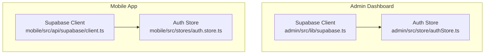
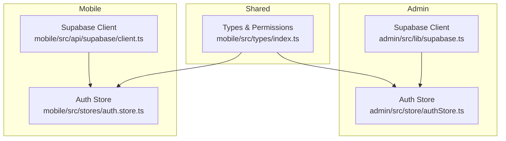
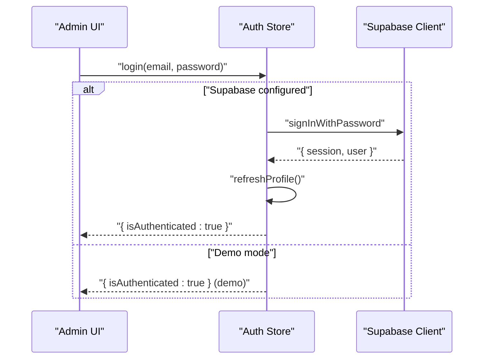
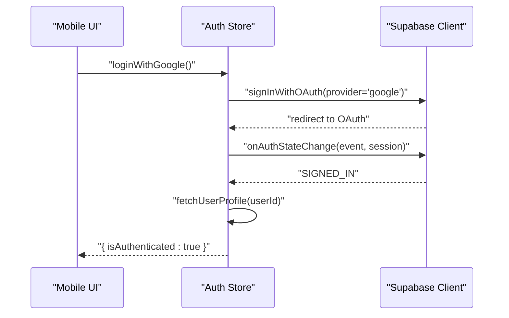
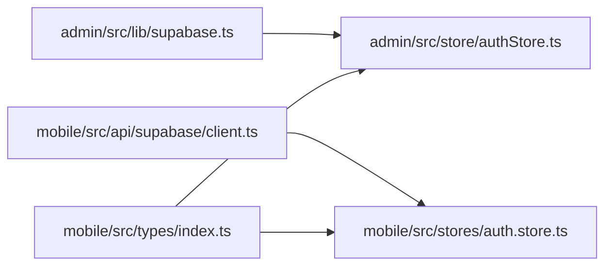

# API Integration Layer

<cite>
**Referenced Files in This Document**
- [admin/src/lib/supabase.ts](file://admin/src/lib/supabase.ts)
- [admin/src/store/authStore.ts](file://admin/src/store/authStore.ts)
- [mobile/src/api/supabase/client.ts](file://mobile/src/api/supabase/client.ts)
- [mobile/src/stores/auth.store.ts](file://mobile/src/stores/auth.store.ts)
- [mobile/src/types/index.ts](file://mobile/src/types/index.ts)
</cite>

## Table of Contents
1. [Introduction](#introduction)
2. [Project Structure](#project-structure)
3. [Core Components](#core-components)
4. [Architecture Overview](#architecture-overview)
5. [Detailed Component Analysis](#detailed-component-analysis)
6. [Dependency Analysis](#dependency-analysis)
7. [Performance Considerations](#performance-considerations)
8. [Troubleshooting Guide](#troubleshooting-guide)
9. [Conclusion](#conclusion)
10. [Appendices](#appendices)

## Introduction
This document describes the API integration layer built on Supabase for both the admin dashboard and the mobile application. It covers client configuration, authentication handling, storage utilities, and the data model used across the platform. It also outlines how the admin and mobile applications manage sessions, roles, permissions, and real-time channels. Practical usage patterns, error handling strategies, and performance considerations are included to guide frontend developers integrating with Supabase.

## Project Structure
The integration layer is split into two primary contexts:
- Admin dashboard (React + Vite): Centralized Supabase client configuration and an auth store managing session lifecycle and role checks.
- Mobile application (React Native): A typed Supabase client with AsyncStorage-backed persistence, real-time configuration, and a comprehensive auth store including OAuth flows and profile management.



**Diagram sources**
- [admin/src/lib/supabase.ts](file://admin/src/lib/supabase.ts#L1-L73)
- [admin/src/store/authStore.ts](file://admin/src/store/authStore.ts#L1-L228)
- [mobile/src/api/supabase/client.ts](file://mobile/src/api/supabase/client.ts#L1-L87)
- [mobile/src/stores/auth.store.ts](file://mobile/src/stores/auth.store.ts#L1-L302)

**Section sources**
- [admin/src/lib/supabase.ts](file://admin/src/lib/supabase.ts#L1-L73)
- [admin/src/store/authStore.ts](file://admin/src/store/authStore.ts#L1-L228)
- [mobile/src/api/supabase/client.ts](file://mobile/src/api/supabase/client.ts#L1-L87)
- [mobile/src/stores/auth.store.ts](file://mobile/src/stores/auth.store.ts#L1-L302)

## Core Components
- Supabase client initialization with environment variables and auth/session persistence
- Storage helpers for public URLs, signed URLs, uploads, and deletions
- Real-time channel creation for reactive updates
- Auth stores for session management, role checks, and profile synchronization

Key capabilities:
- Admin dashboard supports demo mode when Supabase is not configured
- Mobile app enforces institutional email validation and supports OAuth with Google
- Both clients expose storage utilities for avatars, materials, event covers, announcements, and message attachments

**Section sources**
- [admin/src/lib/supabase.ts](file://admin/src/lib/supabase.ts#L1-L73)
- [mobile/src/api/supabase/client.ts](file://mobile/src/api/supabase/client.ts#L1-L87)

## Architecture Overview
The architecture separates concerns between client configuration, auth stores, and shared data types. The admin and mobile apps share a common Supabase client pattern while diverging in auth flows and persistence strategies.



**Diagram sources**
- [admin/src/lib/supabase.ts](file://admin/src/lib/supabase.ts#L1-L73)
- [admin/src/store/authStore.ts](file://admin/src/store/authStore.ts#L1-L228)
- [mobile/src/api/supabase/client.ts](file://mobile/src/api/supabase/client.ts#L1-L87)
- [mobile/src/stores/auth.store.ts](file://mobile/src/stores/auth.store.ts#L1-L302)
- [mobile/src/types/index.ts](file://mobile/src/types/index.ts#L1-L456)

## Detailed Component Analysis

### Admin Supabase Client
Responsibilities:
- Load environment variables for Supabase URL and anonymous key
- Create a Supabase client with auto-refresh, persisted sessions, and URL detection
- Expose storage helpers for public and signed URLs, uploads, and deletions
- Define storage bucket names for avatars, materials, event covers, announcement media, and message attachments

Usage patterns:
- Use environment variables to configure the client at runtime
- Wrap storage operations to rethrow errors for upstream handling
- Use bucket constants to avoid typos and centralize naming

**Section sources**
- [admin/src/lib/supabase.ts](file://admin/src/lib/supabase.ts#L1-L73)

### Admin Auth Store
Responsibilities:
- Initialize auth state, handle auth state changes, and synchronize with user profiles
- Support login/logout flows and admin-only access checks
- Persist only minimal session data to local storage
- Provide selectors for user, admin status, and role comparisons

Key behaviors:
- Demo mode fallback when Supabase is not configured
- On auth state change, refresh profile and update state accordingly
- Admin-only login gating with automatic sign-out for non-admins
- Role comparison via a hierarchical mapping



**Diagram sources**
- [admin/src/store/authStore.ts](file://admin/src/store/authStore.ts#L94-L172)
- [admin/src/lib/supabase.ts](file://admin/src/lib/supabase.ts#L10-L18)

**Section sources**
- [admin/src/store/authStore.ts](file://admin/src/store/authStore.ts#L1-L228)

### Mobile Supabase Client
Responsibilities:
- Enforce environment variable presence at startup
- Configure AsyncStorage-backed auth persistence and real-time event rate limits
- Provide storage helpers and real-time channel creation

Real-time configuration:
- Events per second capped to balance responsiveness and bandwidth

**Section sources**
- [mobile/src/api/supabase/client.ts](file://mobile/src/api/supabase/client.ts#L1-L87)

### Mobile Auth Store
Responsibilities:
- Initialize auth state and subscribe to auth state changes
- Login with email/password and Google OAuth
- Institutional email validation for student accounts
- Profile fetch/update with ban checks and session refresh
- Role and permission checks for UI and feature gating



**Diagram sources**
- [mobile/src/stores/auth.store.ts](file://mobile/src/stores/auth.store.ts#L136-L163)
- [mobile/src/stores/auth.store.ts](file://mobile/src/stores/auth.store.ts#L60-L81)

**Section sources**
- [mobile/src/stores/auth.store.ts](file://mobile/src/stores/auth.store.ts#L1-L302)

### Data Model and Permissions
The shared types define roles, statuses, permissions, and entities used across the platform. Roles are mapped to numeric levels and permissions, enabling fine-grained access control.

Highlights:
- Roles: student, moderator, super_admin, system_owner
- Permissions: courses, users, content moderation, messages, announcements, analytics, system settings
- Hierarchical role levels enable min-role checks
- Entities include users, departments, lecturers, executives, levels, semesters, courses, materials, events, announcements, conversations, messages, activity logs, push tokens, and system settings

```mermaid
classDiagram
class User {
+string id
+string registration_number
+string email
+string full_name
+string role
+string status
}
class Permission {
<<enumeration>>
"courses : view"
"courses : create"
"courses : edit"
"courses : delete"
"users : view"
"users : manage"
"users : role_change"
"content : moderate"
"content : delete"
"messages : send"
"announcements : create"
"system : settings"
"analytics : view"
}
class Role {
<<enumeration>>
"student"
"moderator"
"super_admin"
"system_owner"
}
User --> Role : "has"
Role --> Permission : "grants"
```

**Diagram sources**
- [mobile/src/types/index.ts](file://mobile/src/types/index.ts#L1-L456)

**Section sources**
- [mobile/src/types/index.ts](file://mobile/src/types/index.ts#L1-L456)

## Dependency Analysis
- Admin and mobile apps depend on their respective Supabase clients
- Auth stores depend on Supabase client for authentication and database operations
- Shared types underpin both auth stores and UI logic
- Storage helpers are used across both platforms for media management



**Diagram sources**
- [admin/src/lib/supabase.ts](file://admin/src/lib/supabase.ts#L1-L73)
- [admin/src/store/authStore.ts](file://admin/src/store/authStore.ts#L1-L228)
- [mobile/src/api/supabase/client.ts](file://mobile/src/api/supabase/client.ts#L1-L87)
- [mobile/src/stores/auth.store.ts](file://mobile/src/stores/auth.store.ts#L1-L302)
- [mobile/src/types/index.ts](file://mobile/src/types/index.ts#L1-L456)

**Section sources**
- [admin/src/lib/supabase.ts](file://admin/src/lib/supabase.ts#L1-L73)
- [admin/src/store/authStore.ts](file://admin/src/store/authStore.ts#L1-L228)
- [mobile/src/api/supabase/client.ts](file://mobile/src/api/supabase/client.ts#L1-L87)
- [mobile/src/stores/auth.store.ts](file://mobile/src/stores/auth.store.ts#L1-L302)
- [mobile/src/types/index.ts](file://mobile/src/types/index.ts#L1-L456)

## Performance Considerations
- Real-time events per second is configurable in the mobile client; tune this based on network conditions and UI responsiveness needs
- Use storage signed URLs for temporary access to reduce server load compared to direct downloads
- Persist only essential session data in stores to minimize serialization overhead
- Batch or debounce frequent UI updates triggered by real-time subscriptions
- Prefer selective field queries and appropriate filters to reduce payload sizes

[No sources needed since this section provides general guidance]

## Troubleshooting Guide
Common issues and resolutions:
- Missing environment variables: Ensure Supabase URL and anonymous key are present; the mobile client throws on missing variables
- Auth state changes: Subscribe to auth state changes to keep session and profile synchronized
- Institutional email validation failures: Verify the email matches the required format for student accounts
- Profile not found: Handle cases where user profiles are not yet created during onboarding
- Ban checks: Automatically sign out users whose accounts are banned
- Storage errors: Wrap storage operations to surface errors and prevent silent failures

**Section sources**
- [mobile/src/api/supabase/client.ts](file://mobile/src/api/supabase/client.ts#L9-L13)
- [mobile/src/stores/auth.store.ts](file://mobile/src/stores/auth.store.ts#L104-L107)
- [mobile/src/stores/auth.store.ts](file://mobile/src/stores/auth.store.ts#L209-L215)
- [mobile/src/stores/auth.store.ts](file://mobile/src/stores/auth.store.ts#L218-L228)

## Conclusion
The Supabase integration layer provides a robust foundation for authentication, real-time updates, and storage across both the admin dashboard and mobile application. By centralizing client configuration, leveraging typed models, and implementing resilient auth stores, the system supports scalable development and maintainable frontend integrations.

[No sources needed since this section summarizes without analyzing specific files]

## Appendices

### API Usage Patterns
- Authentication
  - Admin: Use the admin auth store to initialize, log in, and enforce admin-only access
  - Mobile: Use the mobile auth store for email/password and Google OAuth flows with institutional email validation
- Data Access
  - Use the Supabase client to query tables and apply filters; select only required fields
  - Use storage helpers to manage avatars, materials, and media
- Real-time
  - Create channels for conversations, courses, or administrative updates
  - Limit event rates to balance performance and responsiveness

[No sources needed since this section provides general guidance]