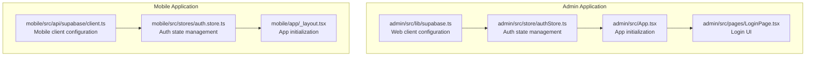
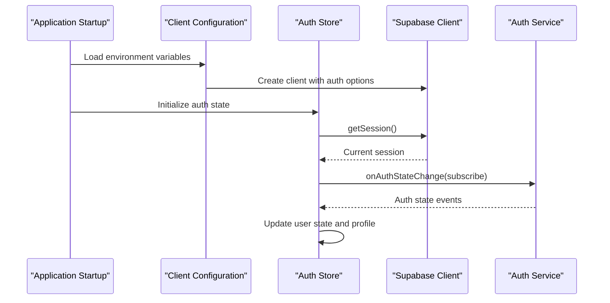
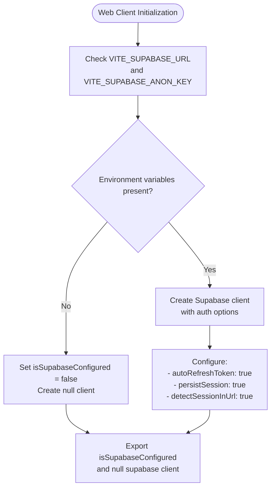
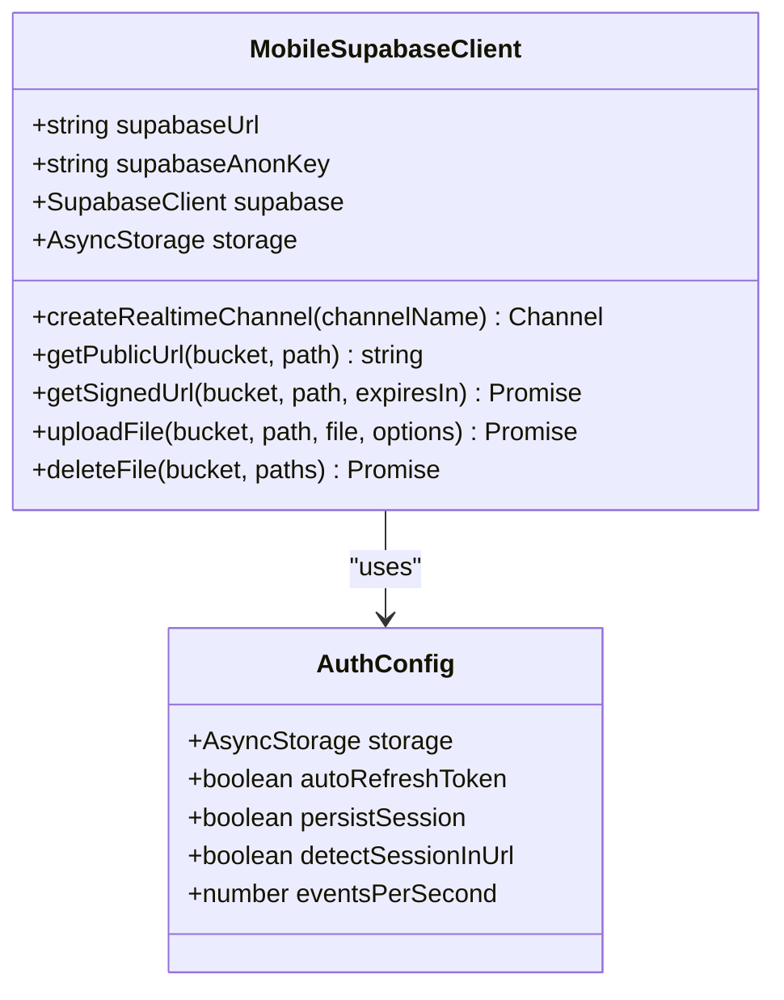
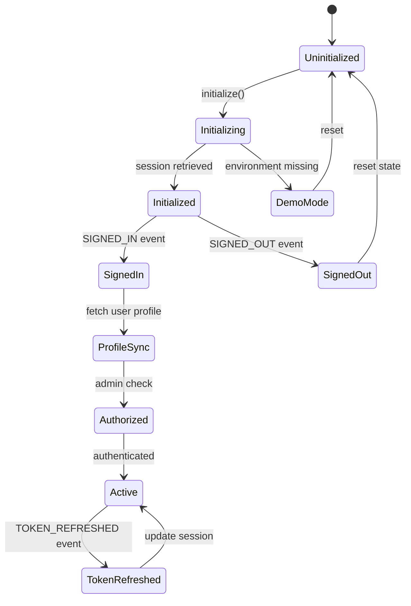
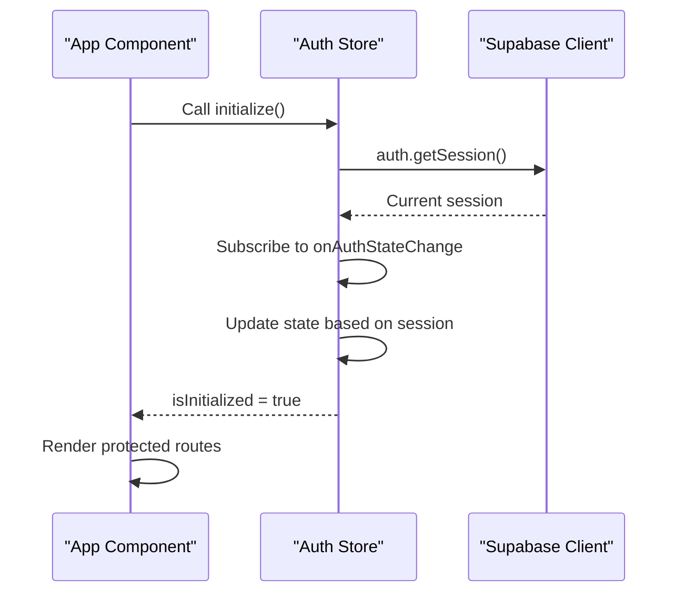
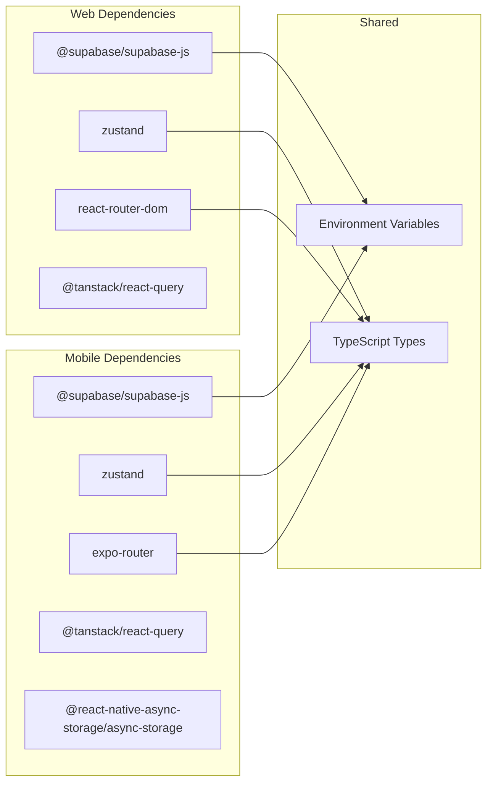

# Supabase Client Configuration

<cite>
**Referenced Files in This Document**
- [admin/src/lib/supabase.ts](file://admin/src/lib/supabase.ts)
- [mobile/src/api/supabase/client.ts](file://mobile/src/api/supabase/client.ts)
- [admin/src/store/authStore.ts](file://admin/src/store/authStore.ts)
- [mobile/src/stores/auth.store.ts](file://mobile/src/stores/auth.store.ts)
- [admin/src/App.tsx](file://admin/src/App.tsx)
- [admin/src/pages/LoginPage.tsx](file://admin/src/pages/LoginPage.tsx)
- [mobile/app/_layout.tsx](file://mobile/app/_layout.tsx)
- [admin/package.json](file://admin/package.json)
- [mobile/package.json](file://mobile/package.json)
- [admin/vite.config.ts](file://admin/vite.config.ts)
- [mobile/app.json](file://mobile/app.json)
- [admin/src/types/index.ts](file://admin/src/types/index.ts)
</cite>

## Table of Contents
1. [Introduction](#introduction)
2. [Project Structure](#project-structure)
3. [Core Components](#core-components)
4. [Architecture Overview](#architecture-overview)
5. [Detailed Component Analysis](#detailed-component-analysis)
6. [Dependency Analysis](#dependency-analysis)
7. [Performance Considerations](#performance-considerations)
8. [Troubleshooting Guide](#troubleshooting-guide)
9. [Conclusion](#conclusion)

## Introduction
This document provides comprehensive guidance for configuring and initializing the Supabase client across both web (admin) and mobile (React Native) applications. It covers environment variable configuration, client initialization patterns, authentication settings, auto-refresh token mechanisms, session persistence, URL detection features, and practical examples for proper initialization. Security considerations for API keys and client-side authentication are addressed alongside best practices for production deployments.

## Project Structure
The Supabase configuration is centralized in dedicated client modules for each platform, with shared authentication stores managing session lifecycle and user state. The admin application uses Vite for development and React Router for navigation, while the mobile application uses Expo Router and React Navigation patterns.

**Diagram sources**
- [admin/src/lib/supabase.ts](file://admin/src/lib/supabase.ts#L1-L73)
- [admin/src/store/authStore.ts](file://admin/src/store/authStore.ts#L1-L228)
- [admin/src/App.tsx](file://admin/src/App.tsx#L1-L64)
- [admin/src/pages/LoginPage.tsx](file://admin/src/pages/LoginPage.tsx#L1-L123)
- [mobile/src/api/supabase/client.ts](file://mobile/src/api/supabase/client.ts#L1-L87)
- [mobile/src/stores/auth.store.ts](file://mobile/src/stores/auth.store.ts#L1-L302)
- [mobile/app/_layout.tsx](file://mobile/app/_layout.tsx#L1-L95)

**Section sources**
- [admin/src/lib/supabase.ts](file://admin/src/lib/supabase.ts#L1-L73)
- [mobile/src/api/supabase/client.ts](file://mobile/src/api/supabase/client.ts#L1-L87)
- [admin/src/store/authStore.ts](file://admin/src/store/authStore.ts#L1-L228)
- [mobile/src/stores/auth.store.ts](file://mobile/src/stores/auth.store.ts#L1-L302)
- [admin/src/App.tsx](file://admin/src/App.tsx#L1-L64)
- [mobile/app/_layout.tsx](file://mobile/app/_layout.tsx#L1-L95)

## Core Components
This section outlines the primary components involved in Supabase client configuration and initialization.

- Web client configuration module: Centralizes environment variable retrieval, client creation, and storage helpers.
- Mobile client configuration module: Handles environment validation, client creation with AsyncStorage integration, and storage helpers.
- Authentication stores: Manage session initialization, state changes, and user profile synchronization.
- Application bootstrap: Initializes authentication state during app startup.

Key responsibilities:
- Environment variable validation and client instantiation
- Auto-refresh token configuration and session persistence
- URL detection for web applications
- Storage bucket management and file operations
- Auth state change subscriptions and profile synchronization

**Section sources**
- [admin/src/lib/supabase.ts](file://admin/src/lib/supabase.ts#L1-L73)
- [mobile/src/api/supabase/client.ts](file://mobile/src/api/supabase/client.ts#L1-L87)
- [admin/src/store/authStore.ts](file://admin/src/store/authStore.ts#L1-L228)
- [mobile/src/stores/auth.store.ts](file://mobile/src/stores/auth.store.ts#L1-L302)

## Architecture Overview
The architecture follows a consistent pattern across platforms with platform-specific adaptations for environment handling and storage persistence.

**Diagram sources**
- [admin/src/lib/supabase.ts](file://admin/src/lib/supabase.ts#L1-L73)
- [mobile/src/api/supabase/client.ts](file://mobile/src/api/supabase/client.ts#L1-L87)
- [admin/src/store/authStore.ts](file://admin/src/store/authStore.ts#L38-L92)
- [mobile/src/stores/auth.store.ts](file://mobile/src/stores/auth.store.ts#L38-L96)

## Detailed Component Analysis

### Web Client Configuration
The web client configuration module demonstrates a graceful degradation approach when environment variables are missing, enabling demo mode operation.

**Diagram sources**
- [admin/src/lib/supabase.ts](file://admin/src/lib/supabase.ts#L3-L18)

Key configuration aspects:
- Environment variable names: VITE_SUPABASE_URL, VITE_SUPABASE_ANON_KEY
- Auto-refresh tokens enabled for seamless session continuation
- Session persistence using browser storage
- URL detection for handling OAuth callbacks
- Graceful fallback to demo mode when not configured

**Section sources**
- [admin/src/lib/supabase.ts](file://admin/src/lib/supabase.ts#L1-L73)

### Mobile Client Configuration
The mobile client configuration enforces strict environment validation and integrates AsyncStorage for session persistence.

**Diagram sources**
- [mobile/src/api/supabase/client.ts](file://mobile/src/api/supabase/client.ts#L15-L27)

Configuration highlights:
- Environment variables: EXPO_PUBLIC_SUPABASE_URL, EXPO_PUBLIC_SUPABASE_ANON_KEY
- Strict validation with explicit error throwing
- AsyncStorage integration for cross-platform session persistence
- Realtime configuration limiting events per second
- URL detection disabled for mobile OAuth flows

**Section sources**
- [mobile/src/api/supabase/client.ts](file://mobile/src/api/supabase/client.ts#L1-L87)

### Authentication State Management
Both platforms implement comprehensive authentication state management with consistent patterns for initialization, session handling, and user profile synchronization.

**Diagram sources**
- [admin/src/store/authStore.ts](file://admin/src/store/authStore.ts#L38-L92)
- [mobile/src/stores/auth.store.ts](file://mobile/src/stores/auth.store.ts#L38-L96)

Platform differences:
- Admin store supports demo mode with simulated admin login
- Mobile store enforces institutional email validation
- Both handle auth state changes and session updates
- Profile synchronization occurs on sign-in and token refresh

**Section sources**
- [admin/src/store/authStore.ts](file://admin/src/store/authStore.ts#L1-L228)
- [mobile/src/stores/auth.store.ts](file://mobile/src/stores/auth.store.ts#L1-L302)

### Application Bootstrap Patterns
The applications demonstrate consistent initialization patterns that ensure proper client setup before rendering protected content.

**Diagram sources**
- [admin/src/App.tsx](file://admin/src/App.tsx#L19-L27)
- [admin/src/store/authStore.ts](file://admin/src/store/authStore.ts#L38-L92)
- [mobile/app/_layout.tsx](file://mobile/app/_layout.tsx#L24-L31)

**Section sources**
- [admin/src/App.tsx](file://admin/src/App.tsx#L1-L64)
- [mobile/app/_layout.tsx](file://mobile/app/_layout.tsx#L1-L95)

## Dependency Analysis
The projects maintain clear separation of concerns with minimal coupling between modules.

**Diagram sources**
- [admin/package.json](file://admin/package.json#L12-L26)
- [mobile/package.json](file://mobile/package.json#L11-L32)

Key observations:
- Both platforms use identical Supabase client library
- State management relies on Zustand for both web and mobile
- Routing differs by platform (React Router vs Expo Router)
- Mobile adds AsyncStorage dependency for session persistence

**Section sources**
- [admin/package.json](file://admin/package.json#L1-L43)
- [mobile/package.json](file://mobile/package.json#L1-L40)

## Performance Considerations
- Realtime event throttling: Mobile client limits events per second to prevent excessive network usage
- Query caching: Both applications configure React Query with appropriate stale and garbage collection times
- Lazy initialization: Authentication state is initialized asynchronously to avoid blocking UI rendering
- Storage efficiency: Session persistence prevents unnecessary re-authentication while maintaining security

## Troubleshooting Guide

### Environment Variable Issues
Common problems and solutions:
- Missing VITE_SUPABASE_URL or VITE_SUPABASE_ANON_KEY in web builds
- Missing EXPO_PUBLIC_SUPABASE_URL or EXPO_PUBLIC_SUPABASE_ANON_KEY in mobile builds
- Incorrect environment variable naming causing runtime errors

Diagnostic steps:
1. Verify environment variables are properly exported in build process
2. Check for typos in variable names
3. Confirm values are not empty strings
4. Test with local development server before building

### Authentication Flow Problems
- Session not persisting between app restarts
- Auto-refresh token failures
- OAuth callback handling issues

Resolution strategies:
1. Ensure AsyncStorage is properly configured for mobile builds
2. Verify auth storage adapter matches platform requirements
3. Check URL detection settings for web OAuth flows
4. Monitor auth state change events for debugging

### Production Deployment Checklist
- Environment variables secured in deployment pipeline
- HTTPS enforced for all client-server communications
- Proper CORS configuration for web applications
- Mobile app signing and certificate management
- Backup and recovery procedures for Supabase credentials

**Section sources**
- [admin/src/lib/supabase.ts](file://admin/src/lib/supabase.ts#L9-L13)
- [mobile/src/api/supabase/client.ts](file://mobile/src/api/supabase/client.ts#L9-L13)
- [admin/src/store/authStore.ts](file://admin/src/store/authStore.ts#L85-L91)
- [mobile/src/stores/auth.store.ts](file://mobile/src/stores/auth.store.ts#L89-L95)

## Conclusion
The Supabase client configuration demonstrates robust, platform-appropriate implementations for both web and mobile environments. The web implementation gracefully handles missing configurations with demo mode support, while the mobile implementation enforces strict validation and integrates native storage mechanisms. Both implementations share consistent patterns for authentication state management, session persistence, and error handling. Following the security considerations and best practices outlined ensures reliable operation in production environments while maintaining developer productivity through clear configuration patterns and comprehensive error handling.