# Academic Learning Management System

<cite>
**Referenced Files in This Document**
- [README.md](file://README.md)
- [001_enums.sql](file://supabase/migrations/001_enums.sql)
- [002_core_tables.sql](file://supabase/migrations/002_core_tables.sql)
- [003_lms_tables.sql](file://supabase/migrations/003_lms_tables.sql)
- [App.tsx](file://admin/src/App.tsx)
- [supabase.ts](file://admin/src/lib/supabase.ts)
- [authStore.ts](file://admin/src/store/authStore.ts)
- [index.ts](file://admin/src/types/index.ts)
- [client.ts](file://mobile/src/api/supabase/client.ts)
- [auth.store.ts](file://mobile/src/stores/auth.store.ts)
- [network.store.ts](file://mobile/src/stores/network.store.ts)
- [package.json](file://admin/package.json)
- [package.json](file://mobile/package.json)
</cite>

## Table of Contents
1. [Introduction](#introduction)
2. [Project Structure](#project-structure)
3. [Core Components](#core-components)
4. [Architecture Overview](#architecture-overview)
5. [Detailed Component Analysis](#detailed-component-analysis)
6. [Dependency Analysis](#dependency-analysis)
7. [Performance Considerations](#performance-considerations)
8. [Troubleshooting Guide](#troubleshooting-guide)
9. [Conclusion](#conclusion)

## Introduction
This document describes the Academic Learning Management System (LMS) within the NALISS UMYU Hub platform. It covers course catalog management, academic level definitions (100–500 levels), semester tracking, course enrollment systems, materials management (resource upload, categorization, access control), user progress tracking, grade management, academic record keeping, admin-mobile integration, offline support, synchronization mechanisms, course creation workflows, material organization, and academic reporting features.

The system is built as a cross-platform solution:
- Mobile application (React Native with Expo) for students and lecturers
- Admin web panel (React with Vite) for content and user management
- Supabase backend providing database, authentication, real-time subscriptions, and storage

## Project Structure
The repository is organized into three primary areas:
- admin/: React-based admin panel with routing, state management, and Supabase integration
- mobile/: React Native mobile application with offline-first design, network awareness, and local persistence
- supabase/: PostgreSQL schema migrations defining enums, core tables, and LMS-specific tables

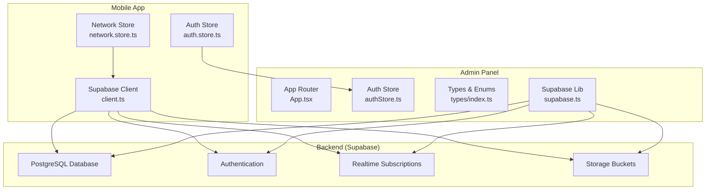

**Diagram sources**
- [client.ts](file://mobile/src/api/supabase/client.ts#L1-L87)
- [auth.store.ts](file://mobile/src/stores/auth.store.ts#L1-L302)
- [network.store.ts](file://mobile/src/stores/network.store.ts#L1-L103)
- [App.tsx](file://admin/src/App.tsx#L1-L64)
- [authStore.ts](file://admin/src/store/authStore.ts#L1-L228)
- [index.ts](file://admin/src/types/index.ts#L1-L224)
- [supabase.ts](file://admin/src/lib/supabase.ts#L1-L73)

**Section sources**
- [README.md](file://README.md#L1-L247)
- [package.json](file://admin/package.json#L1-L43)
- [package.json](file://mobile/package.json#L1-L40)

## Core Components
- Academic Levels and Semesters: Defined via enums and persisted in levels and semesters tables, enabling structured course catalog organization by academic year and term.
- Course Catalog: Courses are linked to semesters and include attributes such as code, title, credits, and core/elective flags.
- Materials Management: Resources categorized by type (notes, assignments, past questions, videos, links, documents) with access controls and engagement metrics.
- User Progress Tracking: Tracks completion percentage, last position for videos, and timestamps for materials within courses.
- Authentication and Authorization: Role-based permissions (student, moderator, super admin, system owner) with RLS policies and audit logging.
- Offline and Synchronization: Mobile app maintains offline capability with network awareness and sync queue management.

**Section sources**
- [001_enums.sql](file://supabase/migrations/001_enums.sql#L9-L167)
- [002_core_tables.sql](file://supabase/migrations/002_core_tables.sql#L43-L92)
- [003_lms_tables.sql](file://supabase/migrations/003_lms_tables.sql#L9-L262)
- [index.ts](file://admin/src/types/index.ts#L1-L224)
- [index.ts](file://mobile/src/types/index.ts#L1-L456)

## Architecture Overview
The system follows a centralized backend architecture with Supabase providing:
- Database: Structured tables for users, departments, lecturers, executives, levels, semesters, courses, materials, and progress
- Authentication: Email/password and optional Google OAuth with session persistence
- Realtime: Subscriptions for live updates in messaging and related features
- Storage: Secure buckets for avatars, materials, event covers, announcements, and message attachments

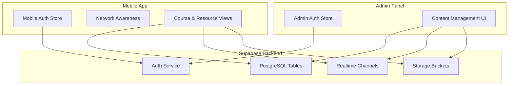

**Diagram sources**
- [client.ts](file://mobile/src/api/supabase/client.ts#L1-L87)
- [auth.store.ts](file://mobile/src/stores/auth.store.ts#L1-L302)
- [network.store.ts](file://mobile/src/stores/network.store.ts#L1-L103)
- [App.tsx](file://admin/src/App.tsx#L1-L64)
- [authStore.ts](file://admin/src/store/authStore.ts#L1-L228)
- [supabase.ts](file://admin/src/lib/supabase.ts#L1-L73)

## Detailed Component Analysis

### Academic Level Definitions (100–500 Levels)
- Enumerated levels include 100, 200, 300, 400, 500, and postgraduate.
- Levels table defines display names and ordering for UI presentation.
- Semesters table references levels and includes academic session, start/end dates, and current flag.

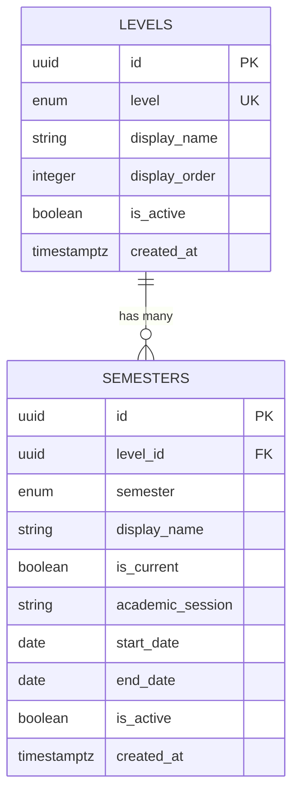

**Diagram sources**
- [001_enums.sql](file://supabase/migrations/001_enums.sql#L29-L44)
- [003_lms_tables.sql](file://supabase/migrations/003_lms_tables.sql#L9-L51)

**Section sources**
- [001_enums.sql](file://supabase/migrations/001_enums.sql#L29-L44)
- [003_lms_tables.sql](file://supabase/migrations/003_lms_tables.sql#L9-L51)

### Course Catalog Management
- Courses are associated with semesters and include course code, title, description, credit units, and core/elective flags.
- Optional lecturer association enables instructor visibility.
- Courses are indexed by code and active status for efficient retrieval.

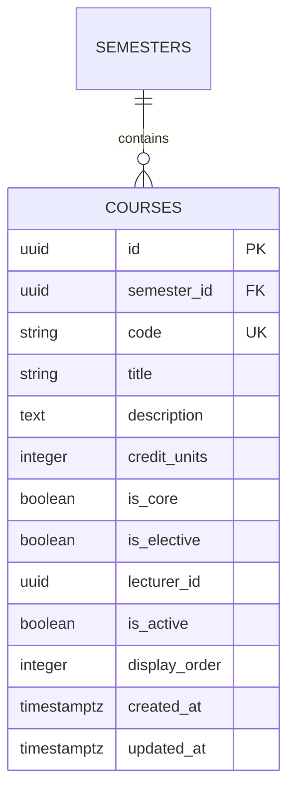

**Diagram sources**
- [003_lms_tables.sql](file://supabase/migrations/003_lms_tables.sql#L66-L92)

**Section sources**
- [003_lms_tables.sql](file://supabase/migrations/003_lms_tables.sql#L66-L92)

### Materials Management System
- Materials table supports multiple types (note, assignment, past_question, video, link, document) with file metadata and external URLs.
- Access control flags (public/downloadable) and engagement metrics (view/download counts) are tracked.
- Storage bucket integration enables secure uploads and signed URLs for downloads.

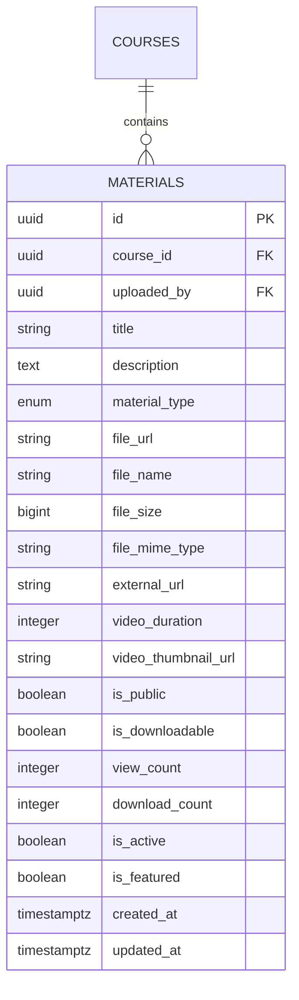

**Diagram sources**
- [003_lms_tables.sql](file://supabase/migrations/003_lms_tables.sql#L108-L146)
- [supabase.ts](file://admin/src/lib/supabase.ts#L20-L43)

**Section sources**
- [003_lms_tables.sql](file://supabase/migrations/003_lms_tables.sql#L108-L146)
- [supabase.ts](file://admin/src/lib/supabase.ts#L20-L43)

### User Progress Tracking and Academic Records
- user_progress tracks individual progress per course and material, including completion status and last position for videos.
- Bookmarks table allows users to save favorite materials.
- Functions increment view and download counts for engagement analytics.

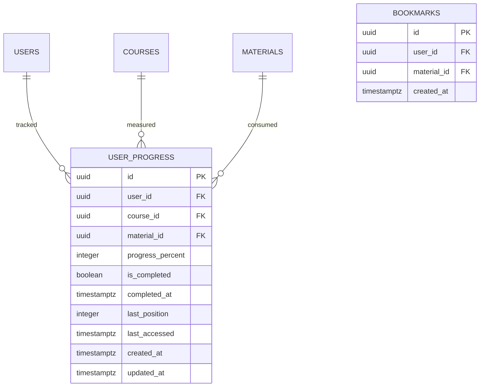

**Diagram sources**
- [003_lms_tables.sql](file://supabase/migrations/003_lms_tables.sql#L168-L188)
- [003_lms_tables.sql](file://supabase/migrations/003_lms_tables.sql#L203-L211)
- [003_lms_tables.sql](file://supabase/migrations/003_lms_tables.sql#L244-L261)

**Section sources**
- [003_lms_tables.sql](file://supabase/migrations/003_lms_tables.sql#L168-L188)
- [003_lms_tables.sql](file://supabase/migrations/003_lms_tables.sql#L203-L211)
- [003_lms_tables.sql](file://supabase/migrations/003_lms_tables.sql#L244-L261)

### Authentication and Authorization
- Role hierarchy: student → moderator → super_admin → system_owner with permission escalation checks.
- Admin panel enforces admin-only access and role comparisons.
- Mobile app validates institutional email format and restricts login to authorized users.

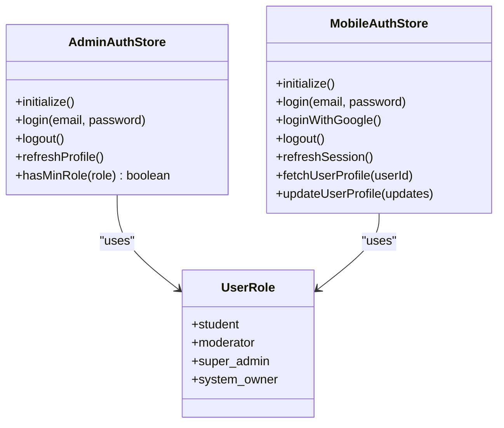

**Diagram sources**
- [index.ts](file://admin/src/types/index.ts#L1-L224)
- [authStore.ts](file://admin/src/store/authStore.ts#L1-L228)
- [index.ts](file://mobile/src/types/index.ts#L1-L456)
- [auth.store.ts](file://mobile/src/stores/auth.store.ts#L1-L302)

**Section sources**
- [index.ts](file://admin/src/types/index.ts#L186-L191)
- [authStore.ts](file://admin/src/store/authStore.ts#L207-L211)
- [index.ts](file://mobile/src/types/index.ts#L449-L456)
- [auth.store.ts](file://mobile/src/stores/auth.store.ts#L268-L294)

### Admin-Mobile Integration and Course Administration
- Admin panel routes protected by authentication and role checks.
- Both admin and mobile share Supabase client configuration and storage bucket definitions.
- Admin types mirror mobile types for consistent data modeling.

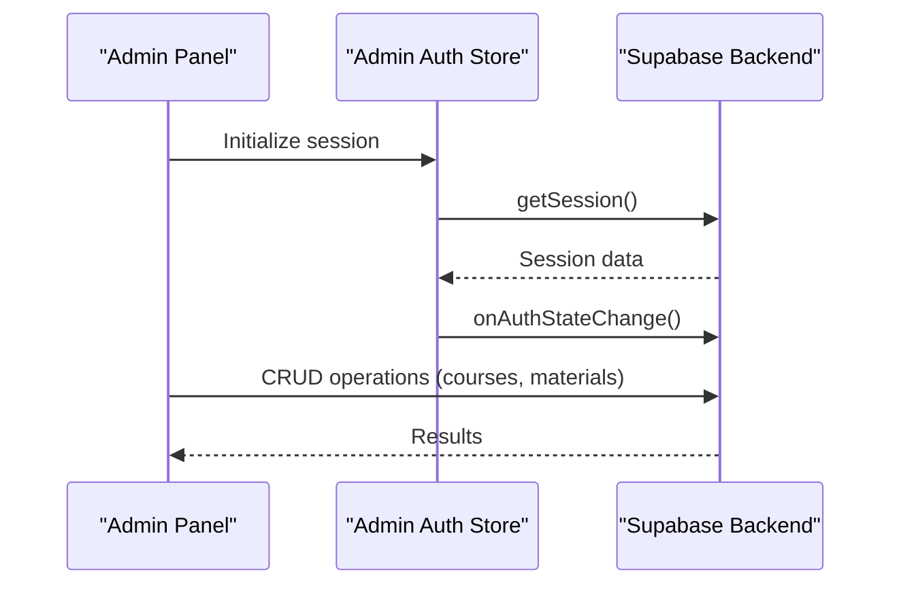

**Diagram sources**
- [App.tsx](file://admin/src/App.tsx#L19-L27)
- [authStore.ts](file://admin/src/store/authStore.ts#L38-L92)
- [supabase.ts](file://admin/src/lib/supabase.ts#L1-L18)

**Section sources**
- [App.tsx](file://admin/src/App.tsx#L34-L57)
- [authStore.ts](file://admin/src/store/authStore.ts#L1-L228)
- [supabase.ts](file://admin/src/lib/supabase.ts#L1-L73)

### Offline Support and Synchronization
- Mobile app monitors network connectivity and toggles online/offline states.
- Pending sync counter tracks queued operations awaiting reconnection.
- Realtime channels enable live updates when connected; offline operations queue for later sync.

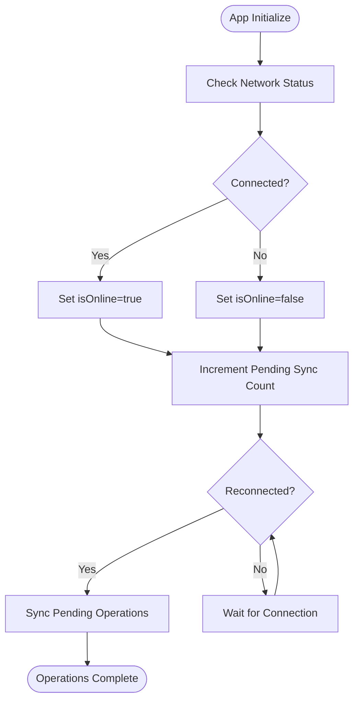

**Diagram sources**
- [network.store.ts](file://mobile/src/stores/network.store.ts#L36-L90)

**Section sources**
- [network.store.ts](file://mobile/src/stores/network.store.ts#L1-L103)

### Course Creation Workflows and Material Organization
- Course creation involves selecting a semester, entering course details, and associating a lecturer if needed.
- Materials are uploaded per course with type selection, metadata capture, and access control settings.
- Full-text search indexing on materials supports discovery and filtering.

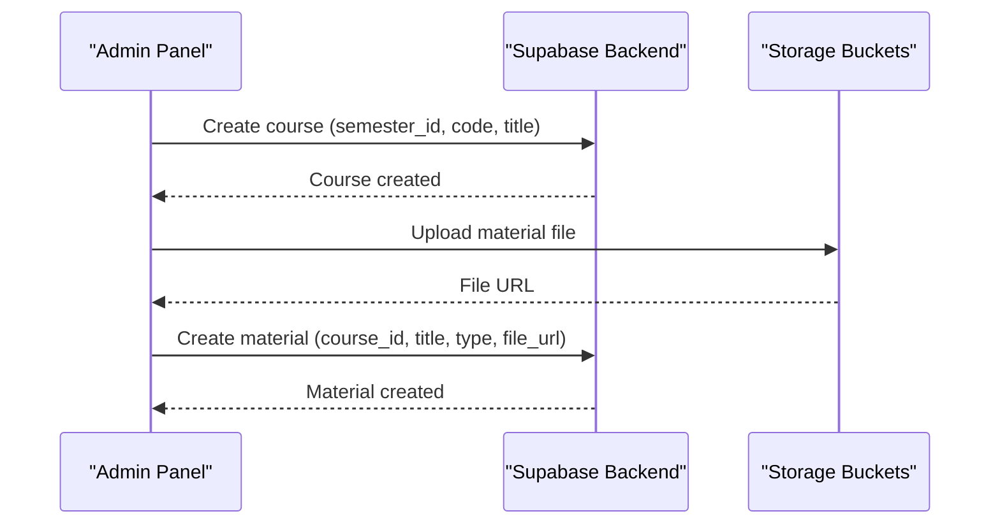

**Diagram sources**
- [003_lms_tables.sql](file://supabase/migrations/003_lms_tables.sql#L66-L92)
- [003_lms_tables.sql](file://supabase/migrations/003_lms_tables.sql#L108-L146)
- [supabase.ts](file://admin/src/lib/supabase.ts#L45-L87)

**Section sources**
- [003_lms_tables.sql](file://supabase/migrations/003_lms_tables.sql#L66-L92)
- [003_lms_tables.sql](file://supabase/migrations/003_lms_tables.sql#L108-L146)
- [supabase.ts](file://admin/src/lib/supabase.ts#L45-L87)

### Academic Reporting Features
- Engagement metrics (view_count, download_count) and progress tracking (progress_percent, is_completed) support reporting dashboards.
- Activity logs capture administrative actions for audit trails.
- Stats aggregates are available for users, content, messaging, and engagement.

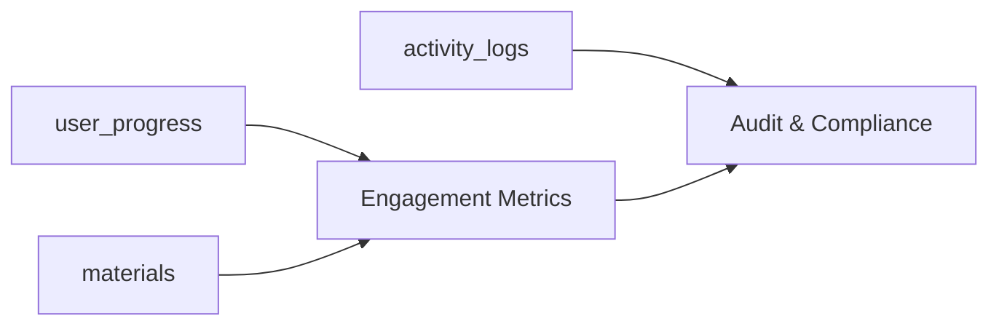

**Diagram sources**
- [003_lms_tables.sql](file://supabase/migrations/003_lms_tables.sql#L168-L188)
- [003_lms_tables.sql](file://supabase/migrations/003_lms_tables.sql#L108-L146)
- [index.ts](file://admin/src/types/index.ts#L133-L183)

**Section sources**
- [003_lms_tables.sql](file://supabase/migrations/003_lms_tables.sql#L168-L188)
- [003_lms_tables.sql](file://supabase/migrations/003_lms_tables.sql#L108-L146)
- [index.ts](file://admin/src/types/index.ts#L133-L183)

## Dependency Analysis
- Frontend dependencies:
  - Mobile: React Native, Expo, Supabase JS, React Query, Zustand, SQLite
  - Admin: React, React Router DOM, Tailwind CSS, Supabase JS, React Query, Zustand
- Backend dependencies:
  - Supabase: PostgreSQL, Auth, Realtime, Storage
- Shared dependencies:
  - TypeScript types for consistent data modeling across platforms

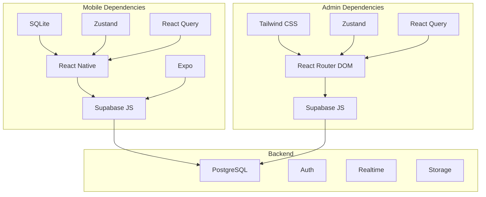

**Diagram sources**
- [package.json](file://mobile/package.json#L11-L32)
- [package.json](file://admin/package.json#L12-L25)

**Section sources**
- [package.json](file://mobile/package.json#L1-L40)
- [package.json](file://admin/package.json#L1-L43)

## Performance Considerations
- Database indexes on frequently queried columns (e.g., course code, material type, progress completion) improve query performance.
- Full-text search indexing on materials enhances discoverability.
- Caching via React Query reduces redundant network requests.
- Storage signed URLs minimize bandwidth and improve download performance.
- Role-based queries and RLS policies ensure minimal data transfer while maintaining security.

## Troubleshooting Guide
- Authentication failures:
  - Verify Supabase URL and keys in environment variables for both admin and mobile apps.
  - Ensure institutional email format matches the required pattern for mobile login.
- Admin access denied:
  - Confirm user role is not student; admin-only routes enforce role checks.
- Storage upload errors:
  - Check bucket permissions and signed URL generation logic.
- Offline sync issues:
  - Monitor network store state and pending sync counter; ensure reconnection triggers sync.

**Section sources**
- [auth.store.ts](file://mobile/src/stores/auth.store.ts#L103-L107)
- [authStore.ts](file://admin/src/store/authStore.ts#L148-L156)
- [supabase.ts](file://admin/src/lib/supabase.ts#L35-L43)
- [network.store.ts](file://mobile/src/stores/network.store.ts#L78-L90)

## Conclusion
The Academic Learning Management System integrates a robust backend with Supabase and two complementary frontends to deliver a comprehensive educational platform. It supports structured course catalogs, materials management, progress tracking, and administrative oversight, while ensuring security through role-based access and RLS. The mobile app’s offline-first design and synchronization mechanisms provide resilience in varied network conditions, and shared data models across admin and mobile ensure consistency and maintainability.