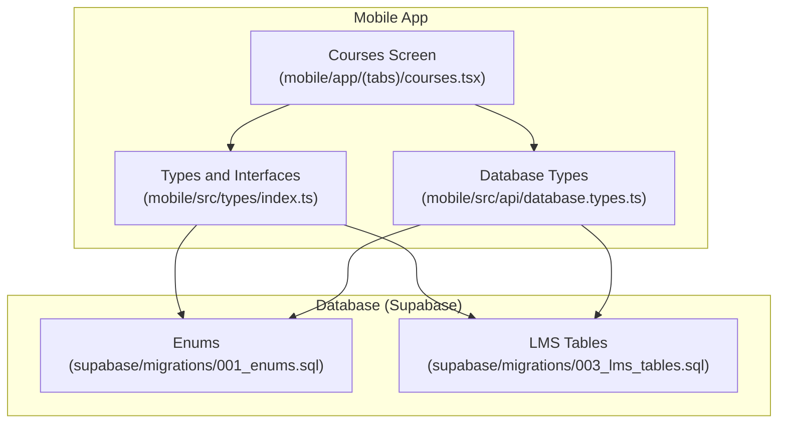
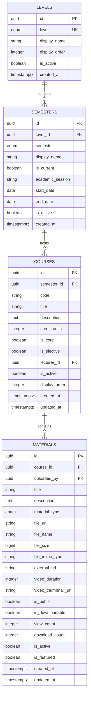
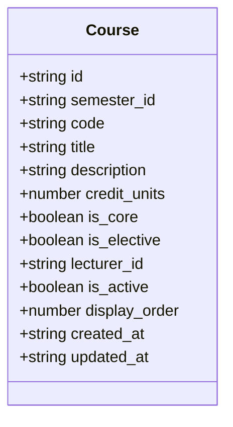
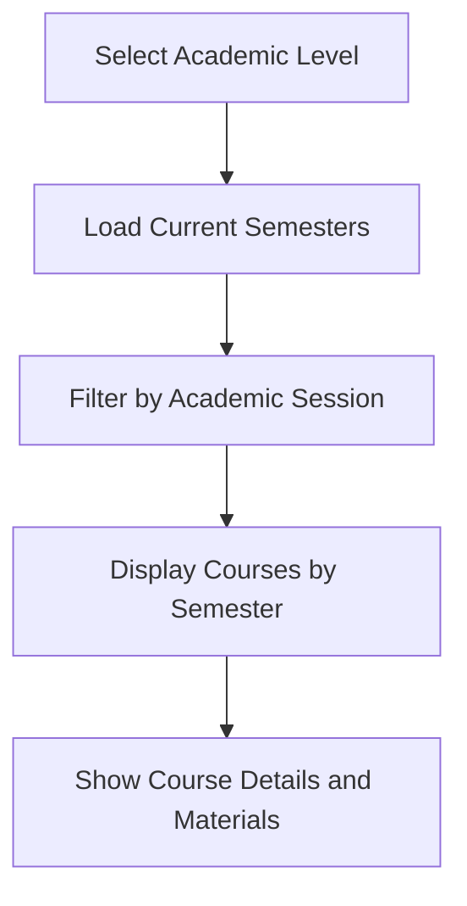
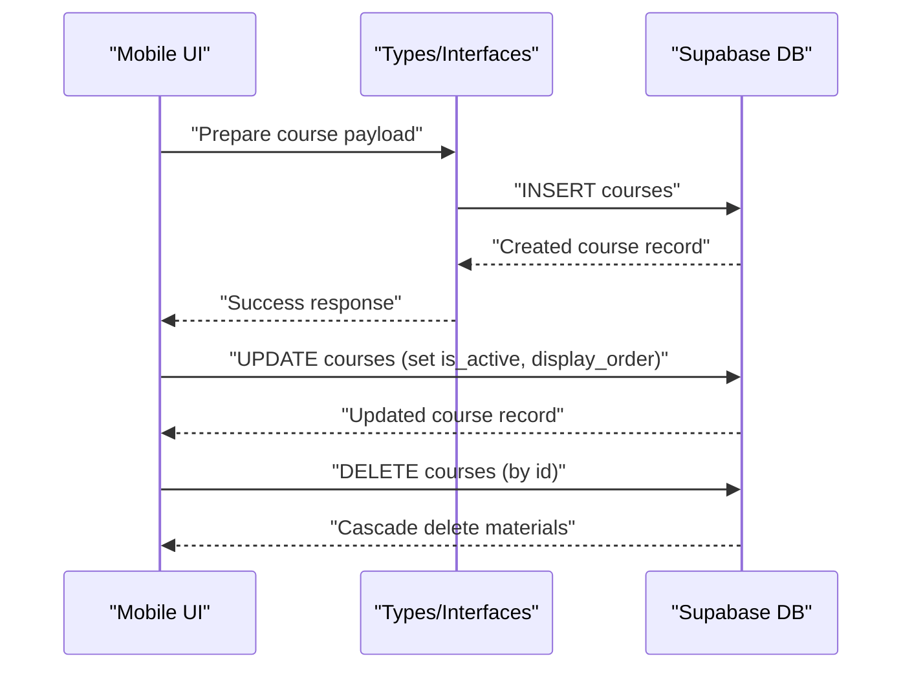
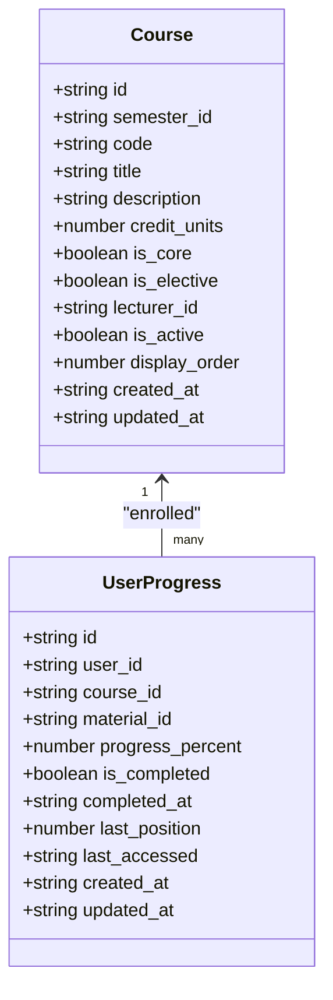
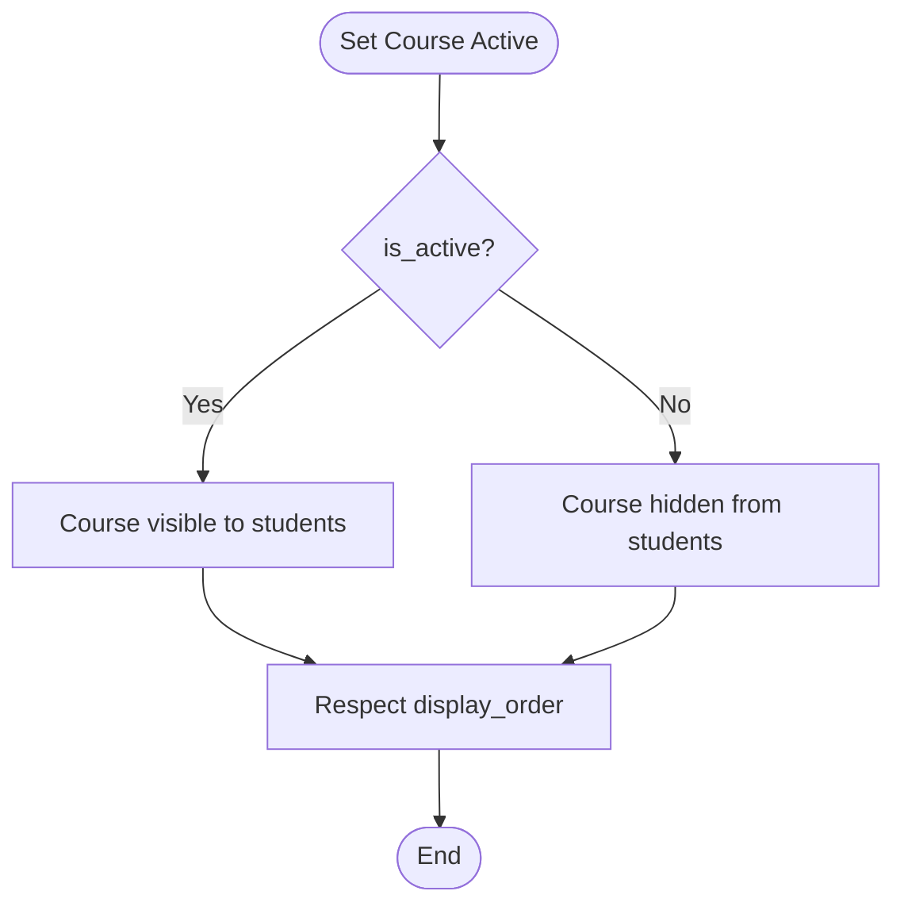
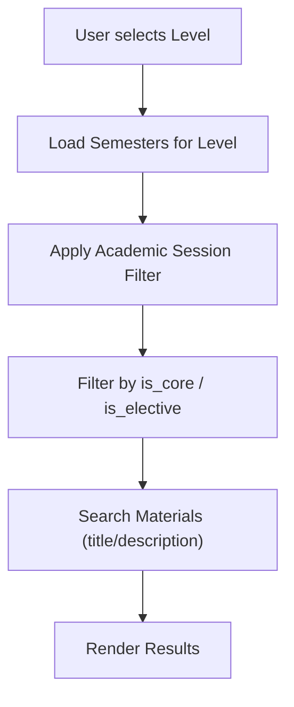
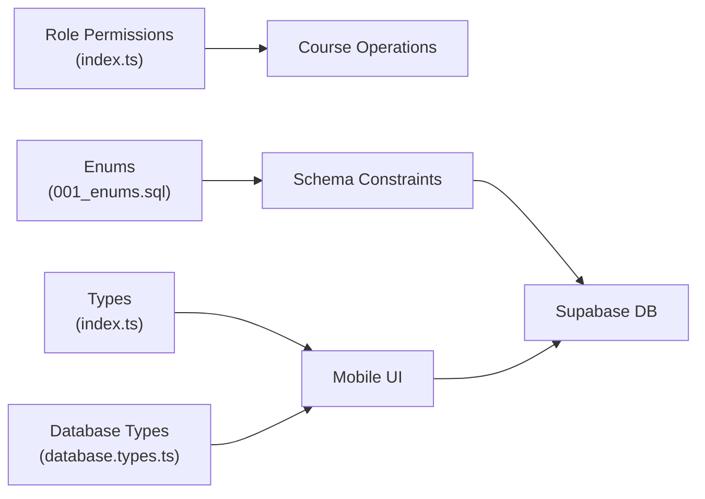

# Course Management System

<cite>
**Referenced Files in This Document**
- [README.md](file://README.md)
- [courses.tsx](file://mobile/app/(tabs)/courses.tsx)
- [003_lms_tables.sql](file://supabase/migrations/003_lms_tables.sql)
- [001_enums.sql](file://supabase/migrations/001_enums.sql)
- [index.ts](file://mobile/src/types/index.ts)
- [database.types.ts](file://mobile/src/api/database.types.ts)
- [index.ts](file://mobile/src/types/index.ts#L410-L447)
</cite>

## Table of Contents
1. [Introduction](#introduction)
2. [Project Structure](#project-structure)
3. [Core Components](#core-components)
4. [Architecture Overview](#architecture-overview)
5. [Detailed Component Analysis](#detailed-component-analysis)
6. [Dependency Analysis](#dependency-analysis)
7. [Performance Considerations](#performance-considerations)
8. [Troubleshooting Guide](#troubleshooting-guide)
9. [Conclusion](#conclusion)

## Introduction
This document describes the Course Management System within Naliss UMYU Hub. It covers the course catalog structure, CRUD workflows, course attributes, hierarchical organization by semesters and levels, enrollment and instructor assignment capabilities, course status management, search and filtering, and integration points with the broader LMS ecosystem. The system leverages Supabase for backend services, with React Native for the mobile app and React for the admin panel.

## Project Structure
The Course Management System spans three primary areas:
- Database schema and enums (Supabase migrations)
- Mobile app UI and types (React Native)
- Admin permissions and roles (shared types)

**Diagram sources**
- [courses.tsx](file://mobile/app/(tabs)/courses.tsx#L1-L296)
- [index.ts](file://mobile/src/types/index.ts#L1-L456)
- [database.types.ts](file://mobile/src/api/database.types.ts#L1-L574)
- [001_enums.sql](file://supabase/migrations/001_enums.sql#L1-L167)
- [003_lms_tables.sql](file://supabase/migrations/003_lms_tables.sql#L1-L262)

**Section sources**
- [README.md](file://README.md#L1-L247)
- [courses.tsx](file://mobile/app/(tabs)/courses.tsx#L1-L296)
- [index.ts](file://mobile/src/types/index.ts#L1-L456)
- [database.types.ts](file://mobile/src/api/database.types.ts#L1-L574)
- [001_enums.sql](file://supabase/migrations/001_enums.sql#L1-L167)
- [003_lms_tables.sql](file://supabase/migrations/003_lms_tables.sql#L1-L262)

## Core Components
- Levels: Academic tiers (100–500, Postgraduate) with ordering and activation.
- Semesters: Per-level, per-session semesters with current flag and date ranges.
- Courses: Catalog items linked to semesters, with attributes for code, title, description, credit units, core/elective flags, instructor assignment, status, and ordering.
- Materials: Resources associated with courses, supporting notes, assignments, videos, links, and documents.
- User Progress: Tracks completion and engagement per course/material.

Key relationships:
- levels.id → semesters.level_id
- semesters.id → courses.semester_id
- courses.id → materials.course_id
- users.id → materials.uploaded_by (via database types)

**Section sources**
- [003_lms_tables.sql](file://supabase/migrations/003_lms_tables.sql#L9-L32)
- [003_lms_tables.sql](file://supabase/migrations/003_lms_tables.sql#L38-L51)
- [003_lms_tables.sql](file://supabase/migrations/003_lms_tables.sql#L66-L92)
- [003_lms_tables.sql](file://supabase/migrations/003_lms_tables.sql#L108-L146)
- [003_lms_tables.sql](file://supabase/migrations/003_lms_tables.sql#L168-L188)
- [database.types.ts](file://mobile/src/api/database.types.ts#L129-L175)
- [database.types.ts](file://mobile/src/api/database.types.ts#L176-L245)

## Architecture Overview
The course catalog is organized hierarchically:
- Levels define academic tiers.
- Semesters define terms within levels and sessions.
- Courses belong to a single semester and carry metadata and status.
- Materials are attached to courses and track engagement.

**Diagram sources**
- [003_lms_tables.sql](file://supabase/migrations/003_lms_tables.sql#L9-L32)
- [003_lms_tables.sql](file://supabase/migrations/003_lms_tables.sql#L38-L51)
- [003_lms_tables.sql](file://supabase/migrations/003_lms_tables.sql#L66-L92)
- [003_lms_tables.sql](file://supabase/migrations/003_lms_tables.sql#L108-L146)

## Detailed Component Analysis

### Course Catalog Structure and Attributes
- Course identifiers: code, title, description, credit_units.
- Classification: is_core, is_elective flags.
- Organization: semester_id links to semesters.
- Instructors: lecturer_id references lecturers.
- Status and presentation: is_active, display_order.
- Timestamps: created_at, updated_at.

**Diagram sources**
- [003_lms_tables.sql](file://supabase/migrations/003_lms_tables.sql#L66-L92)
- [index.ts](file://mobile/src/types/index.ts#L150-L165)

**Section sources**
- [003_lms_tables.sql](file://supabase/migrations/003_lms_tables.sql#L66-L92)
- [index.ts](file://mobile/src/types/index.ts#L150-L165)
- [database.types.ts](file://mobile/src/api/database.types.ts#L129-L175)

### Hierarchical Organization: Levels, Semesters, and Courses
- Levels table defines academic tiers with display_order and is_active.
- Semesters table defines term definitions per level and session, with uniqueness constraints across level, semester, and academic_session.
- Courses table belongs to a semester via foreign key and maintains uniqueness of course code within a semester.

**Diagram sources**
- [003_lms_tables.sql](file://supabase/migrations/003_lms_tables.sql#L9-L32)
- [003_lms_tables.sql](file://supabase/migrations/003_lms_tables.sql#L38-L51)
- [003_lms_tables.sql](file://supabase/migrations/003_lms_tables.sql#L66-L92)
- [courses.tsx](file://mobile/app/(tabs)/courses.tsx#L12-L14)

**Section sources**
- [003_lms_tables.sql](file://supabase/migrations/003_lms_tables.sql#L9-L32)
- [003_lms_tables.sql](file://supabase/migrations/003_lms_tables.sql#L38-L51)
- [003_lms_tables.sql](file://supabase/migrations/003_lms_tables.sql#L66-L92)
- [courses.tsx](file://mobile/app/(tabs)/courses.tsx#L12-L14)

### Course CRUD Workflows
- Create: Insert into courses with semester_id, code, title, description, credit_units, is_core/is_elective, optional lecturer_id, and is_active.
- Read: Query courses by semester_id and optionally filter by is_active and display_order.
- Update: Modify course metadata and status; updated_at triggers automatically.
- Delete: Cascade delete from materials when a course is removed.

**Diagram sources**
- [003_lms_tables.sql](file://supabase/migrations/003_lms_tables.sql#L66-L92)
- [003_lms_tables.sql](file://supabase/migrations/003_lms_tables.sql#L224-L237)
- [database.types.ts](file://mobile/src/api/database.types.ts#L145-L174)

**Section sources**
- [003_lms_tables.sql](file://supabase/migrations/003_lms_tables.sql#L66-L92)
- [003_lms_tables.sql](file://supabase/migrations/003_lms_tables.sql#L224-L237)
- [database.types.ts](file://mobile/src/api/database.types.ts#L145-L174)

### Course Enrollment and Instructor Assignment
- Enrollment: The user_progress table associates users with courses and materials, enabling progress tracking and completion flags.
- Instructor assignment: Courses reference lecturer_id, allowing association with a specific instructor.

**Diagram sources**
- [003_lms_tables.sql](file://supabase/migrations/003_lms_tables.sql#L168-L188)
- [003_lms_tables.sql](file://supabase/migrations/003_lms_tables.sql#L66-L92)

**Section sources**
- [003_lms_tables.sql](file://supabase/migrations/003_lms_tables.sql#L168-L188)
- [003_lms_tables.sql](file://supabase/migrations/003_lms_tables.sql#L66-L92)

### Course Status Management and Visibility Controls
- Status: is_active toggles visibility and participation eligibility.
- Ordering: display_order controls presentation order within a semester.
- Visibility: Materials include is_public and is_featured flags; course-level visibility is managed via is_active.

**Diagram sources**
- [003_lms_tables.sql](file://supabase/migrations/003_lms_tables.sql#L84-L85)
- [003_lms_tables.sql](file://supabase/migrations/003_lms_tables.sql#L98-L99)

**Section sources**
- [003_lms_tables.sql](file://supabase/migrations/003_lms_tables.sql#L84-L85)
- [003_lms_tables.sql](file://supabase/migrations/003_lms_tables.sql#L98-L99)

### Course Search and Filtering
- Filtering by level and semester: The mobile UI exposes level tabs and semester tabs, enabling filtered views.
- Course type filtering: is_core and is_elective flags allow distinguishing required vs elective courses.
- Search: Materials table includes a GIN index for efficient text search across title and description.

**Diagram sources**
- [courses.tsx](file://mobile/app/(tabs)/courses.tsx#L12-L14)
- [003_lms_tables.sql](file://supabase/migrations/003_lms_tables.sql#L157-L159)

**Section sources**
- [courses.tsx](file://mobile/app/(tabs)/courses.tsx#L12-L14)
- [003_lms_tables.sql](file://supabase/migrations/003_lms_tables.sql#L157-L159)

### Practical Examples

#### Example: Course Creation
- Steps:
  - Select academic level and current semester/session.
  - Prepare course payload with code, title, description, credit_units, is_core/is_elective, optional lecturer_id.
  - Persist via INSERT into courses.
- Expected outcome: New course appears in the semester’s course list and can be enrolled by students.

**Section sources**
- [003_lms_tables.sql](file://supabase/migrations/003_lms_tables.sql#L66-L92)
- [database.types.ts](file://mobile/src/api/database.types.ts#L145-L159)

#### Example: Bulk Course Imports
- Recommended approach:
  - Use batched INSERT statements targeting the courses table.
  - Ensure unique constraints are respected (semester_id, code).
  - Populate lecturer_id where applicable.
- Notes: The database enforces uniqueness and referential integrity.

**Section sources**
- [003_lms_tables.sql](file://supabase/migrations/003_lms_tables.sql#L91)
- [003_lms_tables.sql](file://supabase/migrations/003_lms_tables.sql#L81)

#### Example: Course Visibility Controls
- Toggle is_active to hide or show a course.
- Adjust display_order to change presentation order within a semester.
- Manage course type flags (is_core/is_elective) to categorize courses.

**Section sources**
- [003_lms_tables.sql](file://supabase/migrations/003_lms_tables.sql#L84-L85)
- [003_lms_tables.sql](file://supabase/migrations/003_lms_tables.sql#L98-L99)
- [003_lms_tables.sql](file://supabase/migrations/003_lms_tables.sql#L77-L78)

### Course Scheduling Integration
- Semesters include academic_session, start_date, and end_date, enabling scheduling alignment.
- Materials include engagement metrics (view_count, download_count) and timestamps, supporting scheduling of content availability.

**Section sources**
- [003_lms_tables.sql](file://supabase/migrations/003_lms_tables.sql#L44-L47)
- [003_lms_tables.sql](file://supabase/migrations/003_lms_tables.sql#L135-L137)

## Dependency Analysis
- Roles and permissions: The permission map includes granular control over courses (view, create, edit, delete), which governs who can perform CRUD operations.
- Enums: academic_level and semester_type constrain valid values for levels and semesters.
- Type safety: database.types.ts and index.ts define strongly typed interfaces for frontend consumption.

**Diagram sources**
- [index.ts](file://mobile/src/types/index.ts#L410-L447)
- [001_enums.sql](file://supabase/migrations/001_enums.sql#L29-L44)
- [index.ts](file://mobile/src/types/index.ts#L1-L456)
- [database.types.ts](file://mobile/src/api/database.types.ts#L1-L574)

**Section sources**
- [index.ts](file://mobile/src/types/index.ts#L410-L447)
- [001_enums.sql](file://supabase/migrations/001_enums.sql#L29-L44)
- [index.ts](file://mobile/src/types/index.ts#L1-L456)
- [database.types.ts](file://mobile/src/api/database.types.ts#L1-L574)

## Performance Considerations
- Indexes: Courses table has indexes on semester_id, code, lecturer_id, is_active, and display_order to optimize lookups and sorting.
- Triggers: updated_at columns are maintained via triggers to avoid manual timestamp updates.
- Materials GIN index: Full-text search on materials supports efficient filtering by title and description.

Recommendations:
- Use pagination for course lists.
- Leverage indexes for filtering by is_active and display_order.
- Batch operations for bulk imports to reduce transaction overhead.

**Section sources**
- [003_lms_tables.sql](file://supabase/migrations/003_lms_tables.sql#L94-L99)
- [003_lms_tables.sql](file://supabase/migrations/003_lms_tables.sql#L224-L237)
- [003_lms_tables.sql](file://supabase/migrations/003_lms_tables.sql#L157-L159)

## Troubleshooting Guide
Common issues and resolutions:
- Unique constraint violation on (semester_id, code): Ensure course codes are unique within a semester.
- Referential integrity errors: Verify lecturer_id exists in lecturers and semester_id exists in semesters.
- Unexpected inactive courses: Confirm is_active flag is true and display_order is appropriate.
- Permission denied: Check role permissions for course operations.

**Section sources**
- [003_lms_tables.sql](file://supabase/migrations/003_lms_tables.sql#L91)
- [003_lms_tables.sql](file://supabase/migrations/003_lms_tables.sql#L81)
- [index.ts](file://mobile/src/types/index.ts#L410-L447)

## Conclusion
The Course Management System organizes courses hierarchically by levels and semesters, supports robust CRUD operations, and integrates with materials and progress tracking. Strong typing and database constraints ensure data integrity, while indexes and triggers improve performance and maintainability. Administrators can manage course visibility, classification, and instructors, aligning with institutional academic calendars and resource availability.