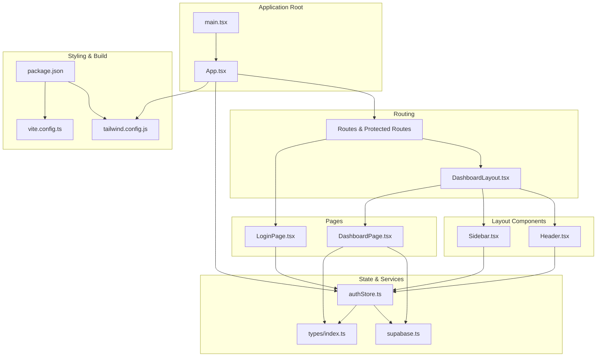
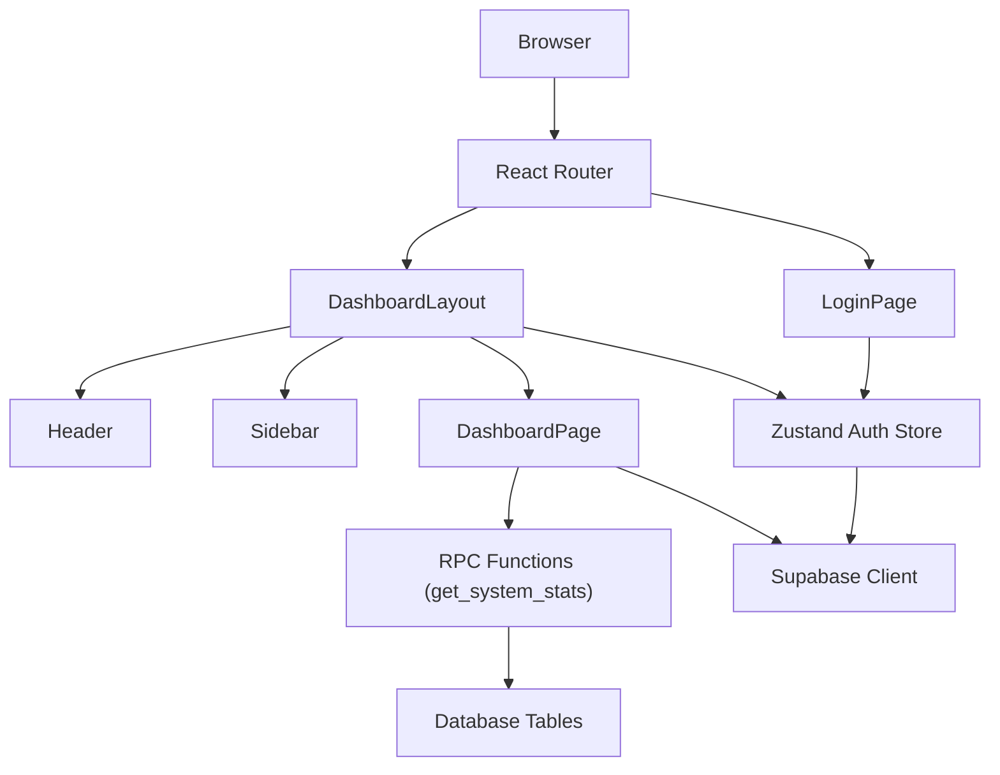
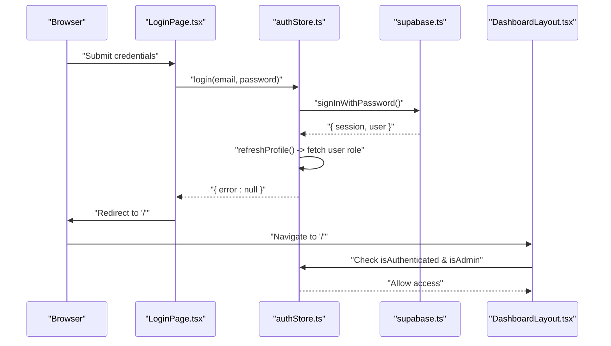
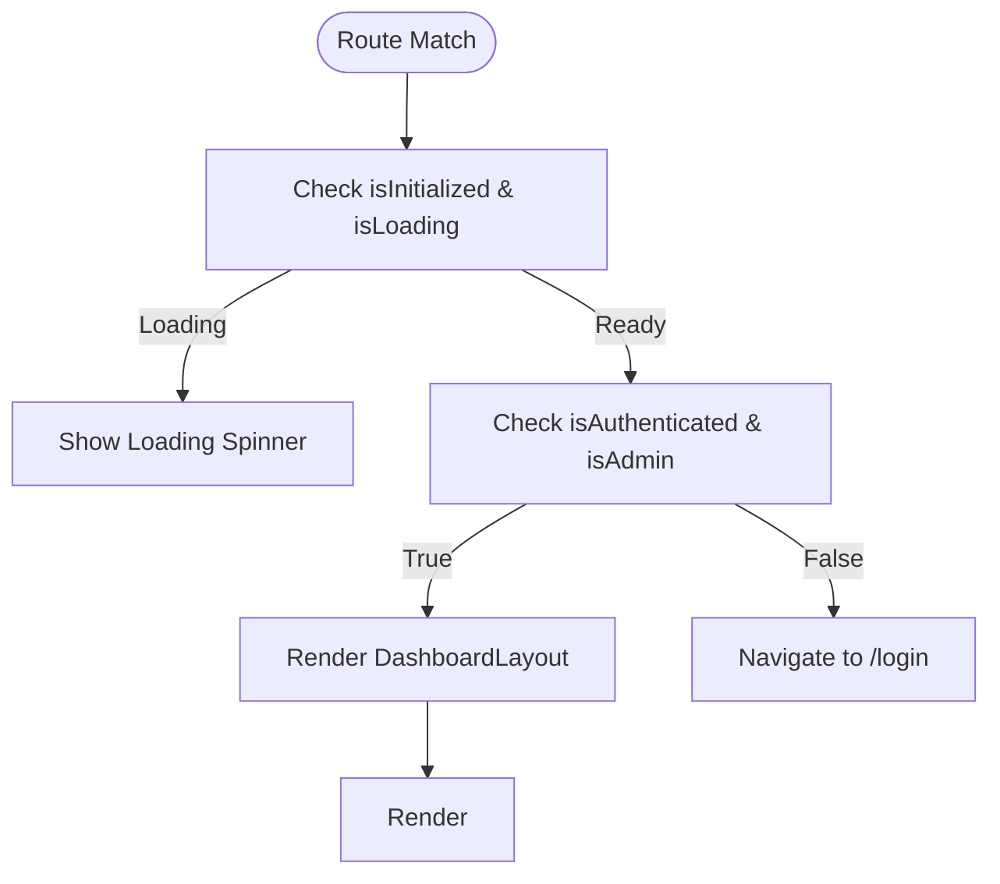
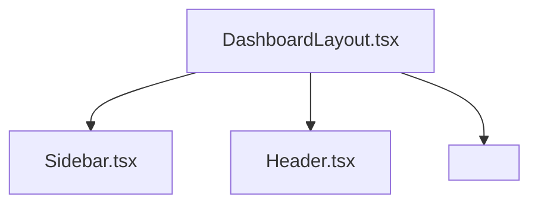
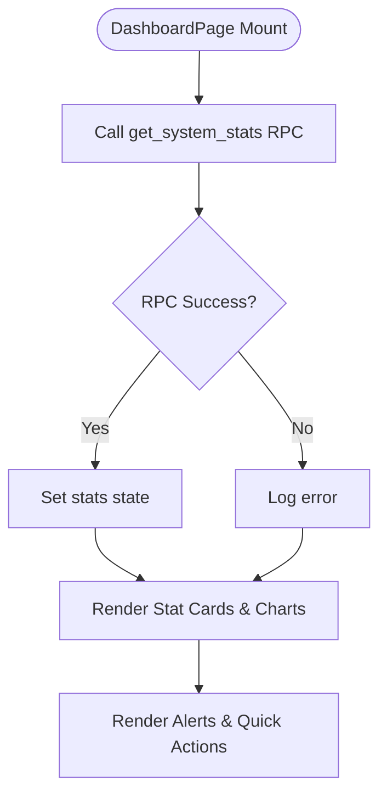
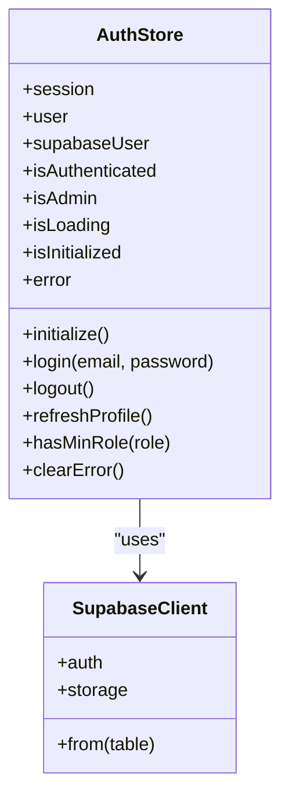
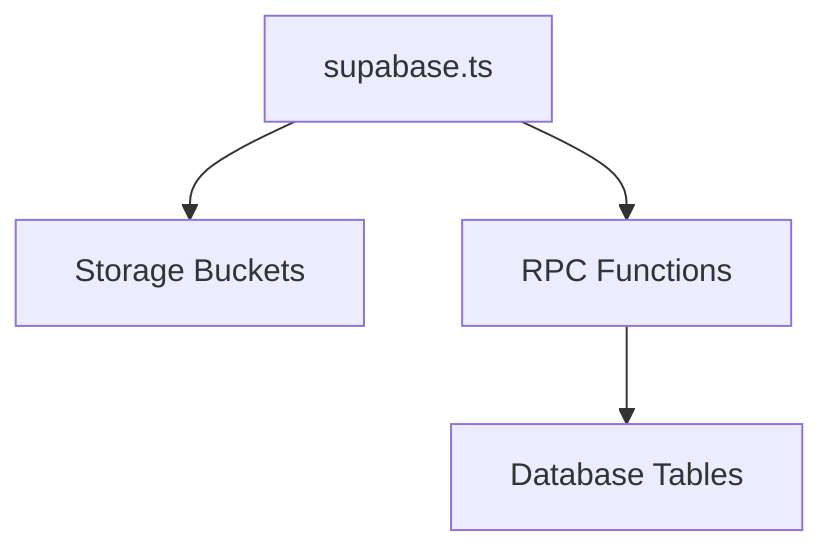
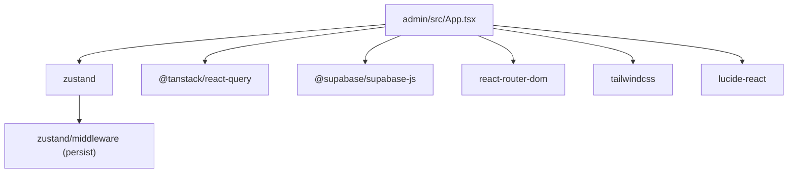

# Admin Dashboard

<cite>
**Referenced Files in This Document**
- [App.tsx](file://admin/src/App.tsx)
- [main.tsx](file://admin/src/main.tsx)
- [DashboardLayout.tsx](file://admin/src/components/layout/DashboardLayout.tsx)
- [Header.tsx](file://admin/src/components/layout/Header.tsx)
- [Sidebar.tsx](file://admin/src/components/layout/Sidebar.tsx)
- [DashboardPage.tsx](file://admin/src/pages/DashboardPage.tsx)
- [LoginPage.tsx](file://admin/src/pages/LoginPage.tsx)
- [authStore.ts](file://admin/src/store/authStore.ts)
- [supabase.ts](file://admin/src/lib/supabase.ts)
- [index.ts](file://admin/src/types/index.ts)
- [tailwind.config.js](file://admin/tailwind.config.js)
- [package.json](file://admin/package.json)
- [vite.config.ts](file://admin/vite.config.ts)
- [README.md](file://admin/README.md)
</cite>

## Table of Contents
1. [Introduction](#introduction)
2. [Project Structure](#project-structure)
3. [Core Components](#core-components)
4. [Architecture Overview](#architecture-overview)
5. [Detailed Component Analysis](#detailed-component-analysis)
6. [Dependency Analysis](#dependency-analysis)
7. [Performance Considerations](#performance-considerations)
8. [Troubleshooting Guide](#troubleshooting-guide)
9. [Conclusion](#conclusion)
10. [Appendices](#appendices)

## Introduction
This document describes the React web admin dashboard application for the NALISS UMYU HUB platform. It covers the dashboard layout architecture with responsive design using Tailwind CSS, navigation structure with sidebar and header components, protected route implementation, and the admin features planned for development. It also documents the authentication flow, state management with Zustand, and integration with Supabase services. UI component documentation, responsive design patterns, and admin workflow optimization strategies are included to help developers and administrators understand and extend the system effectively.

## Project Structure
The admin dashboard is organized around a clear separation of concerns:
- Routing and initialization are handled at the application root.
- Layout components provide the sidebar, header, and outlet for page content.
- Pages implement specific views such as the dashboard and login.
- State management is centralized using Zustand with persistence.
- Supabase integration provides authentication, session management, and storage helpers.
- Types define the domain models and role hierarchy used across the app.
- Tailwind CSS configures the design system and responsive breakpoints.

**Diagram sources**
- [main.tsx](file://admin/src/main.tsx#L1-L11)
- [App.tsx](file://admin/src/App.tsx#L1-L64)
- [DashboardLayout.tsx](file://admin/src/components/layout/DashboardLayout.tsx#L1-L38)
- [Header.tsx](file://admin/src/components/layout/Header.tsx#L1-L105)
- [Sidebar.tsx](file://admin/src/components/layout/Sidebar.tsx#L1-L172)
- [DashboardPage.tsx](file://admin/src/pages/DashboardPage.tsx#L1-L263)
- [LoginPage.tsx](file://admin/src/pages/LoginPage.tsx#L1-L123)
- [authStore.ts](file://admin/src/store/authStore.ts#L1-L228)
- [supabase.ts](file://admin/src/lib/supabase.ts#L1-L73)
- [index.ts](file://admin/src/types/index.ts#L1-L224)
- [tailwind.config.js](file://admin/tailwind.config.js#L1-L27)
- [package.json](file://admin/package.json#L1-L43)
- [vite.config.ts](file://admin/vite.config.ts#L1-L8)

**Section sources**
- [main.tsx](file://admin/src/main.tsx#L1-L11)
- [App.tsx](file://admin/src/App.tsx#L1-L64)
- [tailwind.config.js](file://admin/tailwind.config.js#L1-L27)
- [package.json](file://admin/package.json#L1-L43)
- [vite.config.ts](file://admin/vite.config.ts#L1-L8)

## Core Components
This section documents the key building blocks of the admin dashboard.

- DashboardLayout: Provides the main layout scaffold, handles authentication checks, and renders the sidebar, header, and page content via Outlet.
- Header: Implements the top navigation bar with notifications and user dropdown menu, including logout functionality.
- Sidebar: Implements the collapsible navigation drawer with role-based visibility and active-state highlighting.
- DashboardPage: Renders system statistics, charts, quick actions, and alerts using Supabase RPC and Tailwind styles.
- LoginPage: Handles admin login with form validation, loading states, and redirection after successful authentication.
- authStore: Centralized state for authentication, including initialization, login/logout, profile refresh, role checks, and persistence.
- supabase.ts: Creates the Supabase client, exposes storage helpers, and defines bucket constants.
- types/index.ts: Defines user roles, statuses, domain models, and UI label/color mappings.

**Section sources**
- [DashboardLayout.tsx](file://admin/src/components/layout/DashboardLayout.tsx#L1-L38)
- [Header.tsx](file://admin/src/components/layout/Header.tsx#L1-L105)
- [Sidebar.tsx](file://admin/src/components/layout/Sidebar.tsx#L1-L172)
- [DashboardPage.tsx](file://admin/src/pages/DashboardPage.tsx#L1-L263)
- [LoginPage.tsx](file://admin/src/pages/LoginPage.tsx#L1-L123)
- [authStore.ts](file://admin/src/store/authStore.ts#L1-L228)
- [supabase.ts](file://admin/src/lib/supabase.ts#L1-L73)
- [index.ts](file://admin/src/types/index.ts#L1-L224)

## Architecture Overview
The application follows a layered architecture:
- Presentation Layer: React components (layouts, pages, UI).
- State Management: Zustand stores with persistence for authentication state.
- Services Layer: Supabase client for authentication, session management, and storage operations.
- Data Access: Supabase RPC functions and table queries for analytics and user data.
- Styling: Tailwind CSS for responsive design and theming.

**Diagram sources**
- [App.tsx](file://admin/src/App.tsx#L1-L64)
- [DashboardLayout.tsx](file://admin/src/components/layout/DashboardLayout.tsx#L1-L38)
- [Header.tsx](file://admin/src/components/layout/Header.tsx#L1-L105)
- [Sidebar.tsx](file://admin/src/components/layout/Sidebar.tsx#L1-L172)
- [DashboardPage.tsx](file://admin/src/pages/DashboardPage.tsx#L1-L263)
- [LoginPage.tsx](file://admin/src/pages/LoginPage.tsx#L1-L123)
- [authStore.ts](file://admin/src/store/authStore.ts#L1-L228)
- [supabase.ts](file://admin/src/lib/supabase.ts#L1-L73)

## Detailed Component Analysis

### Authentication Flow
The authentication flow integrates Supabase for session management and local state persistence. It supports both live Supabase environments and a demo mode when configuration is missing.

**Diagram sources**
- [LoginPage.tsx](file://admin/src/pages/LoginPage.tsx#L1-L123)
- [authStore.ts](file://admin/src/store/authStore.ts#L94-L172)
- [supabase.ts](file://admin/src/lib/supabase.ts#L1-L73)
- [DashboardLayout.tsx](file://admin/src/components/layout/DashboardLayout.tsx#L1-L38)

**Section sources**
- [LoginPage.tsx](file://admin/src/pages/LoginPage.tsx#L1-L123)
- [authStore.ts](file://admin/src/store/authStore.ts#L94-L172)
- [supabase.ts](file://admin/src/lib/supabase.ts#L1-L73)
- [DashboardLayout.tsx](file://admin/src/components/layout/DashboardLayout.tsx#L1-L38)

### Protected Route Implementation
Protected routes are enforced by wrapping the dashboard routes with a layout that checks authentication and admin privileges. Unauthenticated or non-admin users are redirected to the login page.

**Diagram sources**
- [DashboardLayout.tsx](file://admin/src/components/layout/DashboardLayout.tsx#L1-L38)
- [App.tsx](file://admin/src/App.tsx#L38-L53)

**Section sources**
- [DashboardLayout.tsx](file://admin/src/components/layout/DashboardLayout.tsx#L1-L38)
- [App.tsx](file://admin/src/App.tsx#L38-L53)

### Dashboard Layout and Navigation
The layout combines a persistent sidebar and a sticky header, with a responsive main content area. The sidebar collapses on small screens and filters navigation items based on user role.

**Diagram sources**
- [DashboardLayout.tsx](file://admin/src/components/layout/DashboardLayout.tsx#L1-L38)
- [Header.tsx](file://admin/src/components/layout/Header.tsx#L1-L105)
- [Sidebar.tsx](file://admin/src/components/layout/Sidebar.tsx#L1-L172)

**Section sources**
- [DashboardLayout.tsx](file://admin/src/components/layout/DashboardLayout.tsx#L1-L38)
- [Header.tsx](file://admin/src/components/layout/Header.tsx#L1-L105)
- [Sidebar.tsx](file://admin/src/components/layout/Sidebar.tsx#L1-L172)

### Dashboard Analytics Page
The dashboard page fetches system statistics via a Supabase RPC function and renders:
- Stat cards for totals and trends
- Charts for user distribution by level and role
- Quick actions and alerts for moderation and administrative tasks

**Diagram sources**
- [DashboardPage.tsx](file://admin/src/pages/DashboardPage.tsx#L1-L263)
- [supabase.ts](file://admin/src/lib/supabase.ts#L1-L73)

**Section sources**
- [DashboardPage.tsx](file://admin/src/pages/DashboardPage.tsx#L1-L263)
- [supabase.ts](file://admin/src/lib/supabase.ts#L1-L73)

### State Management with Zustand
The auth store encapsulates:
- Initialization from persisted session
- Login/logout flows with Supabase
- Profile refresh and role verification
- Role-based access control helpers
- Persistence of session tokens

**Diagram sources**
- [authStore.ts](file://admin/src/store/authStore.ts#L1-L228)
- [supabase.ts](file://admin/src/lib/supabase.ts#L1-L73)

**Section sources**
- [authStore.ts](file://admin/src/store/authStore.ts#L1-L228)
- [supabase.ts](file://admin/src/lib/supabase.ts#L1-L73)

### Supabase Integration
Supabase integration provides:
- Client creation with auto-refresh and session persistence
- Storage helpers for avatars, materials, event covers, announcement media, and message attachments
- Public and signed URL generation for secure asset access

**Diagram sources**
- [supabase.ts](file://admin/src/lib/supabase.ts#L1-L73)

**Section sources**
- [supabase.ts](file://admin/src/lib/supabase.ts#L1-L73)

### Responsive Design Patterns
Tailwind CSS is configured to support a consistent design system and responsive breakpoints:
- Primary color palette customization
- Responsive grid layouts for stats and charts
- Mobile-first navigation with collapsible sidebar
- Adaptive spacing and typography scales

**Section sources**
- [tailwind.config.js](file://admin/tailwind.config.js#L1-L27)
- [DashboardPage.tsx](file://admin/src/pages/DashboardPage.tsx#L87-L177)
- [Sidebar.tsx](file://admin/src/components/layout/Sidebar.tsx#L54-L96)

### Admin Features (Planned)
The routing structure indicates planned admin features:
- Students: View, ban, role assignment
- Content: Announcements, Events, Materials
- Messaging: Moderation
- System Administration: Analytics, Activity Logs, Admin Management, System Settings

These routes are placeholders and will be implemented in dedicated pages with appropriate data fetching, forms, and permissions.

**Section sources**
- [App.tsx](file://admin/src/App.tsx#L42-L52)

## Dependency Analysis
External dependencies include React, React Router, Zustand, Supabase JS SDK, TanStack React Query, Tailwind CSS, and Lucide React for icons. The build system uses Vite with React plugin.

**Diagram sources**
- [package.json](file://admin/package.json#L12-L26)
- [App.tsx](file://admin/src/App.tsx#L1-L64)
- [authStore.ts](file://admin/src/store/authStore.ts#L1-L228)

**Section sources**
- [package.json](file://admin/package.json#L12-L26)
- [vite.config.ts](file://admin/vite.config.ts#L1-L8)

## Performance Considerations
- React Query caching: Default stale time and retry configuration reduce redundant network requests.
- Zustand persistence: Only session is persisted to minimize storage overhead while maintaining login continuity.
- Supabase auto-refresh: Token refresh and session persistence improve reliability without manual intervention.
- Tailwind utilities: Prefer utility classes for minimal CSS overhead and consistent responsiveness.

[No sources needed since this section provides general guidance]

## Troubleshooting Guide
Common issues and resolutions:
- Supabase not configured: The app runs in demo mode, simulating admin login and profile retrieval. Ensure environment variables are set for production.
- Authentication redirects: Verify that the layout checks for authenticated admin status and redirects accordingly.
- Role-based navigation: Confirm that navigation items are filtered by minimum role requirements.
- RPC failures: Check the RPC function availability and database connectivity.

**Section sources**
- [authStore.ts](file://admin/src/store/authStore.ts#L38-L50)
- [DashboardLayout.tsx](file://admin/src/components/layout/DashboardLayout.tsx#L21-L24)
- [Sidebar.tsx](file://admin/src/components/layout/Sidebar.tsx#L44-L47)
- [DashboardPage.tsx](file://admin/src/pages/DashboardPage.tsx#L21-L31)

## Conclusion
The admin dashboard leverages modern React patterns with robust state management, secure authentication, and responsive design. The modular layout, role-based navigation, and Supabase integration provide a solid foundation for extending admin capabilities. Future work should focus on implementing the planned admin features, enhancing UI components, and optimizing data fetching and caching strategies.

[No sources needed since this section summarizes without analyzing specific files]

## Appendices

### UI Component Reference
- Header: Displays notifications and user menu with logout.
- Sidebar: Collapsible navigation with role-based filtering and active state indicators.
- DashboardPage: Analytics dashboard with charts and alerts.

**Section sources**
- [Header.tsx](file://admin/src/components/layout/Header.tsx#L1-L105)
- [Sidebar.tsx](file://admin/src/components/layout/Sidebar.tsx#L1-L172)
- [DashboardPage.tsx](file://admin/src/pages/DashboardPage.tsx#L1-L263)

### Types and Roles
- User roles and status types, domain models, and label/color mappings are defined centrally for consistent UI and logic.

**Section sources**
- [index.ts](file://admin/src/types/index.ts#L1-L224)

### Build and Configuration
- Vite configuration enables React fast refresh.
- Tailwind CSS is configured with a custom primary color palette.

**Section sources**
- [vite.config.ts](file://admin/vite.config.ts#L1-L8)
- [tailwind.config.js](file://admin/tailwind.config.js#L1-L27)
- [README.md](file://admin/README.md#L1-L74)