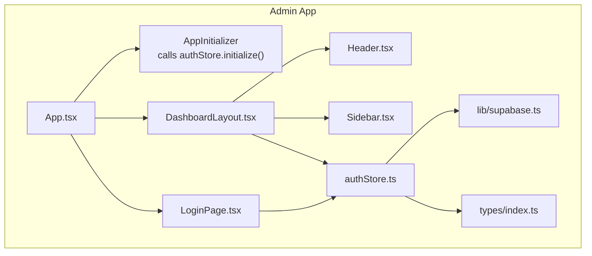
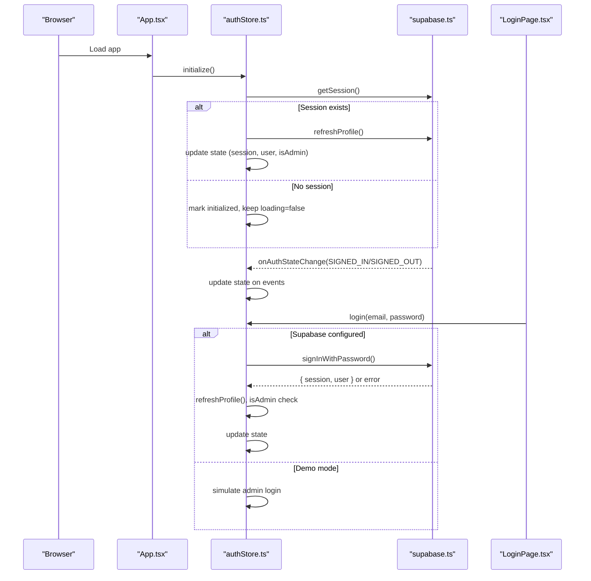
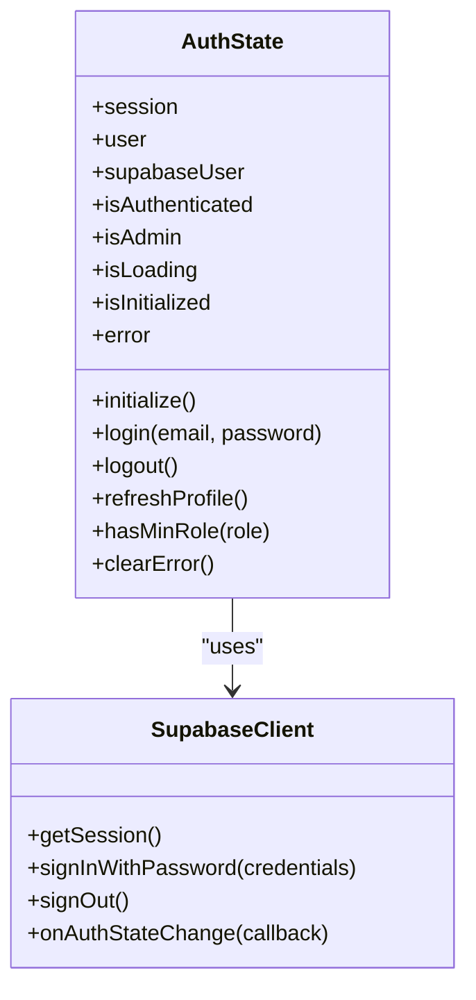
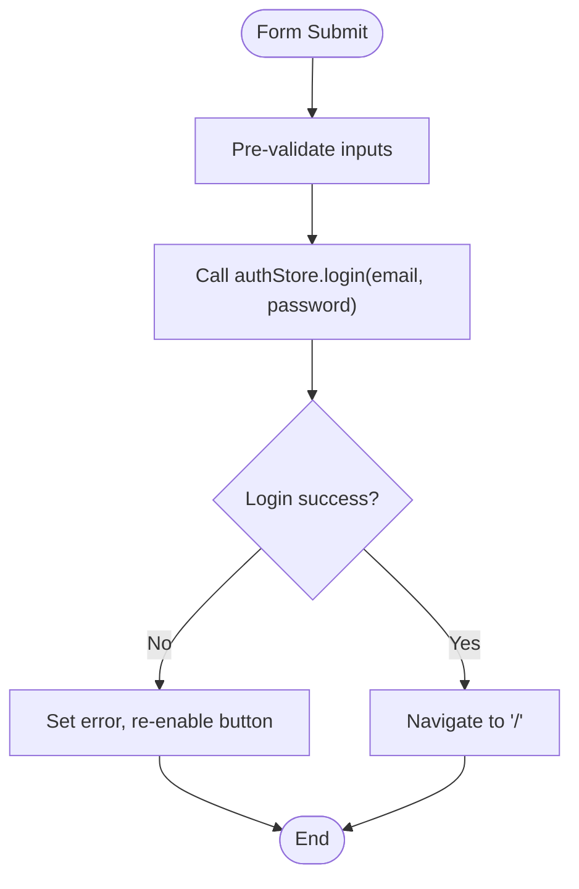
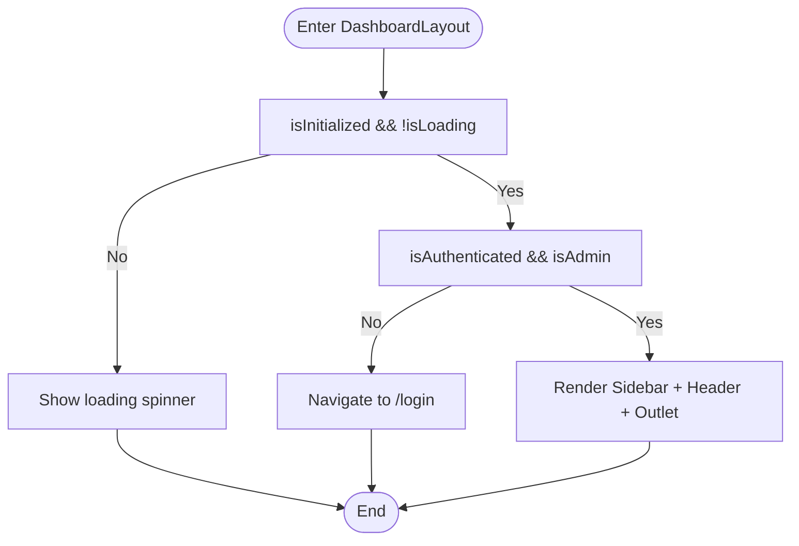
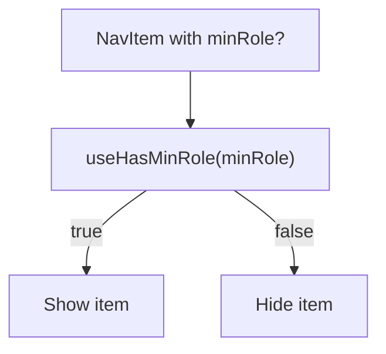
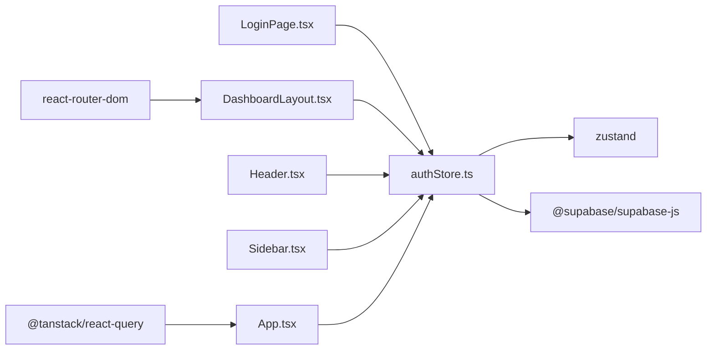

# Authentication & Session Management

<cite>
**Referenced Files in This Document**
- [authStore.ts](file://admin/src/store/authStore.ts)
- [LoginPage.tsx](file://admin/src/pages/LoginPage.tsx)
- [supabase.ts](file://admin/src/lib/supabase.ts)
- [App.tsx](file://admin/src/App.tsx)
- [DashboardLayout.tsx](file://admin/src/components/layout/DashboardLayout.tsx)
- [Sidebar.tsx](file://admin/src/components/layout/Sidebar.tsx)
- [Header.tsx](file://admin/src/components/layout/Header.tsx)
- [index.ts](file://admin/src/types/index.ts)
- [package.json](file://admin/package.json)
</cite>

## Table of Contents
1. [Introduction](#introduction)
2. [Project Structure](#project-structure)
3. [Core Components](#core-components)
4. [Architecture Overview](#architecture-overview)
5. [Detailed Component Analysis](#detailed-component-analysis)
6. [Dependency Analysis](#dependency-analysis)
7. [Performance Considerations](#performance-considerations)
8. [Troubleshooting Guide](#troubleshooting-guide)
9. [Conclusion](#conclusion)

## Introduction
This document explains the admin authentication and session management system for the NALISS Admin Panel. It covers the login page implementation, authentication flow with Supabase, state management using Zustand, role-based access control, automatic session restoration, protected routing, and logout procedures. It also documents security considerations, session persistence, error handling, and demo mode functionality, with integration patterns and selector hooks for state management.

## Project Structure
The admin panel is a React application using Vite and TypeScript. Authentication is centralized in a Zustand store, with Supabase managing server-side sessions and real-time auth state changes. Routing is handled by React Router with protected routes enforced by a layout wrapper.

**Diagram sources**
- [App.tsx](file://admin/src/App.tsx#L19-L27)
- [DashboardLayout.tsx](file://admin/src/components/layout/DashboardLayout.tsx#L6-L37)
- [LoginPage.tsx](file://admin/src/pages/LoginPage.tsx#L5-L32)
- [authStore.ts](file://admin/src/store/authStore.ts#L26-L222)
- [supabase.ts](file://admin/src/lib/supabase.ts#L1-L73)
- [index.ts](file://admin/src/types/index.ts#L185-L191)
- [Header.tsx](file://admin/src/components/layout/Header.tsx#L7-L28)
- [Sidebar.tsx](file://admin/src/components/layout/Sidebar.tsx#L39-L50)

**Section sources**
- [App.tsx](file://admin/src/App.tsx#L1-L64)
- [authStore.ts](file://admin/src/store/authStore.ts#L1-L228)
- [supabase.ts](file://admin/src/lib/supabase.ts#L1-L73)
- [index.ts](file://admin/src/types/index.ts#L1-L224)

## Core Components
- Auth Store (Zustand): Centralized state for session, user, admin status, loading, initialization, and errors. Provides actions for initialization, login, logout, profile refresh, role checks, and error clearing.
- Supabase Client: Configured with auto-refresh, session persistence, and URL detection. Exposes helpers for storage and session retrieval.
- Login Page: Renders a form, validates preconditions, and triggers login via the store.
- Protected Layout: Guards routes by checking initialization, loading state, and admin privileges.
- UI Components: Header and Sidebar consume auth state for rendering and logout.

Key responsibilities:
- Automatic session restoration on app load
- Real-time auth state synchronization
- Role-based navigation filtering
- Demo mode fallback when Supabase is not configured

**Section sources**
- [authStore.ts](file://admin/src/store/authStore.ts#L8-L24)
- [authStore.ts](file://admin/src/store/authStore.ts#L26-L222)
- [supabase.ts](file://admin/src/lib/supabase.ts#L3-L18)
- [LoginPage.tsx](file://admin/src/pages/LoginPage.tsx#L5-L32)
- [DashboardLayout.tsx](file://admin/src/components/layout/DashboardLayout.tsx#L6-L37)
- [Header.tsx](file://admin/src/components/layout/Header.tsx#L7-L28)
- [Sidebar.tsx](file://admin/src/components/layout/Sidebar.tsx#L39-L50)

## Architecture Overview
The system integrates three layers:
- Presentation Layer: Pages and layout components render UI and capture user actions.
- State Layer: Zustand store manages auth state and exposes selectors.
- Infrastructure Layer: Supabase client handles authentication, session persistence, and auth state change events.

**Diagram sources**
- [App.tsx](file://admin/src/App.tsx#L19-L27)
- [authStore.ts](file://admin/src/store/authStore.ts#L38-L92)
- [authStore.ts](file://admin/src/store/authStore.ts#L94-L172)
- [supabase.ts](file://admin/src/lib/supabase.ts#L10-L18)
- [LoginPage.tsx](file://admin/src/pages/LoginPage.tsx#L19-L32)

## Detailed Component Analysis

### Auth Store (Zustand)
The auth store encapsulates:
- State: session, user, supabaseUser, isAuthenticated, isAdmin, isLoading, isInitialized, error
- Actions: initialize, login, logout, refreshProfile, hasMinRole, clearError
- Persistence: Zustand persist middleware storing only the session to enable automatic restoration
- Demo Mode: When Supabase is not configured, login simulates an admin session

**Diagram sources**
- [authStore.ts](file://admin/src/store/authStore.ts#L8-L24)
- [authStore.ts](file://admin/src/store/authStore.ts#L26-L222)
- [supabase.ts](file://admin/src/lib/supabase.ts#L1-L18)

Key behaviors:
- Initialization: Retrieves persisted session, hydrates user profile, subscribes to auth state changes, and marks initialization complete.
- Login: Validates credentials against Supabase or simulates admin login in demo mode; enforces admin-only access.
- Profile Refresh: Fetches user record from the database and derives admin status.
- Role Checks: Compares role levels to enforce minimum roles.
- Logout: Signs out via Supabase and clears local state.

Selector hooks:
- useUser, useIsAdmin, useHasMinRole

**Section sources**
- [authStore.ts](file://admin/src/store/authStore.ts#L8-L24)
- [authStore.ts](file://admin/src/store/authStore.ts#L26-L222)
- [authStore.ts](file://admin/src/store/authStore.ts#L225-L227)
- [index.ts](file://admin/src/types/index.ts#L185-L191)

### Supabase Client Configuration
- Environment variables: VITE_SUPABASE_URL, VITE_SUPABASE_ANON_KEY
- Auto-refresh tokens, persistent sessions, and URL session detection
- Storage helpers for public and signed URLs, uploads, and deletions
- Demo mode guard: isSupabaseConfigured determines whether to use Supabase or demo behavior

**Section sources**
- [supabase.ts](file://admin/src/lib/supabase.ts#L3-L18)
- [supabase.ts](file://admin/src/lib/supabase.ts#L20-L73)
- [authStore.ts](file://admin/src/store/authStore.ts#L42-L50)

### Login Page Implementation
- Prevents navigation to dashboard if already authenticated as admin
- Captures email/password, disables submit during login, and displays errors
- Calls store.login and navigates on success

**Diagram sources**
- [LoginPage.tsx](file://admin/src/pages/LoginPage.tsx#L19-L32)
- [authStore.ts](file://admin/src/store/authStore.ts#L94-L172)

**Section sources**
- [LoginPage.tsx](file://admin/src/pages/LoginPage.tsx#L5-L32)

### Protected Route Implementation
- DashboardLayout checks initialization, loading, and admin status
- Redirects to login if unauthenticated or unauthorized
- Renders sidebar and header inside a protected outlet

**Diagram sources**
- [DashboardLayout.tsx](file://admin/src/components/layout/DashboardLayout.tsx#L9-L24)

**Section sources**
- [DashboardLayout.tsx](file://admin/src/components/layout/DashboardLayout.tsx#L6-L37)

### Role-Based Access Control (RBAC)
- Role hierarchy defines numeric levels for comparison
- Sidebar filters navigation items based on minimum role requirements
- useHasMinRole hook compares current user role against required role

**Diagram sources**
- [Sidebar.tsx](file://admin/src/components/layout/Sidebar.tsx#L44-L47)
- [index.ts](file://admin/src/types/index.ts#L185-L191)

**Section sources**
- [Sidebar.tsx](file://admin/src/components/layout/Sidebar.tsx#L21-L50)
- [index.ts](file://admin/src/types/index.ts#L185-L191)

### Session Restoration and Persistence
- Zustand persist middleware stores only the session field
- On init, getSession() restores session if present
- Supabase auto-refresh and persistSession keep the session alive across browser reloads

**Section sources**
- [authStore.ts](file://admin/src/store/authStore.ts#L215-L221)
- [authStore.ts](file://admin/src/store/authStore.ts#L52-L63)
- [supabase.ts](file://admin/src/lib/supabase.ts#L11-L17)

### Logout Procedure
- Header triggers logout via authStore.logout
- Store signs out via Supabase and clears local state
- Navigation to login completes the flow

**Section sources**
- [Header.tsx](file://admin/src/components/layout/Header.tsx#L25-L28)
- [authStore.ts](file://admin/src/store/authStore.ts#L174-L184)

### Demo Mode Functionality
- When Supabase is not configured, login simulates an admin session
- Demo user is created with admin role and injected into state
- Useful for development and testing without backend

**Section sources**
- [authStore.ts](file://admin/src/store/authStore.ts#L42-L50)
- [authStore.ts](file://admin/src/store/authStore.ts#L98-L132)

## Dependency Analysis
External libraries:
- @supabase/supabase-js: Authentication, session management, auth state events
- zustand: Global state management with middleware for persistence
- react-router-dom: Routing and protected routes
- @tanstack/react-query: Query client provider (used alongside auth)

**Diagram sources**
- [package.json](file://admin/package.json#L12-L26)
- [authStore.ts](file://admin/src/store/authStore.ts#L1-L7)
- [App.tsx](file://admin/src/App.tsx#L1-L7)

**Section sources**
- [package.json](file://admin/package.json#L1-L43)

## Performance Considerations
- Minimal state updates: Persist only the session to reduce storage overhead.
- Efficient role checks: Role levels are O(1) comparisons using a static map.
- Lazy initialization: Auth initialization runs once on app start and defers rendering until ready.
- Supabase auto-refresh: Reduces manual refresh calls and improves UX.

## Troubleshooting Guide
Common issues and resolutions:
- Supabase not configured: Demo mode activates; verify environment variables are missing intentionally for local dev.
- Login fails with “Admin privileges required”: Ensure the user’s role in the database is not student; the store enforces admin-only access.
- Stuck on loading: Check initialization errors and ensure Supabase client is created successfully.
- Auth state not updating: Verify onAuthStateChange subscriptions and that Supabase auto-refresh is enabled.
- Logout does not redirect: Confirm Header calls logout and navigates to /login.

**Section sources**
- [authStore.ts](file://admin/src/store/authStore.ts#L85-L91)
- [authStore.ts](file://admin/src/store/authStore.ts#L147-L156)
- [supabase.ts](file://admin/src/lib/supabase.ts#L11-L17)
- [Header.tsx](file://admin/src/components/layout/Header.tsx#L25-L28)

## Conclusion
The admin authentication system combines Supabase for secure, persistent sessions with a Zustand store for reactive, minimal state management. It provides robust RBAC, automatic session restoration, protected routes, and a seamless logout experience. Demo mode simplifies development while maintaining the same integration patterns. The modular design ensures maintainability and scalability for future enhancements.