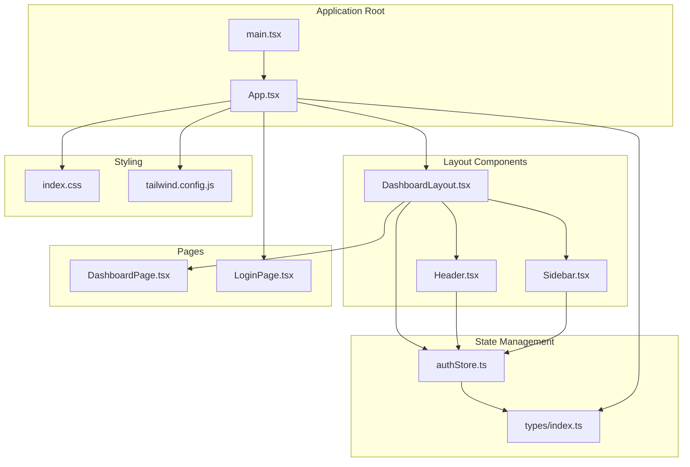
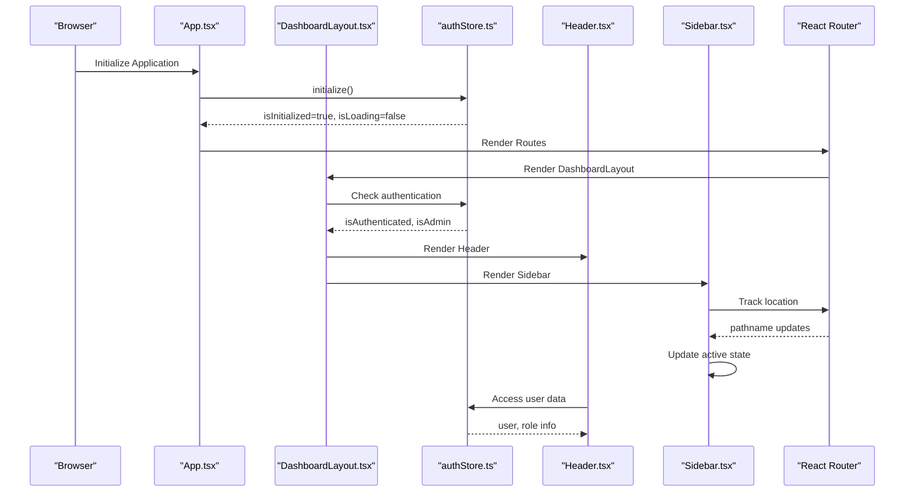
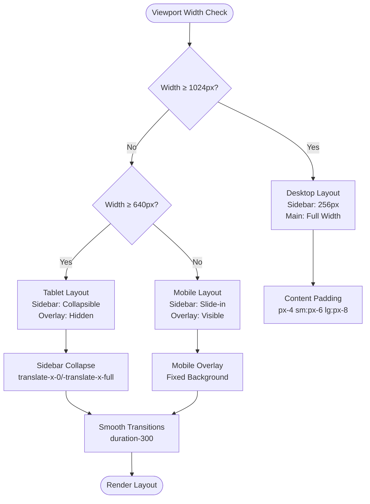
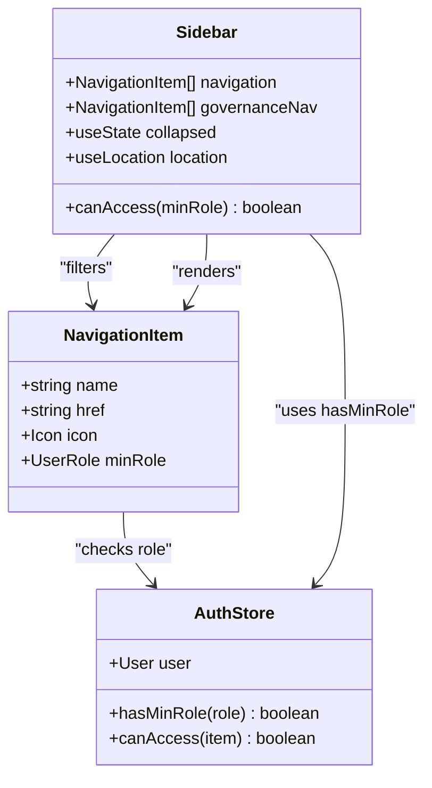
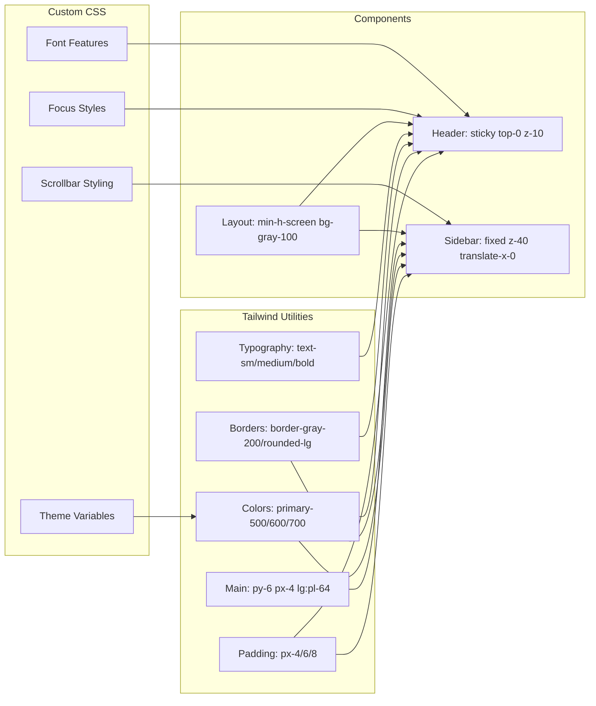

# Dashboard Layout & Navigation

<cite>
**Referenced Files in This Document**
- [DashboardLayout.tsx](file://admin/src/components/layout/DashboardLayout.tsx)
- [Header.tsx](file://admin/src/components/layout/Header.tsx)
- [Sidebar.tsx](file://admin/src/components/layout/Sidebar.tsx)
- [App.tsx](file://admin/src/App.tsx)
- [authStore.ts](file://admin/src/store/authStore.ts)
- [index.ts](file://admin/src/types/index.ts)
- [DashboardPage.tsx](file://admin/src/pages/DashboardPage.tsx)
- [LoginPage.tsx](file://admin/src/pages/LoginPage.tsx)
- [index.css](file://admin/src/index.css)
- [tailwind.config.js](file://admin/tailwind.config.js)
- [main.tsx](file://admin/src/main.tsx)
- [vite.config.ts](file://admin/vite.config.ts)
</cite>

## Table of Contents
1. [Introduction](#introduction)
2. [Project Structure](#project-structure)
3. [Core Components](#core-components)
4. [Architecture Overview](#architecture-overview)
5. [Responsive Layout Structure](#responsive-layout-structure)
6. [Navigation System](#navigation-system)
7. [Styling Patterns and Customization](#styling-patterns-and-customization)
8. [Accessibility and UX Considerations](#accessibility-and-ux-considerations)
9. [Performance Considerations](#performance-considerations)
10. [Troubleshooting Guide](#troubleshooting-guide)
11. [Conclusion](#conclusion)

## Introduction
This document provides comprehensive documentation for the dashboard layout architecture and navigation system used in the admin frontend. It covers the responsive layout structure built with Tailwind CSS, including the main content area, sidebar navigation, and header components. The documentation explains the layout hierarchy, component composition patterns, responsive breakpoints, navigation menu structure, active state management, route-based menu highlighting, styling patterns, component props, customization options, mobile responsiveness, accessibility considerations, and user experience optimization for the admin interface.

## Project Structure
The admin frontend follows a component-based architecture with clear separation of concerns:
- Layout components (DashboardLayout, Header, Sidebar)
- Authentication and state management (authStore)
- Routing configuration (App)
- Type definitions and role-based access control
- Page components (DashboardPage, LoginPage)
- Styling with Tailwind CSS and custom CSS

**Diagram sources**
- [App.tsx](file://admin/src/App.tsx#L1-L64)
- [DashboardLayout.tsx](file://admin/src/components/layout/DashboardLayout.tsx#L1-L38)
- [Header.tsx](file://admin/src/components/layout/Header.tsx#L1-L105)
- [Sidebar.tsx](file://admin/src/components/layout/Sidebar.tsx#L1-L172)
- [authStore.ts](file://admin/src/store/authStore.ts#L1-L228)
- [index.ts](file://admin/src/types/index.ts#L1-L224)
- [DashboardPage.tsx](file://admin/src/pages/DashboardPage.tsx#L1-L263)
- [LoginPage.tsx](file://admin/src/pages/LoginPage.tsx#L1-L123)
- [index.css](file://admin/src/index.css#L1-L60)
- [tailwind.config.js](file://admin/tailwind.config.js#L1-L27)

**Section sources**
- [App.tsx](file://admin/src/App.tsx#L1-L64)
- [main.tsx](file://admin/src/main.tsx#L1-L11)

## Core Components
The layout system consists of three primary components that work together to create a cohesive admin interface:

### DashboardLayout Component
The main layout container that orchestrates the overall page structure and handles authentication flow. It manages loading states, redirects unauthenticated users, and provides the foundation for the sidebar and header components.

Key responsibilities:
- Authentication state management and redirection
- Loading state handling during initialization
- Main content area container with responsive padding
- Integration with routing system via Outlet

### Header Component
Provides the top navigation bar with user profile dropdown, notifications, and branding. Features responsive design with mobile-friendly dropdown menus and user avatar handling.

Key features:
- User profile dropdown with logout functionality
- Notification bell with badge indicator
- Responsive avatar display with fallback initials
- Click-outside detection for dropdown dismissal
- Sticky positioning for persistent navigation

### Sidebar Component
Implements the main navigation sidebar with collapsible functionality, role-based access control, and active state highlighting. Supports both desktop and mobile experiences.

Key capabilities:
- Collapsible design with smooth transitions
- Role-based navigation filtering
- Active route highlighting with distinct colors
- Mobile overlay and hamburger menu
- Governance section separation

**Section sources**
- [DashboardLayout.tsx](file://admin/src/components/layout/DashboardLayout.tsx#L1-L38)
- [Header.tsx](file://admin/src/components/layout/Header.tsx#L1-L105)
- [Sidebar.tsx](file://admin/src/components/layout/Sidebar.tsx#L1-L172)

## Architecture Overview
The layout architecture follows a hierarchical pattern where the DashboardLayout serves as the root container, delegating specific areas to specialized components while maintaining centralized state management.

**Diagram sources**
- [App.tsx](file://admin/src/App.tsx#L19-L27)
- [DashboardLayout.tsx](file://admin/src/components/layout/DashboardLayout.tsx#L6-L24)
- [authStore.ts](file://admin/src/store/authStore.ts#L38-L92)
- [Header.tsx](file://admin/src/components/layout/Header.tsx#L7-L11)
- [Sidebar.tsx](file://admin/src/components/layout/Sidebar.tsx#L39-L50)

The architecture ensures clean separation of concerns with each component having specific responsibilities while maintaining seamless integration through shared state management and routing.

## Responsive Layout Structure
The layout employs a sophisticated responsive design system built entirely with Tailwind CSS utilities, providing optimal user experience across all device sizes.

### Desktop Layout (lg breakpoint and above)
- Fixed sidebar with width of 64 units (256px)
- Main content area with left padding of 64 units (256px)
- Sticky header positioned absolutely at top
- Full-width content area with responsive padding

### Tablet/Mobile Layout (below lg breakpoint)
- Collapsible sidebar with slide-in animation
- Mobile hamburger menu in top-left corner
- Overlay background when sidebar is open
- Reduced sidebar width to 20 units (80px) when collapsed
- Responsive typography and spacing adjustments

### Breakpoint Reference Points
- `sm`: 640px - Small tablets and larger phones
- `lg`: 1024px - Desktop and large tablet screens
- `md`: 768px - Medium tablets and small laptops
- `xl`: 1280px - Large desktop monitors

**Diagram sources**
- [DashboardLayout.tsx](file://admin/src/components/layout/DashboardLayout.tsx#L29-L34)
- [Sidebar.tsx](file://admin/src/components/layout/Sidebar.tsx#L65-L71)
- [Sidebar.tsx](file://admin/src/components/layout/Sidebar.tsx#L163-L168)

**Section sources**
- [DashboardLayout.tsx](file://admin/src/components/layout/DashboardLayout.tsx#L26-L36)
- [Sidebar.tsx](file://admin/src/components/layout/Sidebar.tsx#L54-L71)

## Navigation System
The navigation system implements a comprehensive menu structure with role-based access control, active state management, and intuitive user experience patterns.

### Navigation Structure
The sidebar contains two main navigation sections:

#### Standard Navigation
- Dashboard: Primary landing page
- Students: Student management (requires moderator role)
- Announcements: Content management (requires moderator role)
- Events: Event scheduling and management (requires moderator role)
- Materials: Educational resource management (requires moderator role)
- Messaging: Communication platform (requires moderator role)
- Lecturers: Faculty management
- Executives: Administrative staff management
- Analytics: System analytics and reporting (requires super_admin role)
- Activity Logs: Audit trail and monitoring (requires super_admin role)

#### Governance Navigation
- Admin Management: System administrator management (requires system_owner role)
- System Settings: Platform configuration (requires system_owner role)

### Active State Management
Active navigation items are determined by exact URL path matching:
- Primary navigation uses blue/purple color scheme for active states
- Governance section uses purple accents for distinction
- Smooth transition animations for state changes
- Icon and text styling adapts based on collapse state

### Role-Based Access Control
Navigation items are filtered based on user roles using a hierarchical permission system:
- `student`: Basic user access
- `moderator`: Content management permissions
- `super_admin`: Advanced administrative functions
- `system_owner`: Full system control

**Diagram sources**
- [Sidebar.tsx](file://admin/src/components/layout/Sidebar.tsx#L21-L37)
- [Sidebar.tsx](file://admin/src/components/layout/Sidebar.tsx#L44-L47)
- [authStore.ts](file://admin/src/store/authStore.ts#L207-L211)

**Section sources**
- [Sidebar.tsx](file://admin/src/components/layout/Sidebar.tsx#L21-L50)
- [authStore.ts](file://admin/src/store/authStore.ts#L186-L211)
- [index.ts](file://admin/src/types/index.ts#L185-L199)

## Styling Patterns and Customization
The styling system leverages Tailwind CSS v4 with custom theme extensions and utility-first design principles.

### Color System
Custom primary color palette with semantic variants:
- Primary: Blue spectrum from 50 to 900
- Active states: Primary 600 for main actions, Primary 700 for hover states
- Accent colors: Purple for governance sections, Red for critical actions
- Neutral backgrounds: Gray 100 for content areas, Gray 50 for cards

### Typography and Spacing
- Base font: Inter with system UI fallbacks
- Responsive typography scaling
- Consistent spacing with padding utilities (px-4, px-6, px-8)
- Grid systems for content organization (1/2/4 column layouts)

### Component Styling Patterns
- **Header**: Sticky positioning with shadow and border separation
- **Sidebar**: Fixed positioning with z-index stacking and smooth transitions
- **Cards**: White background with subtle shadows and rounded corners
- **Buttons**: Consistent sizing with hover/focus states and disabled states

### Custom CSS Extensions
Additional CSS provides:
- Theme variable definitions for consistent color usage
- Custom scrollbar styling for cross-browser compatibility
- Focus ring utilities for accessibility compliance
- Font smoothing and rendering optimizations

**Diagram sources**
- [index.css](file://admin/src/index.css#L4-L15)
- [index.css](file://admin/src/index.css#L53-L59)
- [DashboardLayout.tsx](file://admin/src/components/layout/DashboardLayout.tsx#L27-L36)
- [Header.tsx](file://admin/src/components/layout/Header.tsx#L31-L32)
- [Sidebar.tsx](file://admin/src/components/layout/Sidebar.tsx#L65-L71)

**Section sources**
- [tailwind.config.js](file://admin/tailwind.config.js#L8-L23)
- [index.css](file://admin/src/index.css#L1-L60)

## Accessibility and UX Considerations
The interface incorporates several accessibility features and user experience optimizations:

### Accessibility Features
- **Keyboard Navigation**: Full keyboard support for all interactive elements
- **Screen Reader Compatibility**: Proper ARIA labels and semantic HTML structure
- **Focus Management**: Clear focus indicators with custom focus-ring utilities
- **Color Contrast**: Sufficient contrast ratios for text and interactive elements
- **Reduced Motion**: Respects prefers-reduced-motion media queries

### User Experience Optimizations
- **Loading States**: Comprehensive loading indicators during authentication and data fetching
- **Error Handling**: Clear error messages with actionable feedback
- **Responsive Feedback**: Hover states, active states, and transition animations
- **Consistent Patterns**: Uniform styling across all components and pages
- **Mobile First**: Touch-friendly interface with appropriate tap targets

### Security Considerations
- **Authentication Guards**: Route protection prevents unauthorized access
- **Role Validation**: Backend verification of user permissions
- **Session Management**: Secure session handling with automatic cleanup
- **Input Validation**: Form validation with real-time feedback

**Section sources**
- [Header.tsx](file://admin/src/components/layout/Header.tsx#L13-L23)
- [DashboardLayout.tsx](file://admin/src/components/layout/DashboardLayout.tsx#L10-L19)
- [authStore.ts](file://admin/src/store/authStore.ts#L174-L184)

## Performance Considerations
The layout system is designed with performance optimization in mind:

### Rendering Optimization
- **Component Splitting**: Independent components reduce unnecessary re-renders
- **State Isolation**: Minimal shared state reduces cascade updates
- **Lazy Loading**: Route-based lazy loading for page components
- **Efficient Animations**: Hardware-accelerated transitions using transform properties

### Bundle Optimization
- **Tree Shaking**: Unused code elimination through ES6 module imports
- **Critical Path**: Essential styles loaded first, non-critical styles deferred
- **Asset Optimization**: SVG icons embedded for better performance
- **Minimal Dependencies**: Lean dependency footprint with essential packages only

### Runtime Performance
- **Memory Management**: Proper event listener cleanup and component unmounting
- **Event Delegation**: Efficient click handlers with bubbling prevention
- **State Persistence**: Local storage for authentication state persistence
- **Network Optimization**: React Query caching for API responses

## Troubleshooting Guide
Common issues and their solutions:

### Authentication Issues
**Problem**: Users redirected to login despite being authenticated
**Solution**: Check authentication initialization and session state in authStore

**Problem**: Role-based navigation not appearing
**Solution**: Verify user role assignment and ROLE_LEVELS configuration

### Layout Problems
**Problem**: Sidebar not collapsing on mobile devices
**Solution**: Ensure viewport meta tag is present and CSS transitions are enabled

**Problem**: Header overlapping content
**Solution**: Check z-index values and positioning classes in layout components

### Styling Issues
**Problem**: Custom colors not applying
**Solution**: Verify Tailwind configuration and CSS import order

**Problem**: Responsive breakpoints not working
**Solution**: Check Tailwind configuration and utility class usage

**Section sources**
- [authStore.ts](file://admin/src/store/authStore.ts#L38-L92)
- [Sidebar.tsx](file://admin/src/components/layout/Sidebar.tsx#L54-L71)
- [tailwind.config.js](file://admin/tailwind.config.js#L1-L27)

## Conclusion
The dashboard layout and navigation system provides a robust, scalable foundation for the admin interface. The architecture balances flexibility with consistency, offering comprehensive role-based access control, responsive design, and excellent user experience. The modular component structure enables easy maintenance and future enhancements while the styling system ensures visual consistency across all supported devices and screen sizes.

The implementation demonstrates best practices in modern React development, including proper state management, efficient routing, and thoughtful accessibility considerations. The system is well-positioned for growth and can accommodate additional features and complexity as the application evolves.