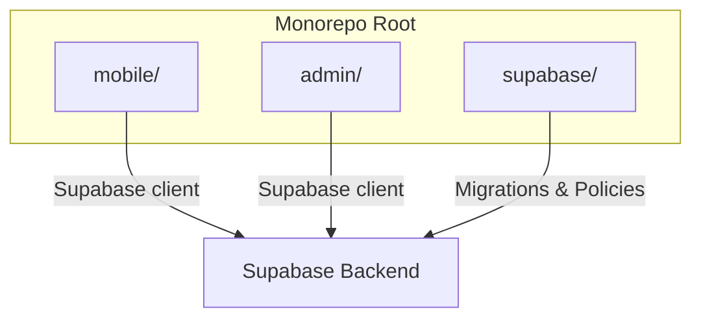
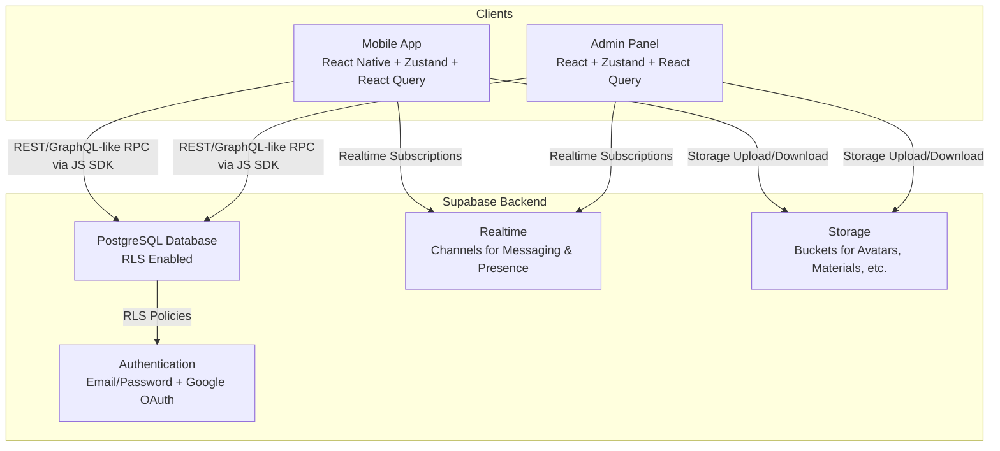
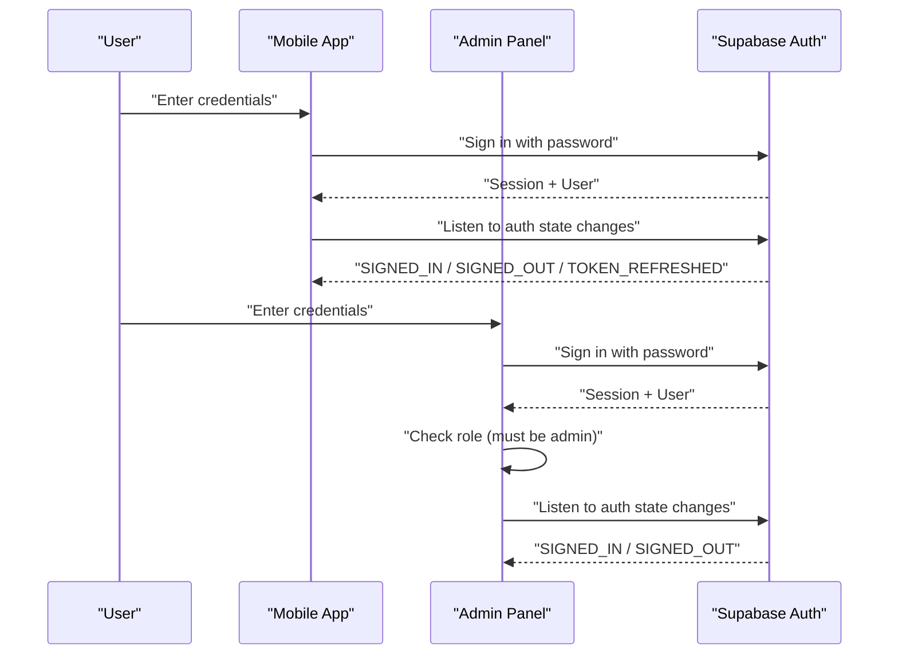
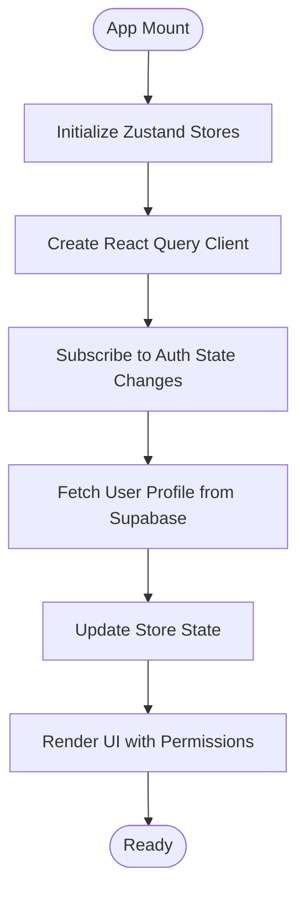
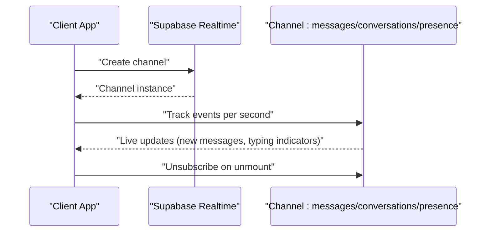
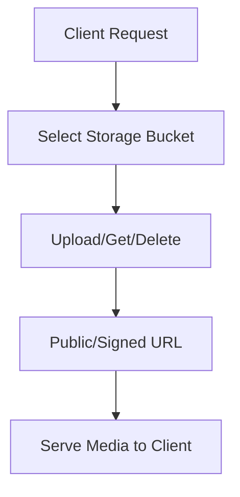
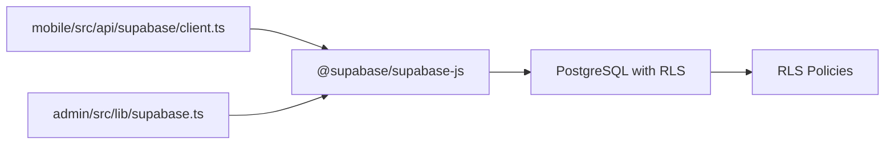
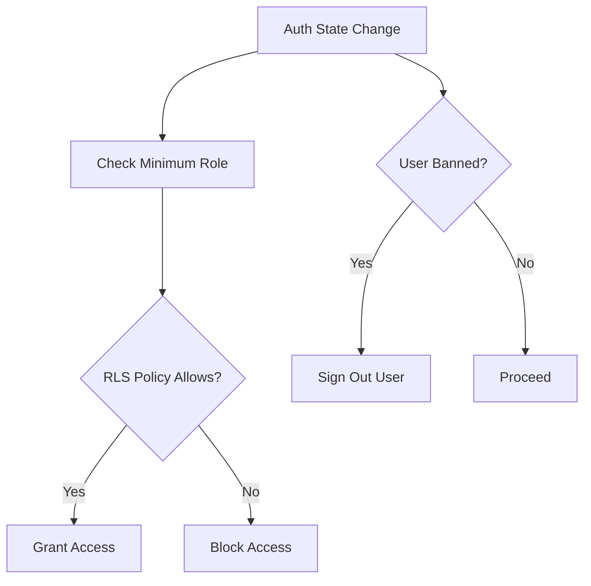
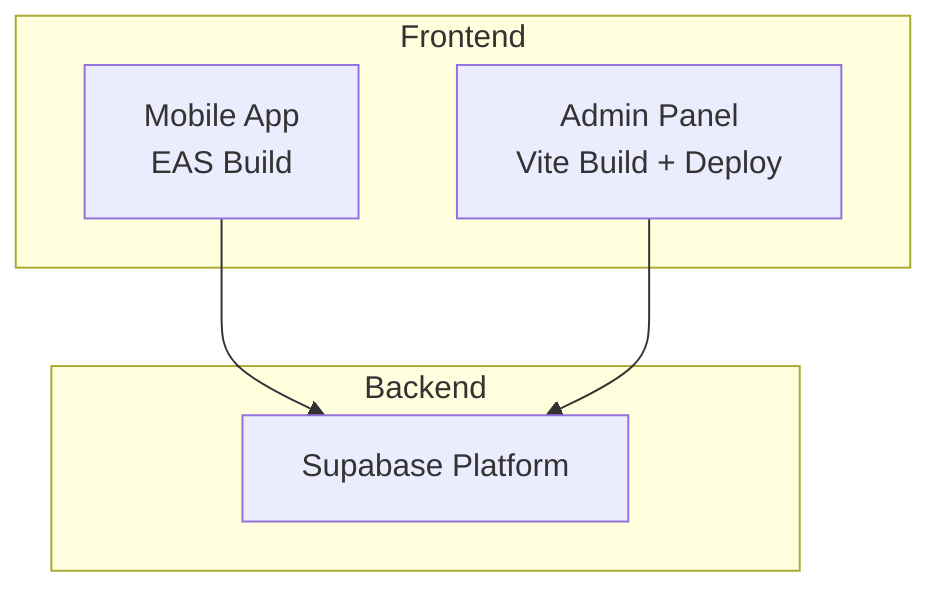

# Architecture Overview

<cite>
**Referenced Files in This Document**
- [README.md](file://README.md)
- [mobile/package.json](file://mobile/package.json)
- [admin/package.json](file://admin/package.json)
- [supabase/migrations/007_rls_policies.sql](file://supabase/migrations/007_rls_policies.sql)
- [mobile/src/api/supabase/client.ts](file://mobile/src/api/supabase/client.ts)
- [admin/src/lib/supabase.ts](file://admin/src/lib/supabase.ts)
- [mobile/src/stores/auth.store.ts](file://mobile/src/stores/auth.store.ts)
- [admin/src/store/authStore.ts](file://admin/src/store/authStore.ts)
- [admin/src/App.tsx](file://admin/src/App.tsx)
- [mobile/src/types/index.ts](file://mobile/src/types/index.ts)
- [admin/src/types/index.ts](file://admin/src/types/index.ts)
</cite>

## Table of Contents
1. [Introduction](#introduction)
2. [Project Structure](#project-structure)
3. [Core Components](#core-components)
4. [Architecture Overview](#architecture-overview)
5. [Detailed Component Analysis](#detailed-component-analysis)
6. [Dependency Analysis](#dependency-analysis)
7. [Performance Considerations](#performance-considerations)
8. [Security Architecture](#security-architecture)
9. [Deployment Topology](#deployment-topology)
10. [Troubleshooting Guide](#troubleshooting-guide)
11. [Conclusion](#conclusion)

## Introduction
This document presents the architectural design of Naliss UMYU Hub, a cross-platform system serving LIS students at UMYU. It covers the monorepo structure separating the React Native mobile application, React web admin panel, and the Supabase-powered backend. The system emphasizes a client-server architecture with Supabase providing PostgreSQL, authentication, real-time capabilities, and storage. State management leverages Zustand for client-side state and React Query for server state synchronization. Security is enforced through Row-Level Security (RLS) policies, while real-time communication is achieved via Supabase Realtime channels.

## Project Structure
Naliss UMYU Hub follows a monorepo layout with three primary workspaces:
- mobile/: React Native application for iOS and Android
- admin/: React web admin panel
- supabase/: SQL migrations defining the backend schema and policies

**Diagram sources**
- [README.md](file://README.md#L5-L14)

**Section sources**
- [README.md](file://README.md#L5-L14)

## Core Components
- Mobile Application (React Native + Expo)
  - Navigation: Expo Router
  - State: Zustand stores
  - Data: Supabase client with React Query integration
  - Offline support: SQLite
- Admin Panel (React + Vite)
  - Navigation: React Router
  - State: Zustand with persistence
  - Data: Supabase client
- Backend (Supabase)
  - Database: PostgreSQL with RLS
  - Auth: Email/password and Google OAuth
  - Realtime: Channels for messaging and presence
  - Storage: Buckets for avatars, materials, event covers, announcements, and message attachments

**Section sources**
- [README.md](file://README.md#L16-L38)
- [mobile/package.json](file://mobile/package.json#L11-L32)
- [admin/package.json](file://admin/package.json#L12-L26)

## Architecture Overview
The system employs a client-server architecture centered on Supabase:
- Clients (mobile and admin) connect to Supabase via dedicated clients configured with environment variables.
- Supabase enforces RLS policies at the database level.
- Realtime channels enable live messaging and presence updates.
- Storage buckets handle media and file sharing.

**Diagram sources**
- [mobile/src/api/supabase/client.ts](file://mobile/src/api/supabase/client.ts#L15-L27)
- [admin/src/lib/supabase.ts](file://admin/src/lib/supabase.ts#L10-L18)
- [supabase/migrations/007_rls_policies.sql](file://supabase/migrations/007_rls_policies.sql#L9-L38)

## Detailed Component Analysis

### Authentication Flow
Both clients subscribe to Supabase auth state changes and synchronize local state accordingly. The mobile app validates institutional email format during login attempts, while the admin panel restricts access to privileged roles.

**Diagram sources**
- [mobile/src/stores/auth.store.ts](file://mobile/src/stores/auth.store.ts#L63-L81)
- [admin/src/store/authStore.ts](file://admin/src/store/authStore.ts#L65-L82)

**Section sources**
- [mobile/src/stores/auth.store.ts](file://mobile/src/stores/auth.store.ts#L98-L134)
- [admin/src/store/authStore.ts](file://admin/src/store/authStore.ts#L94-L172)

### State Management Patterns
- Zustand Stores
  - Mobile: Centralized auth store managing session, user profile, permissions, and lifecycle actions.
  - Admin: Auth store with persisted session and role checks.
- React Query
  - Admin: Provides caching, background refetching, and optimistic updates for server state.

**Diagram sources**
- [admin/src/App.tsx](file://admin/src/App.tsx#L9-L17)
- [admin/src/store/authStore.ts](file://admin/src/store/authStore.ts#L38-L92)
- [mobile/src/stores/auth.store.ts](file://mobile/src/stores/auth.store.ts#L38-L96)

**Section sources**
- [admin/src/App.tsx](file://admin/src/App.tsx#L9-L17)
- [admin/src/store/authStore.ts](file://admin/src/store/authStore.ts#L26-L92)
- [mobile/src/stores/auth.store.ts](file://mobile/src/stores/auth.store.ts#L27-L96)

### Real-Time Communication
Supabase Realtime enables live messaging and presence. Both clients configure channel helpers and subscribe to relevant channels for conversations and presence updates.

**Diagram sources**
- [mobile/src/api/supabase/client.ts](file://mobile/src/api/supabase/client.ts#L30-L32)
- [mobile/src/api/supabase/client.ts](file://mobile/src/api/supabase/client.ts#L22-L26)

**Section sources**
- [mobile/src/api/supabase/client.ts](file://mobile/src/api/supabase/client.ts#L22-L32)

### Data Access and Storage
Both clients use a shared Supabase client configured with environment variables. They leverage storage buckets for media and documents, with helper functions for public URLs, signed URLs, upload, and deletion.

**Diagram sources**
- [mobile/src/api/supabase/client.ts](file://mobile/src/api/supabase/client.ts#L44-L87)
- [admin/src/lib/supabase.ts](file://admin/src/lib/supabase.ts#L30-L72)

**Section sources**
- [mobile/src/api/supabase/client.ts](file://mobile/src/api/supabase/client.ts#L35-L87)
- [admin/src/lib/supabase.ts](file://admin/src/lib/supabase.ts#L20-L72)

## Dependency Analysis
The client applications depend on Supabase for authentication, database access, real-time, and storage. The backend depends on RLS policies to enforce access control.

**Diagram sources**
- [mobile/src/api/supabase/client.ts](file://mobile/src/api/supabase/client.ts#L3)
- [admin/src/lib/supabase.ts](file://admin/src/lib/supabase.ts#L1)
- [supabase/migrations/007_rls_policies.sql](file://supabase/migrations/007_rls_policies.sql#L9-L38)

**Section sources**
- [mobile/src/api/supabase/client.ts](file://mobile/src/api/supabase/client.ts#L3-L27)
- [admin/src/lib/supabase.ts](file://admin/src/lib/supabase.ts#L1-L18)
- [supabase/migrations/007_rls_policies.sql](file://supabase/migrations/007_rls_policies.sql#L9-L38)

## Performance Considerations
- Caching and Background Refetching
  - Admin uses React Query with a default stale time and retry configuration to balance freshness and performance.
- Realtime Event Rate Limiting
  - Mobile sets an events-per-second limit for realtime channels to prevent overload.
- Storage Operations
  - Signed URLs reduce latency for private content delivery; ensure appropriate expiration windows.

**Section sources**
- [admin/src/App.tsx](file://admin/src/App.tsx#L9-L17)
- [mobile/src/api/supabase/client.ts](file://mobile/src/api/supabase/client.ts#L22-L26)

## Security Architecture
- Authentication
  - Email/password with institutional domain validation on the mobile client.
  - Optional Google OAuth provider configured in Supabase.
- Authorization
  - Role hierarchy: Student → Moderator → Super Admin → System Owner.
  - RLS policies define granular access controls across all tables.
- Data Protection
  - Storage buckets with policy-driven access.
  - Ban enforcement automatically revokes access for banned users.

**Diagram sources**
- [mobile/src/stores/auth.store.ts](file://mobile/src/stores/auth.store.ts#L218-L228)
- [supabase/migrations/007_rls_policies.sql](file://supabase/migrations/007_rls_policies.sql#L94-L122)

**Section sources**
- [mobile/src/stores/auth.store.ts](file://mobile/src/stores/auth.store.ts#L104-L107)
- [supabase/migrations/007_rls_policies.sql](file://supabase/migrations/007_rls_policies.sql#L9-L38)

## Deployment Topology
- Mobile
  - Build via EAS for Android and iOS; environment variables configured per platform.
- Admin
  - Build via Vite; deploy to hosting (e.g., Vercel) after production build.
- Backend
  - Supabase-managed PostgreSQL with configured RLS policies and storage buckets.

**Diagram sources**
- [README.md](file://README.md#L188-L215)

**Section sources**
- [README.md](file://README.md#L188-L215)

## Troubleshooting Guide
- Missing Environment Variables
  - Ensure Supabase URL and anonymous key are present in environment files for both mobile and admin.
- Auth Initialization Failures
  - Verify auth state change listeners and session retrieval logic.
- RLS Access Denied
  - Confirm user role and status; check RLS policy conditions for the target table.
- Realtime Channel Issues
  - Validate channel creation and event rate limits; ensure proper unsubscribe on component unmount.

**Section sources**
- [mobile/src/api/supabase/client.ts](file://mobile/src/api/supabase/client.ts#L9-L13)
- [admin/src/lib/supabase.ts](file://admin/src/lib/supabase.ts#L6-L8)
- [mobile/src/stores/auth.store.ts](file://mobile/src/stores/auth.store.ts#L38-L96)
- [admin/src/store/authStore.ts](file://admin/src/store/authStore.ts#L38-L92)

## Conclusion
Naliss UMYU Hub implements a cohesive, scalable architecture leveraging Supabase as the unified backend. The monorepo structure cleanly separates concerns across mobile, admin, and backend components. Client-side state management with Zustand and React Query ensures responsive UIs, while Supabase’s RLS and Realtime capabilities deliver robust security and real-time collaboration. The documented patterns and configurations provide a clear blueprint for development, deployment, and maintenance.