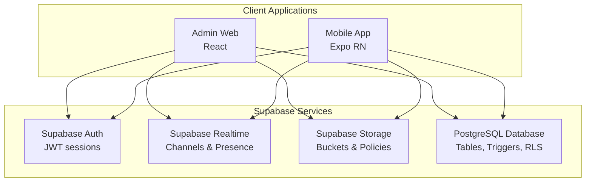
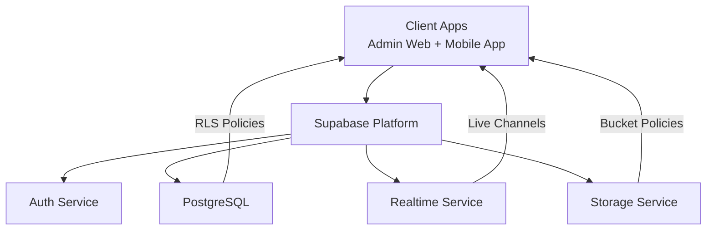
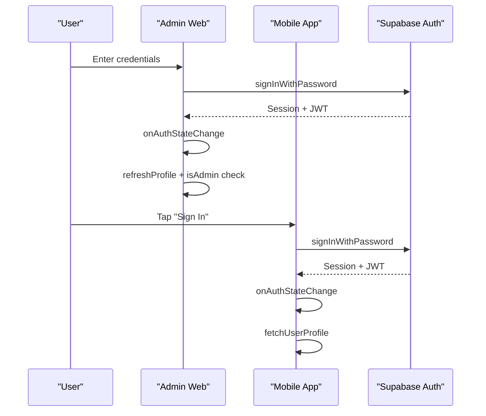
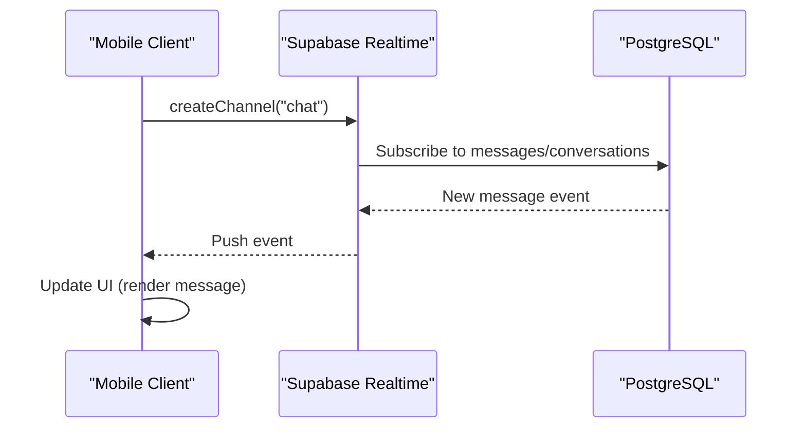
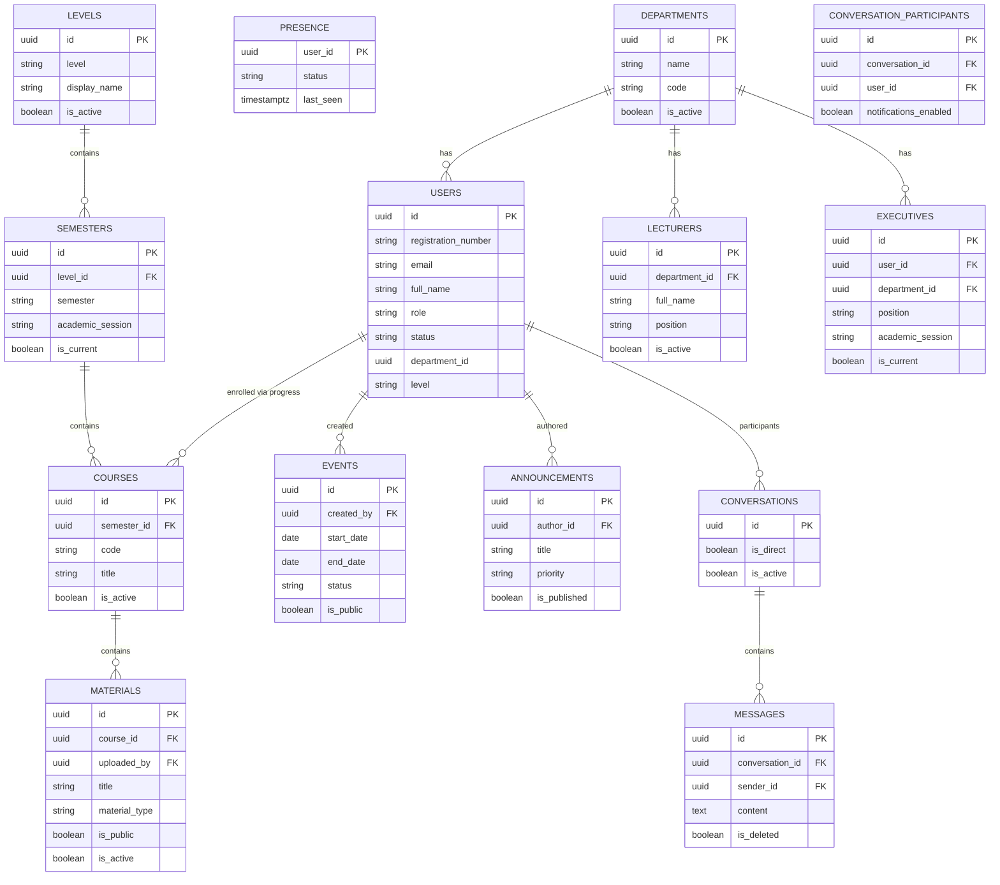
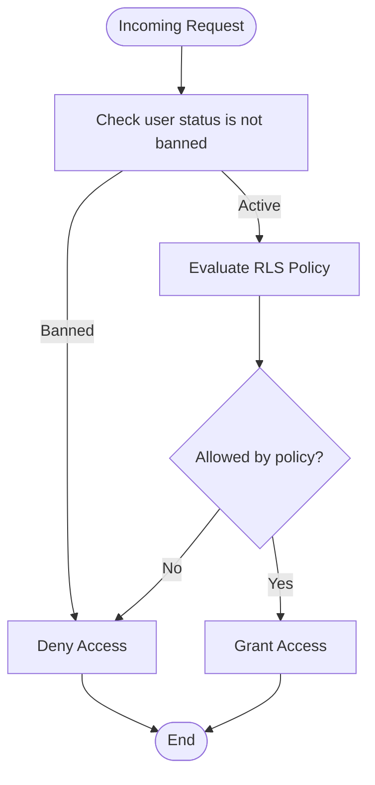
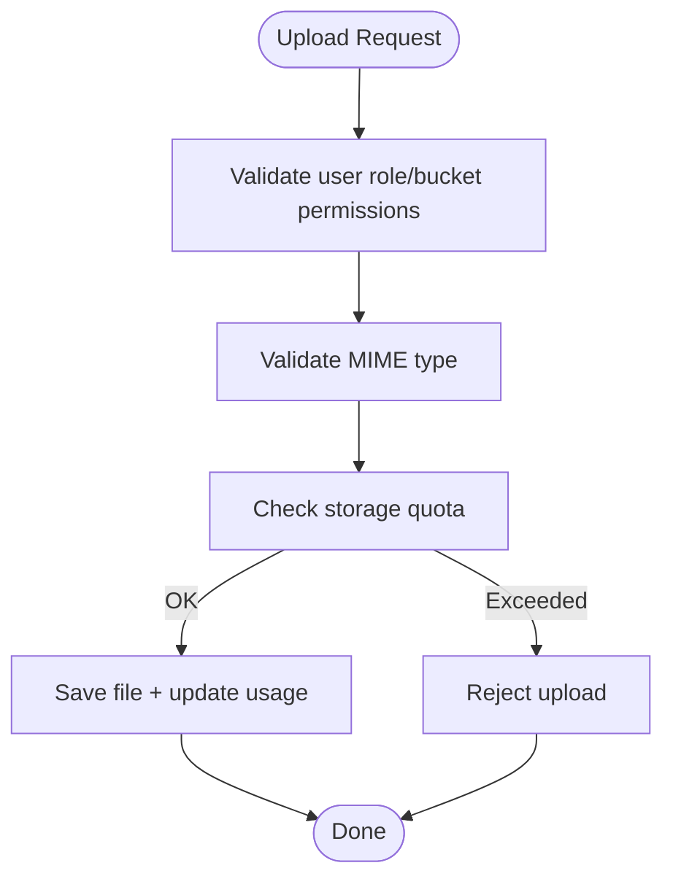
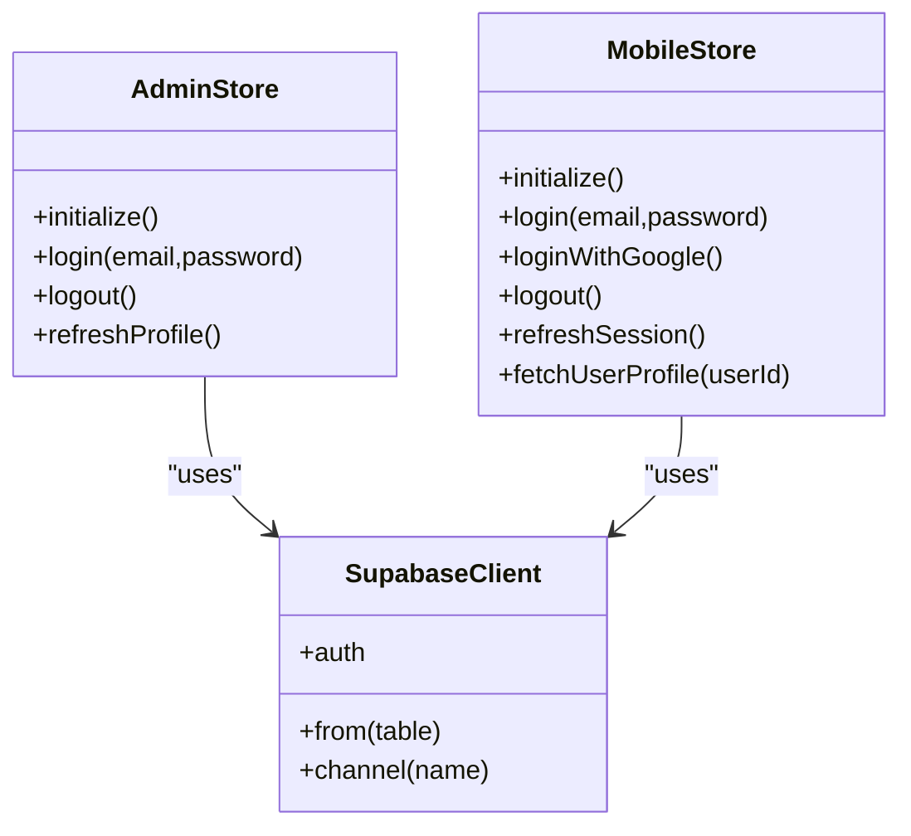
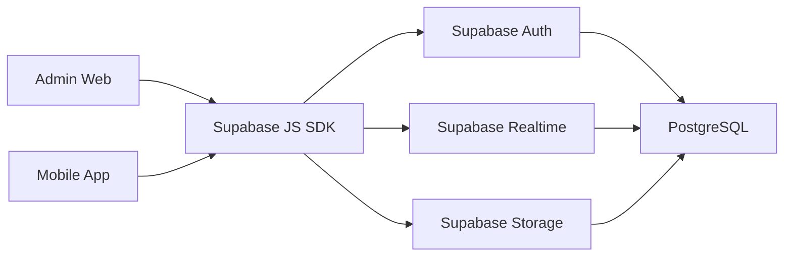

# Backend Architecture

<cite>
**Referenced Files in This Document**
- [001_enums.sql](file://supabase/migrations/001_enums.sql)
- [002_core_tables.sql](file://supabase/migrations/002_core_tables.sql)
- [003_lms_tables.sql](file://supabase/migrations/003_lms_tables.sql)
- [004_events_announcements.sql](file://supabase/migrations/004_events_announcements.sql)
- [005_messaging.sql](file://supabase/migrations/005_messaging.sql)
- [007_rls_policies.sql](file://supabase/migrations/007_rls_policies.sql)
- [008_governance_functions.sql](file://supabase/migrations/008_governance_functions.sql)
- [009_storage_policies.sql](file://supabase/migrations/009_storage_policies.sql)
- [supabase.ts](file://admin/src/lib/supabase.ts)
- [client.ts](file://mobile/src/api/supabase/client.ts)
- [authStore.ts (Admin)](file://admin/src/store/authStore.ts)
- [auth.store.ts (Mobile)](file://mobile/src/stores/auth.store.ts)
- [index.ts (Admin Types)](file://admin/src/types/index.ts)
- [index.ts (Mobile Types)](file://mobile/src/types/index.ts)
- [login.tsx (Mobile Auth)](file://mobile/app/(auth)/login.tsx)
- [LoginPage.tsx (Admin Auth)](file://admin/src/pages/LoginPage.tsx)
</cite>

## Table of Contents
1. [Introduction](#introduction)
2. [Project Structure](#project-structure)
3. [Core Components](#core-components)
4. [Architecture Overview](#architecture-overview)
5. [Detailed Component Analysis](#detailed-component-analysis)
6. [Dependency Analysis](#dependency-analysis)
7. [Performance Considerations](#performance-considerations)
8. [Troubleshooting Guide](#troubleshooting-guide)
9. [Conclusion](#conclusion)
10. [Appendices](#appendices)

## Introduction
This document describes the backend architecture of Naliss UMYU Hub, powered by Supabase. The system leverages a serverless PostgreSQL backend with Supabase Auth, Realtime, and Storage to deliver a modern, scalable platform for students, lecturers, and administrators. It supports:
- Authentication and session management with JWT tokens
- Real-time messaging and presence
- Rich LMS content management (courses, materials, progress)
- Events and announcements with targeted distribution
- Comprehensive Row-Level Security (RLS) policies
- Secure file storage with bucket-level policies and quotas
- Microservices-like separation of concerns across client applications (Admin Web and Mobile App)

## Project Structure
The repository is organized into three main areas:
- admin: React-based admin web application integrating with Supabase
- mobile: Expo/React Native mobile application with Supabase client and real-time
- supabase: SQL migrations defining database schema, enums, triggers, RLS, and storage policies

**Diagram sources**
- [supabase.ts](file://admin/src/lib/supabase.ts#L1-L73)
- [client.ts](file://mobile/src/api/supabase/client.ts#L1-L87)

**Section sources**
- [supabase.ts](file://admin/src/lib/supabase.ts#L1-L73)
- [client.ts](file://mobile/src/api/supabase/client.ts#L1-L87)

## Core Components
- Supabase Auth: Manages user sessions, JWT tokens, OAuth providers, and session persistence. Both clients configure auto-refresh and persisted sessions.
- Supabase Realtime: Enables real-time messaging, presence, and live updates via channels. The database publication is extended to include messaging and announcements.
- Supabase Storage: Provides secure file buckets with granular policies for avatars, materials, event covers, announcements, and message attachments. Includes quotas and usage tracking.
- Database Schema: A comprehensive relational model covering users, departments, lecturers, executives, LMS (levels, semesters, courses, materials), events, announcements, and messaging. Triggers maintain audit timestamps and derived metrics.

**Section sources**
- [001_enums.sql](file://supabase/migrations/001_enums.sql#L1-L167)
- [002_core_tables.sql](file://supabase/migrations/002_core_tables.sql#L1-L252)
- [003_lms_tables.sql](file://supabase/migrations/003_lms_tables.sql#L1-L262)
- [004_events_announcements.sql](file://supabase/migrations/004_events_announcements.sql#L1-L262)
- [005_messaging.sql](file://supabase/migrations/005_messaging.sql#L1-L321)
- [007_rls_policies.sql](file://supabase/migrations/007_rls_policies.sql#L1-L510)
- [009_storage_policies.sql](file://supabase/migrations/009_storage_policies.sql#L1-L402)

## Architecture Overview
The backend follows a serverless Supabase architecture with:
- Auth: Centralized identity and session management
- Database: Relational model with RLS and triggers
- Realtime: Live chat, typing indicators, presence, and event feeds
- Storage: Secure, policy-enforced file access with quotas

**Diagram sources**
- [supabase.ts](file://admin/src/lib/supabase.ts#L1-L73)
- [client.ts](file://mobile/src/api/supabase/client.ts#L1-L87)
- [007_rls_policies.sql](file://supabase/migrations/007_rls_policies.sql#L1-L510)
- [009_storage_policies.sql](file://supabase/migrations/009_storage_policies.sql#L1-L402)

## Detailed Component Analysis

### Authentication and Session Management
- Admin Web: Initializes Supabase client with auto-refresh and persisted sessions. Uses a Zustand store to manage auth state, listen to auth state changes, and enforce admin-only access.
- Mobile App: Similar initialization with AsyncStorage for session persistence and a dedicated auth store for login, OAuth, profile fetch, and logout.
- Both apps validate institutional email formats and handle errors gracefully.

**Diagram sources**
- [authStore.ts (Admin)](file://admin/src/store/authStore.ts#L38-L92)
- [auth.store.ts (Mobile)](file://mobile/src/stores/auth.store.ts#L98-L134)
- [LoginPage.tsx (Admin Auth)](file://admin/src/pages/LoginPage.tsx#L19-L32)
- [login.tsx (Mobile Auth)](file://mobile/app/(auth)/login.tsx#L25-L41)

**Section sources**
- [supabase.ts](file://admin/src/lib/supabase.ts#L1-L73)
- [client.ts](file://mobile/src/api/supabase/client.ts#L1-L87)
- [authStore.ts (Admin)](file://admin/src/store/authStore.ts#L38-L92)
- [auth.store.ts (Mobile)](file://mobile/src/stores/auth.store.ts#L98-L134)
- [LoginPage.tsx (Admin Auth)](file://admin/src/pages/LoginPage.tsx#L19-L32)
- [login.tsx (Mobile Auth)](file://mobile/app/(auth)/login.tsx#L25-L41)

### Real-Time Messaging and Presence
- Database: Messaging tables (conversations, participants, messages) and presence tracking are enabled for real-time subscriptions.
- Supabase: Realtime publication is extended to include messaging and announcements tables.
- Clients: Mobile app exposes a channel helper and configures events-per-second limits.

**Diagram sources**
- [client.ts](file://mobile/src/api/supabase/client.ts#L29-L32)
- [008_governance_functions.sql](file://supabase/migrations/008_governance_functions.sql#L498-L510)
- [005_messaging.sql](file://supabase/migrations/005_messaging.sql#L1-L321)

**Section sources**
- [client.ts](file://mobile/src/api/supabase/client.ts#L29-L32)
- [008_governance_functions.sql](file://supabase/migrations/008_governance_functions.sql#L498-L510)
- [005_messaging.sql](file://supabase/migrations/005_messaging.sql#L1-L321)

### Database Design Principles and Relationships
- Enums: Centralized domain types for roles, statuses, academic levels, material types, priorities, and log actions.
- Core Entities: Users, Departments, Lecturers, Executives, Presence.
- LMS: Levels, Semesters, Courses, Materials, User Progress, Bookmarks.
- Events and Announcements: Lifecycle tracking, targeting, scheduling, and engagement.
- Messaging: Conversations, Participants, Messages, Read receipts, Typing indicators, Muted users, Reports, Profanity filters.
- Triggers: Automatic updated_at timestamps and derived metrics (view counts, attendee counts).

**Diagram sources**
- [001_enums.sql](file://supabase/migrations/001_enums.sql#L1-L167)
- [002_core_tables.sql](file://supabase/migrations/002_core_tables.sql#L1-L252)
- [003_lms_tables.sql](file://supabase/migrations/003_lms_tables.sql#L1-L262)
- [004_events_announcements.sql](file://supabase/migrations/004_events_announcements.sql#L1-L262)
- [005_messaging.sql](file://supabase/migrations/005_messaging.sql#L1-L321)

**Section sources**
- [001_enums.sql](file://supabase/migrations/001_enums.sql#L1-L167)
- [002_core_tables.sql](file://supabase/migrations/002_core_tables.sql#L1-L252)
- [003_lms_tables.sql](file://supabase/migrations/003_lms_tables.sql#L1-L262)
- [004_events_announcements.sql](file://supabase/migrations/004_events_announcements.sql#L1-L262)
- [005_messaging.sql](file://supabase/migrations/005_messaging.sql#L1-L321)

### Row-Level Security (RLS) Policies
- RLS is enabled on all tables. Helper functions provide role checks, admin detection, and department scoping.
- Policies define who can read/write/update/delete across users, departments, lecturers, executives, LMS, events, announcements, messaging, presence, and storage-related tables.
- Examples include “users_read_own”, “admins_read_all”, “materials_read” (public), “materials_read_own”, “events_read_public”, “messages_read” (per conversation), and storage policies per bucket.

**Diagram sources**
- [007_rls_policies.sql](file://supabase/migrations/007_rls_policies.sql#L43-L88)
- [007_rls_policies.sql](file://supabase/migrations/007_rls_policies.sql#L94-L122)
- [007_rls_policies.sql](file://supabase/migrations/007_rls_policies.sql#L193-L209)

**Section sources**
- [007_rls_policies.sql](file://supabase/migrations/007_rls_policies.sql#L1-L510)

### Storage Policies and Quotas
- Buckets: avatars, materials, event-covers, announcement-media, message-attachments.
- Policies: per-bucket rules for upload/update/read/delete, scoped by user role or ownership.
- Quotas and usage: storage_usage table tracks per-user, per-bucket usage; helper functions validate file types and enforce quotas.

**Diagram sources**
- [009_storage_policies.sql](file://supabase/migrations/009_storage_policies.sql#L26-L101)
- [009_storage_policies.sql](file://supabase/migrations/009_storage_policies.sql#L326-L401)

**Section sources**
- [009_storage_policies.sql](file://supabase/migrations/009_storage_policies.sql#L1-L402)

### API Abstraction Layers and Client Integration
- Admin Web: Supabase client initialized with auto-refresh and persisted sessions; storage helpers for public URLs, signed URLs, upload, and delete.
- Mobile App: Supabase client with AsyncStorage, real-time events-per-second tuning, and storage helpers; auth store manages login, OAuth, session refresh, and profile fetch.

**Diagram sources**
- [supabase.ts](file://admin/src/lib/supabase.ts#L1-L73)
- [client.ts](file://mobile/src/api/supabase/client.ts#L1-L87)
- [authStore.ts (Admin)](file://admin/src/store/authStore.ts#L26-L92)
- [auth.store.ts (Mobile)](file://mobile/src/stores/auth.store.ts#L27-L96)

**Section sources**
- [supabase.ts](file://admin/src/lib/supabase.ts#L1-L73)
- [client.ts](file://mobile/src/api/supabase/client.ts#L1-L87)
- [authStore.ts (Admin)](file://admin/src/store/authStore.ts#L26-L92)
- [auth.store.ts (Mobile)](file://mobile/src/stores/auth.store.ts#L27-L96)

### Error Handling Strategies
- Client stores capture and surface errors during auth operations, profile fetches, and updates.
- Mobile app validates institutional email format and displays user-friendly alerts.
- Admin app simulates demo mode when Supabase is not configured, logging and proceeding without backend.

**Section sources**
- [authStore.ts (Admin)](file://admin/src/store/authStore.ts#L85-L91)
- [auth.store.ts (Mobile)](file://mobile/src/stores/auth.store.ts#L104-L107)
- [login.tsx (Mobile Auth)](file://mobile/app/(auth)/login.tsx#L26-L28)

### Offline-First and Data Synchronization Patterns
- Persistence: Admin uses persisted sessions; Mobile uses AsyncStorage for session persistence.
- Auto-refresh: Both clients enable autoRefreshToken to keep sessions valid.
- Real-time: Mobile configures eventsPerSecond for controlled event throughput; clients subscribe to channels for live updates.
- Note: The codebase does not implement explicit local caching or conflict resolution; sessions and real-time updates are the primary synchronization mechanisms.

**Section sources**
- [supabase.ts](file://admin/src/lib/supabase.ts#L10-L18)
- [client.ts](file://mobile/src/api/supabase/client.ts#L15-L27)

### Security Architecture, Encryption, and Access Control
- Transport: Supabase enforces HTTPS; client SDKs connect securely.
- Tokens: JWT-based sessions with refresh tokens; clients auto-refresh and persist sessions.
- Access control: RLS policies govern row-level visibility and manipulation; storage policies govern bucket-level access.
- Roles and permissions: Defined via enums and helper functions; role comparisons enforce hierarchical access.
- Audit: Activity logs track significant actions.

**Section sources**
- [007_rls_policies.sql](file://supabase/migrations/007_rls_policies.sql#L43-L88)
- [009_storage_policies.sql](file://supabase/migrations/009_storage_policies.sql#L26-L53)
- [index.ts (Admin Types)](file://admin/src/types/index.ts#L185-L191)
- [index.ts (Mobile Types)](file://mobile/src/types/index.ts#L449-L456)

### Microservices-Like Backend Services
- Supabase Auth acts as an identity service.
- Supabase Realtime acts as a pub/sub service for live features.
- Supabase Storage acts as a file service with bucket policies.
- Database encapsulates business logic via RLS, triggers, and functions.

**Section sources**
- [007_rls_policies.sql](file://supabase/migrations/007_rls_policies.sql#L1-L510)
- [009_storage_policies.sql](file://supabase/migrations/009_storage_policies.sql#L1-L402)
- [008_governance_functions.sql](file://supabase/migrations/008_governance_functions.sql#L498-L510)

## Dependency Analysis
- Client-to-Supabase: Admin and Mobile clients depend on Supabase SDKs for Auth, Realtime, and Storage.
- Supabase-to-Database: All client operations route through Supabase, which enforces RLS and invokes database functions/triggers.
- Cross-cutting concerns: Enums and helper functions unify domain semantics and role comparisons across clients and database.

**Diagram sources**
- [supabase.ts](file://admin/src/lib/supabase.ts#L1-L73)
- [client.ts](file://mobile/src/api/supabase/client.ts#L1-L87)

**Section sources**
- [supabase.ts](file://admin/src/lib/supabase.ts#L1-L73)
- [client.ts](file://mobile/src/api/supabase/client.ts#L1-L87)

## Performance Considerations
- Realtime eventsPerSecond: Mobile sets a conservative rate to balance responsiveness and bandwidth.
- Indexes: Strategic indexes on foreign keys, status, dates, and full-text search improve query performance.
- Triggers: Automatic updated_at and derived metrics reduce application-level overhead.
- Storage quotas: Enforce usage caps to prevent runaway growth.

[No sources needed since this section provides general guidance]

## Troubleshooting Guide
- Missing environment variables: Both clients throw errors if Supabase URL or anon key are missing.
- Auth state changes: Stores listen for sign-in/sign-out/token refresh to keep UI and state synchronized.
- Institutional email validation: Mobile rejects non-institutional emails early.
- Banned accounts: On profile fetch, if a user is banned, the session is terminated and an error is surfaced.

**Section sources**
- [client.ts](file://mobile/src/api/supabase/client.ts#L9-L13)
- [auth.store.ts (Mobile)](file://mobile/src/stores/auth.store.ts#L104-L107)
- [auth.store.ts (Mobile)](file://mobile/src/stores/auth.store.ts#L217-L228)

## Conclusion
Naliss UMYU Hub’s backend leverages Supabase to provide a robust, serverless foundation. With RLS-driven access control, real-time messaging, secure storage, and a clean separation of concerns across client apps, the system scales efficiently while maintaining strong security and usability. The documented patterns enable consistent development and predictable maintenance across the Admin Web and Mobile App.

## Appendices
- Role and permission mapping for access control decisions
- Enum definitions for consistent domain modeling
- Storage bucket naming and policy references

**Section sources**
- [index.ts (Admin Types)](file://admin/src/types/index.ts#L185-L224)
- [index.ts (Mobile Types)](file://mobile/src/types/index.ts#L409-L447)
- [001_enums.sql](file://supabase/migrations/001_enums.sql#L1-L167)
- [009_storage_policies.sql](file://supabase/migrations/009_storage_policies.sql#L12-L20)