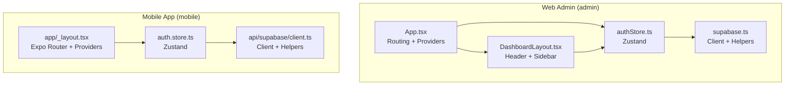
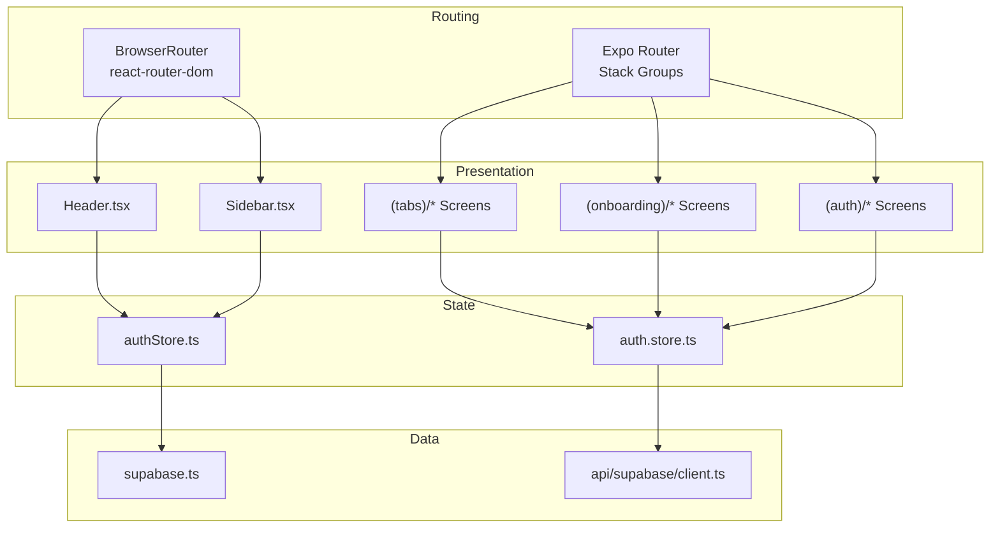
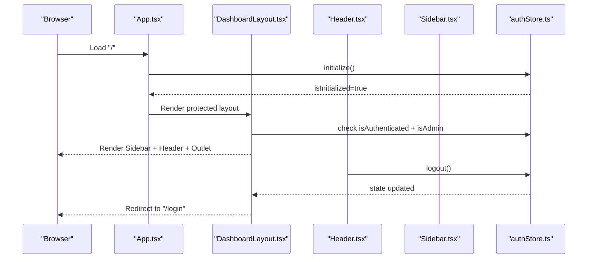
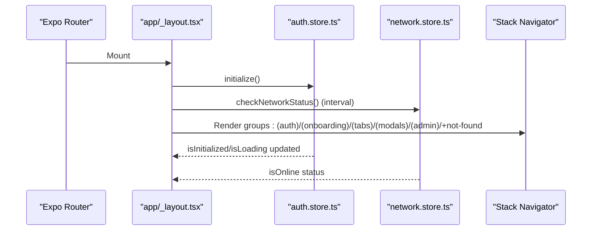
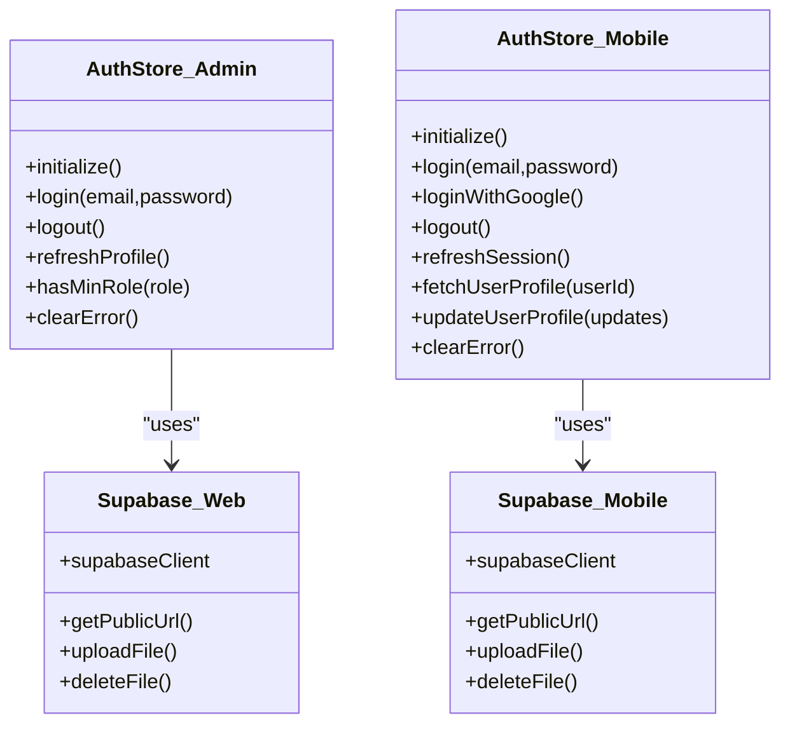
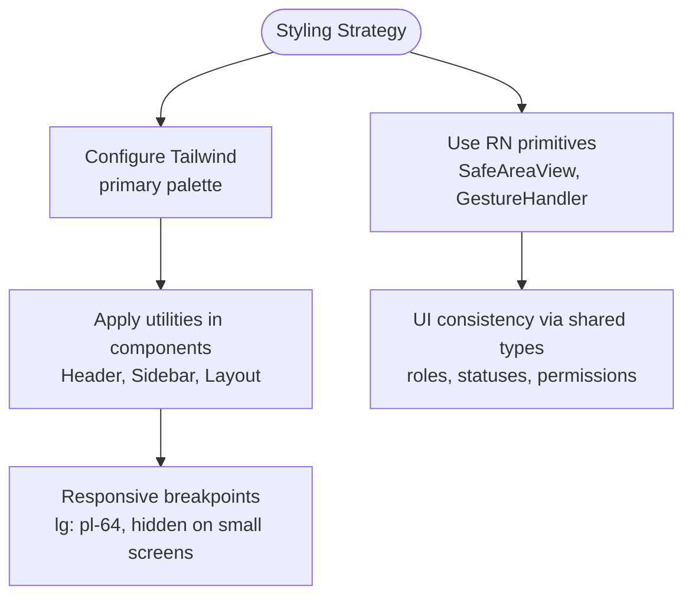
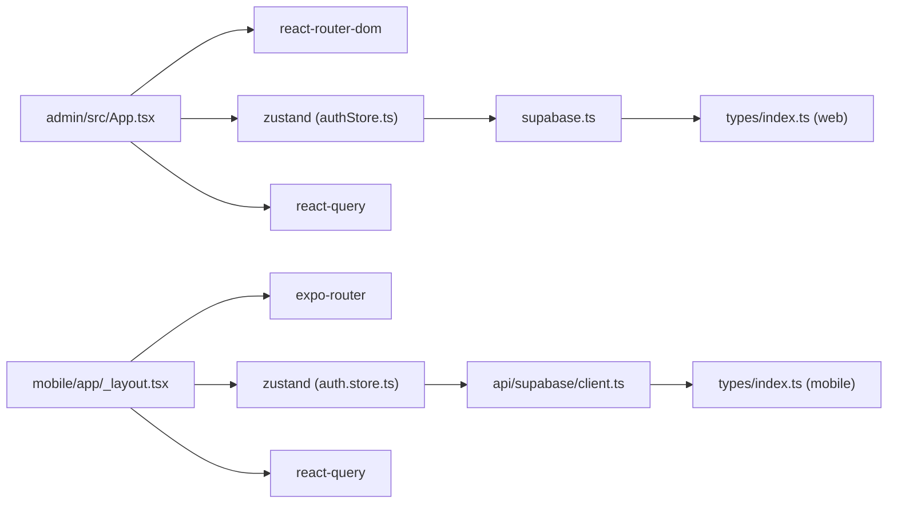

# Frontend Architecture

<cite>
**Referenced Files in This Document**
- [admin/package.json](file://admin/package.json)
- [mobile/package.json](file://mobile/package.json)
- [admin/src/App.tsx](file://admin/src/App.tsx)
- [mobile/app/_layout.tsx](file://mobile/app/_layout.tsx)
- [admin/src/store/authStore.ts](file://admin/src/store/authStore.ts)
- [mobile/src/stores/auth.store.ts](file://mobile/src/stores/auth.store.ts)
- [admin/src/components/layout/DashboardLayout.tsx](file://admin/src/components/layout/DashboardLayout.tsx)
- [admin/src/components/layout/Header.tsx](file://admin/src/components/layout/Header.tsx)
- [admin/src/components/layout/Sidebar.tsx](file://admin/src/components/layout/Sidebar.tsx)
- [admin/src/lib/supabase.ts](file://admin/src/lib/supabase.ts)
- [mobile/src/api/supabase/client.ts](file://mobile/src/api/supabase/client.ts)
- [admin/tailwind.config.js](file://admin/tailwind.config.js)
- [admin/src/types/index.ts](file://admin/src/types/index.ts)
- [mobile/src/types/index.ts](file://mobile/src/types/index.ts)
</cite>

## Table of Contents
1. [Introduction](#introduction)
2. [Project Structure](#project-structure)
3. [Core Components](#core-components)
4. [Architecture Overview](#architecture-overview)
5. [Detailed Component Analysis](#detailed-component-analysis)
6. [Dependency Analysis](#dependency-analysis)
7. [Performance Considerations](#performance-considerations)
8. [Troubleshooting Guide](#troubleshooting-guide)
9. [Conclusion](#conclusion)

## Introduction
This document describes the frontend architecture of Naliss UMYU Hub, focusing on the dual-application design with a React web admin dashboard and a React Native mobile application. It explains routing strategies, layout systems, shared design tokens via Tailwind CSS, component composition patterns, state management with Zustand stores, and cross-platform UI consistency. It also covers separation of concerns, reusability, responsive design, and performance optimization strategies grounded in the repository’s code.

## Project Structure
The project is organized into two distinct frontend applications:
- Web Admin Dashboard (React + Vite): Located under admin/
- Mobile Application (React Native + Expo Router): Located under mobile/

Each application maintains its own package.json, routing configuration, stores, and UI components. They share domain types and Supabase client utilities to maintain consistency across platforms.

**Diagram sources**
- [admin/src/App.tsx](file://admin/src/App.tsx#L1-L64)
- [admin/src/components/layout/DashboardLayout.tsx](file://admin/src/components/layout/DashboardLayout.tsx#L1-L38)
- [admin/src/store/authStore.ts](file://admin/src/store/authStore.ts#L1-L228)
- [admin/src/lib/supabase.ts](file://admin/src/lib/supabase.ts#L1-L73)
- [mobile/app/_layout.tsx](file://mobile/app/_layout.tsx#L1-L95)
- [mobile/src/stores/auth.store.ts](file://mobile/src/stores/auth.store.ts#L1-L302)
- [mobile/src/api/supabase/client.ts](file://mobile/src/api/supabase/client.ts#L1-L87)

**Section sources**
- [admin/package.json](file://admin/package.json#L1-L43)
- [mobile/package.json](file://mobile/package.json#L1-L40)

## Core Components
- Routing and Navigation
  - Web Admin uses React Router DOM with nested routes and a protected layout wrapper.
  - Mobile uses Expo Router with named route groups for auth, onboarding, tabs, modals, admin, and not-found screens.
- State Management
  - Both apps use Zustand for centralized state with persistence where applicable.
  - Authentication stores encapsulate initialization, login/logout, session refresh, and profile retrieval.
- Data Access
  - Supabase clients are configured per platform with environment-driven keys and storage helpers for uploads and URLs.
- UI and Layout
  - Web Admin provides a sidebar and header with role-aware navigation and Tailwind-based styling.
  - Mobile uses a root Stack layout with providers for gesture handling, safe areas, and React Query.

**Section sources**
- [admin/src/App.tsx](file://admin/src/App.tsx#L1-L64)
- [mobile/app/_layout.tsx](file://mobile/app/_layout.tsx#L1-L95)
- [admin/src/store/authStore.ts](file://admin/src/store/authStore.ts#L1-L228)
- [mobile/src/stores/auth.store.ts](file://mobile/src/stores/auth.store.ts#L1-L302)
- [admin/src/lib/supabase.ts](file://admin/src/lib/supabase.ts#L1-L73)
- [mobile/src/api/supabase/client.ts](file://mobile/src/api/supabase/client.ts#L1-L87)
- [admin/src/components/layout/DashboardLayout.tsx](file://admin/src/components/layout/DashboardLayout.tsx#L1-L38)
- [admin/src/components/layout/Header.tsx](file://admin/src/components/layout/Header.tsx#L1-L105)
- [admin/src/components/layout/Sidebar.tsx](file://admin/src/components/layout/Sidebar.tsx#L1-L172)

## Architecture Overview
The architecture separates concerns across layers:
- Presentation Layer: React components for web and React Native screens for mobile.
- Routing Layer: React Router DOM for web, Expo Router for mobile.
- State Layer: Zustand stores for auth and UI/network state.
- Data Layer: Supabase client utilities for authentication, real-time, storage, and database operations.
- Shared Types: Domain models and permissions defined in shared type files.

**Diagram sources**
- [admin/src/App.tsx](file://admin/src/App.tsx#L1-L64)
- [admin/src/components/layout/Header.tsx](file://admin/src/components/layout/Header.tsx#L1-L105)
- [admin/src/components/layout/Sidebar.tsx](file://admin/src/components/layout/Sidebar.tsx#L1-L172)
- [mobile/app/_layout.tsx](file://mobile/app/_layout.tsx#L1-L95)
- [admin/src/store/authStore.ts](file://admin/src/store/authStore.ts#L1-L228)
- [mobile/src/stores/auth.store.ts](file://mobile/src/stores/auth.store.ts#L1-L302)
- [admin/src/lib/supabase.ts](file://admin/src/lib/supabase.ts#L1-L73)
- [mobile/src/api/supabase/client.ts](file://mobile/src/api/supabase/client.ts#L1-L87)

## Detailed Component Analysis

### Web Admin Routing and Layout
- App initializes React Query and wraps routes with a provider. It defines public and protected routes, with a DashboardLayout protecting admin pages.
- DashboardLayout enforces authentication and admin role checks, renders Sidebar and Header, and injects page content via Outlet.
- Sidebar supports responsive collapsing, role-aware visibility, and active-state highlighting.
- Header manages notifications and user dropdown actions including logout.

**Diagram sources**
- [admin/src/App.tsx](file://admin/src/App.tsx#L1-L64)
- [admin/src/components/layout/DashboardLayout.tsx](file://admin/src/components/layout/DashboardLayout.tsx#L1-L38)
- [admin/src/components/layout/Header.tsx](file://admin/src/components/layout/Header.tsx#L1-L105)
- [admin/src/components/layout/Sidebar.tsx](file://admin/src/components/layout/Sidebar.tsx#L1-L172)
- [admin/src/store/authStore.ts](file://admin/src/store/authStore.ts#L1-L228)

**Section sources**
- [admin/src/App.tsx](file://admin/src/App.tsx#L1-L64)
- [admin/src/components/layout/DashboardLayout.tsx](file://admin/src/components/layout/DashboardLayout.tsx#L1-L38)
- [admin/src/components/layout/Header.tsx](file://admin/src/components/layout/Header.tsx#L1-L105)
- [admin/src/components/layout/Sidebar.tsx](file://admin/src/components/layout/Sidebar.tsx#L1-L172)

### Mobile App Routing and Layout
- Root layout configures React Query, SafeAreaProvider, GestureHandlerRootView, and a Stack navigator with named groups for auth, onboarding, tabs, modals, admin, and not-found.
- Auth initialization runs on mount; periodic network checks keep connectivity awareness.
- Modal presentations and tab-based navigation are declared centrally for discoverability and consistency.

**Diagram sources**
- [mobile/app/_layout.tsx](file://mobile/app/_layout.tsx#L1-L95)
- [mobile/src/stores/auth.store.ts](file://mobile/src/stores/auth.store.ts#L1-L302)

**Section sources**
- [mobile/app/_layout.tsx](file://mobile/app/_layout.tsx#L1-L95)

### Authentication Stores and Cross-Platform Consistency
- Web Admin store:
  - Initializes session, listens to auth state changes, supports login/logout, profile refresh, and role checks.
  - Provides selectors for user, admin status, and minimum role checks.
- Mobile store:
  - Mirrors initialization and auth state handling, adds Google OAuth support and institutional email validation.
  - Includes permission checks and role-level comparisons.
- Shared types:
  - Both projects define User, roles, statuses, and permissions to ensure consistent domain modeling.

**Diagram sources**
- [admin/src/store/authStore.ts](file://admin/src/store/authStore.ts#L1-L228)
- [mobile/src/stores/auth.store.ts](file://mobile/src/stores/auth.store.ts#L1-L302)
- [admin/src/lib/supabase.ts](file://admin/src/lib/supabase.ts#L1-L73)
- [mobile/src/api/supabase/client.ts](file://mobile/src/api/supabase/client.ts#L1-L87)

**Section sources**
- [admin/src/store/authStore.ts](file://admin/src/store/authStore.ts#L1-L228)
- [mobile/src/stores/auth.store.ts](file://mobile/src/stores/auth.store.ts#L1-L302)
- [admin/src/types/index.ts](file://admin/src/types/index.ts#L1-L224)
- [mobile/src/types/index.ts](file://mobile/src/types/index.ts#L1-L456)

### Design System and Styling Architecture
- Tailwind CSS is configured in the web admin project with a custom primary palette and content scanning for tree-shaking.
- Web components leverage Tailwind utilities for responsive spacing, colors, and interactive states.
- Mobile relies on React Native primitives and platform-specific providers; Tailwind is not used on mobile.

**Diagram sources**
- [admin/tailwind.config.js](file://admin/tailwind.config.js#L1-L27)
- [admin/src/components/layout/Header.tsx](file://admin/src/components/layout/Header.tsx#L1-L105)
- [admin/src/components/layout/Sidebar.tsx](file://admin/src/components/layout/Sidebar.tsx#L1-L172)
- [mobile/app/_layout.tsx](file://mobile/app/_layout.tsx#L1-L95)

**Section sources**
- [admin/tailwind.config.js](file://admin/tailwind.config.js#L1-L27)
- [admin/src/components/layout/Header.tsx](file://admin/src/components/layout/Header.tsx#L1-L105)
- [admin/src/components/layout/Sidebar.tsx](file://admin/src/components/layout/Sidebar.tsx#L1-L172)

## Dependency Analysis
- Web Admin depends on react-router-dom for routing, Zustand for state, and TanStack React Query for caching.
- Mobile depends on expo-router for navigation, Zustand for state, and TanStack React Query for caching.
- Both applications depend on Supabase for auth, real-time, and storage, with environment variables controlling client configuration.
- Shared domain types ensure consistent role and permission semantics across platforms.

**Diagram sources**
- [admin/src/App.tsx](file://admin/src/App.tsx#L1-L64)
- [mobile/app/_layout.tsx](file://mobile/app/_layout.tsx#L1-L95)
- [admin/src/store/authStore.ts](file://admin/src/store/authStore.ts#L1-L228)
- [mobile/src/stores/auth.store.ts](file://mobile/src/stores/auth.store.ts#L1-L302)
- [admin/src/lib/supabase.ts](file://admin/src/lib/supabase.ts#L1-L73)
- [mobile/src/api/supabase/client.ts](file://mobile/src/api/supabase/client.ts#L1-L87)
- [admin/src/types/index.ts](file://admin/src/types/index.ts#L1-L224)
- [mobile/src/types/index.ts](file://mobile/src/types/index.ts#L1-L456)

**Section sources**
- [admin/package.json](file://admin/package.json#L1-L43)
- [mobile/package.json](file://mobile/package.json#L1-L40)

## Performance Considerations
- Caching and Refetching
  - React Query default options set staleTime and retry policies to balance freshness and performance.
  - Mobile sets refetchOnWindowFocus and refetchOnReconnect to keep data fresh on mobile networks.
- Persistence
  - Web Admin persists only session data in auth store to reduce unnecessary writes.
- Network Awareness
  - Mobile checks connectivity periodically and exposes online/offline state for UI feedback.
- Bundle Size and Tree Shaking
  - Tailwind content scanning ensures unused CSS is removed.
- Rendering
  - Web layout collapses sidebar on small screens and hides labels to save space.
  - Mobile uses Stack navigator groups to lazily load screens and avoid heavy initial render.

[No sources needed since this section provides general guidance]

## Troubleshooting Guide
- Authentication Initialization
  - If the app appears stuck on loading, verify environment variables for Supabase keys and ensure the auth store completes initialization.
- Role-Based Access
  - If navigation items are missing, confirm the user’s role and the minimum role required for each route.
- Network Issues (Mobile)
  - If offline, verify periodic network checks and ensure the network store is active.
- Supabase Client Configuration
  - Confirm environment variables are present and the client is initialized with appropriate auth storage and realtime settings.

**Section sources**
- [admin/src/store/authStore.ts](file://admin/src/store/authStore.ts#L1-L228)
- [mobile/src/stores/auth.store.ts](file://mobile/src/stores/auth.store.ts#L1-L302)
- [admin/src/lib/supabase.ts](file://admin/src/lib/supabase.ts#L1-L73)
- [mobile/src/api/supabase/client.ts](file://mobile/src/api/supabase/client.ts#L1-L87)

## Conclusion
Naliss UMYU Hub employs a clean dual-application architecture with React Router DOM for the web admin and Expo Router for the mobile app. Shared domain types and Supabase clients ensure consistent data access and role semantics across platforms. Zustand stores centralize authentication and UI state, while Tailwind CSS provides a cohesive design system on the web. The routing and layout systems enforce separation of concerns, promote component reusability, and deliver responsive experiences tailored to each platform.