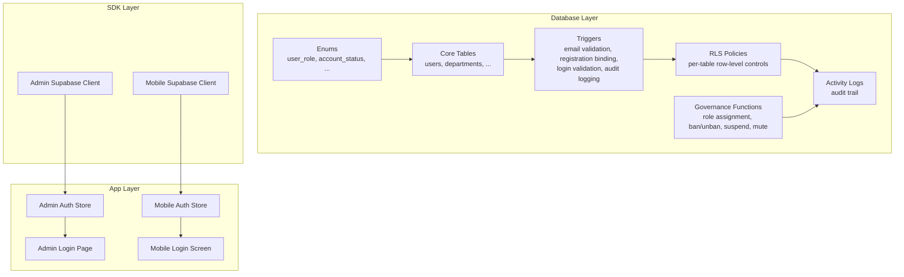
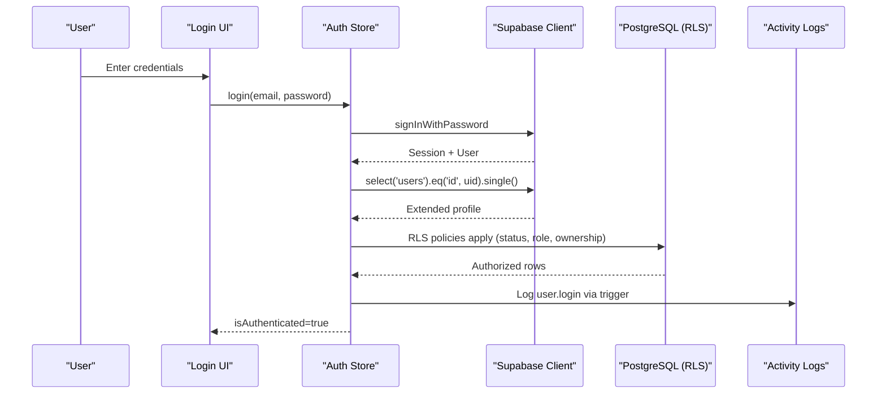
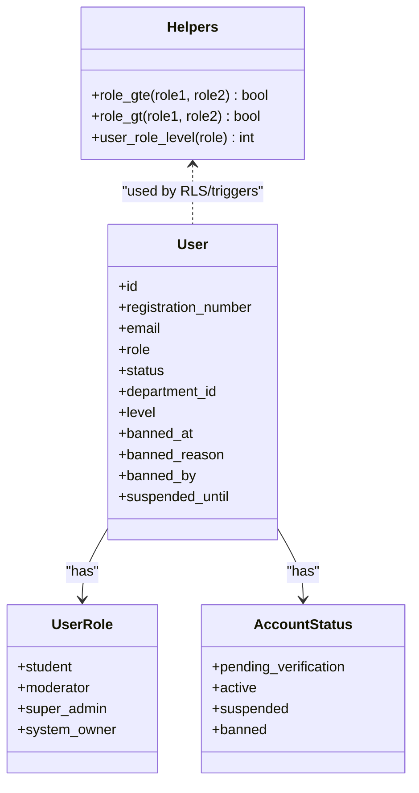
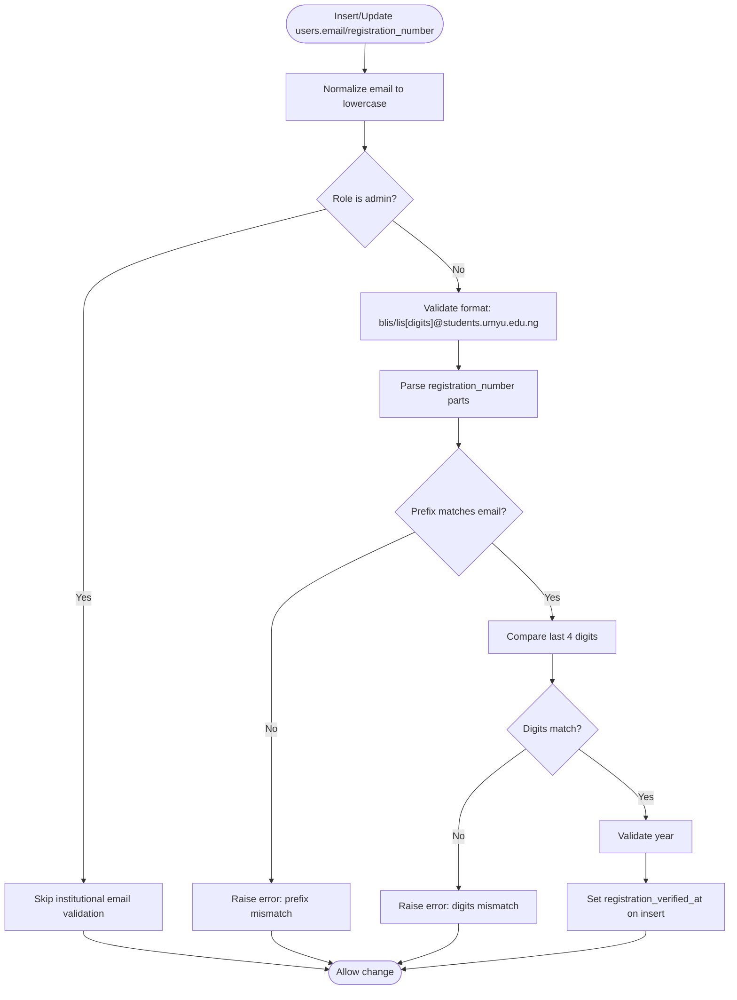
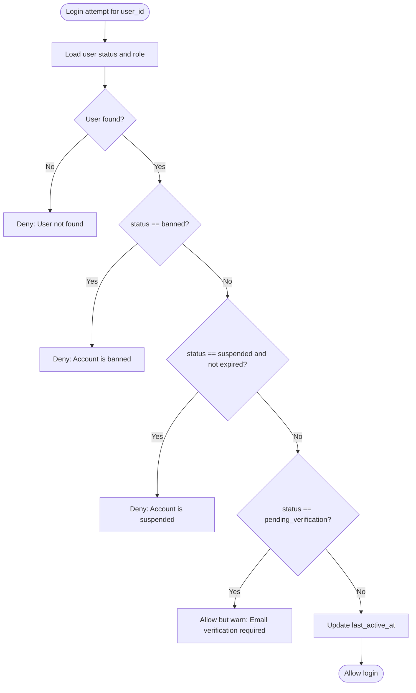
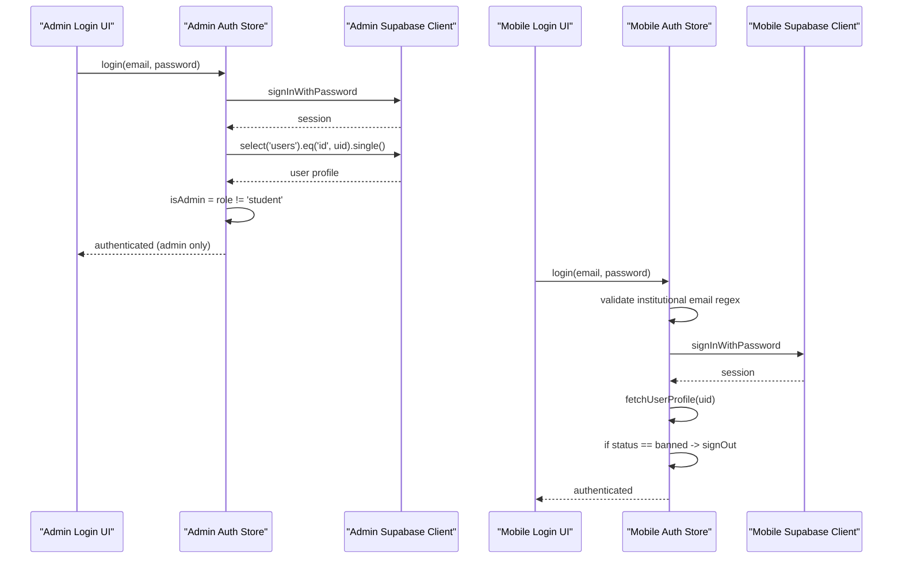
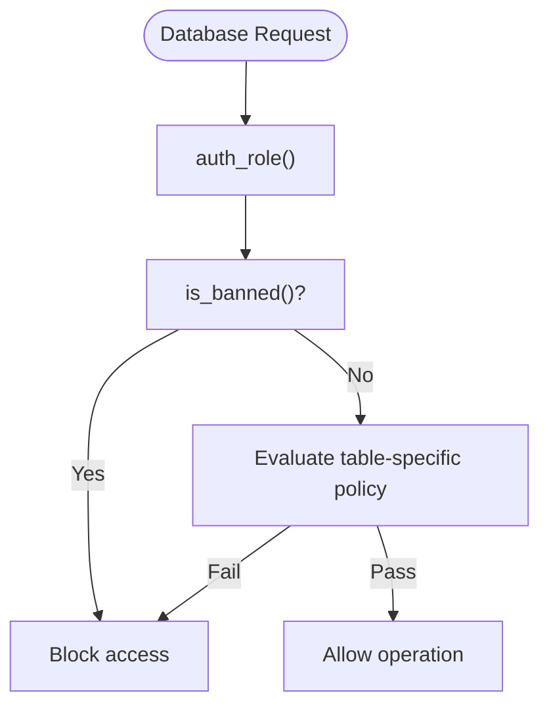
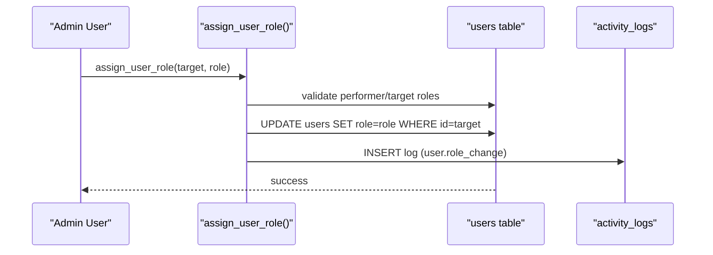
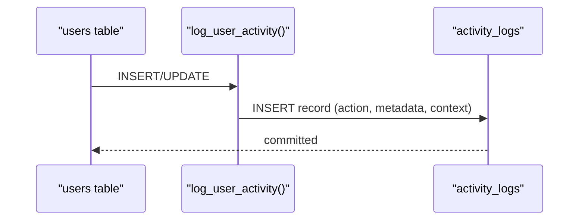
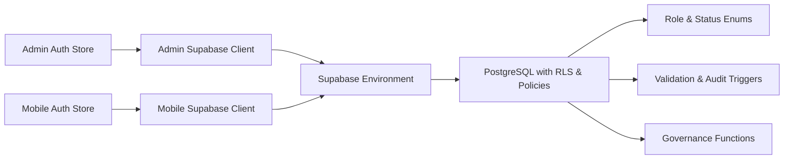

# Authentication & Authorization

<cite>
**Referenced Files in This Document**
- [001_enums.sql](file://supabase/migrations/001_enums.sql)
- [002_core_tables.sql](file://supabase/migrations/002_core_tables.sql)
- [006_triggers.sql](file://supabase/migrations/006_triggers.sql)
- [007_rls_policies.sql](file://supabase/migrations/007_rls_policies.sql)
- [008_governance_functions.sql](file://supabase/migrations/008_governance_functions.sql)
- [supabase.ts](file://admin/src/lib/supabase.ts)
- [client.ts](file://mobile/src/api/supabase/client.ts)
- [authStore.ts (Admin)](file://admin/src/store/authStore.ts)
- [auth.store.ts (Mobile)](file://mobile/src/stores/auth.store.ts)
- [index.ts (Admin Types)](file://admin/src/types/index.ts)
- [index.ts (Mobile Types)](file://mobile/src/types/index.ts)
- [LoginPage.tsx](file://admin/src/pages/LoginPage.tsx)
- [login.tsx (Mobile)](file://mobile/app/(auth)/login.tsx)
</cite>

## Table of Contents
1. [Introduction](#introduction)
2. [Project Structure](#project-structure)
3. [Core Components](#core-components)
4. [Architecture Overview](#architecture-overview)
5. [Detailed Component Analysis](#detailed-component-analysis)
6. [Dependency Analysis](#dependency-analysis)
7. [Performance Considerations](#performance-considerations)
8. [Troubleshooting Guide](#troubleshooting-guide)
9. [Conclusion](#conclusion)

## Introduction
This document explains the authentication and authorization system of Naliss UMYU Hub. It covers the four-tier role hierarchy, institutional email validation and academic identity binding, automatic enforcement of bans and suspensions, Supabase Auth-based authentication and session management, cross-application consistency, Row-Level Security (RLS) policies, access control, and audit logging for administrative actions. Practical examples and security considerations are included to guide developers and administrators.

## Project Structure
The authentication and authorization logic spans three layers:
- Database layer: enums, tables, triggers, RLS policies, governance functions, and audit logging.
- Backend SDK layer: Supabase client configuration for admin and mobile apps.
- Application layer: auth stores and UI flows for login and session handling.

**Diagram sources**
- [001_enums.sql](file://supabase/migrations/001_enums.sql#L9-L167)
- [002_core_tables.sql](file://supabase/migrations/002_core_tables.sql#L43-L252)
- [006_triggers.sql](file://supabase/migrations/006_triggers.sql#L9-L214)
- [007_rls_policies.sql](file://supabase/migrations/007_rls_policies.sql#L9-L510)
- [008_governance_functions.sql](file://supabase/migrations/008_governance_functions.sql#L9-L495)
- [supabase.ts](file://admin/src/lib/supabase.ts#L1-L73)
- [client.ts](file://mobile/src/api/supabase/client.ts#L1-L87)
- [authStore.ts (Admin)](file://admin/src/store/authStore.ts#L1-L228)
- [auth.store.ts (Mobile)](file://mobile/src/stores/auth.store.ts#L1-L302)
- [LoginPage.tsx](file://admin/src/pages/LoginPage.tsx#L1-L123)
- [login.tsx (Mobile)](file://mobile/app/(auth)/login.tsx#L1-L336)

**Section sources**
- [001_enums.sql](file://supabase/migrations/001_enums.sql#L9-L167)
- [002_core_tables.sql](file://supabase/migrations/002_core_tables.sql#L43-L252)
- [006_triggers.sql](file://supabase/migrations/006_triggers.sql#L9-L214)
- [007_rls_policies.sql](file://supabase/migrations/007_rls_policies.sql#L9-L510)
- [008_governance_functions.sql](file://supabase/migrations/008_governance_functions.sql#L9-L495)
- [supabase.ts](file://admin/src/lib/supabase.ts#L1-L73)
- [client.ts](file://mobile/src/api/supabase/client.ts#L1-L87)
- [authStore.ts (Admin)](file://admin/src/store/authStore.ts#L1-L228)
- [auth.store.ts (Mobile)](file://mobile/src/stores/auth.store.ts#L1-L302)
- [LoginPage.tsx](file://admin/src/pages/LoginPage.tsx#L1-L123)
- [login.tsx (Mobile)](file://mobile/app/(auth)/login.tsx#L1-L336)

## Core Components
- Role hierarchy and status enums define the four-tier roles and account states.
- Core users table extends Supabase Auth with academic identity and status.
- Triggers enforce institutional email format, registration number binding, login validation, and audit logging.
- RLS policies govern per-table access based on roles, status, and ownership.
- Governance functions implement role assignment, banning, suspension, muting, and statistics.
- Supabase clients configure session persistence, token refresh, and storage access.
- Auth stores manage session lifecycle, profile refresh, role checks, and UI flows.

**Section sources**
- [001_enums.sql](file://supabase/migrations/001_enums.sql#L9-L167)
- [002_core_tables.sql](file://supabase/migrations/002_core_tables.sql#L43-L252)
- [006_triggers.sql](file://supabase/migrations/006_triggers.sql#L9-L214)
- [007_rls_policies.sql](file://supabase/migrations/007_rls_policies.sql#L9-L510)
- [008_governance_functions.sql](file://supabase/migrations/008_governance_functions.sql#L9-L495)
- [supabase.ts](file://admin/src/lib/supabase.ts#L1-L73)
- [client.ts](file://mobile/src/api/supabase/client.ts#L1-L87)
- [authStore.ts (Admin)](file://admin/src/store/authStore.ts#L1-L228)
- [auth.store.ts (Mobile)](file://mobile/src/stores/auth.store.ts#L1-L302)

## Architecture Overview
The system uses Supabase Auth for identity and session management, with database-side enforcement for policy and security.

**Diagram sources**
- [authStore.ts (Admin)](file://admin/src/store/authStore.ts#L94-L172)
- [auth.store.ts (Mobile)](file://mobile/src/stores/auth.store.ts#L98-L134)
- [007_rls_policies.sql](file://supabase/migrations/007_rls_policies.sql#L94-L121)
- [006_triggers.sql](file://supabase/migrations/006_triggers.sql#L160-L214)

## Detailed Component Analysis

### Role Hierarchy and Identity Model
- Roles: student → moderator → super_admin → system_owner.
- Status: pending_verification → active → suspended → banned.
- Users table holds registration_number, email, role, status, department_id, level, and ban/suspension fields.
- Enums and helper functions compare roles and enforce hierarchical checks.

**Diagram sources**
- [001_enums.sql](file://supabase/migrations/001_enums.sql#L9-L167)
- [002_core_tables.sql](file://supabase/migrations/002_core_tables.sql#L43-L92)
- [007_rls_policies.sql](file://supabase/migrations/007_rls_policies.sql#L43-L88)

**Section sources**
- [001_enums.sql](file://supabase/migrations/001_enums.sql#L9-L167)
- [002_core_tables.sql](file://supabase/migrations/002_core_tables.sql#L43-L92)
- [index.ts (Admin Types)](file://admin/src/types/index.ts#L1-L33)
- [index.ts (Mobile Types)](file://mobile/src/types/index.ts#L50-L73)

### Institutional Email Validation and Academic Binding
- Email validation enforces blis or lis followed by digits and institutional domain; admin roles bypass this for non-student accounts.
- Registration number validation ensures:
  - Prefix matches email (blis/lis).
  - Last 4 digits of registration number match last 4 digits of email.
  - Year component is present and reasonable.
  - Sets registration_verified_at on insert.

**Diagram sources**
- [006_triggers.sql](file://supabase/migrations/006_triggers.sql#L9-L101)

**Section sources**
- [006_triggers.sql](file://supabase/migrations/006_triggers.sql#L9-L101)

### Automatic Ban and Suspension Enforcement
- Login attempt validation blocks banned and suspended users, returns warnings for pending verification, and updates last_active_at for valid logins.
- RLS policies consistently filter out banned users from most operations.

**Diagram sources**
- [006_triggers.sql](file://supabase/migrations/006_triggers.sql#L107-L154)
- [007_rls_policies.sql](file://supabase/migrations/007_rls_policies.sql#L94-L121)

**Section sources**
- [006_triggers.sql](file://supabase/migrations/006_triggers.sql#L107-L154)
- [007_rls_policies.sql](file://supabase/migrations/007_rls_policies.sql#L94-L121)

### Authentication Flow and Session Management
- Admin app initializes Supabase with persistent sessions and auto-refresh; subscribes to auth state changes; restricts admin login to non-student roles.
- Mobile app validates institutional email format before login; persists sessions; handles token refresh; signs out on banned status.

**Diagram sources**
- [authStore.ts (Admin)](file://admin/src/store/authStore.ts#L94-L172)
- [LoginPage.tsx](file://admin/src/pages/LoginPage.tsx#L19-L32)
- [supabase.ts](file://admin/src/lib/supabase.ts#L10-L18)
- [auth.store.ts (Mobile)](file://mobile/src/stores/auth.store.ts#L98-L134)
- [login.tsx (Mobile)](file://mobile/app/(auth)/login.tsx#L25-L41)
- [client.ts](file://mobile/src/api/supabase/client.ts#L15-L27)

**Section sources**
- [authStore.ts (Admin)](file://admin/src/store/authStore.ts#L94-L172)
- [LoginPage.tsx](file://admin/src/pages/LoginPage.tsx#L1-L123)
- [supabase.ts](file://admin/src/lib/supabase.ts#L1-L73)
- [auth.store.ts (Mobile)](file://mobile/src/stores/auth.store.ts#L98-L134)
- [login.tsx (Mobile)](file://mobile/app/(auth)/login.tsx#L1-L336)
- [client.ts](file://mobile/src/api/supabase/client.ts#L1-L87)

### Row-Level Security (RLS) and Access Control
- RLS is enabled on all relevant tables.
- Policy helpers:
  - auth_role(), is_banned(), has_min_role(), auth_department_id(), is_admin(), is_super_admin(), is_system_owner().
- Examples:
  - Users: self-read; admins-all-read; super-admins-manage-users; users cannot change role/status.
  - Departments: active read for all; admins read all; super-admins write.
  - Materials: public active read; own uploads; admins manage; users insert own.
  - Events: public/published read; own read; admins manage; registrations own/admin.
  - Announcements: published read; authors update own; admins manage.
  - Messaging: participants read own conversations; send messages; admins moderate; receipts read own.
  - Presence: read all; update own.
  - Settings: public read; admins read all; super-admins write.
  - Activity logs: admins read; insert via trigger.
  - Sessions: read/delete own.
  - 2FA: read/manage own.
  - Rate limits: insert/update.

**Diagram sources**
- [007_rls_policies.sql](file://supabase/migrations/007_rls_policies.sql#L43-L88)
- [007_rls_policies.sql](file://supabase/migrations/007_rls_policies.sql#L94-L121)

**Section sources**
- [007_rls_policies.sql](file://supabase/migrations/007_rls_policies.sql#L9-L510)

### Governance Functions and Administrative Controls
- assign_user_role(target_user_id, new_role): permission checks and role hierarchy enforcement; logs role changes.
- ban_user(target_user_id, reason): enforces strict privilege checks; sets status and audit logs.
- unban_user(target_user_id): only super_admin/system_owner; resets ban fields and logs.
- suspend_user(target_user_id, until, reason): temporary restriction; logs.
- mute_user/unmute_user: messaging moderation; logs.
- get_system_stats(): aggregates counts by role and status.
- get_user_activity_log(target_user_id): retrieves audit entries for a user.
- user_can(user_id, permission): evaluates permissions against role hierarchy.

**Diagram sources**
- [008_governance_functions.sql](file://supabase/migrations/008_governance_functions.sql#L9-L68)
- [008_governance_functions.sql](file://supabase/migrations/008_governance_functions.sql#L74-L127)

**Section sources**
- [008_governance_functions.sql](file://supabase/migrations/008_governance_functions.sql#L9-L495)

### Audit Logging and Compliance
- Triggers log user registration, role changes, and status changes (ban/suspend/unban) with metadata.
- Activity logs include actor, action, entity, description, IP, user agent, and timestamps.
- Admins can query logs and user activity via helper functions.

**Diagram sources**
- [006_triggers.sql](file://supabase/migrations/006_triggers.sql#L160-L214)
- [007_rls_policies.sql](file://supabase/migrations/007_rls_policies.sql#L473-L479)

**Section sources**
- [006_triggers.sql](file://supabase/migrations/006_triggers.sql#L160-L214)
- [007_rls_policies.sql](file://supabase/migrations/007_rls_policies.sql#L473-L479)

### Practical Role-Based Access Patterns
- Student:
  - Can view courses and announcements (public).
  - Can send messages and manage own bookmarks/progress.
  - Cannot manage users or content beyond own uploads.
- Moderator:
  - Inherits student capabilities plus content moderation and deletion.
  - Can create announcements and manage materials within department scope.
- Super Admin:
  - Inherits moderator capabilities plus user management and system settings.
  - Can assign roles up to super_admin; view analytics.
- System Owner:
  - Highest privilege; can assign system owner, manage all settings, and perform all administrative actions.

**Section sources**
- [index.ts (Mobile Types)](file://mobile/src/types/index.ts#L409-L447)
- [007_rls_policies.sql](file://supabase/migrations/007_rls_policies.sql#L117-L121)
- [008_governance_functions.sql](file://supabase/migrations/008_governance_functions.sql#L9-L68)

## Dependency Analysis
- Frontend stores depend on Supabase clients for session and profile operations.
- Supabase clients depend on environment variables for URL and anon key.
- Database policies and functions depend on role enums and helper functions.
- Cross-application consistency relies on shared Supabase configuration and RLS.

**Diagram sources**
- [supabase.ts](file://admin/src/lib/supabase.ts#L1-L73)
- [client.ts](file://mobile/src/api/supabase/client.ts#L1-L87)
- [001_enums.sql](file://supabase/migrations/001_enums.sql#L9-L167)
- [006_triggers.sql](file://supabase/migrations/006_triggers.sql#L9-L214)
- [008_governance_functions.sql](file://supabase/migrations/008_governance_functions.sql#L9-L495)

**Section sources**
- [supabase.ts](file://admin/src/lib/supabase.ts#L1-L73)
- [client.ts](file://mobile/src/api/supabase/client.ts#L1-L87)
- [001_enums.sql](file://supabase/migrations/001_enums.sql#L9-L167)
- [006_triggers.sql](file://supabase/migrations/006_triggers.sql#L9-L214)
- [008_governance_functions.sql](file://supabase/migrations/008_governance_functions.sql#L9-L495)

## Performance Considerations
- RLS adds minimal overhead; ensure indexes on frequently filtered columns (e.g., users(role, status), users(department_id), activity_logs(user_id, created_at)).
- Use helper functions (auth_role, has_min_role) in policies to avoid repeated lookups.
- Persist sessions and enable auto-refresh to reduce re-authentication churn.
- Batch audit writes and keep log queries scoped with date ranges.

## Troubleshooting Guide
Common issues and resolutions:
- Login blocked due to status:
  - Banned: Contact system owner/super admin for unban.
  - Suspended: Wait until suspended_until passes.
  - Pending verification: Complete email verification.
- Institutional email errors:
  - Ensure email follows blis/lis[digits]@students.umyu.edu.ng.
  - Registration number must match email prefix and last 4 digits.
- Admin login denied:
  - Ensure role is not student; otherwise sign out and use admin credentials.
- Session not persisting:
  - Verify environment variables and storage configuration for each platform.
- Excessive rate limiting:
  - Review system settings for max attempts and lockout duration.

**Section sources**
- [auth.store.ts (Mobile)](file://mobile/src/stores/auth.store.ts#L217-L228)
- [authStore.ts (Admin)](file://admin/src/store/authStore.ts#L148-L156)
- [006_triggers.sql](file://supabase/migrations/006_triggers.sql#L107-L154)
- [007_rls_policies.sql](file://supabase/migrations/007_rls_policies.sql#L94-L121)

## Conclusion
Naliss UMYU Hub implements a robust, database-first authentication and authorization model. The four-tier role hierarchy, institutional identity binding, automatic ban/suspension enforcement, Supabase Auth integration, and comprehensive RLS policies ensure strong security and compliance. Governance functions centralize administrative controls, while audit logging supports transparency and accountability. Developers should leverage helper functions, maintain proper indexes, and follow the role-based access patterns outlined here to build secure features consistently across applications.