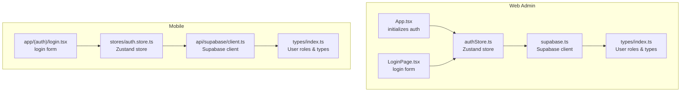
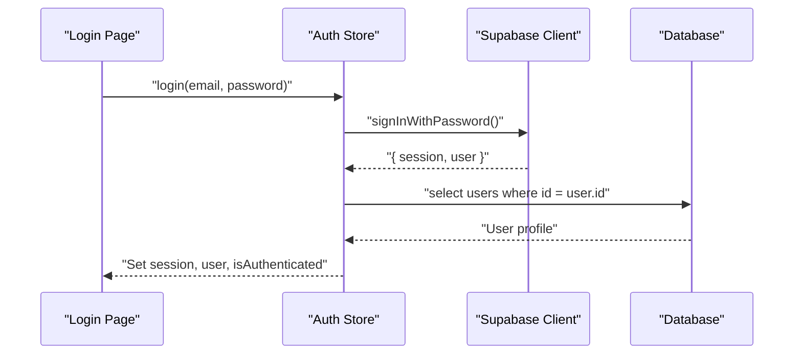
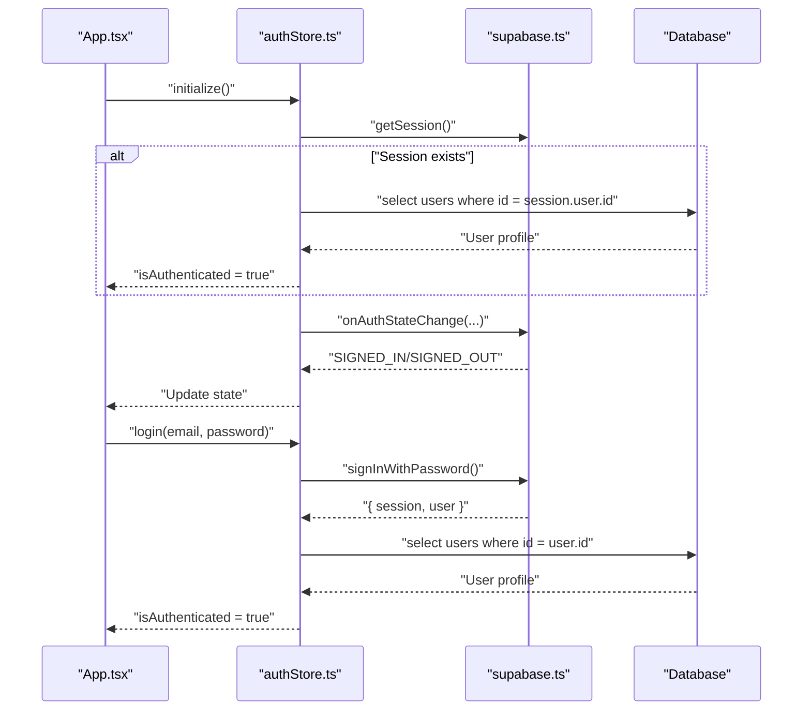
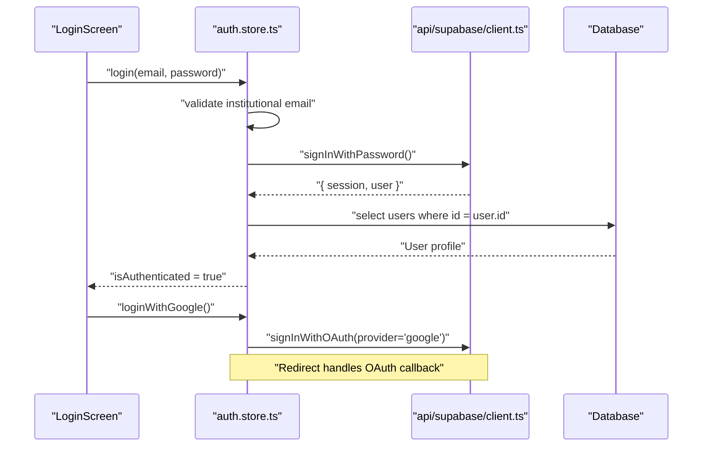
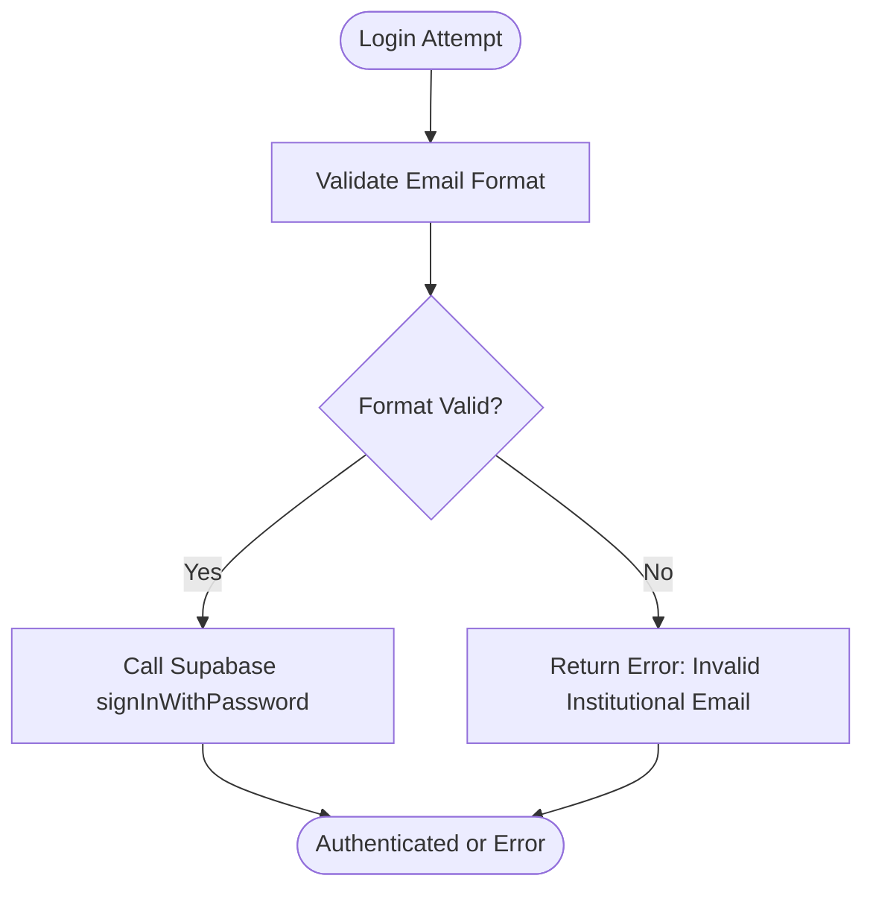
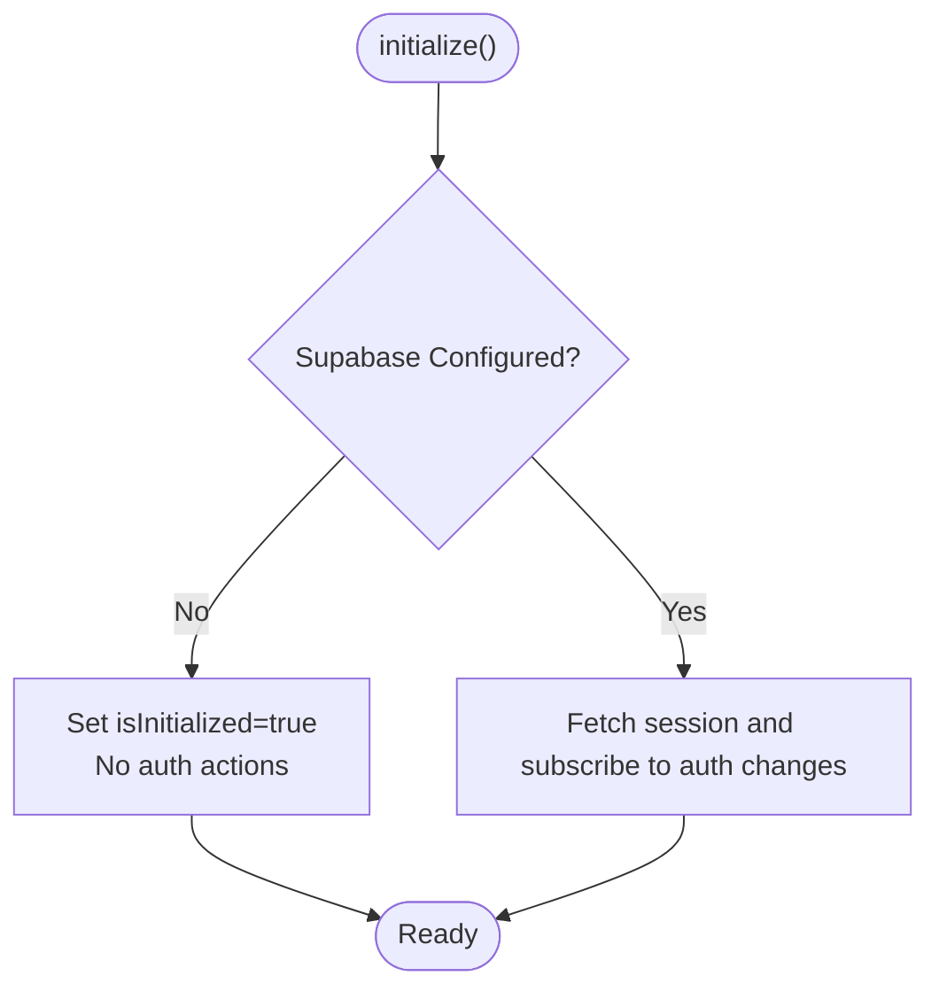
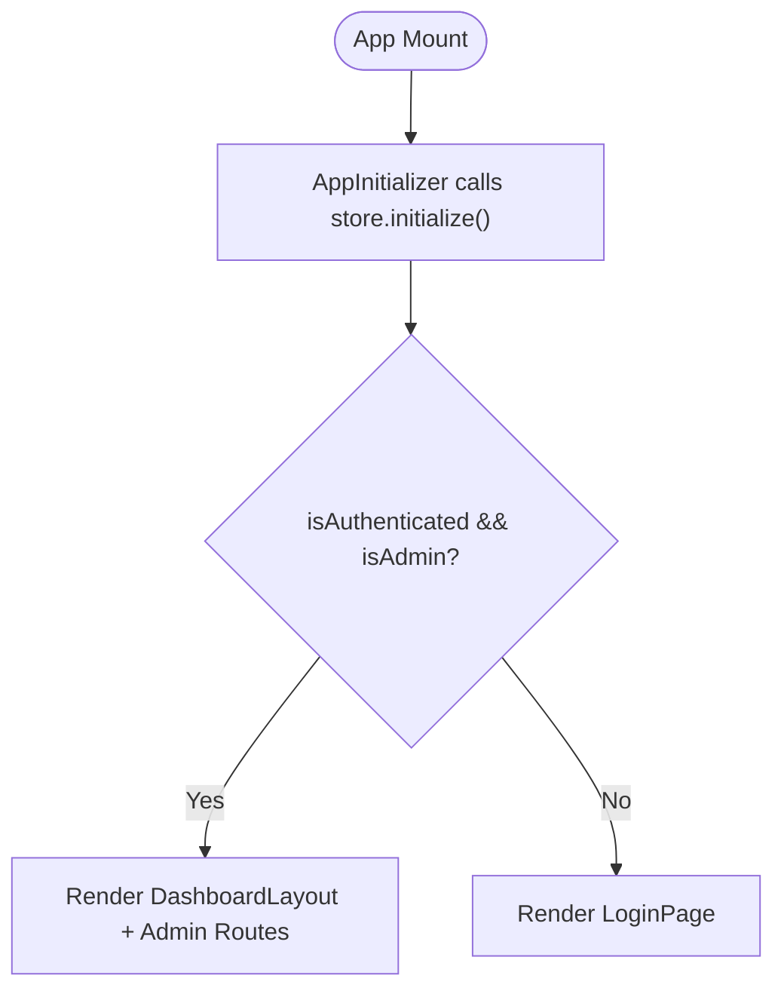
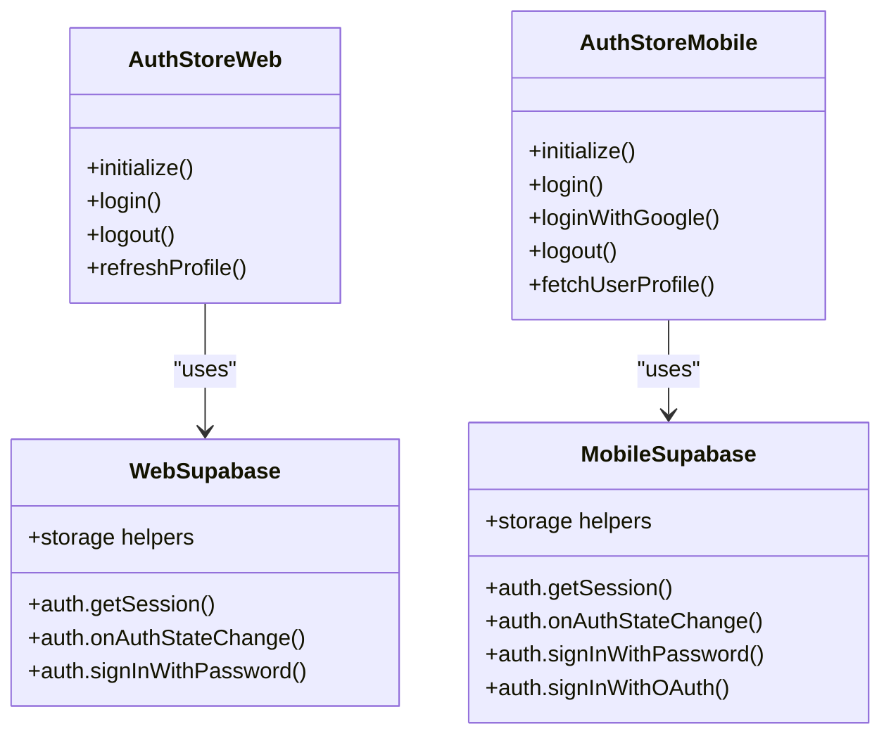
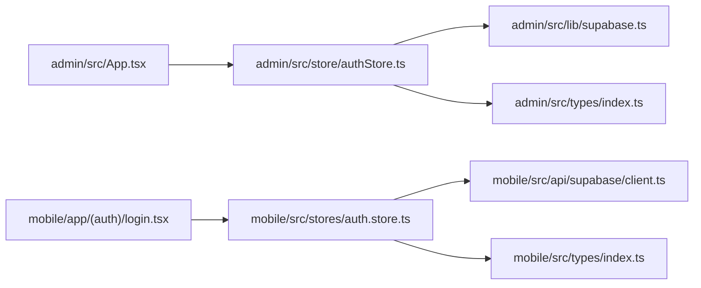

# Authentication Flow

<cite>
**Referenced Files in This Document**
- [admin/src/lib/supabase.ts](file://admin/src/lib/supabase.ts)
- [admin/src/store/authStore.ts](file://admin/src/store/authStore.ts)
- [admin/src/pages/LoginPage.tsx](file://admin/src/pages/LoginPage.tsx)
- [admin/src/App.tsx](file://admin/src/App.tsx)
- [admin/src/types/index.ts](file://admin/src/types/index.ts)
- [mobile/src/api/supabase/client.ts](file://mobile/src/api/supabase/client.ts)
- [mobile/src/stores/auth.store.ts](file://mobile/src/stores/auth.store.ts)
- [mobile/app/(auth)/login.tsx](file://mobile/app/(auth)/login.tsx)
- [mobile/src/types/index.ts](file://mobile/src/types/index.ts)
</cite>

## Table of Contents
1. [Introduction](#introduction)
2. [Project Structure](#project-structure)
3. [Core Components](#core-components)
4. [Architecture Overview](#architecture-overview)
5. [Detailed Component Analysis](#detailed-component-analysis)
6. [Dependency Analysis](#dependency-analysis)
7. [Performance Considerations](#performance-considerations)
8. [Troubleshooting Guide](#troubleshooting-guide)
9. [Conclusion](#conclusion)

## Introduction
This document explains the authentication flow across the web (admin) and mobile applications, focusing on Supabase Auth integration, session management lifecycle, and cross-platform consistency. It covers the login process (institutional email validation, password authentication), session persistence, demo mode for development, authentication state change handling, automatic session restoration, and practical examples for authentication hooks usage, protected route implementation, and error handling strategies.

## Project Structure
The authentication system is implemented separately for the web and mobile apps, each with its own Supabase client configuration and local state store. Both share a common user model and role hierarchy types.

**Diagram sources**
- [admin/src/App.tsx](file://admin/src/App.tsx#L19-L27)
- [admin/src/pages/LoginPage.tsx](file://admin/src/pages/LoginPage.tsx#L1-L123)
- [admin/src/store/authStore.ts](file://admin/src/store/authStore.ts#L26-L222)
- [admin/src/lib/supabase.ts](file://admin/src/lib/supabase.ts#L1-L73)
- [admin/src/types/index.ts](file://admin/src/types/index.ts#L1-L224)
- [mobile/app/(auth)/login.tsx](file://mobile/app/(auth)/login.tsx#L1-L336)
- [mobile/src/stores/auth.store.ts](file://mobile/src/stores/auth.store.ts#L27-L302)
- [mobile/src/api/supabase/client.ts](file://mobile/src/api/supabase/client.ts#L1-L87)
- [mobile/src/types/index.ts](file://mobile/src/types/index.ts#L1-L456)

**Section sources**
- [admin/src/App.tsx](file://admin/src/App.tsx#L1-L64)
- [admin/src/pages/LoginPage.tsx](file://admin/src/pages/LoginPage.tsx#L1-L123)
- [admin/src/store/authStore.ts](file://admin/src/store/authStore.ts#L1-L228)
- [admin/src/lib/supabase.ts](file://admin/src/lib/supabase.ts#L1-L73)
- [admin/src/types/index.ts](file://admin/src/types/index.ts#L1-L224)
- [mobile/app/(auth)/login.tsx](file://mobile/app/(auth)/login.tsx#L1-L336)
- [mobile/src/stores/auth.store.ts](file://mobile/src/stores/auth.store.ts#L1-L302)
- [mobile/src/api/supabase/client.ts](file://mobile/src/api/supabase/client.ts#L1-L87)
- [mobile/src/types/index.ts](file://mobile/src/types/index.ts#L1-L456)

## Core Components
- Supabase client initialization with session persistence and auto-refresh enabled for both platforms.
- Centralized Zustand stores managing authentication state, session restoration, and profile synchronization.
- Institutional email validation on mobile login.
- Demo mode fallback when Supabase is not configured (web admin).
- Auth state change listeners to keep UI and session in sync.

Key implementation references:
- Web Supabase client and helpers: [admin/src/lib/supabase.ts](file://admin/src/lib/supabase.ts#L1-L73)
- Web auth store (initialize, login, logout, onAuthStateChange): [admin/src/store/authStore.ts](file://admin/src/store/authStore.ts#L26-L222)
- Mobile Supabase client and helpers: [mobile/src/api/supabase/client.ts](file://mobile/src/api/supabase/client.ts#L1-L87)
- Mobile auth store (initialize, login, loginWithGoogle, onAuthStateChange): [mobile/src/stores/auth.store.ts](file://mobile/src/stores/auth.store.ts#L27-L302)
- User types and role hierarchy: [admin/src/types/index.ts](file://admin/src/types/index.ts#L1-L224), [mobile/src/types/index.ts](file://mobile/src/types/index.ts#L1-L456)

**Section sources**
- [admin/src/lib/supabase.ts](file://admin/src/lib/supabase.ts#L1-L73)
- [admin/src/store/authStore.ts](file://admin/src/store/authStore.ts#L26-L222)
- [mobile/src/api/supabase/client.ts](file://mobile/src/api/supabase/client.ts#L1-L87)
- [mobile/src/stores/auth.store.ts](file://mobile/src/stores/auth.store.ts#L27-L302)
- [admin/src/types/index.ts](file://admin/src/types/index.ts#L1-L224)
- [mobile/src/types/index.ts](file://mobile/src/types/index.ts#L1-L456)

## Architecture Overview
The authentication architecture follows a consistent pattern across platforms:
- Supabase client is initialized with session persistence and auto-refresh.
- On startup, the app retrieves the persisted session and subscribes to auth state changes.
- Login triggers either password or OAuth sign-in via Supabase.
- After successful sign-in, the app fetches the user profile from the database and updates local state.
- Logout signs out from Supabase and clears local state.

**Diagram sources**
- [admin/src/pages/LoginPage.tsx](file://admin/src/pages/LoginPage.tsx#L19-L32)
- [admin/src/store/authStore.ts](file://admin/src/store/authStore.ts#L94-L172)
- [mobile/app/(auth)/login.tsx](file://mobile/app/(auth)/login.tsx#L25-L41)
- [mobile/src/stores/auth.store.ts](file://mobile/src/stores/auth.store.ts#L98-L134)
- [mobile/src/api/supabase/client.ts](file://mobile/src/api/supabase/client.ts#L15-L27)

## Detailed Component Analysis

### Web Admin Authentication Flow
- Initialization:
  - Retrieves persisted session and synchronizes state.
  - Subscribes to auth state changes to update UI reactively.
  - Supports demo mode when Supabase is not configured.
- Login:
  - Validates credentials and signs in via Supabase.
  - Fetches user profile and checks admin privilege.
  - Updates store with session and user data.
- Logout:
  - Signs out from Supabase and clears local state.

**Diagram sources**
- [admin/src/App.tsx](file://admin/src/App.tsx#L19-L27)
- [admin/src/store/authStore.ts](file://admin/src/store/authStore.ts#L38-L92)
- [admin/src/lib/supabase.ts](file://admin/src/lib/supabase.ts#L10-L18)
- [admin/src/store/authStore.ts](file://admin/src/store/authStore.ts#L134-L172)

**Section sources**
- [admin/src/App.tsx](file://admin/src/App.tsx#L19-L27)
- [admin/src/store/authStore.ts](file://admin/src/store/authStore.ts#L38-L92)
- [admin/src/lib/supabase.ts](file://admin/src/lib/supabase.ts#L10-L18)
- [admin/src/store/authStore.ts](file://admin/src/store/authStore.ts#L94-L172)

### Mobile Authentication Flow
- Initialization:
  - Retrieves persisted session and subscribes to auth state changes.
  - Fetches user profile from database upon sign-in.
- Login:
  - Validates institutional email format before signing in.
  - Supports Google OAuth with redirect URI and offline access.
- Logout:
  - Signs out from Supabase and clears local state.

**Diagram sources**
- [mobile/app/(auth)/login.tsx](file://mobile/app/(auth)/login.tsx#L25-L53)
- [mobile/src/stores/auth.store.ts](file://mobile/src/stores/auth.store.ts#L98-L163)
- [mobile/src/api/supabase/client.ts](file://mobile/src/api/supabase/client.ts#L15-L27)
- [mobile/src/stores/auth.store.ts](file://mobile/src/stores/auth.store.ts#L137-L163)

**Section sources**
- [mobile/app/(auth)/login.tsx](file://mobile/app/(auth)/login.tsx#L17-L53)
- [mobile/src/stores/auth.store.ts](file://mobile/src/stores/auth.store.ts#L37-L96)
- [mobile/src/api/supabase/client.ts](file://mobile/src/api/supabase/client.ts#L15-L27)
- [mobile/src/stores/auth.store.ts](file://mobile/src/stores/auth.store.ts#L98-L163)

### Institutional Email Validation (Mobile)
The mobile login enforces institutional email format using a regular expression to ensure only students’ emails are accepted during login.

**Diagram sources**
- [mobile/src/stores/auth.store.ts](file://mobile/src/stores/auth.store.ts#L103-L107)
- [mobile/app/(auth)/login.tsx](file://mobile/app/(auth)/login.tsx#L25-L41)

**Section sources**
- [mobile/src/stores/auth.store.ts](file://mobile/src/stores/auth.store.ts#L103-L107)
- [mobile/app/(auth)/login.tsx](file://mobile/app/(auth)/login.tsx#L78-L90)

### Demo Mode (Web Admin)
When Supabase is not configured, the web admin runs in demo mode:
- Initialization completes immediately without real auth.
- Login simulates a successful admin login with predefined user data.
- Useful for development and UI testing without backend.

**Diagram sources**
- [admin/src/store/authStore.ts](file://admin/src/store/authStore.ts#L38-L50)
- [admin/src/store/authStore.ts](file://admin/src/store/authStore.ts#L98-L132)

**Section sources**
- [admin/src/store/authStore.ts](file://admin/src/store/authStore.ts#L38-L50)
- [admin/src/store/authStore.ts](file://admin/src/store/authStore.ts#L98-L132)

### Protected Routes and Layouts
- Web admin uses React Router with a protected layout wrapper around admin routes. The login page is publicly accessible.
- Authentication state determines whether to render the login page or the protected layout.

**Diagram sources**
- [admin/src/App.tsx](file://admin/src/App.tsx#L19-L27)
- [admin/src/pages/LoginPage.tsx](file://admin/src/pages/LoginPage.tsx#L14-L17)

**Section sources**
- [admin/src/App.tsx](file://admin/src/App.tsx#L34-L57)
- [admin/src/pages/LoginPage.tsx](file://admin/src/pages/LoginPage.tsx#L14-L17)

### Cross-Platform Consistency
- Both platforms use Supabase Auth with session persistence and auto-refresh.
- Auth state changes are handled consistently via onAuthStateChange subscriptions.
- User profile is fetched from the database after sign-in to populate local state.
- Role-based permissions and admin checks are enforced similarly.

**Diagram sources**
- [admin/src/lib/supabase.ts](file://admin/src/lib/supabase.ts#L10-L18)
- [admin/src/store/authStore.ts](file://admin/src/store/authStore.ts#L38-L92)
- [mobile/src/api/supabase/client.ts](file://mobile/src/api/supabase/client.ts#L15-L27)
- [mobile/src/stores/auth.store.ts](file://mobile/src/stores/auth.store.ts#L37-L96)

**Section sources**
- [admin/src/lib/supabase.ts](file://admin/src/lib/supabase.ts#L10-L18)
- [admin/src/store/authStore.ts](file://admin/src/store/authStore.ts#L38-L92)
- [mobile/src/api/supabase/client.ts](file://mobile/src/api/supabase/client.ts#L15-L27)
- [mobile/src/stores/auth.store.ts](file://mobile/src/stores/auth.store.ts#L37-L96)

## Dependency Analysis
- Web admin depends on:
  - Supabase client for auth and storage.
  - Zustand store for state management.
  - React Router for routing and protected layout.
- Mobile depends on:
  - Supabase client with AsyncStorage for session persistence.
  - Zustand store for state management.
  - Expo Router for navigation and OAuth redirect handling.

**Diagram sources**
- [admin/src/App.tsx](file://admin/src/App.tsx#L1-L64)
- [admin/src/store/authStore.ts](file://admin/src/store/authStore.ts#L1-L228)
- [admin/src/lib/supabase.ts](file://admin/src/lib/supabase.ts#L1-L73)
- [admin/src/types/index.ts](file://admin/src/types/index.ts#L1-L224)
- [mobile/app/(auth)/login.tsx](file://mobile/app/(auth)/login.tsx#L1-L336)
- [mobile/src/stores/auth.store.ts](file://mobile/src/stores/auth.store.ts#L1-L302)
- [mobile/src/api/supabase/client.ts](file://mobile/src/api/supabase/client.ts#L1-L87)
- [mobile/src/types/index.ts](file://mobile/src/types/index.ts#L1-L456)

**Section sources**
- [admin/src/App.tsx](file://admin/src/App.tsx#L1-L64)
- [admin/src/store/authStore.ts](file://admin/src/store/authStore.ts#L1-L228)
- [admin/src/lib/supabase.ts](file://admin/src/lib/supabase.ts#L1-L73)
- [admin/src/types/index.ts](file://admin/src/types/index.ts#L1-L224)
- [mobile/app/(auth)/login.tsx](file://mobile/app/(auth)/login.tsx#L1-L336)
- [mobile/src/stores/auth.store.ts](file://mobile/src/stores/auth.store.ts#L1-L302)
- [mobile/src/api/supabase/client.ts](file://mobile/src/api/supabase/client.ts#L1-L87)
- [mobile/src/types/index.ts](file://mobile/src/types/index.ts#L1-L456)

## Performance Considerations
- Auto-refresh tokens and persistent sessions reduce redundant sign-ins and improve UX.
- Using React Query on the web and centralized auth stores on mobile minimizes unnecessary re-renders.
- Keep staleTime reasonable to balance freshness and performance.
- Avoid excessive profile fetches by caching user data in memory and only updating on auth state changes.

## Troubleshooting Guide
Common issues and resolutions:
- Missing Supabase environment variables:
  - Web: Check Vite environment variables for Supabase URL and anon key.
  - Mobile: Ensure EXPO_PUBLIC_SUPABASE_URL and EXPO_PUBLIC_SUPABASE_ANON_KEY are set.
- OAuth redirect failures:
  - Verify redirect URI matches provider configuration and app route.
- Institutional email errors (mobile):
  - Ensure the email matches the required institutional format before login.
- Session not restored:
  - Confirm persistSession is enabled and storage is available (AsyncStorage on mobile, browser storage on web).
- Admin-only access denied:
  - Verify user role in the database; only non-student roles are considered admins.

**Section sources**
- [admin/src/lib/supabase.ts](file://admin/src/lib/supabase.ts#L3-L7)
- [mobile/src/api/supabase/client.ts](file://mobile/src/api/supabase/client.ts#L6-L13)
- [mobile/src/stores/auth.store.ts](file://mobile/src/stores/auth.store.ts#L137-L163)
- [admin/src/store/authStore.ts](file://admin/src/store/authStore.ts#L147-L156)

## Conclusion
The authentication system integrates Supabase Auth consistently across web and mobile, with robust session persistence, reactive auth state handling, and institutional email validation on mobile. Demo mode enables development without backend dependencies, while protected routes and role checks enforce access control. The provided hooks and stores offer a clear pattern for implementing authentication flows, protected routes, and error handling across both platforms.