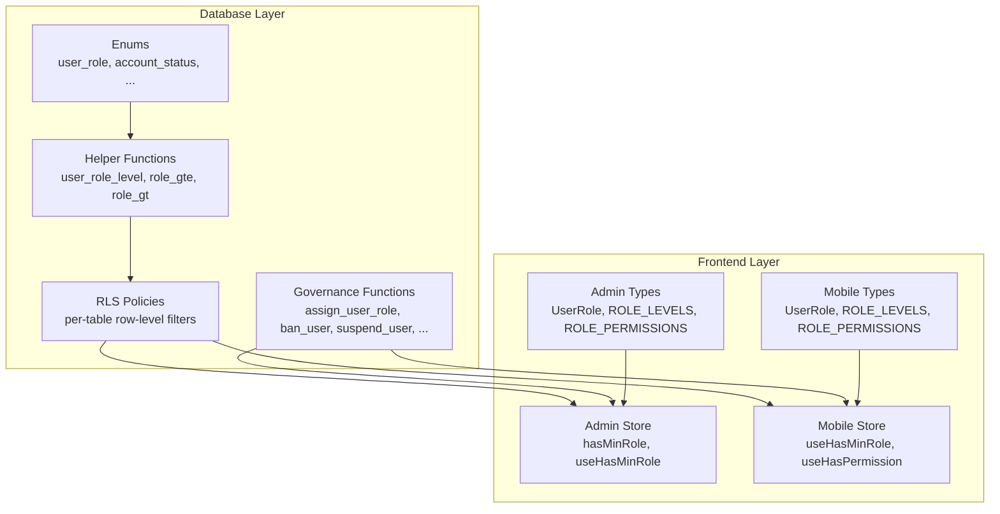
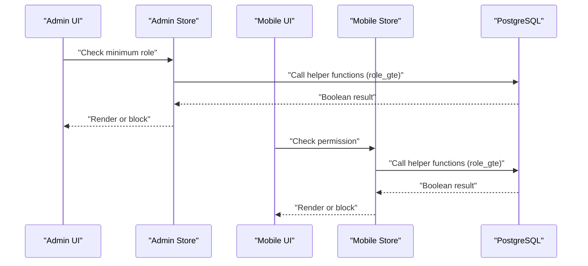
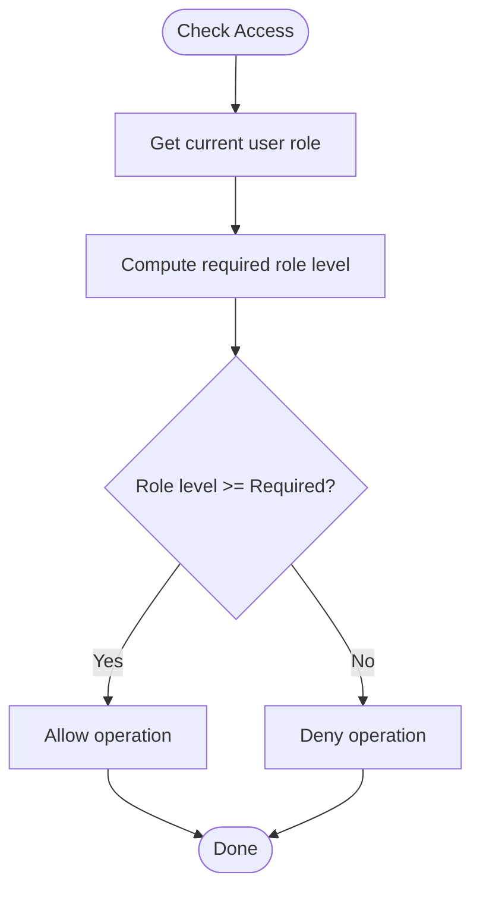
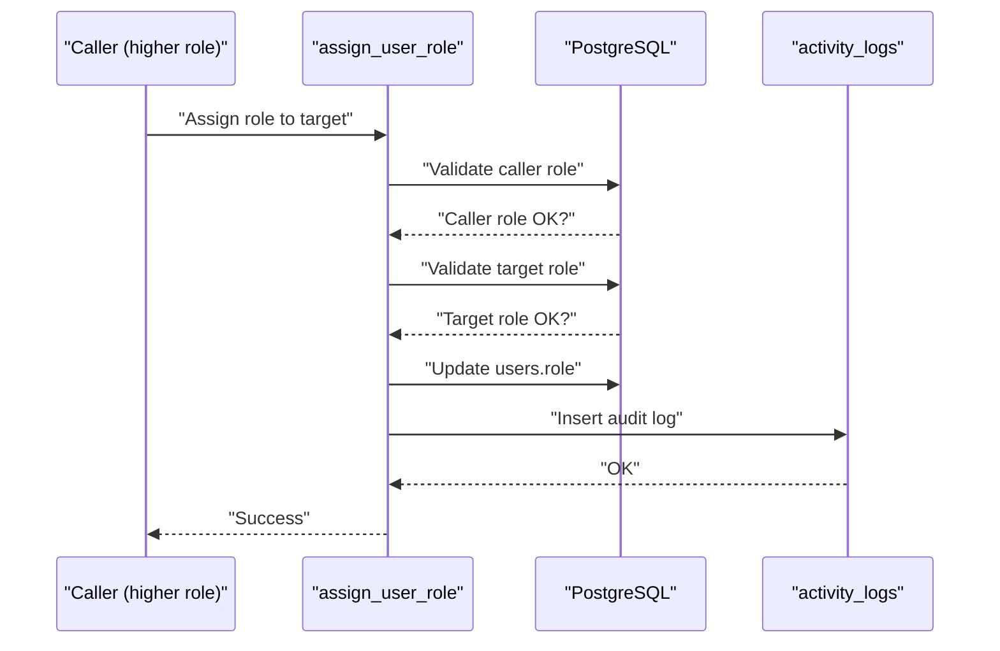
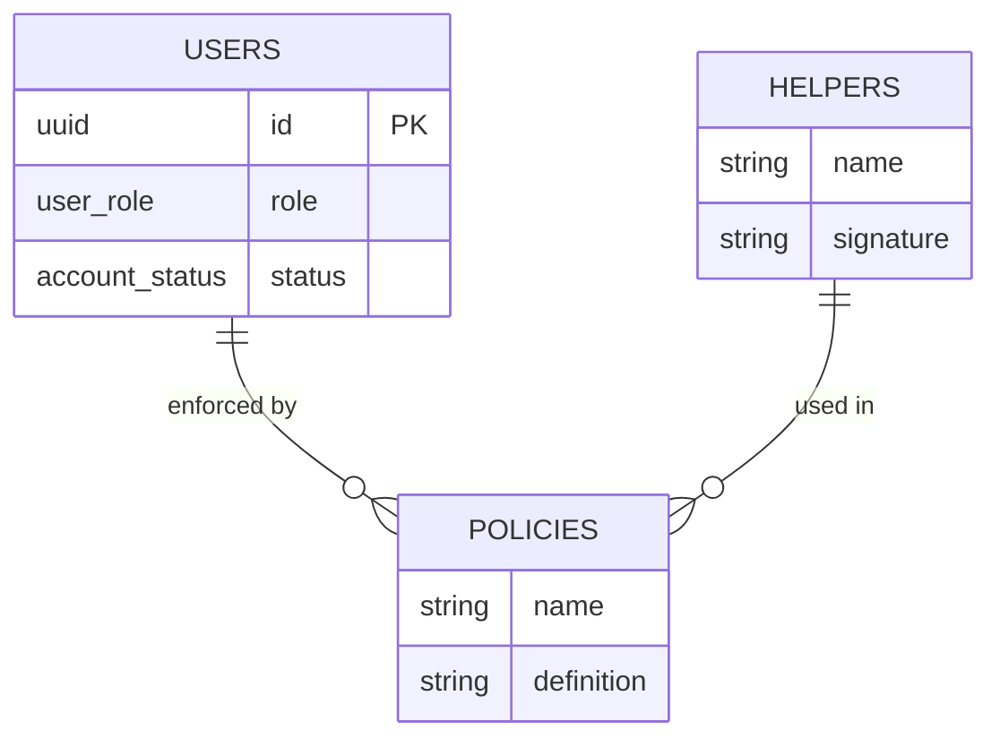
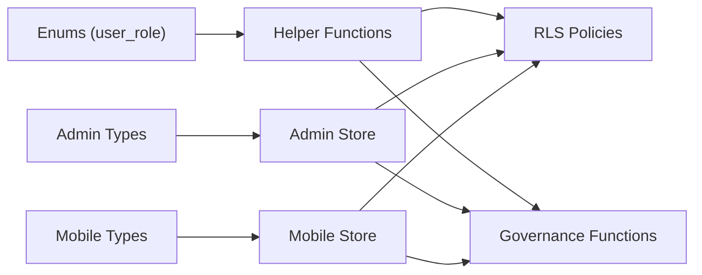

# User Roles & Permissions

<cite>
**Referenced Files in This Document**
- [001_enums.sql](file://supabase/migrations/001_enums.sql)
- [007_rls_policies.sql](file://supabase/migrations/007_rls_policies.sql)
- [008_governance_functions.sql](file://supabase/migrations/008_governance_functions.sql)
- [index.ts (Admin Types)](file://admin/src/types/index.ts)
- [authStore.ts (Admin Store)](file://admin/src/store/authStore.ts)
- [index.ts (Mobile Types)](file://mobile/src/types/index.ts)
- [auth.store.ts (Mobile Store)](file://mobile/src/stores/auth.store.ts)
- [supabase.ts (Admin Client)](file://admin/src/lib/supabase.ts)
- [client.ts (Mobile Client)](file://mobile/src/api/supabase/client.ts)
</cite>

## Table of Contents
1. [Introduction](#introduction)
2. [Project Structure](#project-structure)
3. [Core Components](#core-components)
4. [Architecture Overview](#architecture-overview)
5. [Detailed Component Analysis](#detailed-component-analysis)
6. [Dependency Analysis](#dependency-analysis)
7. [Performance Considerations](#performance-considerations)
8. [Troubleshooting Guide](#troubleshooting-guide)
9. [Conclusion](#conclusion)

## Introduction
This document explains the 4-tier role hierarchy system in Naliss UMYU Hub. It covers the role levels from Student (lowest) to System Owner (highest), detailing permissions, capabilities, and access restrictions per tier. It documents the ROLE_LEVELS mapping mechanism, role-based access control (RBAC) implementation, enforcement of minimum role requirements, and how user roles relate to database access via Row-Level Security (RLS). Practical examples of role-based UI rendering and administrative privilege escalation are included, along with guidance on how to implement role-aware features in both the admin dashboard and the mobile app.

## Project Structure
The role and permission model spans three layers:
- Database layer: Enumerations, helper functions, and RLS policies define the hierarchy and enforce access rules.
- Backend service layer: Governance functions implement administrative actions and enforce escalation rules.
- Frontend layer: TypeScript types define the role hierarchy and permissions; Zustand stores implement role checks and expose selector hooks for UI rendering.

**Diagram sources**
- [001_enums.sql](file://supabase/migrations/001_enums.sql#L10-L167)
- [007_rls_policies.sql](file://supabase/migrations/007_rls_policies.sql#L1-L510)
- [008_governance_functions.sql](file://supabase/migrations/008_governance_functions.sql#L1-L577)
- [index.ts (Admin Types)](file://admin/src/types/index.ts#L185-L224)
- [authStore.ts (Admin Store)](file://admin/src/store/authStore.ts#L207-L227)
- [index.ts (Mobile Types)](file://mobile/src/types/index.ts#L449-L447)
- [auth.store.ts (Mobile Store)](file://mobile/src/stores/auth.store.ts#L268-L302)

**Section sources**
- [001_enums.sql](file://supabase/migrations/001_enums.sql#L10-L167)
- [007_rls_policies.sql](file://supabase/migrations/007_rls_policies.sql#L1-L510)
- [008_governance_functions.sql](file://supabase/migrations/008_governance_functions.sql#L1-L577)
- [index.ts (Admin Types)](file://admin/src/types/index.ts#L185-L224)
- [authStore.ts (Admin Store)](file://admin/src/store/authStore.ts#L207-L227)
- [index.ts (Mobile Types)](file://mobile/src/types/index.ts#L449-L447)
- [auth.store.ts (Mobile Store)](file://mobile/src/stores/auth.store.ts#L268-L302)

## Core Components
- Role hierarchy and labels: Defined as enums and mapped to numeric levels and human-readable labels.
- Minimum role enforcement: Implemented via helper functions and stored-procedure selectors.
- RBAC in the database: Enforced by RLS policies and governance functions.
- Frontend role checks: Exposed via typed stores and selector hooks.

Key implementation references:
- Role levels and labels in Admin types
- Role levels and permissions in Mobile types
- Minimum role checks in Admin store
- Permission checks and role checks in Mobile store
- Database helper functions and RLS policies
- Governance functions for role assignment and administrative actions

**Section sources**
- [index.ts (Admin Types)](file://admin/src/types/index.ts#L185-L224)
- [index.ts (Mobile Types)](file://mobile/src/types/index.ts#L449-L447)
- [authStore.ts (Admin Store)](file://admin/src/store/authStore.ts#L207-L227)
- [auth.store.ts (Mobile Store)](file://mobile/src/stores/auth.store.ts#L268-L302)
- [001_enums.sql](file://supabase/migrations/001_enums.sql#L138-L166)
- [007_rls_policies.sql](file://supabase/migrations/007_rls_policies.sql#L43-L88)
- [008_governance_functions.sql](file://supabase/migrations/008_governance_functions.sql#L9-L68)

## Architecture Overview
The system enforces a strict 4-tier hierarchy with explicit escalation rules and checks at multiple layers.

**Diagram sources**
- [authStore.ts (Admin Store)](file://admin/src/store/authStore.ts#L207-L227)
- [auth.store.ts (Mobile Store)](file://mobile/src/stores/auth.store.ts#L268-L302)
- [001_enums.sql](file://supabase/migrations/001_enums.sql#L138-L166)
- [007_rls_policies.sql](file://supabase/migrations/007_rls_policies.sql#L43-L88)

## Detailed Component Analysis

### Role Hierarchy and Mapping
- Roles: student, moderator, super_admin, system_owner
- Numeric levels: 1, 2, 3, 4 respectively
- Labels: Human-friendly names for UI
- Color tokens: Used for consistent role badges and theming

Implementation highlights:
- Database-level numeric mapping and comparison helpers
- Frontend ROLE_LEVELS for client-side comparisons
- Frontend ROLE_LABELS and color tokens for UI

Practical usage:
- Use ROLE_LEVELS to compare minimum required roles for UI controls and API access.
- Use ROLE_LABELS for displaying role names consistently across platforms.

**Section sources**
- [001_enums.sql](file://supabase/migrations/001_enums.sql#L10-L16)
- [001_enums.sql](file://supabase/migrations/001_enums.sql#L138-L166)
- [index.ts (Admin Types)](file://admin/src/types/index.ts#L185-L224)
- [index.ts (Mobile Types)](file://mobile/src/types/index.ts#L449-L456)

### Role-Based Access Control (RBAC) Implementation
- Database RLS policies:
  - Users can view/update their own profiles.
  - Admins (moderator+) can view all users and manage content.
  - Super admins can manage users and system settings.
  - System owners have root access and can assign roles.
- Helper functions:
  - auth_role, has_min_role, is_admin, is_super_admin, is_system_owner
  - role_gte and role_gt for comparisons

Frontend enforcement:
- Admin store exposes hasMinRole and selector hooks.
- Mobile store exposes useHasMinRole and useHasPermission.

**Diagram sources**
- [007_rls_policies.sql](file://supabase/migrations/007_rls_policies.sql#L43-L88)
- [authStore.ts (Admin Store)](file://admin/src/store/authStore.ts#L207-L227)
- [auth.store.ts (Mobile Store)](file://mobile/src/stores/auth.store.ts#L275-L287)

**Section sources**
- [007_rls_policies.sql](file://supabase/migrations/007_rls_policies.sql#L94-L121)
- [007_rls_policies.sql](file://supabase/migrations/007_rls_policies.sql#L100-L143)
- [007_rls_policies.sql](file://supabase/migrations/007_rls_policies.sql#L457-L467)
- [007_rls_policies.sql](file://supabase/migrations/007_rls_policies.sql#L43-L88)
- [authStore.ts (Admin Store)](file://admin/src/store/authStore.ts#L207-L227)
- [auth.store.ts (Mobile Store)](file://mobile/src/stores/auth.store.ts#L275-L287)

### Administrative Privilege Escalation and Governance
- assign_user_role enforces:
  - Only system owners can assign system owner.
  - Super admins can assign up to super_admin.
  - Moderators can only manage student roles.
  - Cannot modify system owners unless you are one.
- ban_user, suspend_user, unban_user enforce hierarchical authority.
- user_can evaluates permissions dynamically for custom checks.

**Diagram sources**
- [008_governance_functions.sql](file://supabase/migrations/008_governance_functions.sql#L9-L68)
- [008_governance_functions.sql](file://supabase/migrations/008_governance_functions.sql#L74-L127)
- [008_governance_functions.sql](file://supabase/migrations/008_governance_functions.sql#L374-L408)

**Section sources**
- [008_governance_functions.sql](file://supabase/migrations/008_governance_functions.sql#L9-L68)
- [008_governance_functions.sql](file://supabase/migrations/008_governance_functions.sql#L74-L127)
- [008_governance_functions.sql](file://supabase/migrations/008_governance_functions.sql#L374-L408)

### Role-Based UI Rendering Examples
- Admin dashboard:
  - Render admin-only menus and analytics panels when hasMinRole(moderator) passes.
  - Show user management controls when hasMinRole(super_admin) passes.
  - Restrict sensitive actions behind system_owner checks.
- Mobile app:
  - Use useHasMinRole to conditionally render tabs or actions.
  - Use useHasPermission for granular feature toggles (e.g., content moderation, announcements creation).

Implementation references:
- Admin store hasMinRole and selector hooks
- Mobile store permission and role hooks

**Section sources**
- [authStore.ts (Admin Store)](file://admin/src/store/authStore.ts#L207-L227)
- [auth.store.ts (Mobile Store)](file://mobile/src/stores/auth.store.ts#L268-L302)

### Relationship Between User Roles and Database Access (RLS)
- RLS policies filter rows based on:
  - Current user ID (own data)
  - Minimum role thresholds (is_admin, is_super_admin, is_system_owner)
  - Account status (active, not banned)
- Helper functions auth_role, has_min_role encapsulate policy logic in SQL for reuse.

**Diagram sources**
- [007_rls_policies.sql](file://supabase/migrations/007_rls_policies.sql#L43-L88)
- [007_rls_policies.sql](file://supabase/migrations/007_rls_policies.sql#L94-L121)
- [007_rls_policies.sql](file://supabase/migrations/007_rls_policies.sql#L139-L143)

**Section sources**
- [007_rls_policies.sql](file://supabase/migrations/007_rls_policies.sql#L43-L88)
- [007_rls_policies.sql](file://supabase/migrations/007_rls_policies.sql#L94-L121)
- [007_rls_policies.sql](file://supabase/migrations/007_rls_policies.sql#L139-L143)

## Dependency Analysis
- Database dependencies:
  - Enums define the canonical role order.
  - Helper functions depend on enums and are used by RLS policies and governance functions.
  - RLS policies depend on helper functions and user status.
- Frontend dependencies:
  - Admin and Mobile stores depend on local ROLE_LEVELS and ROLE_PERMISSIONS.
  - Stores call backend helpers indirectly via Supabase SQL functions.

**Diagram sources**
- [001_enums.sql](file://supabase/migrations/001_enums.sql#L10-L16)
- [001_enums.sql](file://supabase/migrations/001_enums.sql#L138-L166)
- [007_rls_policies.sql](file://supabase/migrations/007_rls_policies.sql#L43-L88)
- [008_governance_functions.sql](file://supabase/migrations/008_governance_functions.sql#L9-L68)
- [index.ts (Admin Types)](file://admin/src/types/index.ts#L185-L224)
- [index.ts (Mobile Types)](file://mobile/src/types/index.ts#L449-L447)
- [authStore.ts (Admin Store)](file://admin/src/store/authStore.ts#L207-L227)
- [auth.store.ts (Mobile Store)](file://mobile/src/stores/auth.store.ts#L268-L302)

**Section sources**
- [001_enums.sql](file://supabase/migrations/001_enums.sql#L10-L167)
- [007_rls_policies.sql](file://supabase/migrations/007_rls_policies.sql#L1-L510)
- [008_governance_functions.sql](file://supabase/migrations/008_governance_functions.sql#L1-L577)
- [index.ts (Admin Types)](file://admin/src/types/index.ts#L185-L224)
- [index.ts (Mobile Types)](file://mobile/src/types/index.ts#L449-L447)
- [authStore.ts (Admin Store)](file://admin/src/store/authStore.ts#L207-L227)
- [auth.store.ts (Mobile Store)](file://mobile/src/stores/auth.store.ts#L268-L302)

## Performance Considerations
- Keep role comparisons O(1) using precomputed numeric levels.
- Prefer helper functions for repeated checks to avoid duplicating logic.
- Use targeted RLS policies to minimize scans and joins.
- Cache frequently accessed user data in frontend stores to reduce round trips.

## Troubleshooting Guide
Common issues and resolutions:
- Access denied errors:
  - Verify the user’s role meets the minimum requirement.
  - Confirm the account is active and not banned.
  - Ensure the correct Supabase client is configured in the environment.
- Role escalation failures:
  - Confirm the acting user has sufficient privilege (only system owners can assign system owners).
  - Check that the target user is not a system owner unless permitted.
- UI not reflecting permissions:
  - Ensure the store is initialized and the user profile is fetched.
  - Confirm the correct selector hooks are used (hasMinRole vs hasPermission).

**Section sources**
- [authStore.ts (Admin Store)](file://admin/src/store/authStore.ts#L134-L172)
- [auth.store.ts (Mobile Store)](file://mobile/src/stores/auth.store.ts#L99-L134)
- [008_governance_functions.sql](file://supabase/migrations/008_governance_functions.sql#L27-L48)
- [007_rls_policies.sql](file://supabase/migrations/007_rls_policies.sql#L43-L88)

## Conclusion
Naliss UMYU Hub implements a robust 4-tier role hierarchy with clear escalation rules and comprehensive RBAC enforcement. The database layer defines canonical roles and policies, while the frontend stores provide convenient hooks for role-based UI rendering and permission checks. Governance functions ensure safe administrative actions, preventing privilege abuse and maintaining system integrity.