# Communication Platform

<cite>
**Referenced Files in This Document**
- [README.md](file://README.md)
- [client.ts](file://mobile/src/api/supabase/client.ts)
- [supabase.ts](file://admin/src/lib/supabase.ts)
- [005_messaging.sql](file://supabase/migrations/005_messaging.sql)
- [004_events_announcements.sql](file://supabase/migrations/004_events_announcements.sql)
- [007_rls_policies.sql](file://supabase/migrations/007_rls_policies.sql)
- [006_triggers.sql](file://supabase/migrations/006_triggers.sql)
- [008_governance_functions.sql](file://supabase/migrations/008_governance_functions.sql)
- [index.ts](file://mobile/src/types/index.ts)
- [auth.store.ts](file://mobile/src/stores/auth.store.ts)
- [authStore.ts](file://admin/src/store/authStore.ts)
- [DashboardPage.tsx](file://admin/src/pages/DashboardPage.tsx)
</cite>

## Table of Contents
1. [Introduction](#introduction)
2. [Project Structure](#project-structure)
3. [Core Components](#core-components)
4. [Architecture Overview](#architecture-overview)
5. [Detailed Component Analysis](#detailed-component-analysis)
6. [Dependency Analysis](#dependency-analysis)
7. [Performance Considerations](#performance-considerations)
8. [Troubleshooting Guide](#troubleshooting-guide)
9. [Conclusion](#conclusion)

## Introduction
This document describes the real-time communication platform built with a cross-platform mobile application, a React-based admin panel, and a Supabase-powered backend. It focuses on the messaging system architecture (conversation management, message threading, presence detection), the announcement system for institutional communications, event registration and calendar integration, and notification mechanisms. It also covers real-time features via Supabase Realtime, offline-aware workflows, push notification integration, user blocking mechanisms, and content moderation features, including the integration between mobile messaging and admin moderation tools.

## Project Structure
The platform consists of three primary areas:
- Mobile application (React Native with Expo) for messaging, events, announcements, and profile management
- Admin panel (React with Vite) for dashboard, user management, content moderation, and analytics
- Supabase backend (PostgreSQL) with row-level security, triggers, stored functions, and publication-based real-time

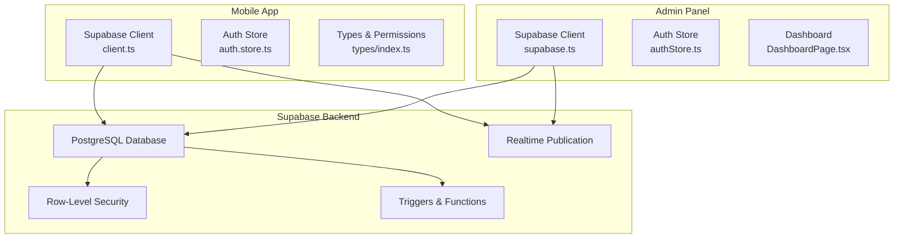

**Diagram sources**
- [client.ts](file://mobile/src/api/supabase/client.ts#L15-L27)
- [supabase.ts](file://admin/src/lib/supabase.ts#L10-L18)
- [007_rls_policies.sql](file://supabase/migrations/007_rls_policies.sql#L9-L36)
- [008_governance_functions.sql](file://supabase/migrations/008_governance_functions.sql#L498-L510)

**Section sources**
- [README.md](file://README.md#L1-L14)
- [client.ts](file://mobile/src/api/supabase/client.ts#L1-L87)
- [supabase.ts](file://admin/src/lib/supabase.ts#L1-L73)

## Core Components
- Real-time messaging: conversations, participants, messages, read receipts, typing indicators, muted users, message reports, and profanity filters
- Announcements and events: lifecycle, targeting, scheduling, visibility, and engagement metrics
- Presence and notifications: push tokens and presence records
- Governance and moderation: role hierarchy, ban/suspend/mute functions, reporting, and audit logging
- Authentication and permissions: institutional email validation, registration binding, and role-based access control

**Section sources**
- [005_messaging.sql](file://supabase/migrations/005_messaging.sql#L9-L321)
- [004_events_announcements.sql](file://supabase/migrations/004_events_announcements.sql#L9-L262)
- [007_rls_policies.sql](file://supabase/migrations/007_rls_policies.sql#L42-L510)
- [006_triggers.sql](file://supabase/migrations/006_triggers.sql#L9-L154)
- [008_governance_functions.sql](file://supabase/migrations/008_governance_functions.sql#L9-L284)
- [index.ts](file://mobile/src/types/index.ts#L1-L456)

## Architecture Overview
The system leverages Supabase for authentication, database, storage, and real-time subscriptions. The mobile app and admin panel share the same Supabase project and rely on RLS policies to enforce access control. Real-time updates are enabled for messaging, announcements, and events via the supabase_realtime publication.

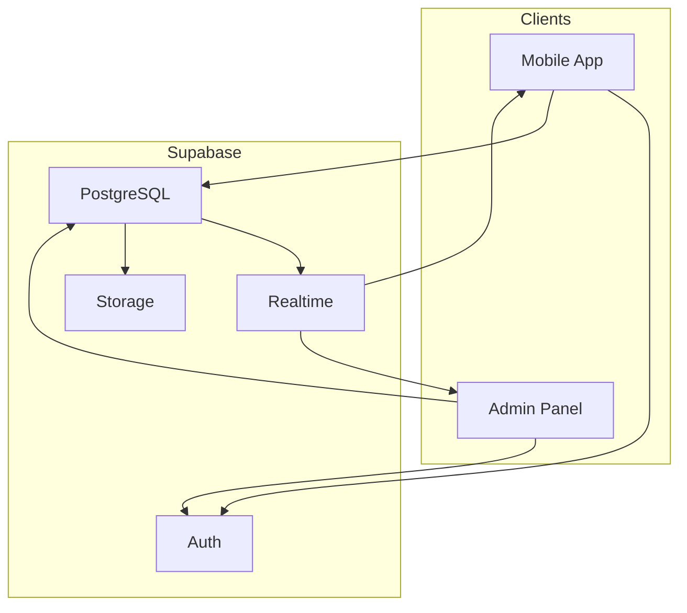

**Diagram sources**
- [client.ts](file://mobile/src/api/supabase/client.ts#L15-L27)
- [supabase.ts](file://admin/src/lib/supabase.ts#L10-L18)
- [008_governance_functions.sql](file://supabase/migrations/008_governance_functions.sql#L498-L510)

## Detailed Component Analysis

### Messaging System Architecture
The messaging system centers around conversations, participants, and messages with threading and moderation support. Real-time updates are delivered via Supabase Realtime, and presence-related signals (typing indicators) are tracked.

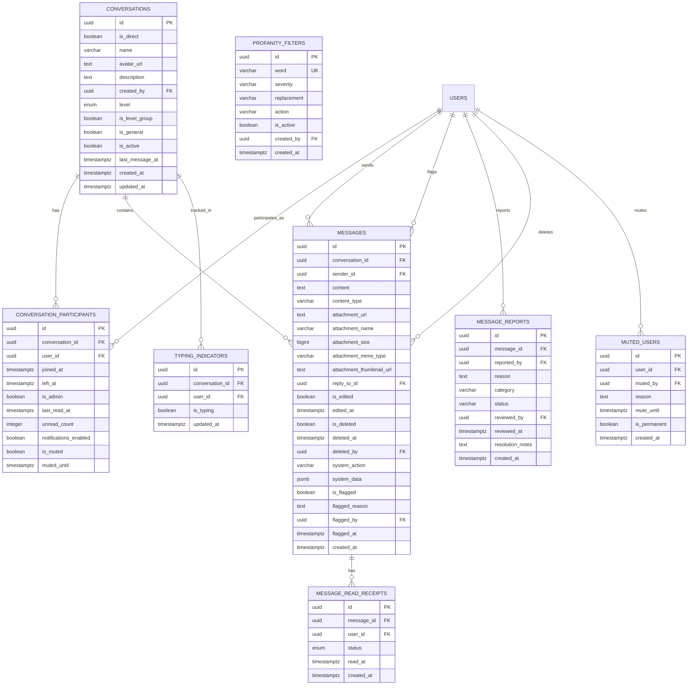

**Diagram sources**
- [005_messaging.sql](file://supabase/migrations/005_messaging.sql#L9-L321)

#### Real-time Subscriptions and Presence
- Realtime channels are created per conversation and broadcast message inserts, updates, and deletions.
- Typing indicators track who is currently typing in a conversation.
- Presence records capture user activity for presence-aware features.

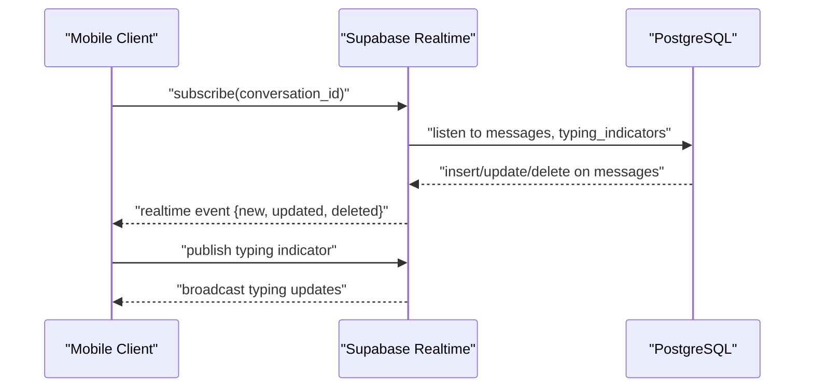

**Diagram sources**
- [client.ts](file://mobile/src/api/supabase/client.ts#L29-L32)
- [005_messaging.sql](file://supabase/migrations/005_messaging.sql#L176-L191)
- [008_governance_functions.sql](file://supabase/migrations/008_governance_functions.sql#L498-L510)

#### Conversation Management Workflows
- Creating a conversation (direct or group) and adding participants
- Managing unread counts and last message timestamps
- Enforcing mute and notification preferences per participant

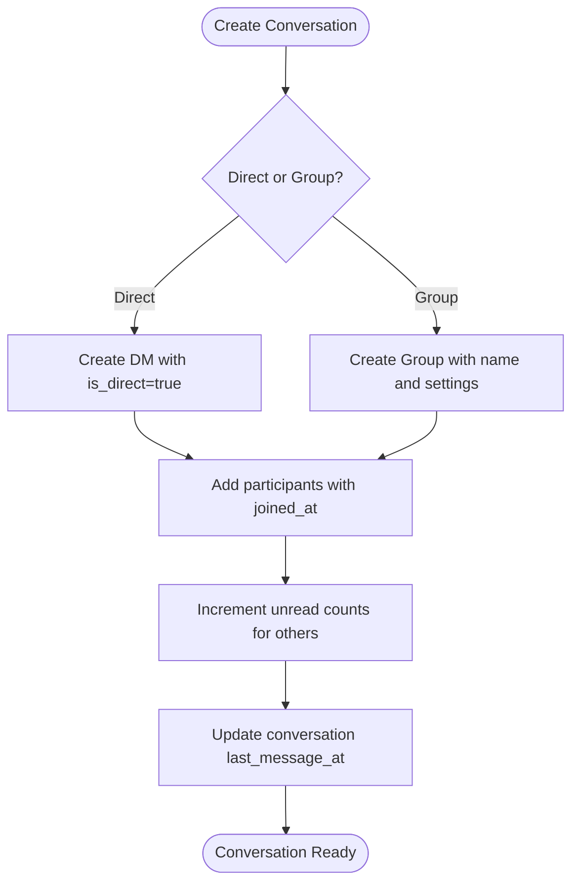

**Diagram sources**
- [005_messaging.sql](file://supabase/migrations/005_messaging.sql#L9-L41)
- [005_messaging.sql](file://supabase/migrations/005_messaging.sql#L277-L321)

#### Message Threading and Replies
- Messages can reference another message via reply_to_id to form threads
- Deleted messages are marked soft-deleted with metadata
- System messages can annotate conversation events (e.g., user joined/left)

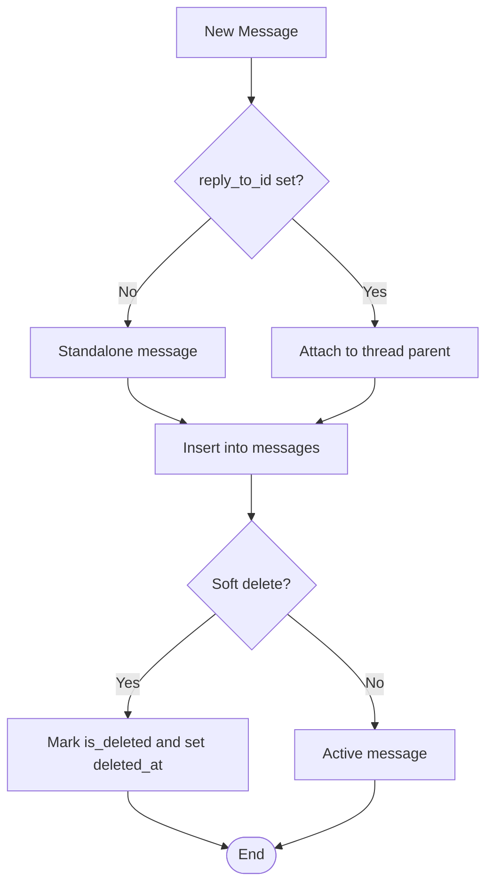

**Diagram sources**
- [005_messaging.sql](file://supabase/migrations/005_messaging.sql#L89-L127)
- [005_messaging.sql](file://supabase/migrations/005_messaging.sql#L105-L117)

#### Presence Detection
- Typing indicators are maintained per conversation and user
- Cleanup functions remove stale typing indicators automatically

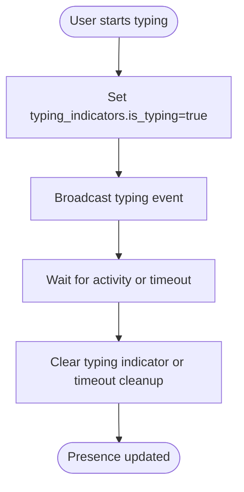

**Diagram sources**
- [005_messaging.sql](file://supabase/migrations/005_messaging.sql#L176-L191)
- [008_governance_functions.sql](file://supabase/migrations/008_governance_functions.sql#L438-L449)

### Announcement System
Announcements support targeting, scheduling, publishing, pinning, and view tracking. Events include lifecycle management, capacity tracking, and registration workflows.

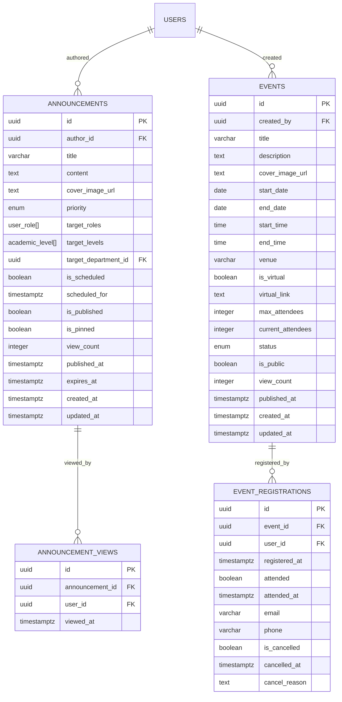

**Diagram sources**
- [004_events_announcements.sql](file://supabase/migrations/004_events_announcements.sql#L105-L160)
- [004_events_announcements.sql](file://supabase/migrations/004_events_announcements.sql#L69-L100)
- [004_events_announcements.sql](file://supabase/migrations/004_events_announcements.sql#L9-L51)

### Notification Mechanisms
- Push tokens are stored per user and device, enabling targeted push notifications
- Tokens are associated with device metadata and push service identifiers
- Activity logs capture administrative actions for audit trails

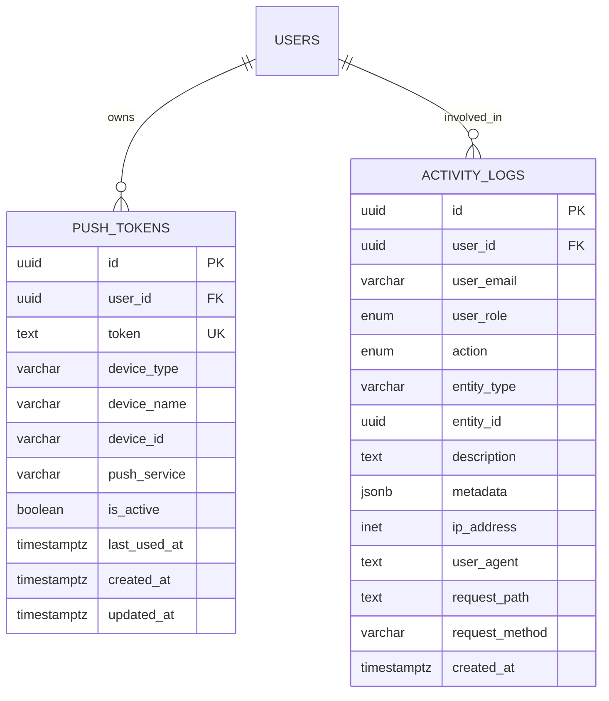

**Diagram sources**
- [006_triggers.sql](file://supabase/migrations/006_triggers.sql#L261-L291)
- [006_triggers.sql](file://supabase/migrations/006_triggers.sql#L220-L255)

### Content Moderation and Governance
- Role hierarchy defines permissions for users, moderators, super admins, and system owners
- Functions handle role assignment, banning, suspending, muting, and unmute
- Message reports and profanity filters support automated and manual moderation
- Audit logging captures all significant actions

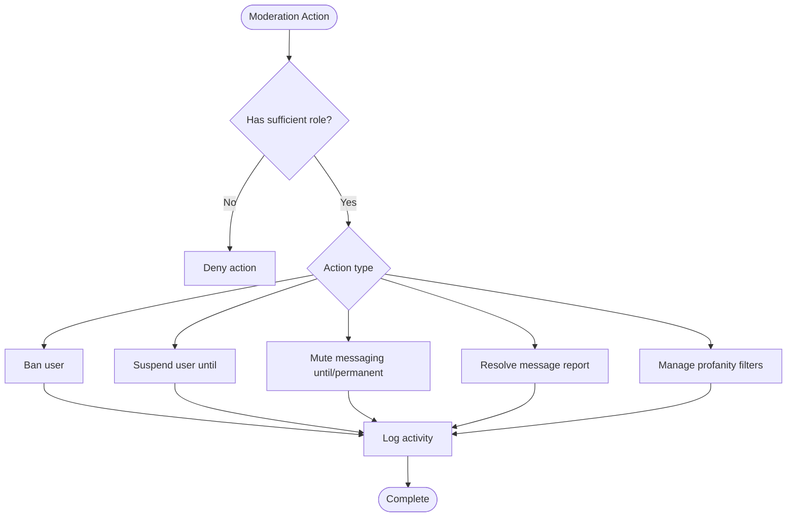

**Diagram sources**
- [008_governance_functions.sql](file://supabase/migrations/008_governance_functions.sql#L9-L284)
- [007_rls_policies.sql](file://supabase/migrations/007_rls_policies.sql#L42-L88)
- [005_messaging.sql](file://supabase/migrations/005_messaging.sql#L224-L250)

### Authentication and Security
- Institutional email validation ensures only UMYU LIS students use student accounts
- Registration number validation binds academic identity to email
- Login attempts are validated against account status (active, banned, suspended)
- Row-level security enforces fine-grained access control across all tables
- Activity logs record user actions for auditability

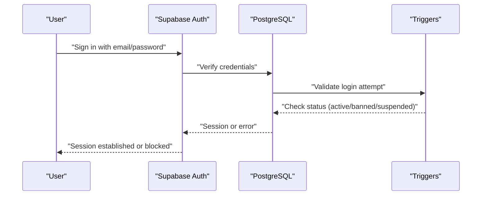

**Diagram sources**
- [auth.store.ts](file://mobile/src/stores/auth.store.ts#L99-L134)
- [006_triggers.sql](file://supabase/migrations/006_triggers.sql#L108-L154)
- [007_rls_policies.sql](file://supabase/migrations/007_rls_policies.sql#L94-L122)

### Admin Moderation Tools
- Dashboard displays system statistics and moderation alerts
- RPC function aggregates counts for users, content, messaging, engagement, and moderation
- Role-based access controls ensure only authorized users can manage content and users

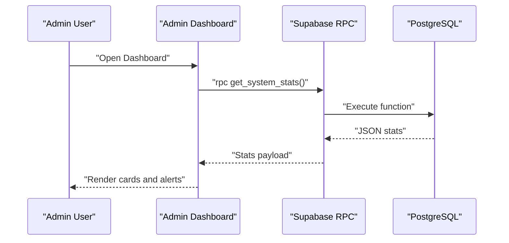

**Diagram sources**
- [DashboardPage.tsx](file://admin/src/pages/DashboardPage.tsx#L21-L31)
- [008_governance_functions.sql](file://supabase/migrations/008_governance_functions.sql#L290-L336)

**Section sources**
- [auth.store.ts](file://mobile/src/stores/auth.store.ts#L99-L134)
- [authStore.ts](file://admin/src/store/authStore.ts#L94-L172)
- [DashboardPage.tsx](file://admin/src/pages/DashboardPage.tsx#L21-L31)
- [006_triggers.sql](file://supabase/migrations/006_triggers.sql#L9-L154)
- [007_rls_policies.sql](file://supabase/migrations/007_rls_policies.sql#L314-L426)
- [008_governance_functions.sql](file://supabase/migrations/008_governance_functions.sql#L288-L336)

## Dependency Analysis
- Mobile and admin clients depend on shared Supabase configuration and environment variables
- Realtime subscriptions rely on the supabase_realtime publication being enabled for messaging and announcements
- RLS policies depend on helper functions to evaluate roles and statuses
- Governance functions encapsulate administrative operations and audit logging

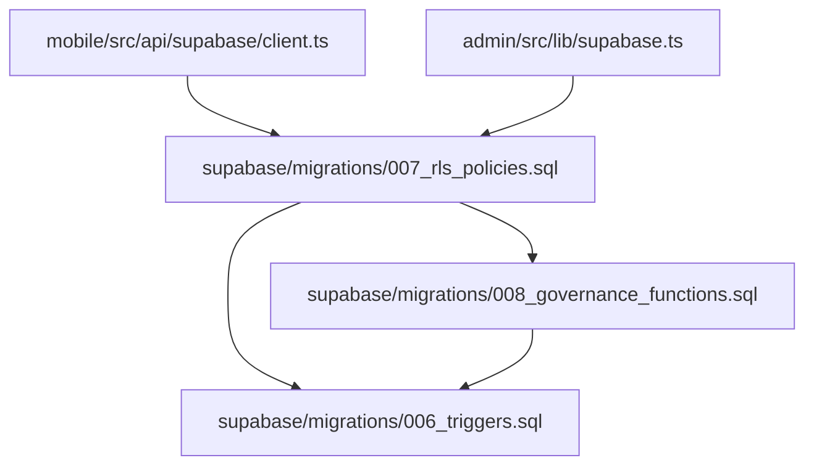

**Diagram sources**
- [client.ts](file://mobile/src/api/supabase/client.ts#L6-L27)
- [supabase.ts](file://admin/src/lib/supabase.ts#L3-L18)
- [007_rls_policies.sql](file://supabase/migrations/007_rls_policies.sql#L42-L88)
- [006_triggers.sql](file://supabase/migrations/006_triggers.sql#L108-L154)
- [008_governance_functions.sql](file://supabase/migrations/008_governance_functions.sql#L498-L510)

**Section sources**
- [client.ts](file://mobile/src/api/supabase/client.ts#L6-L27)
- [supabase.ts](file://admin/src/lib/supabase.ts#L3-L18)
- [007_rls_policies.sql](file://supabase/migrations/007_rls_policies.sql#L42-L88)
- [006_triggers.sql](file://supabase/migrations/006_triggers.sql#L108-L154)
- [008_governance_functions.sql](file://supabase/migrations/008_governance_functions.sql#L498-L510)

## Performance Considerations
- Realtime event rate limiting: the mobile client configures eventsPerSecond to control load
- Indexes on frequently queried columns (timestamps, foreign keys, flags) improve read performance
- Full-text search indexes support efficient content discovery
- Cleanup functions for typing indicators, rate limits, and expired sessions reduce storage overhead
- Use pagination and server-side filtering for large datasets (events, announcements, logs)

[No sources needed since this section provides general guidance]

## Troubleshooting Guide
Common issues and resolutions:
- Supabase environment variables missing: ensure EXPO_PUBLIC_SUPABASE_URL and EXPO_PUBLIC_SUPABASE_ANON_KEY are set in the mobile app and VITE_SUPABASE_URL and VITE_SUPABASE_ANON_KEY in the admin panel
- Authentication failures: verify institutional email format and registration binding; check login attempt validation for banned/suspended/pending users
- Realtime not updating: confirm supabase_realtime publication includes messaging and announcements tables
- RLS access denied: review policy conditions and user roles; ensure user status is active
- Push notifications not received: validate push tokens are registered and active; confirm device metadata and push service identifiers

**Section sources**
- [client.ts](file://mobile/src/api/supabase/client.ts#L9-L13)
- [supabase.ts](file://admin/src/lib/supabase.ts#L6-L8)
- [auth.store.ts](file://mobile/src/stores/auth.store.ts#L104-L107)
- [006_triggers.sql](file://supabase/migrations/006_triggers.sql#L108-L154)
- [008_governance_functions.sql](file://supabase/migrations/008_governance_functions.sql#L498-L510)
- [007_rls_policies.sql](file://supabase/migrations/007_rls_policies.sql#L317-L335)

## Conclusion
The platform provides a robust, real-time communication ecosystem with strong governance, moderation, and user management capabilities. Supabase’s real-time, RLS, and stored functions enable scalable, secure, and auditable operations across mobile and admin interfaces. The architecture supports institutional identity binding, presence detection, event-driven announcements, and comprehensive moderation workflows.