# Real-time Messaging

<cite>
**Referenced Files in This Document**
- [005_messaging.sql](file://supabase/migrations/005_messaging.sql)
- [008_governance_functions.sql](file://supabase/migrations/008_governance_functions.sql)
- [client.ts](file://mobile/src/api/supabase/client.ts)
- [messages.tsx](file://mobile/app/(tabs)/messages.tsx)
- [index.ts](file://mobile/src/types/index.ts)
</cite>

## Table of Contents
1. [Introduction](#introduction)
2. [Project Structure](#project-structure)
3. [Core Components](#core-components)
4. [Architecture Overview](#architecture-overview)
5. [Detailed Component Analysis](#detailed-component-analysis)
6. [Dependency Analysis](#dependency-analysis)
7. [Performance Considerations](#performance-considerations)
8. [Troubleshooting Guide](#troubleshooting-guide)
9. [Conclusion](#conclusion)

## Introduction
This document describes the real-time messaging system architecture, covering conversation management (direct messages and group conversations with level-based grouping), message threading, read receipts, typing indicators, and real-time synchronization via Supabase Realtime. It also documents participant management, role-based permissions, notification settings, content types and attachments, replies, moderation features, and the database schema with relationships and constraints. Finally, it outlines performance considerations, indexing strategies, and scalability patterns for large-scale messaging.

## Project Structure
The messaging system spans two primary areas:
- Backend database schema and triggers in Supabase migrations
- Frontend mobile application integrating Supabase client and Realtime subscriptions

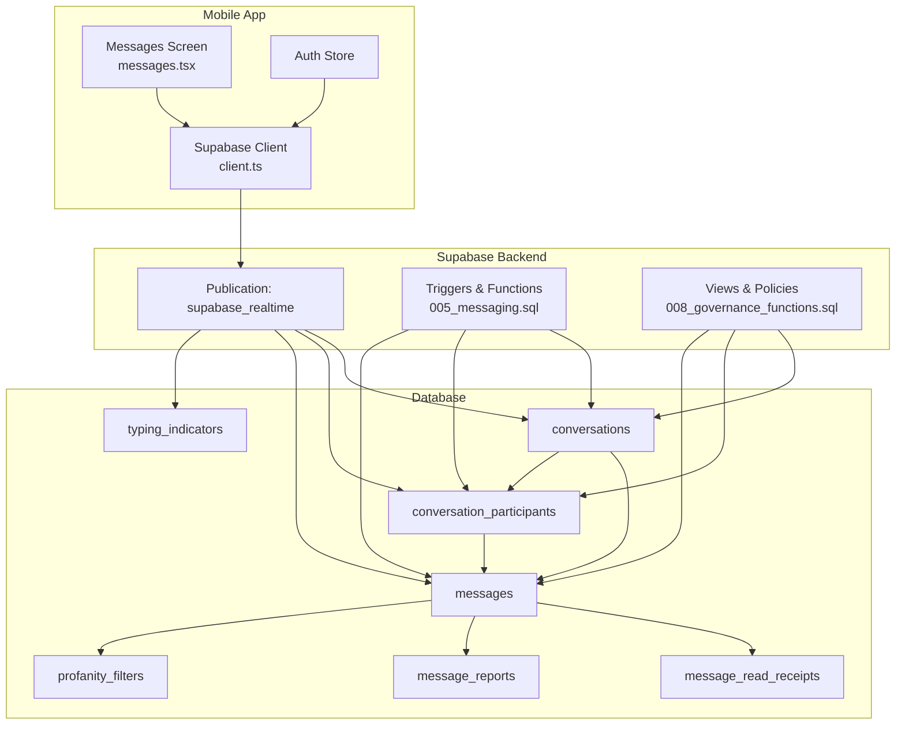

**Diagram sources**
- [messages.tsx](file://mobile/app/(tabs)/messages.tsx#L16-L65)
- [client.ts](file://mobile/src/api/supabase/client.ts#L15-L32)
- [005_messaging.sql](file://supabase/migrations/005_messaging.sql#L9-L321)
- [008_governance_functions.sql](file://supabase/migrations/008_governance_functions.sql#L501-L509)

**Section sources**
- [messages.tsx](file://mobile/app/(tabs)/messages.tsx#L16-L65)
- [client.ts](file://mobile/src/api/supabase/client.ts#L15-L32)
- [005_messaging.sql](file://supabase/migrations/005_messaging.sql#L9-L321)
- [008_governance_functions.sql](file://supabase/migrations/008_governance_functions.sql#L501-L509)

## Core Components
- Conversations: Direct or group chats with optional level-based grouping and general department-wide groups
- Participants: Membership with roles, read tracking, and notification settings
- Messages: Rich content with attachments, replies, edits, deletions, and moderation
- Read receipts: Delivery and read status tracking
- Typing indicators: Real-time presence of other users typing
- Moderation: Reports, flagging, and profanity filtering
- Realtime: Supabase Realtime publication enabling live updates

**Section sources**
- [005_messaging.sql](file://supabase/migrations/005_messaging.sql#L9-L191)
- [008_governance_functions.sql](file://supabase/migrations/008_governance_functions.sql#L501-L509)

## Architecture Overview
The frontend fetches conversations and subscribes to Supabase Realtime channels for live updates. Backend triggers maintain conversation timestamps, participant unread counts, and updated_at fields. Moderation and reporting tables support content governance.

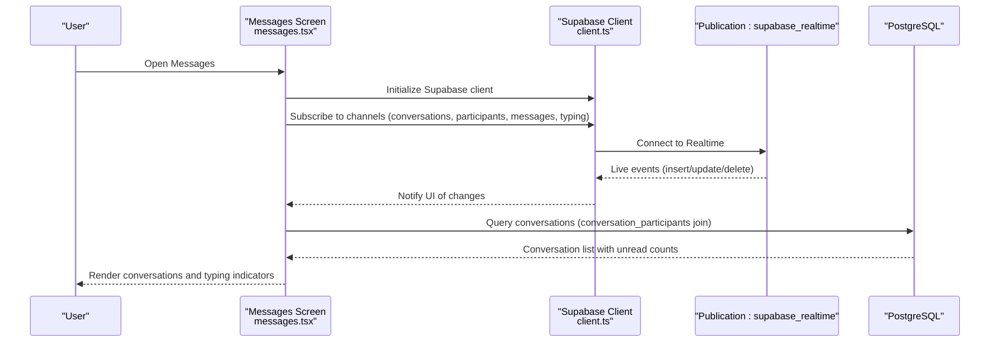

**Diagram sources**
- [messages.tsx](file://mobile/app/(tabs)/messages.tsx#L16-L65)
- [client.ts](file://mobile/src/api/supabase/client.ts#L15-L32)
- [008_governance_functions.sql](file://supabase/migrations/008_governance_functions.sql#L501-L509)

## Detailed Component Analysis

### Conversations
- Purpose: Stores chat rooms (direct or group), metadata, level-based grouping, and general department-wide groups
- Key attributes: Type flag, name, avatar, creator, level, general flag, activity status, last message timestamp
- Constraints: Group name required for non-direct conversations
- Indexes: Active status, last message ordering, level-based grouping, general groups

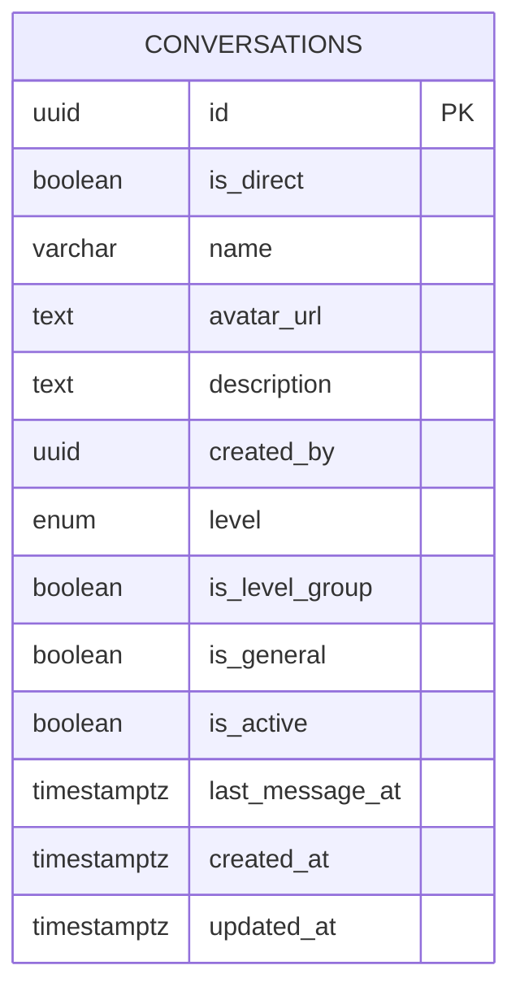

**Diagram sources**
- [005_messaging.sql](file://supabase/migrations/005_messaging.sql#L9-L44)

**Section sources**
- [005_messaging.sql](file://supabase/migrations/005_messaging.sql#L9-L44)

### Conversation Participants
- Purpose: Tracks who belongs to a conversation, roles, read status, and notification preferences
- Key attributes: Joined/Left timestamps, admin flag, last read timestamp, unread count, notification settings, muting
- Indexes: Per-conversation lookup, per-user lookup, unread counts, active memberships

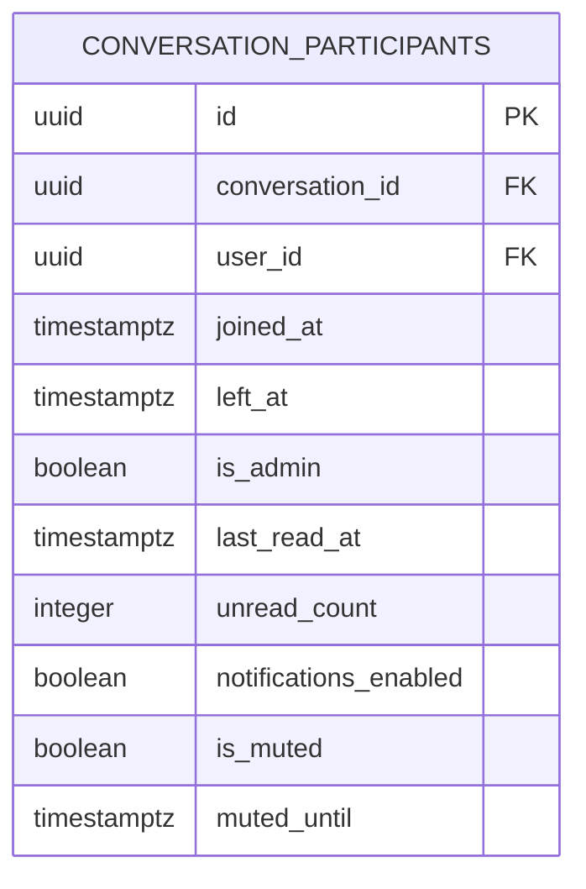

**Diagram sources**
- [005_messaging.sql](file://supabase/migrations/005_messaging.sql#L50-L83)

**Section sources**
- [005_messaging.sql](file://supabase/migrations/005_messaging.sql#L50-L83)

### Messages
- Purpose: Stores messages with rich content, attachments, threading via replies, system actions, moderation flags, and timestamps
- Key attributes: Content type, attachments, reply-to, edit/deleted flags, system action/data, moderation flags, timestamps
- Indexes: Conversation-ordered retrieval, sender, reply chain, creation time, active messages, full-text search

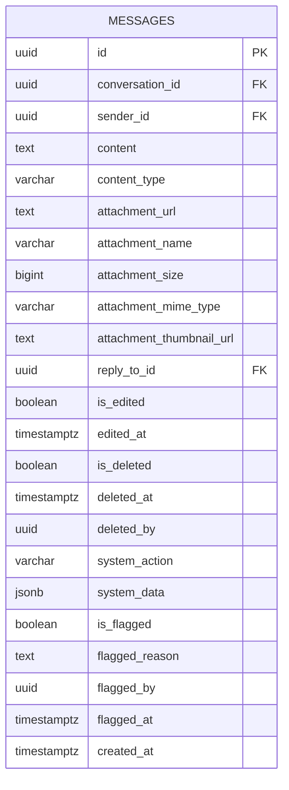

**Diagram sources**
- [005_messaging.sql](file://supabase/migrations/005_messaging.sql#L89-L145)

**Section sources**
- [005_messaging.sql](file://supabase/migrations/005_messaging.sql#L89-L145)

### Message Read Receipts
- Purpose: Tracks delivery and read status per user per message
- Attributes: Status, read timestamp, creation timestamp
- Indexes: Message/user/status for efficient lookups

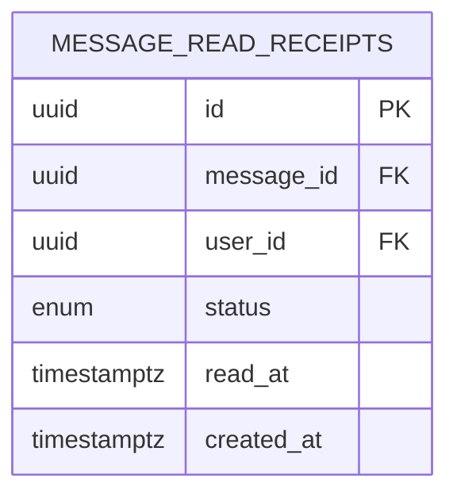

**Diagram sources**
- [005_messaging.sql](file://supabase/migrations/005_messaging.sql#L151-L170)

**Section sources**
- [005_messaging.sql](file://supabase/migrations/005_messaging.sql#L151-L170)

### Typing Indicators
- Purpose: Real-time typing presence per conversation
- Attributes: Typing flag, last updated timestamp
- Indexes: Conversation-based lookup

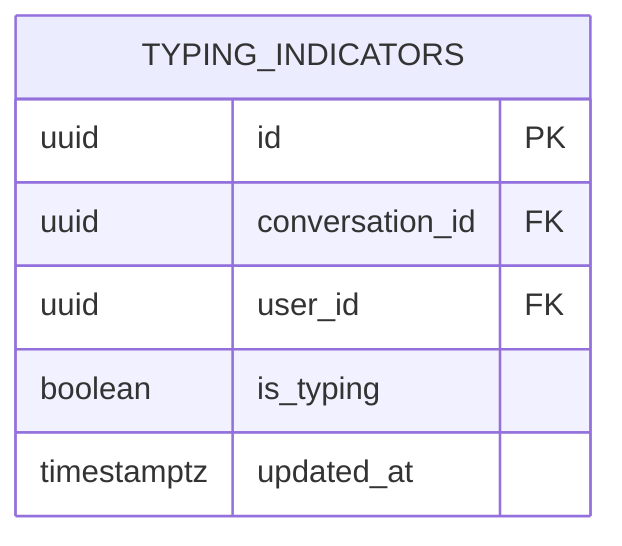

**Diagram sources**
- [005_messaging.sql](file://supabase/migrations/005_messaging.sql#L176-L191)

**Section sources**
- [005_messaging.sql](file://supabase/migrations/005_messaging.sql#L176-L191)

### Moderation and Reporting
- Message Reports: Tracks user-reported messages with categories and resolution status
- Profanity Filters: Word list with severity and actions for moderation
- Muted Users: Records user-level muting by admins/moderators

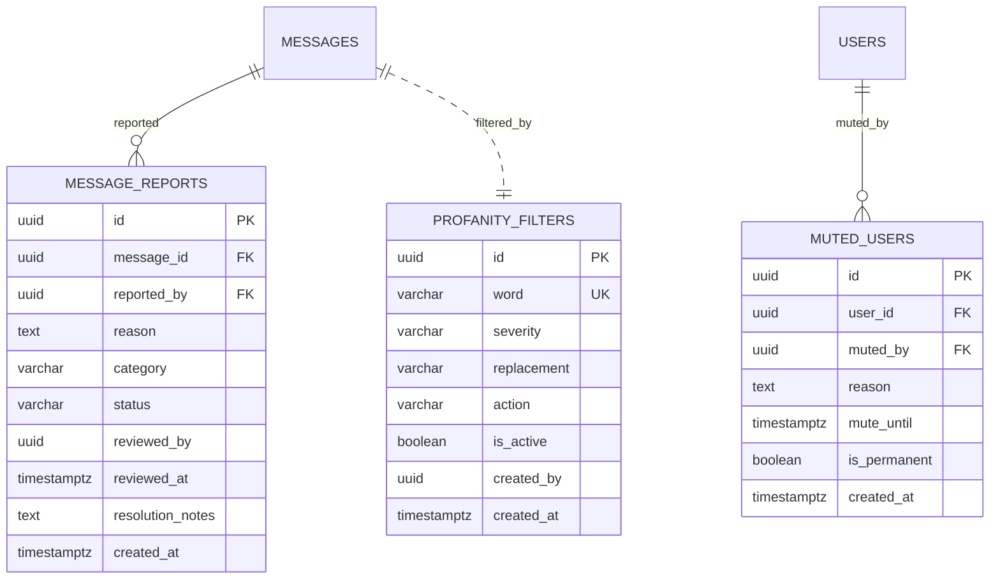

**Diagram sources**
- [005_messaging.sql](file://supabase/migrations/005_messaging.sql#L224-L271)

**Section sources**
- [005_messaging.sql](file://supabase/migrations/005_messaging.sql#L224-L271)

### Triggers and Automatic Behaviors
- Conversation last message timestamp update on new message
- Unread count increment for participants (excluding sender, muted, or left)
- Updated-at column maintenance for conversations

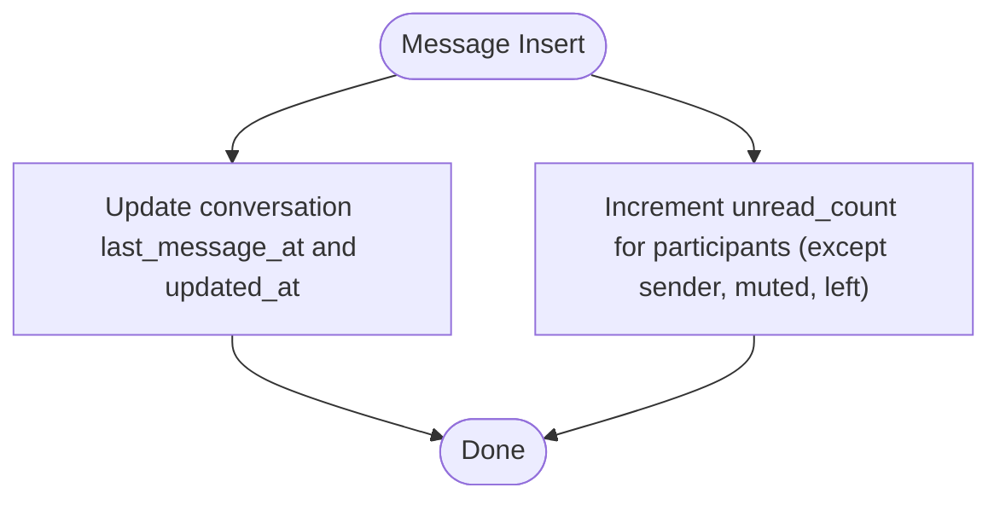

**Diagram sources**
- [005_messaging.sql](file://supabase/migrations/005_messaging.sql#L277-L321)

**Section sources**
- [005_messaging.sql](file://supabase/migrations/005_messaging.sql#L277-L321)

### Frontend Integration and Realtime
- Mobile screen fetches conversations via a join of conversation_participants and conversations, orders by last_read_at, and displays unread counts
- Supabase client configured with Realtime events per second limit and helper for channels
- Supabase Realtime publication enabled for messaging tables

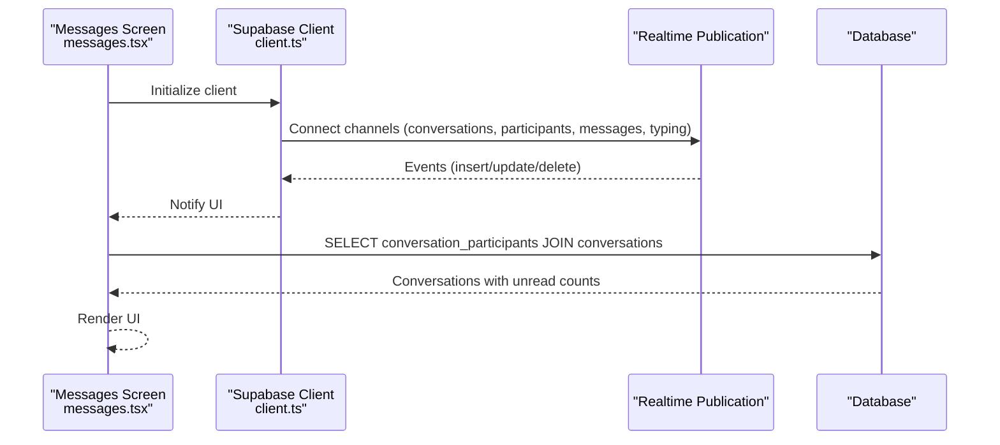

**Diagram sources**
- [messages.tsx](file://mobile/app/(tabs)/messages.tsx#L16-L65)
- [client.ts](file://mobile/src/api/supabase/client.ts#L15-L32)
- [008_governance_functions.sql](file://supabase/migrations/008_governance_functions.sql#L501-L509)

**Section sources**
- [messages.tsx](file://mobile/app/(tabs)/messages.tsx#L16-L65)
- [client.ts](file://mobile/src/api/supabase/client.ts#L15-L32)
- [008_governance_functions.sql](file://supabase/migrations/008_governance_functions.sql#L501-L509)

### Role-Based Permissions and Notification Settings
- Roles and permissions are defined centrally and include messaging capabilities
- Participants carry notification settings and muting controls

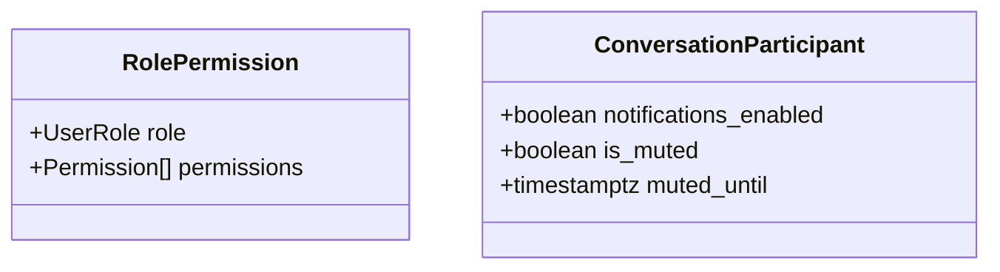

**Diagram sources**
- [index.ts](file://mobile/src/types/index.ts#L410-L447)
- [005_messaging.sql](file://supabase/migrations/005_messaging.sql#L66-L69)

**Section sources**
- [index.ts](file://mobile/src/types/index.ts#L410-L447)
- [005_messaging.sql](file://supabase/migrations/005_messaging.sql#L66-L69)

## Dependency Analysis
- Conversations ↔ Messages: One-to-many relationship via conversation_id
- Conversations ↔ Participants: One-to-many relationship via conversation_id
- Participants ↔ Users: Many-to-one via user_id
- Messages ↔ Messages (threading): Self-reference via reply_to_id
- Read receipts ↔ Messages/Users: Many-to-one to both
- Typing indicators ↔ Conversations/Users: Many-to-one to both
- Moderation: Reports link to messages; filters apply to messages; muted users link to users

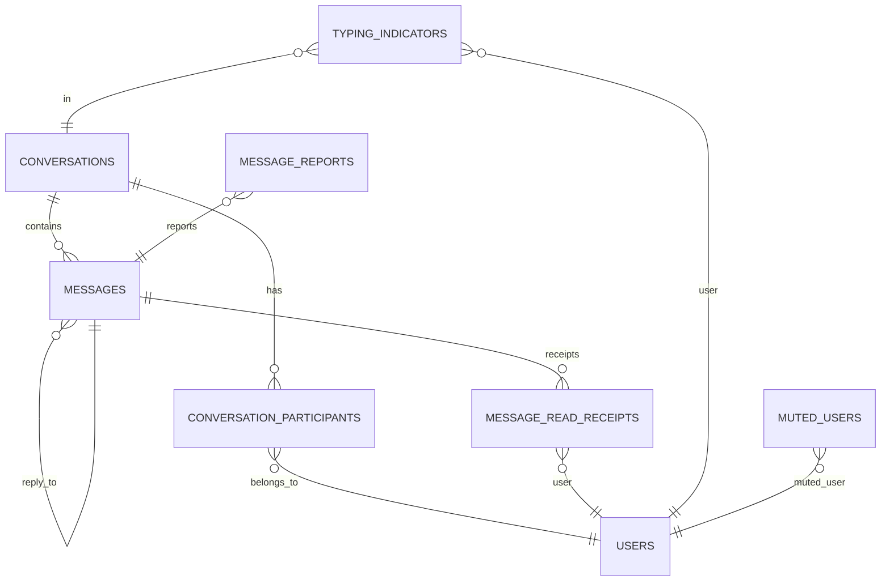

**Diagram sources**
- [005_messaging.sql](file://supabase/migrations/005_messaging.sql#L9-L191)

**Section sources**
- [005_messaging.sql](file://supabase/migrations/005_messaging.sql#L9-L191)

## Performance Considerations
- Indexing strategy
  - Conversations: Active status, last_message_at descending, level/general filters
  - Participants: Conversation/user, unread counts with partial index, active membership
  - Messages: Conversation-ordered by created_at, sender, reply chain, created_at, flagged, active messages, full-text search
  - Read receipts: message/user/status
  - Typing indicators: conversation-based
  - Moderation: active filters and word indexing
- Triggers
  - Minimal overhead: lightweight updates for last_message_at and unread counts
- Realtime
  - Controlled events-per-second to balance responsiveness and bandwidth
- Scalability patterns
  - Partitioning: level-based groups and general groups reduce query scope
  - Pagination: fetch messages per conversation with cursor-based pagination
  - Caching: unread counts and recent previews cached in memory
  - Offloading heavy moderation tasks to background jobs if needed

[No sources needed since this section provides general guidance]

## Troubleshooting Guide
- Realtime not updating
  - Verify publication includes messaging tables
  - Confirm client initialization and channel creation
- Missing conversations
  - Ensure participant records are not marked as left
  - Check ordering by last_read_at and active flags
- Typing indicators not appearing
  - Confirm typing indicator entries and channel subscription
- Moderation issues
  - Validate report statuses and flagged flags
  - Check profanity filter activation and word normalization

**Section sources**
- [008_governance_functions.sql](file://supabase/migrations/008_governance_functions.sql#L501-L509)
- [client.ts](file://mobile/src/api/supabase/client.ts#L15-L32)
- [005_messaging.sql](file://supabase/migrations/005_messaging.sql#L176-L191)
- [005_messaging.sql](file://supabase/migrations/005_messaging.sql#L224-L271)

## Conclusion
The messaging system integrates robust database modeling with Supabase Realtime to deliver responsive direct and group conversations, level-based grouping, threaded replies, read receipts, typing indicators, and comprehensive moderation. Carefully designed indexes and triggers ensure performance at scale, while role-based permissions and notification settings provide flexibility for diverse user needs.