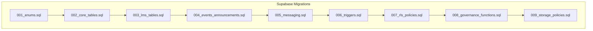
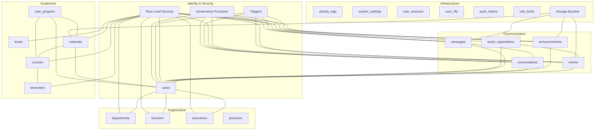

# Core Entities

<cite>
**Referenced Files in This Document**
- [README.md](file://README.md)
- [001_enums.sql](file://supabase/migrations/001_enums.sql)
- [002_core_tables.sql](file://supabase/migrations/002_core_tables.sql)
- [003_lms_tables.sql](file://supabase/migrations/003_lms_tables.sql)
- [004_events_announcements.sql](file://supabase/migrations/004_events_announcements.sql)
- [005_messaging.sql](file://supabase/migrations/005_messaging.sql)
- [006_triggers.sql](file://supabase/migrations/006_triggers.sql)
- [007_rls_policies.sql](file://supabase/migrations/007_rls_policies.sql)
- [008_governance_functions.sql](file://supabase/migrations/008_governance_functions.sql)
- [009_storage_policies.sql](file://supabase/migrations/009_storage_policies.sql)
- [database.types.ts](file://mobile/src/api/database.types.ts)
- [index.ts](file://mobile/src/types/index.ts)
</cite>

## Table of Contents
1. [Introduction](#introduction)
2. [Project Structure](#project-structure)
3. [Core Components](#core-components)
4. [Architecture Overview](#architecture-overview)
5. [Detailed Component Analysis](#detailed-component-analysis)
6. [Dependency Analysis](#dependency-analysis)
7. [Performance Considerations](#performance-considerations)
8. [Troubleshooting Guide](#troubleshooting-guide)
9. [Conclusion](#conclusion)
10. [Appendices](#appendices)

## Introduction
This document provides comprehensive data model documentation for Naliss UMYU Hub’s core entity tables. It focuses on the user management system, department and faculty structures, program hierarchies, and organizational relationships. It also explains enum definitions, table schemas with primary keys, foreign keys, indexes, and constraints, along with data validation rules, defaults, and business logic. Entity relationship diagrams illustrate connections among users, departments, programs, and hierarchical relationships. Finally, it addresses data access patterns, cascading operations, and referential integrity enforcement.

## Project Structure
The data model is implemented as PostgreSQL migrations within the Supabase project. The migrations are ordered to establish enums, core tables, LMS tables, events and announcements, messaging, triggers, row-level security, governance functions, and storage policies. The frontend types align with the database schema for strong typing across the stack.



**Diagram sources**
- [001_enums.sql](file://supabase/migrations/001_enums.sql#L1-L167)
- [002_core_tables.sql](file://supabase/migrations/002_core_tables.sql#L1-L252)
- [003_lms_tables.sql](file://supabase/migrations/003_lms_tables.sql#L1-L262)
- [004_events_announcements.sql](file://supabase/migrations/004_events_announcements.sql#L1-L262)
- [005_messaging.sql](file://supabase/migrations/005_messaging.sql#L1-L321)
- [006_triggers.sql](file://supabase/migrations/006_triggers.sql#L1-L436)
- [007_rls_policies.sql](file://supabase/migrations/007_rls_policies.sql#L1-L510)
- [008_governance_functions.sql](file://supabase/migrations/008_governance_functions.sql#L1-L577)
- [009_storage_policies.sql](file://supabase/migrations/009_storage_policies.sql#L1-L402)

**Section sources**
- [README.md](file://README.md#L145-L186)

## Core Components
This section outlines the core entities and their responsibilities:
- Users: Extended profiles with role, status, academic affiliation, and governance fields.
- Departments: Academic units with contact and operational metadata.
- Lecturers: Faculty directory entries with professional details.
- Executives: Student leadership with term and position metadata.
- Presence: Real-time online status tracking.
- Levels, Semesters, Courses, Materials: Academic hierarchy and learning resources.
- Events and Announcements: Organizational communication channels.
- Conversations, Messages, Participants: Real-time messaging infrastructure.
- Governance tables: Audit logs, system settings, sessions, 2FA, push tokens, rate limits.

**Section sources**
- [002_core_tables.sql](file://supabase/migrations/002_core_tables.sql#L9-L76)
- [003_lms_tables.sql](file://supabase/migrations/003_lms_tables.sql#L9-L92)
- [004_events_announcements.sql](file://supabase/migrations/004_events_announcements.sql#L9-L141)
- [005_messaging.sql](file://supabase/migrations/005_messaging.sql#L9-L127)
- [006_triggers.sql](file://supabase/migrations/006_triggers.sql#L9-L154)
- [007_rls_policies.sql](file://supabase/migrations/007_rls_policies.sql#L9-L37)
- [008_governance_functions.sql](file://supabase/migrations/008_governance_functions.sql#L9-L68)
- [009_storage_policies.sql](file://supabase/migrations/009_storage_policies.sql#L273-L320)

## Architecture Overview
The system enforces a strict role hierarchy and row-level security. Triggers enforce institutional email validation, registration binding, and login checks. Governance functions centralize role assignment, bans, suspensions, and moderation. Storage policies govern file uploads across buckets. Frontend types mirror the database schema for type safety.



**Diagram sources**
- [002_core_tables.sql](file://supabase/migrations/002_core_tables.sql#L9-L174)
- [003_lms_tables.sql](file://supabase/migrations/003_lms_tables.sql#L9-L188)
- [004_events_announcements.sql](file://supabase/migrations/004_events_announcements.sql#L9-L173)
- [005_messaging.sql](file://supabase/migrations/005_messaging.sql#L9-L218)
- [006_triggers.sql](file://supabase/migrations/006_triggers.sql#L9-L154)
- [007_rls_policies.sql](file://supabase/migrations/007_rls_policies.sql#L9-L37)
- [008_governance_functions.sql](file://supabase/migrations/008_governance_functions.sql#L9-L68)
- [009_storage_policies.sql](file://supabase/migrations/009_storage_policies.sql#L12-L220)

## Detailed Component Analysis

### Enum Definitions
Enums define standardized values across the system:
- user_role: student, moderator, super_admin, system_owner
- account_status: pending_verification, active, suspended, banned
- academic_level: 100, 200, 300, 400, 500, postgraduate
- semester_type: first, second, summer
- event_status: draft, published, ongoing, completed, cancelled
- material_type: note, assignment, past_question, video, link, document
- announcement_priority: low, normal, high, urgent
- message_status: sent, delivered, read
- log_action: user.*, message.*, material.*, event.*, announcement.*, admin.*, settings.*

Helper functions compare roles numerically and enforce role-gating.

**Section sources**
- [001_enums.sql](file://supabase/migrations/001_enums.sql#L10-L167)

### Users
- Purpose: Extended user profiles bound to Supabase Auth.
- Primary key: id (UUID) references auth.users(id) with ON DELETE CASCADE.
- Foreign keys: department_id -> departments(id) with ON DELETE SET NULL.
- Notable fields: registration_number (UNIQUE), email (UNIQUE), role (default student), status (default pending_verification), level, ban/suspension tracking.
- Defaults: created_at, updated_at timestamps; last_active_at; email_verified_at, registration_verified_at.
- Indexes: email, registration_number, role, status, department_id, level, created_at desc, last_active_at desc.
- Triggers: update_updated_at on updates.
- RLS: Select own profile; admins can select all; only super admins can manage users; cannot change own role/status.

Validation and constraints:
- Trigger validates institutional email format for non-admin roles.
- Trigger validates registration number format and cross-checks email suffix; sets registration_verified_at on insert.
- Login attempt validation checks status and updates last_active_at.

**Section sources**
- [002_core_tables.sql](file://supabase/migrations/002_core_tables.sql#L43-L76)
- [006_triggers.sql](file://supabase/migrations/006_triggers.sql#L9-L101)
- [006_triggers.sql](file://supabase/migrations/006_triggers.sql#L107-L154)
- [007_rls_policies.sql](file://supabase/migrations/007_rls_policies.sql#L94-L121)

### Departments
- Purpose: Academic departments with contact and operational metadata.
- Primary key: id (UUID).
- Unique constraints: name (UNIQUE), code (UNIQUE).
- Fields: description, logo_url, office_location, contact_email, contact_phone, is_active (default TRUE).
- Indexes: code, is_active.
- Triggers: update_updated_at on updates.
- RLS: Active departments readable by authenticated users; super admins can manage.

**Section sources**
- [002_core_tables.sql](file://supabase/migrations/002_core_tables.sql#L9-L29)
- [007_rls_policies.sql](file://supabase/migrations/007_rls_policies.sql#L127-L143)

### Lecturers
- Purpose: Faculty directory with professional details.
- Primary key: id (UUID).
- Foreign key: department_id -> departments(id) with ON DELETE CASCADE.
- Fields: title, position, specialization, office_location, office_hours, bio, qualifications, is_active (default TRUE), display_order (default 0).
- Indexes: department_id, is_active, display_order.
- Triggers: update_updated_at on updates.
- RLS: Active lecturers readable by authenticated users; admins can manage within their department.

**Section sources**
- [002_core_tables.sql](file://supabase/migrations/002_core_tables.sql#L98-L126)
- [007_rls_policies.sql](file://supabase/migrations/007_rls_policies.sql#L149-L161)

### Executives
- Purpose: Student leadership with term and position metadata.
- Primary key: id (UUID).
- Foreign keys: user_id -> users(id) with ON DELETE SET NULL; department_id -> departments(id) with ON DELETE CASCADE.
- Fields: position, position_code, academic_session, start_date, end_date, is_current (default TRUE), display_order (default 0), social_links (JSONB).
- Unique constraint: (position_code, department_id, academic_session).
- Indexes: department_id, user_id, academic_session, is_current.
- Triggers: update_updated_at on updates.
- RLS: Executives readable by authenticated users; admins can manage.

**Section sources**
- [002_core_tables.sql](file://supabase/migrations/002_core_tables.sql#L140-L174)
- [007_rls_policies.sql](file://supabase/migrations/007_rls_policies.sql#L167-L175)

### Presence
- Purpose: Real-time user presence tracking.
- Primary key: user_id (UUID) references users(id) with ON DELETE CASCADE.
- Fields: status (default online), last_seen (default NOW), device_info (JSONB).
- Indexes: status, last_seen desc.
- RLS: Presence readable by non-banned users; users can update own presence.

**Section sources**
- [002_core_tables.sql](file://supabase/migrations/002_core_tables.sql#L189-L194)
- [007_rls_policies.sql](file://supabase/migrations/007_rls_policies.sql#L431-L435)

### Levels
- Purpose: Academic levels (100–500, postgraduate).
- Primary key: id (UUID).
- Unique constraint: level (across enum values).
- Fields: display_name, description, display_order (default 0), is_active (default TRUE).
- Indexes: display_order.
- Seed data inserted for all academic levels.

**Section sources**
- [003_lms_tables.sql](file://supabase/migrations/003_lms_tables.sql#L9-L17)

### Semesters
- Purpose: Semester definitions per level and academic session.
- Primary key: id (UUID).
- Foreign key: level_id -> levels(id) with ON DELETE CASCADE.
- Fields: semester (enum), display_name, is_current (default FALSE), academic_session, start_date, end_date, is_active (default TRUE).
- Unique constraint: (level_id, semester, academic_session).
- Indexes: level_id, is_current, academic_session, is_active.

**Section sources**
- [003_lms_tables.sql](file://supabase/migrations/003_lms_tables.sql#L38-L51)

### Courses
- Purpose: Course catalog organized by semester.
- Primary key: id (UUID).
- Foreign key: semester_id -> semesters(id) with ON DELETE CASCADE.
- Fields: code (UNIQUE per semester), title, description, credit_units (default 2), is_core (default TRUE), is_elective (default FALSE), lecturer_id -> lecturers(id) with ON DELETE SET NULL, is_active (default TRUE), display_order (default 0).
- Indexes: semester_id, code, lecturer_id, is_active, display_order.
- Triggers: update_updated_at on updates.

**Section sources**
- [003_lms_tables.sql](file://supabase/migrations/003_lms_tables.sql#L66-L92)

### Materials
- Purpose: Academic materials (notes, assignments, past questions, videos, links, documents).
- Primary key: id (UUID).
- Foreign keys: course_id -> courses(id) with ON DELETE CASCADE; uploaded_by -> users(id) with ON DELETE CASCADE.
- Fields: title, description, material_type (enum), file metadata (url, name, size, mime), external_url, video metadata, access controls (is_public, is_downloadable), engagement metrics (view_count, download_count), is_active (default TRUE), is_featured (default FALSE).
- Indexes: course_id, uploaded_by, material_type, is_active, is_featured, created_at desc, view_count desc.
- Full-text search index on title and description.
- Triggers: update_updated_at on updates; functions to increment view/download counts.

**Section sources**
- [003_lms_tables.sql](file://supabase/migrations/003_lms_tables.sql#L108-L146)

### User Progress
- Purpose: Track user progress through materials.
- Primary key: id (UUID).
- Foreign keys: user_id -> users(id) with ON DELETE CASCADE; course_id -> courses(id) with ON DELETE CASCADE; material_id -> materials(id) with ON DELETE CASCADE.
- Fields: progress_percent (default 0), is_completed (default FALSE), completed_at, last_position (default 0), last_accessed (default NOW).
- Unique constraint: (user_id, material_id).
- Indexes: user_id, course_id, material_id, is_completed.

**Section sources**
- [003_lms_tables.sql](file://supabase/migrations/003_lms_tables.sql#L168-L188)

### Bookmarks
- Purpose: User bookmarks for materials.
- Primary key: id (UUID).
- Foreign keys: user_id -> users(id) with ON DELETE CASCADE; material_id -> materials(id) with ON DELETE CASCADE.
- Unique constraint: (user_id, material_id).
- Indexes: user_id, material_id.

**Section sources**
- [003_lms_tables.sql](file://supabase/migrations/003_lms_tables.sql#L203-L211)

### Events
- Purpose: Events management with lifecycle tracking.
- Primary key: id (UUID).
- Foreign key: created_by -> users(id) with ON DELETE CASCADE.
- Fields: title, description, cover_image_url, scheduling (start_date, end_date, start_time, end_time), venue, is_virtual, virtual_link, capacity (max_attendees, current_attendees), status (enum, default draft), visibility (is_public), engagement (view_count), timestamps (published_at).
- Constraints: valid_dates (end_date >= start_date or null), valid_attendees (max_attendees >= current_attendees or null).
- Indexes: created_by, status, dates, is_public, created_at desc.
- Full-text search index on title and description.
- Triggers: update_updated_at on updates; attendee count management; view count increment function.

**Section sources**
- [004_events_announcements.sql](file://supabase/migrations/004_events_announcements.sql#L9-L50)
- [004_events_announcements.sql](file://supabase/migrations/004_events_announcements.sql#L199-L226)
- [004_events_announcements.sql](file://supabase/migrations/004_events_announcements.sql#L232-L239)

### Event Registrations
- Purpose: User registrations for events.
- Primary key: id (UUID).
- Foreign keys: event_id -> events(id) with ON DELETE CASCADE; user_id -> users(id) with ON DELETE CASCADE.
- Fields: registered_at (default NOW), attended (default FALSE), attended_at, contact info captured at registration, cancellation flags and reasons.
- Unique constraint: (event_id, user_id).
- Indexes: event_id, user_id, attended, is_cancelled.

**Section sources**
- [004_events_announcements.sql](file://supabase/migrations/004_events_announcements.sql#L70-L90)

### Announcements
- Purpose: System announcements with targeting and scheduling.
- Primary key: id (UUID).
- Foreign key: author_id -> users(id) with ON DELETE CASCADE.
- Fields: title, content, cover_image_url, priority (enum, default normal), target_roles (array of user_role), target_department_id -> departments(id) with ON DELETE SET NULL, scheduling (is_scheduled, scheduled_for), status (is_published, is_pinned), engagement (view_count), timestamps (published_at, expires_at).
- Constraints: valid_schedule (scheduled_for must be present when is_scheduled is true).
- Indexes: author_id, is_published, is_pinned, priority, target_department_id, created_at desc, expires_at (when not null), scheduled_for (when is_scheduled=true).
- Full-text search index on title and content.
- Triggers: update_updated_at on updates; view count increment function.

**Section sources**
- [004_events_announcements.sql](file://supabase/migrations/004_events_announcements.sql#L105-L141)
- [004_events_announcements.sql](file://supabase/migrations/004_events_announcements.sql#L245-L261)

### Announcement Views
- Purpose: Track announcement views per user.
- Primary key: id (UUID).
- Foreign keys: announcement_id -> announcements(id) with ON DELETE CASCADE; user_id -> users(id) with ON DELETE CASCADE.
- Unique constraint: (announcement_id, user_id).
- Indexes: announcement_id, user_id.

**Section sources**
- [004_events_announcements.sql](file://supabase/migrations/004_events_announcements.sql#L165-L173)

### Conversations
- Purpose: Chat conversations (direct messages and groups).
- Primary key: id (UUID).
- Fields: is_direct (default TRUE), name (required for groups), avatar_url, description, created_by -> users(id) with ON DELETE SET NULL, level (academic_level), is_level_group (default FALSE), is_general (default FALSE), is_active (default TRUE), last_message_at, timestamps.
- Constraints: group_name_required (name must be present for groups).
- Indexes: is_active, last_message_at desc, level (when is_level_group), is_general (when true).

**Section sources**
- [005_messaging.sql](file://supabase/migrations/005_messaging.sql#L9-L35)

### Conversation Participants
- Purpose: Conversation membership and read status.
- Primary key: id (UUID).
- Foreign keys: conversation_id -> conversations(id) with ON DELETE CASCADE; user_id -> users(id) with ON DELETE CASCADE.
- Fields: joined_at (default NOW), left_at, admin flag (is_admin), read tracking (last_read_at), unread_count (default 0), notifications (enabled, muted, muted_until), timestamps.
- Unique constraint: (conversation_id, user_id).
- Indexes: conversation_id, user_id, unread_count > 0, active membership (left_at IS NULL).

**Section sources**
- [005_messaging.sql](file://supabase/migrations/005_messaging.sql#L50-L72)

### Messages
- Purpose: Chat messages with threading and moderation support.
- Primary key: id (UUID).
- Foreign keys: conversation_id -> conversations(id) with ON DELETE CASCADE; sender_id -> users(id) with ON DELETE CASCADE.
- Fields: content, content_type (default text), attachment metadata, reply_to_id -> messages(id) with ON DELETE SET NULL, editing/deletion flags and timestamps, moderation fields (is_flagged, flagged_by, flagged_at), system messages (system_action, system_data), timestamps.
- Indexes: conversation_id+created_at desc, sender_id, reply_to_id, created_at desc, flagged (when true).
- Partial index for active messages (not deleted).
- Full-text search index on content (when not deleted).
- Triggers: update_updated_at on updates; conversation last message timestamp; unread count increments; view count increments.

**Section sources**
- [005_messaging.sql](file://supabase/migrations/005_messaging.sql#L89-L127)

### Message Read Receipts
- Purpose: Message delivery and read status.
- Primary key: id (UUID).
- Foreign keys: message_id -> messages(id) with ON DELETE CASCADE; user_id -> users(id) with ON DELETE CASCADE.
- Fields: status (enum, default delivered), read_at, created_at.
- Unique constraint: (message_id, user_id).
- Indexes: message_id, user_id, status.

**Section sources**
- [005_messaging.sql](file://supabase/migrations/005_messaging.sql#L151-L162)

### Typing Indicators
- Purpose: Real-time typing status per conversation.
- Primary key: id (UUID).
- Foreign keys: conversation_id -> conversations(id) with ON DELETE CASCADE; user_id -> users(id) with ON DELETE CASCADE.
- Fields: is_typing (default TRUE), updated_at.
- Unique constraint: (conversation_id, user_id).
- Indexes: conversation_id.

**Section sources**
- [005_messaging.sql](file://supabase/migrations/005_messaging.sql#L176-L185)

### Muted Users
- Purpose: Users muted from messaging by moderators/admins.
- Primary key: id (UUID).
- Foreign keys: user_id -> users(id) with ON DELETE CASCADE; muted_by -> users(id) with ON DELETE CASCADE.
- Fields: reason, mute_until (nullable for permanent), is_permanent (default FALSE).
- Constraints: cant_mute_self (user_id != muted_by).
- Indexes: user_id, muted_by, active mute (mute_until is null or > now).

**Section sources**
- [005_messaging.sql](file://supabase/migrations/005_messaging.sql#L197-L209)

### Message Reports
- Purpose: User reports for message moderation.
- Primary key: id (UUID).
- Foreign keys: message_id -> messages(id) with ON DELETE CASCADE; reported_by -> users(id) with ON DELETE CASCADE.
- Fields: reason, category, resolution status (pending, reviewed, resolved, dismissed), reviewed_by -> users(id) with ON DELETE SET NULL, reviewed_at, resolution_notes.
- Unique constraint: (message_id, reported_by).
- Indexes: message_id, reported_by, status.

**Section sources**
- [005_messaging.sql](file://supabase/migrations/005_messaging.sql#L224-L241)

### Profanity Filters
- Purpose: Profanity filter word list for messaging moderation.
- Primary key: id (UUID).
- Fields: word (unique), severity (default medium), replacement, action (default replace), is_active (default TRUE), created_by -> users(id) with ON DELETE SET NULL.
- Indexes: is_active (when true), word (lowercased).

**Section sources**
- [005_messaging.sql](file://supabase/migrations/005_messaging.sql#L255-L264)

### Governance Tables
- Activity Logs: Audit trail for all system actions; indexed for efficient queries.
- Push Tokens: Push notification tokens per user; indexed for fast lookup.
- System Settings: Configuration settings with categories and editable_by roles; indexed for quick access.
- User Sessions: Session management with validity and expiration; indexed for cleanup.
- Rate Limits: Authentication and API rate limiting; indexed for windows.
- Storage Usage: Tracks per-user storage per bucket; indexed for aggregation.

**Section sources**
- [006_triggers.sql](file://supabase/migrations/006_triggers.sql#L220-L297)
- [007_rls_policies.sql](file://supabase/migrations/007_rls_policies.sql#L220-L251)
- [008_governance_functions.sql](file://supabase/migrations/008_governance_functions.sql#L288-L336)
- [009_storage_policies.sql](file://supabase/migrations/009_storage_policies.sql#L273-L320)

### Frontend Type Alignment
Frontend TypeScript types mirror database enums and table shapes for strong typing across the stack. Enums and interfaces align with database definitions.

**Section sources**
- [database.types.ts](file://mobile/src/api/database.types.ts#L14-L574)
- [index.ts](file://mobile/src/types/index.ts#L1-L456)

## Dependency Analysis
This section maps dependencies and relationships among core entities.

```mermaid
erDiagram
USERS {
uuid id PK
varchar registration_number UK
varchar email UK
varchar full_name
varchar display_name
varchar avatar_url
varchar phone
text bio
enum role
enum status
uuid department_id FK
enum level
timestamptz email_verified_at
timestamptz registration_verified_at
timestamptz last_active_at
timestamptz created_at
timestamptz updated_at
timestamptz banned_at
text banned_reason
uuid banned_by FK
timestamptz suspended_until
}
DEPARTMENTS {
uuid id PK
varchar name UK
varchar code UK
text description
varchar logo_url
varchar office_location
varchar contact_email
varchar contact_phone
boolean is_active
timestamptz created_at
timestamptz updated_at
}
LECTURERS {
uuid id PK
uuid department_id FK
varchar full_name
varchar title
varchar email
varchar phone
varchar avatar_url
varchar position
text specialization
varchar office_location
text office_hours
text bio
text qualifications
boolean is_active
integer display_order
timestamptz created_at
timestamptz updated_at
}
EXECUTIVES {
uuid id PK
uuid user_id FK
uuid department_id FK
varchar full_name
varchar avatar_url
text bio
varchar position
varchar position_code
varchar academic_session
date start_date
date end_date
boolean is_current
integer display_order
timestamptz created_at
timestamptz updated_at
}
PRESENCE {
uuid user_id PK
varchar status
timestamptz last_seen
jsonb device_info
}
LEVELS {
uuid id PK
enum level UK
varchar display_name
text description
integer display_order
boolean is_active
timestamptz created_at
}
SEMESTERS {
uuid id PK
uuid level_id FK
enum semester
varchar display_name
boolean is_current
varchar academic_session
date start_date
date end_date
boolean is_active
timestamptz created_at
}
COURSES {
uuid id PK
uuid semester_id FK
varchar code
varchar title
text description
integer credit_units
boolean is_core
boolean is_elective
uuid lecturer_id FK
boolean is_active
integer display_order
timestamptz created_at
timestamptz updated_at
}
MATERIALS {
uuid id PK
uuid course_id FK
uuid uploaded_by FK
varchar title
text description
enum material_type
varchar file_url
varchar file_name
bigint file_size
varchar file_mime_type
varchar external_url
integer video_duration
varchar video_thumbnail_url
boolean is_public
boolean is_downloadable
integer view_count
integer download_count
boolean is_active
boolean is_featured
timestamptz created_at
timestamptz updated_at
}
USER_PROGRESS {
uuid id PK
uuid user_id FK
uuid course_id FK
uuid material_id FK
integer progress_percent
boolean is_completed
timestamptz completed_at
integer last_position
timestamptz last_accessed
timestamptz created_at
timestamptz updated_at
}
BOOKMARKS {
uuid id PK
uuid user_id FK
uuid material_id FK
timestamptz created_at
}
EVENTS {
uuid id PK
uuid created_by FK
varchar title
text description
varchar cover_image_url
date start_date
date end_date
time start_time
time end_time
varchar venue
boolean is_virtual
varchar virtual_link
integer max_attendees
integer current_attendees
enum status
boolean is_public
integer view_count
timestamptz published_at
timestamptz created_at
timestamptz updated_at
}
EVENT_REGISTRATIONS {
uuid id PK
uuid event_id FK
uuid user_id FK
timestamptz registered_at
boolean attended
timestamptz attended_at
varchar email
varchar phone
boolean is_cancelled
timestamptz cancelled_at
text cancel_reason
}
ANNOUNCEMENTS {
uuid id PK
uuid author_id FK
varchar title
text content
varchar cover_image_url
enum priority
enum[] target_roles
uuid target_department_id FK
boolean is_scheduled
timestamptz scheduled_for
boolean is_published
boolean is_pinned
integer view_count
timestamptz published_at
timestamptz created_at
timestamptz updated_at
}
ANNOUNCEMENT_VIEWS {
uuid id PK
uuid announcement_id FK
uuid user_id FK
timestamptz viewed_at
}
CONVERSATIONS {
uuid id PK
boolean is_direct
varchar name
varchar avatar_url
text description
uuid created_by FK
enum level
boolean is_level_group
boolean is_general
boolean is_active
timestamptz last_message_at
timestamptz created_at
timestamptz updated_at
}
CONVERSATION_PARTICIPANTS {
uuid id PK
uuid conversation_id FK
uuid user_id FK
timestamptz joined_at
timestamptz left_at
boolean is_admin
timestamptz last_read_at
integer unread_count
boolean notifications_enabled
boolean is_muted
timestamptz muted_until
}
MESSAGES {
uuid id PK
uuid conversation_id FK
uuid sender_id FK
text content
varchar content_type
varchar attachment_url
varchar attachment_name
bigint attachment_size
varchar attachment_mime_type
uuid reply_to_id FK
boolean is_edited
timestamptz edited_at
boolean is_deleted
timestamptz deleted_at
uuid deleted_by FK
varchar system_action
jsonb system_data
boolean is_flagged
text flagged_reason
uuid flagged_by FK
timestamptz flagged_at
timestamptz created_at
}
MESSAGE_READ_RECEIPTS {
uuid id PK
uuid message_id FK
uuid user_id FK
enum status
timestamptz read_at
timestamptz created_at
}
TYPING_INDICATORS {
uuid id PK
uuid conversation_id FK
uuid user_id FK
boolean is_typing
timestamptz updated_at
}
MUTED_USERS {
uuid id PK
uuid user_id FK
uuid muted_by FK
text reason
timestamptz mute_until
boolean is_permanent
}
MESSAGE_REPORTS {
uuid id PK
uuid message_id FK
uuid reported_by FK
text reason
varchar category
varchar status
uuid reviewed_by FK
timestamptz reviewed_at
text resolution_notes
}
PROFANITY_FILTERS {
uuid id PK
varchar word UK
varchar severity
varchar replacement
varchar action
boolean is_active
uuid created_by FK
timestamptz created_at
}
ACTIVITY_LOGS {
uuid id PK
uuid user_id FK
varchar user_email
enum user_role
enum action
varchar entity_type
uuid entity_id
text description
jsonb metadata
inet ip_address
text user_agent
text request_path
varchar request_method
timestamptz created_at
}
PUSH_TOKENS {
uuid id PK
uuid user_id FK
text token UK
varchar device_type
varchar device_name
varchar device_id
varchar push_service
boolean is_active
timestamptz last_used_at
timestamptz created_at
timestamptz updated_at
}
SYSTEM_SETTINGS {
uuid id PK
varchar key UK
text value
varchar value_type
text description
varchar category
boolean is_public
enum[] editable_by
timestamptz created_at
timestamptz updated_at
}
USER_SESSIONS {
uuid id PK
uuid user_id FK
varchar session_token UK
jsonb device_info
inet ip_address
text user_agent
boolean is_valid
timestamptz last_used_at
timestamptz created_at
timestamptz expires_at
}
USER_2FA {
uuid id PK
uuid user_id FK UK
varchar secret
text[] backup_codes
boolean is_enabled
timestamptz enabled_at
timestamptz created_at
}
RATE_LIMITS {
uuid id PK
uuid user_id FK
inet ip_address
varchar action
integer attempts
timestamptz window_start
}
STORAGE_USAGE {
uuid id PK
uuid user_id FK
varchar bucket_id
bigint total_bytes
integer file_count
timestamptz updated_at
}
USERS }o--|| DEPARTMENTS : "department_id"
USERS }o--|| LECTURERS : "lecturer_id"
EXECUTIVES }o--|| USERS : "user_id"
EXECUTIVES }o--|| DEPARTMENTS : "department_id"
PRESENCE }o--|| USERS : "user_id"
COURSES }o--|| SEMESTERS : "semester_id"
COURSES }o--|| LECTURERS : "lecturer_id"
MATERIALS }o--|| COURSES : "course_id"
MATERIALS }o--|| USERS : "uploaded_by"
USER_PROGRESS }o--|| USERS : "user_id"
USER_PROGRESS }o--|| COURSES : "course_id"
USER_PROGRESS }o--|| MATERIALS : "material_id"
BOOKMARKS }o--|| USERS : "user_id"
BOOKMARKS }o--|| MATERIALS : "material_id"
EVENTS }o--|| USERS : "created_by"
EVENT_REGISTRATIONS }o--|| EVENTS : "event_id"
EVENT_REGISTRATIONS }o--|| USERS : "user_id"
ANNOUNCEMENTS }o--|| USERS : "author_id"
ANNOUNCEMENT_VIEWS }o--|| ANNOUNCEMENTS : "announcement_id"
ANNOUNCEMENT_VIEWS }o--|| USERS : "user_id"
CONVERSATIONS }o--|| USERS : "created_by"
CONVERSATION_PARTICIPANTS }o--|| CONVERSATIONS : "conversation_id"
CONVERSATION_PARTICIPANTS }o--|| USERS : "user_id"
MESSAGES }o--|| CONVERSATIONS : "conversation_id"
MESSAGES }o--|| USERS : "sender_id"
MESSAGES }o--|| MESSAGES : "reply_to_id"
MESSAGE_READ_RECEIPTS }o--|| MESSAGES : "message_id"
MESSAGE_READ_RECEIPTS }o--|| USERS : "user_id"
TYPING_INDICATORS }o--|| CONVERSATIONS : "conversation_id"
TYPING_INDICATORS }o--|| USERS : "user_id"
MUTED_USERS }o--|| USERS : "user_id"
MUTED_USERS }o--|| USERS : "muted_by"
MESSAGE_REPORTS }o--|| MESSAGES : "message_id"
MESSAGE_REPORTS }o--|| USERS : "reported_by"
PROFANITY_FILTERS }o--|| USERS : "created_by"
ACTIVITY_LOGS }o--|| USERS : "user_id"
PUSH_TOKENS }o--|| USERS : "user_id"
USER_SESSIONS }o--|| USERS : "user_id"
USER_2FA }o--|| USERS : "user_id"
RATE_LIMITS }o--|| USERS : "user_id"
STORAGE_USAGE }o--|| USERS : "user_id"
```

**Diagram sources**
- [001_enums.sql](file://supabase/migrations/001_enums.sql#L10-L167)
- [002_core_tables.sql](file://supabase/migrations/002_core_tables.sql#L9-L174)
- [003_lms_tables.sql](file://supabase/migrations/003_lms_tables.sql#L9-L188)
- [004_events_announcements.sql](file://supabase/migrations/004_events_announcements.sql#L9-L173)
- [005_messaging.sql](file://supabase/migrations/005_messaging.sql#L9-L218)
- [006_triggers.sql](file://supabase/migrations/006_triggers.sql#L220-L297)
- [007_rls_policies.sql](file://supabase/migrations/007_rls_policies.sql#L220-L251)
- [008_governance_functions.sql](file://supabase/migrations/008_governance_functions.sql#L288-L336)
- [009_storage_policies.sql](file://supabase/migrations/009_storage_policies.sql#L273-L320)

## Performance Considerations
- Indexes: Strategic indexes on frequently filtered and sorted columns (e.g., created_at desc, status, department_id, level, material_type) improve query performance.
- Full-text search: GIN indexes on title/content fields accelerate text search across materials, events, announcements, and messages.
- Triggers: update_updated_at triggers reduce manual timestamp maintenance overhead while ensuring consistency.
- Cascading deletes: ON DELETE CASCADE on user-dependent tables ensures referential integrity and prevents orphaned records.
- Partial indexes: Partial indexes on active records (e.g., is_deleted=false) reduce index size and improve performance.
- Storage usage tracking: Centralized storage_usage table enables quota enforcement and monitoring.

[No sources needed since this section provides general guidance]

## Troubleshooting Guide
Common issues and resolutions:
- Email validation failures: Ensure institutional email format matches blis/lis[digits]@students.umyu.edu.ng for non-admin roles.
- Registration number mismatch: Verify registration number format and that the last 4 digits match the email suffix.
- Login blocked: Accounts that are banned or suspended will be blocked; pending verification requires email confirmation.
- RLS policy errors: Confirm user role and status; banned users cannot access protected resources.
- Storage quota exceeded: Check storage_usage and system settings for bucket quotas; validate file types against allowed lists.

**Section sources**
- [006_triggers.sql](file://supabase/migrations/006_triggers.sql#L9-L101)
- [006_triggers.sql](file://supabase/migrations/006_triggers.sql#L107-L154)
- [007_rls_policies.sql](file://supabase/migrations/007_rls_policies.sql#L94-L121)
- [009_storage_policies.sql](file://supabase/migrations/009_storage_policies.sql#L368-L401)

## Conclusion
Naliss UMYU Hub’s data model establishes a robust foundation for user identity, academic hierarchy, and communication. The schema enforces role-based access control, institutional identity binding, and governance functions. Cascading operations and indexes ensure referential integrity and performance. The frontend types align with the database for type-safe development across platforms.

[No sources needed since this section summarizes without analyzing specific files]

## Appendices

### Data Access Patterns and Business Logic Constraints
- Users can only update non-sensitive fields; role and status changes require administrative privileges.
- Moderators can manage materials and lecturers within their department; super admins can manage globally.
- Events and announcements are publicly visible when published; admins can manage lifecycle and targeting.
- Messaging enforces conversation membership and participant read/unread tracking.
- Governance functions centralize role assignment, bans, suspensions, and moderation actions with audit logging.

**Section sources**
- [007_rls_policies.sql](file://supabase/migrations/007_rls_policies.sql#L94-L121)
- [007_rls_policies.sql](file://supabase/migrations/007_rls_policies.sql#L156-L161)
- [007_rls_policies.sql](file://supabase/migrations/007_rls_policies.sql#L252-L263)
- [007_rls_policies.sql](file://supabase/migrations/007_rls_policies.sql#L295-L304)
- [008_governance_functions.sql](file://supabase/migrations/008_governance_functions.sql#L9-L68)
- [008_governance_functions.sql](file://supabase/migrations/008_governance_functions.sql#L74-L127)
- [008_governance_functions.sql](file://supabase/migrations/008_governance_functions.sql#L173-L211)

### Frontend Type Mapping
Frontend TypeScript types mirror database enums and table shapes for strong typing across the stack.

**Section sources**
- [database.types.ts](file://mobile/src/api/database.types.ts#L14-L574)
- [index.ts](file://mobile/src/types/index.ts#L1-L456)