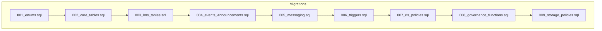
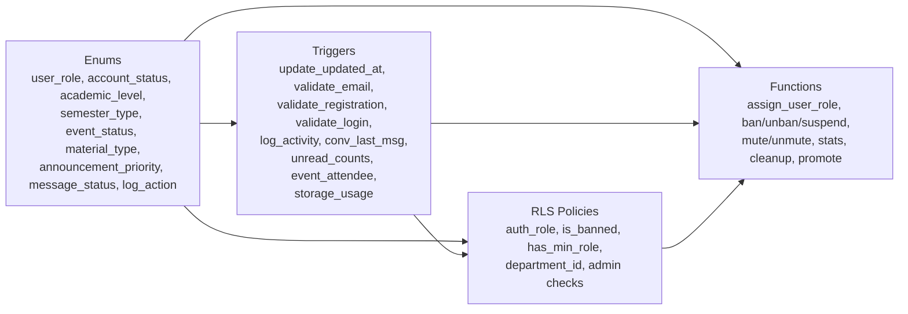

# Database Schema

<cite>
**Referenced Files in This Document**
- [001_enums.sql](file://supabase/migrations/001_enums.sql)
- [002_core_tables.sql](file://supabase/migrations/002_core_tables.sql)
- [003_lms_tables.sql](file://supabase/migrations/003_lms_tables.sql)
- [004_events_announcements.sql](file://supabase/migrations/004_events_announcements.sql)
- [005_messaging.sql](file://supabase/migrations/005_messaging.sql)
- [006_triggers.sql](file://supabase/migrations/006_triggers.sql)
- [007_rls_policies.sql](file://supabase/migrations/007_rls_policies.sql)
- [008_governance_functions.sql](file://supabase/migrations/008_governance_functions.sql)
- [009_storage_policies.sql](file://supabase/migrations/009_storage_policies.sql)
</cite>

## Table of Contents
1. [Introduction](#introduction)
2. [Project Structure](#project-structure)
3. [Core Components](#core-components)
4. [Architecture Overview](#architecture-overview)
5. [Detailed Component Analysis](#detailed-component-analysis)
6. [Dependency Analysis](#dependency-analysis)
7. [Performance Considerations](#performance-considerations)
8. [Troubleshooting Guide](#troubleshooting-guide)
9. [Conclusion](#conclusion)
10. [Appendices](#appendices)

## Introduction
This document describes the NALISS UMYU Hub database schema implemented through sequential migrations. It covers entity relationships, table structures, indexes, constraints, enums, triggers, Row-Level Security (RLS) policies, governance functions, storage policies, and audit trails. The schema spans four major domains:
- Core: users, departments, lecturers, executives, presence
- LMS: levels, semesters, courses, materials, user progress, bookmarks
- Communication: conversations, participants, messages, read receipts, typing indicators, muted users, message reports, profanity filters, activity logs, push tokens, rate limits, system settings, sessions, 2FA
- Governance: administrative functions, statistics, and views

## Project Structure
The database is structured as a series of ordered migrations executed in the following sequence:
- 001_enums.sql: Defines custom enums and helper functions
- 002_core_tables.sql: Core identity and organizational tables
- 003_lms_tables.sql: Academic content and learning management
- 004_events_announcements.sql: Events and announcements
- 005_messaging.sql: Real-time messaging infrastructure
- 006_triggers.sql: Security and audit triggers, plus auxiliary tables
- 007_rls_policies.sql: Row-Level Security policies for all tables
- 008_governance_functions.sql: Administrative functions, views, and realtime enablement
- 009_storage_policies.sql: Storage bucket policies and helpers



**Diagram sources**
- [001_enums.sql](file://supabase/migrations/001_enums.sql#L1-L167)
- [002_core_tables.sql](file://supabase/migrations/002_core_tables.sql#L1-L252)
- [003_lms_tables.sql](file://supabase/migrations/003_lms_tables.sql#L1-L262)
- [004_events_announcements.sql](file://supabase/migrations/004_events_announcements.sql#L1-L262)
- [005_messaging.sql](file://supabase/migrations/005_messaging.sql#L1-L321)
- [006_triggers.sql](file://supabase/migrations/006_triggers.sql#L1-L436)
- [007_rls_policies.sql](file://supabase/migrations/007_rls_policies.sql#L1-L510)
- [008_governance_functions.sql](file://supabase/migrations/008_governance_functions.sql#L1-L577)
- [009_storage_policies.sql](file://supabase/migrations/009_storage_policies.sql#L1-L402)

**Section sources**
- [README.md](file://README.md#L73-L87)

## Core Components
This section outlines the foundational tables and their relationships.

- Departments
  - Purpose: Academic departments within the institution
  - Keys: id (primary key), unique name, unique code
  - Indexes: code, is_active
  - Notes: Default department seed inserted during migration

- Users
  - Purpose: Extended user profiles bound to Supabase Auth
  - Keys: id (primary key, references auth.users), unique registration_number, unique email
  - Foreign keys: department_id -> departments.id
  - Roles/status: user_role enum, account_status enum
  - Timestamps: email_verified_at, registration_verified_at, last_active_at, created_at, updated_at
  - Constraints: bans/suspensions tracked via banned_at/banned_reason/banned_by, suspended_until

- Lecturers
  - Purpose: Department faculty directory
  - Keys: id (primary key), foreign key department_id -> departments.id
  - Indexes: department_id, is_active, display_order

- Executives
  - Purpose: Student leadership teams
  - Keys: id (primary key), optional user_id -> users.id
  - Foreign keys: department_id -> departments.id
  - Constraints: unique(position_code, department_id, academic_session)
  - Indexes: department_id, user_id, academic_session, is_current

- Presence
  - Purpose: Real-time user presence tracking
  - Keys: user_id (primary key, references users.id)
  - Indexes: status, last_seen

**Section sources**
- [002_core_tables.sql](file://supabase/migrations/002_core_tables.sql#L9-L29)
- [002_core_tables.sql](file://supabase/migrations/002_core_tables.sql#L43-L76)
- [002_core_tables.sql](file://supabase/migrations/002_core_tables.sql#L98-L126)
- [002_core_tables.sql](file://supabase/migrations/002_core_tables.sql#L140-L174)
- [002_core_tables.sql](file://supabase/migrations/002_core_tables.sql#L189-L194)
- [002_core_tables.sql](file://supabase/migrations/002_core_tables.sql#L207-L214)

## Architecture Overview
The schema enforces identity binding, role-based access, and auditability. The following diagram shows key relationships among core, LMS, communication, and governance entities.

```mermaid
erDiagram
DEPARTMENTS {
uuid id PK
varchar name UK
varchar code UK
boolean is_active
timestamptz created_at
timestamptz updated_at
}
USERS {
uuid id PK
uuid auth_user_id FK
varchar registration_number UK
varchar email UK
varchar role
varchar status
uuid department_id FK
varchar level
timestamptz created_at
timestamptz updated_at
}
LECTURERS {
uuid id PK
uuid department_id FK
boolean is_active
integer display_order
timestamptz created_at
timestamptz updated_at
}
EXECUTIVES {
uuid id PK
uuid user_id FK
uuid department_id FK
varchar position
varchar position_code
varchar academic_session
boolean is_current
integer display_order
timestamptz created_at
timestamptz updated_at
}
PRESENCE {
uuid user_id PK
varchar status
timestamptz last_seen
}
LEVELS {
uuid id PK
varchar level UK
varchar display_name
boolean is_active
integer display_order
timestamptz created_at
}
SEMESTERS {
uuid id PK
uuid level_id FK
varchar semester
varchar academic_session
boolean is_current
date start_date
date end_date
boolean is_active
timestamptz created_at
}
COURSES {
uuid id PK
uuid semester_id FK
varchar code
varchar title
boolean is_core
boolean is_elective
uuid lecturer_id FK
boolean is_active
integer display_order
timestamptz created_at
timestamptz updated_at
}
MATERIALS {
uuid id PK
uuid course_id FK
uuid uploaded_by FK
varchar material_type
varchar file_url
varchar external_url
boolean is_public
boolean is_downloadable
integer view_count
integer download_count
boolean is_active
boolean is_featured
timestamptz created_at
timestamptz updated_at
}
USER_PROGRESS {
uuid id PK
uuid user_id FK
uuid course_id FK
uuid material_id FK
integer progress_percent
boolean is_completed
timestamptz completed_at
integer last_position
timestamptz last_accessed
timestamptz created_at
timestamptz updated_at
}
BOOKMARKS {
uuid id PK
uuid user_id FK
uuid material_id FK
timestamptz created_at
}
EVENTS {
uuid id PK
uuid created_by FK
varchar title
integer max_attendees
integer current_attendees
date start_date
date end_date
boolean is_virtual
varchar virtual_link
varchar status
boolean is_public
integer view_count
timestamptz published_at
timestamptz created_at
timestamptz updated_at
}
EVENT_REGISTRATIONS {
uuid id PK
uuid event_id FK
uuid user_id FK
boolean attended
timestamptz attended_at
boolean is_cancelled
timestamptz cancelled_at
}
ANNOUNCEMENTS {
uuid id PK
uuid author_id FK
varchar title
varchar priority
uuid target_department_id FK
boolean is_scheduled
timestamptz scheduled_for
boolean is_published
boolean is_pinned
integer view_count
timestamptz published_at
timestamptz expires_at
timestamptz created_at
timestamptz updated_at
}
ANNOUNCEMENT_VIEWS {
uuid id PK
uuid announcement_id FK
uuid user_id FK
timestamptz viewed_at
}
CONVERSATIONS {
uuid id PK
boolean is_direct
varchar name
boolean is_level_group
varchar level
boolean is_general
boolean is_active
timestamptz last_message_at
timestamptz created_at
timestamptz updated_at
}
CONVERSATION_PARTICIPANTS {
uuid id PK
uuid conversation_id FK
uuid user_id FK
boolean is_admin
integer unread_count
boolean notifications_enabled
boolean is_muted
timestamptz muted_until
timestamptz joined_at
timestamptz left_at
timestamptz last_read_at
}
MESSAGES {
uuid id PK
uuid conversation_id FK
uuid sender_id FK
text content
varchar content_type
boolean is_edited
boolean is_deleted
uuid deleted_by FK
boolean is_flagged
varchar system_action
timestamptz created_at
}
MESSAGE_READ_RECEIPTS {
uuid id PK
uuid message_id FK
uuid user_id FK
varchar status
timestamptz read_at
timestamptz created_at
}
TYPING_INDICATORS {
uuid id PK
uuid conversation_id FK
uuid user_id FK
boolean is_typing
timestamptz updated_at
}
MUTED_USERS {
uuid id PK
uuid user_id FK
uuid muted_by FK
boolean is_permanent
timestamptz mute_until
timestamptz created_at
}
MESSAGE_REPORTS {
uuid id PK
uuid message_id FK
uuid reported_by FK
varchar reason
varchar status
uuid reviewed_by FK
timestamptz reviewed_at
text resolution_notes
timestamptz created_at
}
PROFANITY_FILTERS {
uuid id PK
varchar word UK
varchar severity
varchar action
boolean is_active
timestamptz created_at
}
ACTIVITY_LOGS {
uuid id PK
uuid user_id FK
varchar user_email
varchar user_role
varchar action
varchar entity_type
uuid entity_id
text description
jsonb metadata
inet ip_address
text user_agent
text request_path
text request_method
timestamptz created_at
}
PUSH_TOKENS {
uuid id PK
uuid user_id FK
text token UK
varchar device_type
varchar device_name
varchar device_id
varchar push_service
boolean is_active
timestamptz last_used_at
timestamptz created_at
timestamptz updated_at
}
SYSTEM_SETTINGS {
uuid id PK
varchar key UK
text value
varchar value_type
varchar description
varchar category
boolean is_public
timestamptz created_at
timestamptz updated_at
}
USER_SESSIONS {
uuid id PK
uuid user_id FK
varchar session_token UK
jsonb device_info
inet ip_address
text user_agent
boolean is_valid
timestamptz last_used_at
timestamptz created_at
timestamptz expires_at
}
USER_2FA {
uuid id PK
uuid user_id FK UK
varchar secret
text[] backup_codes
boolean is_enabled
timestamptz enabled_at
timestamptz created_at
}
STORAGE_USAGE {
uuid id PK
uuid user_id FK
varchar bucket_id
bigint total_bytes
integer file_count
timestamptz updated_at
}
DEPARTMENTS ||--o{ USERS : "has"
DEPARTMENTS ||--o{ LECTURERS : "hosts"
DEPARTMENTS ||--o{ EXECUTIVES : "governs"
USERS ||--o{ PRESENCE : "tracked_by"
LEVELS ||--o{ SEMESTERS : "defines"
SEMESTERS ||--o{ COURSES : "organizes"
COURSES ||--o{ MATERIALS : "contains"
USERS ||--o{ MATERIALS : "uploads"
USERS ||--o{ USER_PROGRESS : "tracks"
USERS ||--o{ BOOKMARKS : "stores"
COURSES ||--o{ USER_PROGRESS : "measures"
COURSES ||--o{ BOOKMARKS : "targets"
MATERIALS ||--o{ USER_PROGRESS : "measured_by"
MATERIALS ||--o{ BOOKMARKS : "bookmarked_by"
USERS ||--o{ EVENTS : "creates"
USERS ||--o{ EVENT_REGISTRATIONS : "registers"
EVENTS ||--o{ EVENT_REGISTRATIONS : "enrolls"
USERS ||--o{ ANNOUNCEMENTS : "writes"
USERS ||--o{ ANNOUNCEMENT_VIEWS : "views"
ANNOUNCEMENTS ||--o{ ANNOUNCEMENT_VIEWS : "viewed_by"
USERS ||--o{ CONVERSATIONS : "creates"
USERS ||--o{ CONVERSATION_PARTICIPANTS : "joins"
CONVERSATIONS ||--o{ CONVERSATION_PARTICIPANTS : "includes"
USERS ||--o{ MESSAGES : "sends"
CONVERSATIONS ||--o{ MESSAGES : "contains"
MESSAGES ||--o{ MESSAGE_READ_RECEIPTS : "acknowledges"
USERS ||--o{ MESSAGE_READ_RECEIPTS : "records"
USERS ||--o{ TYPING_INDICATORS : "indicates"
CONVERSATIONS ||--o{ TYPING_INDICATORS : "observed_in"
USERS ||--o{ MUTED_USERS : "muted_by"
USERS ||--o{ MESSAGE_REPORTS : "files"
MESSAGES ||--o{ MESSAGE_REPORTS : "reported"
USERS ||--o{ ACTIVITY_LOGS : "involved_in"
USERS ||--o{ PUSH_TOKENS : "owns"
USERS ||--o{ USER_SESSIONS : "maintains"
USERS ||--o{ USER_2FA : "configured_by"
USERS ||--o{ STORAGE_USAGE : "consumes"
```

**Diagram sources**
- [002_core_tables.sql](file://supabase/migrations/002_core_tables.sql#L9-L174)
- [003_lms_tables.sql](file://supabase/migrations/003_lms_tables.sql#L9-L188)
- [004_events_announcements.sql](file://supabase/migrations/004_events_announcements.sql#L9-L180)
- [005_messaging.sql](file://supabase/migrations/005_messaging.sql#L9-L218)
- [006_triggers.sql](file://supabase/migrations/006_triggers.sql#L220-L435)
- [007_rls_policies.sql](file://supabase/migrations/007_rls_policies.sql#L9-L37)
- [008_governance_functions.sql](file://supabase/migrations/008_governance_functions.sql#L515-L576)
- [009_storage_policies.sql](file://supabase/migrations/009_storage_policies.sql#L273-L282)

## Detailed Component Analysis

### Enums and Helper Functions
- Enum definitions
  - user_role: student, moderator, super_admin, system_owner
  - account_status: pending_verification, active, suspended, banned
  - academic_level: 100, 200, 300, 400, 500, postgraduate
  - semester_type: first, second, summer
  - event_status: draft, published, ongoing, completed, cancelled
  - material_type: note, assignment, past_question, video, link, document
  - announcement_priority: low, normal, high, urgent
  - message_status: sent, delivered, read
  - log_action: user actions, message actions, material actions, event actions, announcement actions, admin actions, settings actions
- Helper functions
  - user_role_level(role): numeric level for comparisons
  - role_gte(role1, role2), role_gt(role1, role2): role hierarchy comparisons

**Section sources**
- [001_enums.sql](file://supabase/migrations/001_enums.sql#L10-L167)

### Core Domain Tables
- Departments
  - Unique constraints: name, code
  - Indexes: code, is_active
- Users
  - Unique constraints: registration_number, email
  - Foreign keys: department_id -> departments.id
  - Triggers: update_updated_at on insert/update
  - Comments: extended profiles with academic identity
- Lecturers
  - Unique constraints: none; indexed by department, activity, display order
- Executives
  - Unique constraint: (position_code, department_id, academic_session)
  - Indexed by department, user, session, current term
- Presence
  - Indexed by status, last_seen

**Section sources**
- [002_core_tables.sql](file://supabase/migrations/002_core_tables.sql#L9-L29)
- [002_core_tables.sql](file://supabase/migrations/002_core_tables.sql#L43-L76)
- [002_core_tables.sql](file://supabase/migrations/002_core_tables.sql#L98-L126)
- [002_core_tables.sql](file://supabase/migrations/002_core_tables.sql#L140-L174)
- [002_core_tables.sql](file://supabase/migrations/002_core_tables.sql#L189-L194)
- [002_core_tables.sql](file://supabase/migrations/002_core_tables.sql#L219-L252)

### LMS Domain Tables
- Levels
  - Unique constraint: level
  - Seeded rows for 100–500 and postgraduate
- Semesters
  - Unique constraint: (level_id, semester, academic_session)
  - Indexed by level, current flag, session, activity
- Courses
  - Unique constraint: (semester_id, code)
  - Indexed by semester, code, lecturer, activity, display order
- Materials
  - Unique constraints: none; indexed by course, uploader, type, activity, featured, created_at, view_count
  - Full-text search index on title/description
- User Progress
  - Unique constraint: (user_id, material_id)
  - Indexed by user, course, material, completion
- Bookmarks
  - Unique constraint: (user_id, material_id)
  - Indexed by user, material

**Section sources**
- [003_lms_tables.sql](file://supabase/migrations/003_lms_tables.sql#L9-L17)
- [003_lms_tables.sql](file://supabase/migrations/003_lms_tables.sql#L25-L32)
- [003_lms_tables.sql](file://supabase/migrations/003_lms_tables.sql#L38-L51)
- [003_lms_tables.sql](file://supabase/migrations/003_lms_tables.sql#L66-L92)
- [003_lms_tables.sql](file://supabase/migrations/003_lms_tables.sql#L108-L146)
- [003_lms_tables.sql](file://supabase/migrations/003_lms_tables.sql#L168-L188)
- [003_lms_tables.sql](file://supabase/migrations/003_lms_tables.sql#L203-L211)

### Communication Domain Tables
- Conversations
  - Unique constraints: none; indexed by active, last_message_at, level group, general
  - Constraint: group_name_required for non-direct groups
- Conversation Participants
  - Unique constraint: (conversation_id, user_id)
  - Indexed by conversation, user, unread count (when > 0), active membership
- Messages
  - Unique constraints: none; indexed by conversation/time, sender, reply, created_at, flagged
  - Partial index for active messages
  - Full-text search index on content (non-deleted)
- Message Read Receipts
  - Unique constraint: (message_id, user_id)
  - Indexed by message, user, status
- Typing Indicators
  - Unique constraint: (conversation_id, user_id)
  - Indexed by conversation
- Muted Users
  - Unique constraints: none; indexed by user, muted_by, active mute
  - Constraint: cannot mute self
- Message Reports
  - Unique constraint: (message_id, reported_by)
  - Indexed by message, reporter, status
- Profanity Filters
  - Unique constraint: word; indexed by active, word

**Section sources**
- [005_messaging.sql](file://supabase/migrations/005_messaging.sql#L9-L35)
- [005_messaging.sql](file://supabase/migrations/005_messaging.sql#L50-L72)
- [005_messaging.sql](file://supabase/migrations/005_messaging.sql#L89-L127)
- [005_messaging.sql](file://supabase/migrations/005_messaging.sql#L151-L162)
- [005_messaging.sql](file://supabase/migrations/005_messaging.sql#L176-L185)
- [005_messaging.sql](file://supabase/migrations/005_messaging.sql#L197-L209)
- [005_messaging.sql](file://supabase/migrations/005_messaging.sql#L224-L241)
- [005_messaging.sql](file://supabase/migrations/005_messaging.sql#L255-L264)

### Events and Announcements
- Events
  - Unique constraints: none; indexed by creator, status, dates, public, created_at
  - Full-text search index on title/description
  - Constraints: valid_dates, valid_attendees
- Event Registrations
  - Unique constraint: (event_id, user_id)
  - Indexed by event, user, attendance, cancellation
- Announcements
  - Unique constraints: none; indexed by author, published, pinned, priority, department, created_at, expires, scheduled
  - Full-text search index on title/content
  - Constraints: valid_schedule
- Announcement Views
  - Unique constraint: (announcement_id, user_id)
  - Indexed by announcement, user

**Section sources**
- [004_events_announcements.sql](file://supabase/migrations/004_events_announcements.sql#L9-L50)
- [004_events_announcements.sql](file://supabase/migrations/004_events_announcements.sql#L70-L90)
- [004_events_announcements.sql](file://supabase/migrations/004_events_announcements.sql#L105-L141)
- [004_events_announcements.sql](file://supabase/migrations/004_events_announcements.sql#L165-L173)

### Governance and Audit Tables
- Activity Logs
  - Indexed by user, action, entity, created_at, IP
- Push Tokens
  - Unique constraint: (user_id, token); indexed by user, token, active
- System Settings
  - Unique constraint: key; indexed by key, category, public
- User Sessions
  - Unique constraint: session_token; indexed by user, token, validity, expiry
- User 2FA
  - Unique constraint: user_id; indexed by user

**Section sources**
- [006_triggers.sql](file://supabase/migrations/006_triggers.sql#L220-L245)
- [006_triggers.sql](file://supabase/migrations/006_triggers.sql#L261-L283)
- [006_triggers.sql](file://supabase/migrations/006_triggers.sql#L333-L352)
- [006_triggers.sql](file://supabase/migrations/006_triggers.sql#L372-L383)
- [006_triggers.sql](file://supabase/migrations/006_triggers.sql#L406-L414)

### Triggers and Functions
- Core triggers
  - update_updated_at_column(): generic trigger for updated_at timestamps
  - Applied to departments, users, lecturers, executives, courses, materials, user_progress, events, announcements, conversations, push_tokens, system_settings
- Security and audit
  - validate_institutional_email(): enforce email format for non-admin roles
  - validate_registration_binding(): cross-validate registration number and email
  - validate_login_attempt(p_user_id): check ban/suspension/pending verification; update last_active_at
  - log_user_activity(): audit user register, role change, status change (ban/suspend/unban)
- Messaging triggers
  - update_conversation_last_message(): update conversations.last_message_at and updated_at on new message
  - increment_unread_counts(): increment unread counts for participants (except sender, muted, left)
- Event triggers
  - update_event_attendee_count(): adjust current_attendees on registration insert/update/delete
- Engagement functions
  - increment_material_view(material_id)
  - increment_material_download(material_id)
  - increment_event_view(event_id)
  - record_announcement_view(p_announcement_id, p_user_id)

**Section sources**
- [002_core_tables.sql](file://supabase/migrations/002_core_tables.sql#L220-L252)
- [003_lms_tables.sql](file://supabase/migrations/003_lms_tables.sql#L224-L238)
- [004_events_announcements.sql](file://supabase/migrations/004_events_announcements.sql#L186-L194)
- [004_events_announcements.sql](file://supabase/migrations/004_events_announcements.sql#L200-L226)
- [005_messaging.sql](file://supabase/migrations/005_messaging.sql#L277-L293)
- [005_messaging.sql](file://supabase/migrations/005_messaging.sql#L295-L314)
- [006_triggers.sql](file://supabase/migrations/006_triggers.sql#L9-L34)
- [006_triggers.sql](file://supabase/migrations/006_triggers.sql#L40-L101)
- [006_triggers.sql](file://supabase/migrations/006_triggers.sql#L107-L154)
- [006_triggers.sql](file://supabase/migrations/006_triggers.sql#L160-L208)
- [003_lms_tables.sql](file://supabase/migrations/003_lms_tables.sql#L243-L261)
- [004_events_announcements.sql](file://supabase/migrations/004_events_announcements.sql#L232-L239)
- [004_events_announcements.sql](file://supabase/migrations/004_events_announcements.sql#L244-L261)

### Row-Level Security Policies
- Enable RLS on all tables
- Helper functions
  - auth_role(), is_banned(), has_min_role(min_role), auth_department_id(), is_admin(), is_super_admin(), is_system_owner()
- Policies by domain
  - Users: self-read, admin-all-read, self-update with role/status restrictions, super-admin manage
  - Departments: active read for authenticated, admin read, super-admin write
  - Lecturers: active read for authenticated, moderators manage within department
  - Executives: authenticated read, moderators manage
  - LMS: levels/semesters/courses readable by active, materials public/read own/admin manage, user progress/bookmarks own
  - Events: public published read, own read, admin read/manage, registrations own/admin
  - Announcements: published read, admin read, moderators insert, authors update own, admin manage, views own
  - Messaging: conversations/participants own read/create/admin read, messages own insert/update/delete/admin moderate, receipts own read/insert, typing own read/write, muted admin, reports own/admin, profanity admin
  - Presence: active read, own update
  - Push tokens: own read/insert/update/delete
  - System settings: public read, admin read, super-admin write
  - Activity logs: admin read, insert via trigger
  - User sessions: own read/delete
  - User 2FA: own read/manage
  - Rate limits: insert/update

**Section sources**
- [007_rls_policies.sql](file://supabase/migrations/007_rls_policies.sql#L9-L37)
- [007_rls_policies.sql](file://supabase/migrations/007_rls_policies.sql#L43-L88)
- [007_rls_policies.sql](file://supabase/migrations/007_rls_policies.sql#L94-L121)
- [007_rls_policies.sql](file://supabase/migrations/007_rls_policies.sql#L127-L143)
- [007_rls_policies.sql](file://supabase/migrations/007_rls_policies.sql#L149-L161)
- [007_rls_policies.sql](file://supabase/migrations/007_rls_policies.sql#L167-L175)
- [007_rls_policies.sql](file://supabase/migrations/007_rls_policies.sql#L181-L230)
- [007_rls_policies.sql](file://supabase/migrations/007_rls_policies.sql#L235-L263)
- [007_rls_policies.sql](file://supabase/migrations/007_rls_policies.sql#L265-L277)
- [007_rls_policies.sql](file://supabase/migrations/007_rls_policies.sql#L283-L304)
- [007_rls_policies.sql](file://supabase/migrations/007_rls_policies.sql#L317-L381)
- [007_rls_policies.sql](file://supabase/migrations/007_rls_policies.sql#L383-L421)
- [007_rls_policies.sql](file://supabase/migrations/007_rls_policies.sql#L428-L451)
- [007_rls_policies.sql](file://supabase/migrations/007_rls_policies.sql#L457-L467)

### Governance Functions
- Role management
  - assign_user_role(target_user_id, new_role): permission checks and logging
  - ban_user(target_user_id, reason), unban_user(target_user_id), suspend_user(target_user_id, until, reason)
  - mute_user(target_user_id, mute_until, reason), unmute_user(target_user_id)
- Statistics and reporting
  - get_system_stats(): aggregated counts across users, content, messaging, engagement, moderation
  - get_user_activity_log(target_user_id, limit, offset): paginated audit log
  - user_can(p_user_id, p_permission): permission matrix evaluation
- Cleanup functions
  - cleanup_expired_sessions(), cleanup_rate_limits(), cleanup_typing_indicators(), process_expired_mutes()
- Initial setup
  - promote_initial_system_owner(target_user_id): promotes first user to system_owner
- Realtime
  - Enable publication for messaging and announcements/events tables
- Views
  - user_summaries, conversation_previews, material_library

**Section sources**
- [008_governance_functions.sql](file://supabase/migrations/008_governance_functions.sql#L9-L68)
- [008_governance_functions.sql](file://supabase/migrations/008_governance_functions.sql#L74-L127)
- [008_governance_functions.sql](file://supabase/migrations/008_governance_functions.sql#L133-L167)
- [008_governance_functions.sql](file://supabase/migrations/008_governance_functions.sql#L173-L211)
- [008_governance_functions.sql](file://supabase/migrations/008_governance_functions.sql#L217-L284)
- [008_governance_functions.sql](file://supabase/migrations/008_governance_functions.sql#L289-L336)
- [008_governance_functions.sql](file://supabase/migrations/008_governance_functions.sql#L342-L368)
- [008_governance_functions.sql](file://supabase/migrations/008_governance_functions.sql#L374-L408)
- [008_governance_functions.sql](file://supabase/migrations/008_governance_functions.sql#L414-L464)
- [008_governance_functions.sql](file://supabase/migrations/008_governance_functions.sql#L472-L495)
- [008_governance_functions.sql](file://supabase/migrations/008_governance_functions.sql#L501-L510)
- [008_governance_functions.sql](file://supabase/migrations/008_governance_functions.sql#L515-L576)

### Storage Policies and Helpers
- Buckets to create (via dashboard/API):
  - avatars, materials, event-covers, announcement-media, message-attachments
- Policies
  - Avatars: own upload/update/delete; everyone can read
  - Materials: moderators upload/read/update; super admins delete
  - Event covers: own upload/update; admins delete
  - Announcement media: moderators upload/update/delete
  - Message attachments: own upload/read/delete; admins delete
- Helpers
  - get_avatar_path(user_id, file_ext)
  - get_material_path(course_id, material_id, filename)
  - get_message_attachment_path(conversation_id, message_id, filename)
  - validate_file_type(p_mime_type, p_bucket)
  - check_storage_quota(p_user_id, p_bucket, p_file_size)
- Storage usage tracking
  - storage_usage: per-user per-bucket byte and file counts
  - update_storage_usage(): trigger-like function to maintain usage on insert/delete

**Section sources**
- [009_storage_policies.sql](file://supabase/migrations/009_storage_policies.sql#L12-L20)
- [009_storage_policies.sql](file://supabase/migrations/009_storage_policies.sql#L27-L53)
- [009_storage_policies.sql](file://supabase/migrations/009_storage_policies.sql#L59-L101)
- [009_storage_policies.sql](file://supabase/migrations/009_storage_policies.sql#L107-L143)
- [009_storage_policies.sql](file://supabase/migrations/009_storage_policies.sql#L149-L190)
- [009_storage_policies.sql](file://supabase/migrations/009_storage_policies.sql#L196-L235)
- [009_storage_policies.sql](file://supabase/migrations/009_storage_policies.sql#L241-L267)
- [009_storage_policies.sql](file://supabase/migrations/009_storage_policies.sql#L291-L320)
- [009_storage_policies.sql](file://supabase/migrations/009_storage_policies.sql#L326-L401)

## Dependency Analysis
- Enum dependencies
  - user_role, account_status, academic_level, semester_type, event_status, material_type, announcement_priority, message_status, log_action
- Table dependencies
  - users.department_id -> departments.id
  - lecturers.department_id -> departments.id
  - executives.user_id -> users.id; executives.department_id -> departments.id
  - courses.semester_id -> semesters.id; courses.lecturer_id -> lecturers.id
  - materials.course_id -> courses.id; materials.uploaded_by -> users.id
  - user_progress.user_id -> users.id; user_progress.course_id -> courses.id; user_progress.material_id -> materials.id
  - bookmarks.user_id -> users.id; bookmarks.material_id -> materials.id
  - events.created_by -> users.id
  - event_registrations.event_id -> events.id; event_registrations.user_id -> users.id
  - announcements.author_id -> users.id; announcements.target_department_id -> departments.id
  - announcement_views.announcement_id -> announcements.id; announcement_views.user_id -> users.id
  - conversations.created_by -> users.id
  - conversation_participants.conversation_id -> conversations.id; conversation_participants.user_id -> users.id
  - messages.conversation_id -> conversations.id; messages.sender_id -> users.id; messages.deleted_by -> users.id
  - message_read_receipts.message_id -> messages.id; message_read_receipts.user_id -> users.id
  - typing_indicators.conversation_id -> conversations.id; typing_indicators.user_id -> users.id
  - muted_users.user_id -> users.id; muted_users.muted_by -> users.id
  - message_reports.message_id -> messages.id; message_reports.reported_by -> users.id; message_reports.reviewed_by -> users.id
  - presence.user_id -> users.id
  - push_tokens.user_id -> users.id
  - system_settings.id -> (no FK)
  - user_sessions.user_id -> users.id
  - user_2fa.user_id -> users.id
  - storage_usage.user_id -> users.id
- Policy dependencies
  - RLS policies depend on helper functions (auth_role, is_banned, has_min_role, auth_department_id, is_admin, is_super_admin, is_system_owner)
- Trigger dependencies
  - update_updated_at_column() used across many tables
  - validate_institutional_email(), validate_registration_binding(), validate_login_attempt(), log_user_activity() used on users
  - update_conversation_last_message(), increment_unread_counts() used on messages/conversations
  - update_event_attendee_count() used on event_registrations/events
  - update_storage_usage() used on storage.objects
- Function dependencies
  - assign_user_role(), ban_user(), unban_user(), suspend_user(), mute_user(), unmute_user() depend on role_gte/role_gt and user_role enum
  - get_system_stats() aggregates from multiple tables
  - promote_initial_system_owner() depends on activity_logs for audit



**Diagram sources**
- [001_enums.sql](file://supabase/migrations/001_enums.sql#L10-L167)
- [006_triggers.sql](file://supabase/migrations/006_triggers.sql#L9-L154)
- [007_rls_policies.sql](file://supabase/migrations/007_rls_policies.sql#L43-L88)
- [008_governance_functions.sql](file://supabase/migrations/008_governance_functions.sql#L9-L68)

**Section sources**
- [001_enums.sql](file://supabase/migrations/001_enums.sql#L10-L167)
- [006_triggers.sql](file://supabase/migrations/006_triggers.sql#L9-L154)
- [007_rls_policies.sql](file://supabase/migrations/007_rls_policies.sql#L43-L88)
- [008_governance_functions.sql](file://supabase/migrations/008_governance_functions.sql#L9-L68)

## Performance Considerations
- Indexes
  - High-cardinality foreign keys indexed (e.g., users.department_id, courses.semester_id, materials.course_id)
  - Status/activity booleans indexed (e.g., departments.is_active, materials.is_active, conversations.is_active)
  - Timestamps indexed for recent-first queries (e.g., users.created_at DESC, messages.created_at DESC)
  - Full-text search indexes on content fields (materials, events, announcements, messages)
- Partial indexes
  - Active records only (e.g., messages where is_deleted = FALSE)
  - Unread counts for participants with unread_count > 0
  - Scheduled/expired announcements filtered by conditions
- Triggers
  - Minimal overhead via lightweight plpgsql functions
  - Avoid heavy computations in triggers; keep them deterministic and fast
- Storage
  - validate_file_type() and check_storage_quota() prevent misuse and excessive usage
  - storage_usage maintains per-user per-bucket accounting
- Queries
  - Views (user_summaries, conversation_previews, material_library) encapsulate joins for common reads
- Maintenance
  - Cleanup functions for sessions, rate limits, typing indicators, and expired mutes reduce table bloat

[No sources needed since this section provides general guidance]

## Troubleshooting Guide
- Authentication and identity binding
  - Institutional email validation fails: ensure email matches blis/lis[digits]@students.umyu.edu.ng for non-admin roles
  - Registration number mismatch: verify format U1/U2/YEAR/PREFIX/NUMBER and that last 4 digits match email suffix
  - Login blocked: check status (banned/suspended/pending_verification) and update last_active_at accordingly
- Role and access
  - Cannot update profile: self-update policy restricts role/status changes
  - Cannot manage users: only super admins can manage users; system owners can assign roles
  - Messaging muted: check muted_users entries and unmute if expired
- Content visibility
  - Materials not visible: ensure is_public = TRUE or access via own uploads policy
  - Announcements not visible: check is_published and expiration/expiry
- Storage uploads
  - Upload denied: verify bucket policy and file type validation; check storage quota
  - Avatar not updating: ensure path ownership and bucket permissions
- Audit and logs
  - Missing logs: verify log_user_activity trigger and activity_logs insert policy
  - Excessive logs: confirm cleanup functions are running periodically

**Section sources**
- [006_triggers.sql](file://supabase/migrations/006_triggers.sql#L9-L34)
- [006_triggers.sql](file://supabase/migrations/006_triggers.sql#L40-L101)
- [006_triggers.sql](file://supabase/migrations/006_triggers.sql#L107-L154)
- [007_rls_policies.sql](file://supabase/migrations/007_rls_policies.sql#L94-L121)
- [007_rls_policies.sql](file://supabase/migrations/007_rls_policies.sql#L409-L421)
- [009_storage_policies.sql](file://supabase/migrations/009_storage_policies.sql#L326-L401)

## Conclusion
The NALISS UMYU Hub database schema is designed around identity binding, role-based access, and comprehensive auditability. The sequential migrations establish a robust foundation across core, LMS, communication, and governance domains. Strong indexing, RLS policies, and helper functions ensure performance, security, and operability. Governance functions provide administrative capabilities, while storage policies and helpers manage file uploads safely and efficiently.

[No sources needed since this section summarizes without analyzing specific files]

## Appendices

### Sequential Migration Approach
- Run migrations in order: 001 → 002 → 003 → 004 → 005 → 006 → 007 → 008 → 009
- After 009, create storage buckets as documented and configure providers in Supabase

**Section sources**
- [README.md](file://README.md#L73-L94)

### Data Lifecycle and Storage Policies
- Data retention and cleanup
  - Sessions: cleanup_expired_sessions()
  - Rate limits: cleanup_rate_limits()
  - Typing indicators: cleanup_typing_indicators()
  - Muted users: process_expired_mutes()
- Storage quotas
  - validate_file_type() and check_storage_quota() enforce bucket-specific limits
  - storage_usage tracks per-user consumption

**Section sources**
- [008_governance_functions.sql](file://supabase/migrations/008_governance_functions.sql#L414-L464)
- [009_storage_policies.sql](file://supabase/migrations/009_storage_policies.sql#L326-L401)