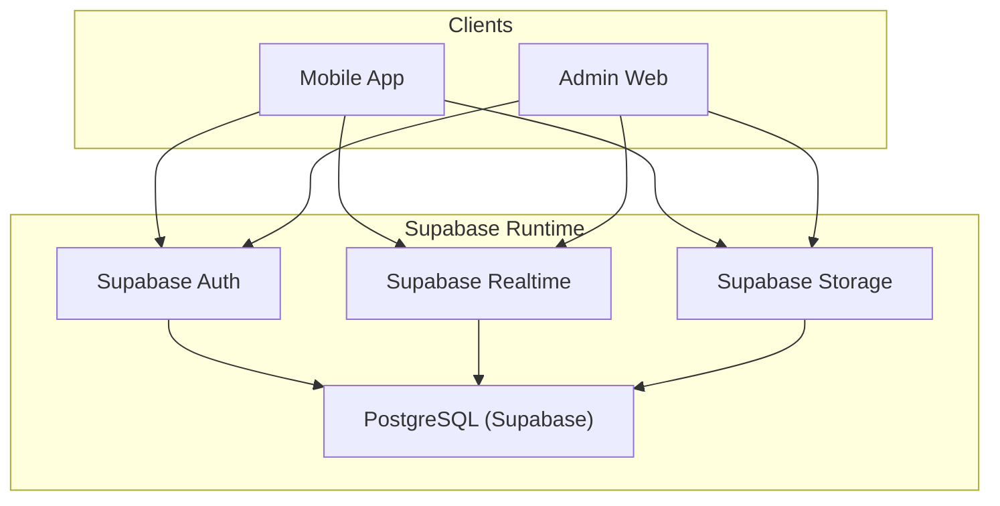
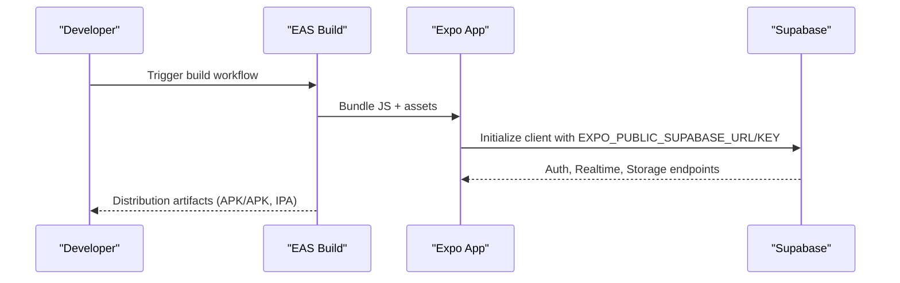
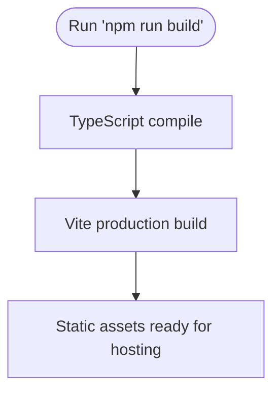
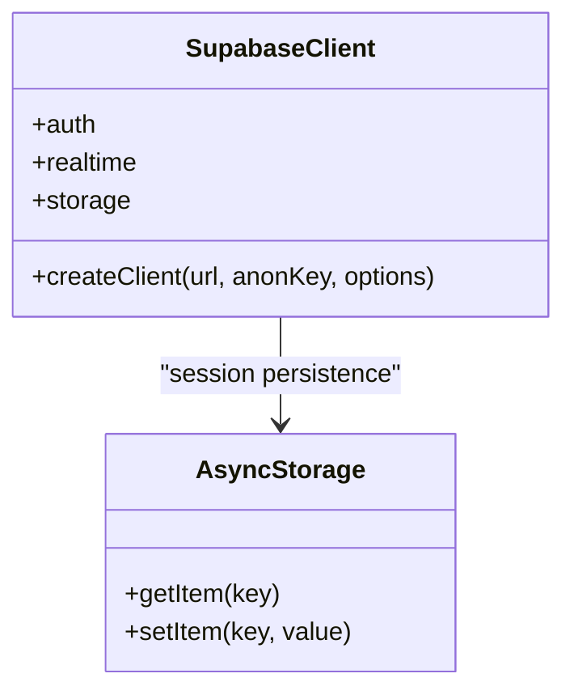
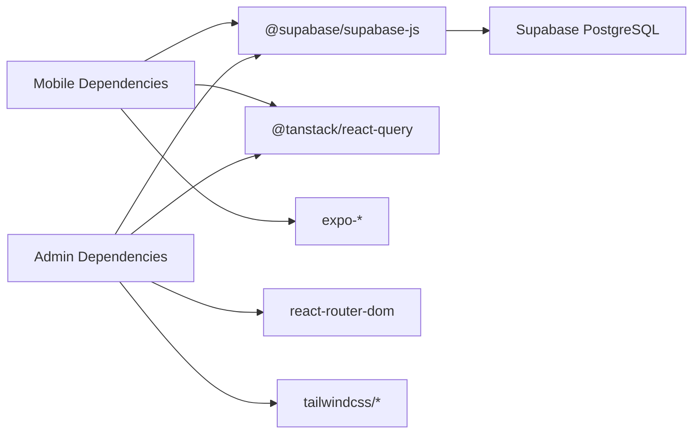
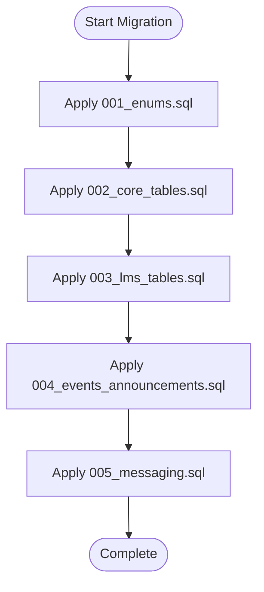

# Deployment & Production

<cite>
**Referenced Files in This Document**
- [mobile/package.json](file://mobile/package.json)
- [mobile/app.json](file://mobile/app.json)
- [mobile/tsconfig.json](file://mobile/tsconfig.json)
- [mobile/src/api/supabase/client.ts](file://mobile/src/api/supabase/client.ts)
- [admin/package.json](file://admin/package.json)
- [admin/vite.config.ts](file://admin/vite.config.ts)
- [admin/tsconfig.json](file://admin/tsconfig.json)
- [admin/src/lib/supabase.ts](file://admin/src/lib/supabase.ts)
- [supabase/migrations/001_enums.sql](file://supabase/migrations/001_enums.sql)
- [supabase/migrations/002_core_tables.sql](file://supabase/migrations/002_core_tables.sql)
- [supabase/migrations/003_lms_tables.sql](file://supabase/migrations/003_lms_tables.sql)
- [supabase/migrations/004_events_announcements.sql](file://supabase/migrations/004_events_announcements.sql)
- [supabase/migrations/005_messaging.sql](file://supabase/migrations/005_messaging.sql)
</cite>

## Table of Contents
1. [Introduction](#introduction)
2. [Project Structure](#project-structure)
3. [Core Components](#core-components)
4. [Architecture Overview](#architecture-overview)
5. [Detailed Component Analysis](#detailed-component-analysis)
6. [Dependency Analysis](#dependency-analysis)
7. [Performance Considerations](#performance-considerations)
8. [Security Hardening](#security-hardening)
9. [Environment Variables Management](#environment-variables-management)
10. [CI/CD Considerations](#cicd-considerations)
11. [Production Monitoring](#production-monitoring)
12. [Supabase Deployment & Database Operations](#supabase-deployment--database-operations)
13. [Troubleshooting Guide](#troubleshooting-guide)
14. [Maintenance Procedures](#maintenance-procedures)
15. [Conclusion](#conclusion)

## Introduction
This document provides comprehensive deployment and production guidance for Naliss UMYU Hub. It covers production build processes for the mobile application using Expo Application Services (EAS) and the admin web application using Vite, along with environment variable management, CI/CD considerations, production monitoring, Supabase deployment and migration strategies, performance optimization, security hardening, and maintenance procedures.

## Project Structure
Naliss UMYU Hub consists of three primary parts:
- Mobile application built with Expo Router and React Native
- Admin web application built with React, Vite, and TypeScript
- Supabase-managed PostgreSQL database with structured migrations

```mermaid
graph TB
subgraph "Mobile App"
M_PKG["mobile/package.json"]
M_APP_JSON["mobile/app.json"]
M_TS["mobile/tsconfig.json"]
M_SUPABASE["mobile/src/api/supabase/client.ts"]
end
subgraph "Admin Web"
A_PKG["admin/package.json"]
A_VITE["admin/vite.config.ts"]
A_TS["admin/tsconfig.json"]
A_SUPABASE["admin/src/lib/supabase.ts"]
end
subgraph "Database"
DB_ENUMS["supabase/migrations/001_enums.sql"]
DB_CORE["supabase/migrations/002_core_tables.sql"]
DB_LMS["supabase/migrations/003_lms_tables.sql"]
DB_EVENTS["supabase/migrations/004_events_announcements.sql"]
DB_MSG["supabase/migrations/005_messaging.sql"]
end
M_SUPABASE --> DB_CORE
A_SUPABASE --> DB_CORE
DB_LMS --> DB_CORE
DB_EVENTS --> DB_CORE
DB_MSG --> DB_CORE
```

**Diagram sources**
- [mobile/package.json](file://mobile/package.json#L1-L40)
- [mobile/app.json](file://mobile/app.json#L1-L70)
- [mobile/tsconfig.json](file://mobile/tsconfig.json#L1-L7)
- [mobile/src/api/supabase/client.ts](file://mobile/src/api/supabase/client.ts#L1-L87)
- [admin/package.json](file://admin/package.json#L1-L43)
- [admin/vite.config.ts](file://admin/vite.config.ts#L1-L8)
- [admin/tsconfig.json](file://admin/tsconfig.json#L1-L8)
- [admin/src/lib/supabase.ts](file://admin/src/lib/supabase.ts#L1-L73)
- [supabase/migrations/001_enums.sql](file://supabase/migrations/001_enums.sql#L1-L167)
- [supabase/migrations/002_core_tables.sql](file://supabase/migrations/002_core_tables.sql#L1-L252)
- [supabase/migrations/003_lms_tables.sql](file://supabase/migrations/003_lms_tables.sql#L1-L262)
- [supabase/migrations/004_events_announcements.sql](file://supabase/migrations/004_events_announcements.sql#L1-L262)
- [supabase/migrations/005_messaging.sql](file://supabase/migrations/005_messaging.sql#L1-L321)

**Section sources**
- [mobile/package.json](file://mobile/package.json#L1-L40)
- [mobile/app.json](file://mobile/app.json#L1-L70)
- [mobile/tsconfig.json](file://mobile/tsconfig.json#L1-L7)
- [admin/package.json](file://admin/package.json#L1-L43)
- [admin/vite.config.ts](file://admin/vite.config.ts#L1-L8)
- [admin/tsconfig.json](file://admin/tsconfig.json#L1-L8)
- [admin/src/lib/supabase.ts](file://admin/src/lib/supabase.ts#L1-L73)
- [supabase/migrations/001_enums.sql](file://supabase/migrations/001_enums.sql#L1-L167)
- [supabase/migrations/002_core_tables.sql](file://supabase/migrations/002_core_tables.sql#L1-L252)
- [supabase/migrations/003_lms_tables.sql](file://supabase/migrations/003_lms_tables.sql#L1-L262)
- [supabase/migrations/004_events_announcements.sql](file://supabase/migrations/004_events_announcements.sql#L1-L262)
- [supabase/migrations/005_messaging.sql](file://supabase/migrations/005_messaging.sql#L1-L321)

## Core Components
- Mobile application: Expo Router-based React Native app with Supabase client initialization and environment-driven configuration.
- Admin web application: React + Vite + TypeScript app with Supabase client initialization and environment-driven configuration.
- Database: Supabase-managed PostgreSQL with ordered migrations defining enums, core tables, LMS, events/announcements, and messaging.

Key build and configuration files:
- Mobile: package scripts for development and EAS builds, app.json for EAS configuration, TypeScript strictness.
- Admin: Vite configuration with React plugin, TypeScript project references, and build/lint scripts.
- Supabase: Ordered migration files for database schema and policies.

**Section sources**
- [mobile/package.json](file://mobile/package.json#L1-L40)
- [mobile/app.json](file://mobile/app.json#L1-L70)
- [mobile/tsconfig.json](file://mobile/tsconfig.json#L1-L7)
- [admin/package.json](file://admin/package.json#L1-L43)
- [admin/vite.config.ts](file://admin/vite.config.ts#L1-L8)
- [admin/tsconfig.json](file://admin/tsconfig.json#L1-L8)
- [admin/src/lib/supabase.ts](file://admin/src/lib/supabase.ts#L1-L73)
- [mobile/src/api/supabase/client.ts](file://mobile/src/api/supabase/client.ts#L1-L87)

## Architecture Overview
The production runtime architecture connects clients to Supabase:
- Mobile app authenticates via Supabase Auth and interacts with Supabase Realtime and Storage.
- Admin web app authenticates via Supabase Auth and uses Supabase client for queries and storage.
- Database operations are governed by Supabase RLS policies and triggers defined in migrations.

**Diagram sources**
- [mobile/src/api/supabase/client.ts](file://mobile/src/api/supabase/client.ts#L1-L87)
- [admin/src/lib/supabase.ts](file://admin/src/lib/supabase.ts#L1-L73)
- [supabase/migrations/001_enums.sql](file://supabase/migrations/001_enums.sql#L1-L167)
- [supabase/migrations/002_core_tables.sql](file://supabase/migrations/002_core_tables.sql#L1-L252)
- [supabase/migrations/003_lms_tables.sql](file://supabase/migrations/003_lms_tables.sql#L1-L262)
- [supabase/migrations/004_events_announcements.sql](file://supabase/migrations/004_events_announcements.sql#L1-L262)
- [supabase/migrations/005_messaging.sql](file://supabase/migrations/005_messaging.sql#L1-L321)

## Detailed Component Analysis

### Mobile Build and EAS Configuration
- Scripts: Development and platform-specific start commands; EAS build steps are managed externally via EAS Build and Submit workflows.
- EAS configuration: app.json includes EAS project ID under extra.eas.projectId and owner for project association.
- Environment variables: Supabase URL and anonymous key are consumed from EXPO_PUBLIC_* environment variables at runtime.
- TypeScript: Strict compilation enabled.

**Diagram sources**
- [mobile/app.json](file://mobile/app.json#L63-L65)
- [mobile/src/api/supabase/client.ts](file://mobile/src/api/supabase/client.ts#L6-L13)

**Section sources**
- [mobile/package.json](file://mobile/package.json#L5-L10)
- [mobile/app.json](file://mobile/app.json#L63-L65)
- [mobile/src/api/supabase/client.ts](file://mobile/src/api/supabase/client.ts#L6-L13)
- [mobile/tsconfig.json](file://mobile/tsconfig.json#L3-L5)

### Admin Web Build with Vite
- Scripts: dev, build, lint, preview.
- Build pipeline: TypeScript precompilation followed by Vite production build.
- Environment variables: Supabase URL and anonymous key are consumed from Vite import.meta.env.VITE_* variables.
- Plugins: React plugin configured in Vite config.

**Diagram sources**
- [admin/package.json](file://admin/package.json#L8-L8)
- [admin/vite.config.ts](file://admin/vite.config.ts#L1-L8)

**Section sources**
- [admin/package.json](file://admin/package.json#L6-L10)
- [admin/vite.config.ts](file://admin/vite.config.ts#L1-L8)
- [admin/tsconfig.json](file://admin/tsconfig.json#L1-L8)
- [admin/src/lib/supabase.ts](file://admin/src/lib/supabase.ts#L3-L7)

### Supabase Client Initialization (Mobile)
- Client creation uses EXPO_PUBLIC_SUPABASE_URL and EXPO_PUBLIC_SUPABASE_ANON_KEY.
- Authentication persistence configured with AsyncStorage and auto-refresh.
- Realtime events rate limited for stability.
- Storage helpers for public URLs, signed URLs, upload, and delete.

**Diagram sources**
- [mobile/src/api/supabase/client.ts](file://mobile/src/api/supabase/client.ts#L15-L27)

**Section sources**
- [mobile/src/api/supabase/client.ts](file://mobile/src/api/supabase/client.ts#L1-L87)

### Supabase Client Initialization (Admin)
- Client creation guarded by environment checks; returns null if missing configuration.
- Authentication options include auto-refresh and URL detection.
- Storage helpers mirror mobile for public URLs, signed URLs, upload, and delete.

**Section sources**
- [admin/src/lib/supabase.ts](file://admin/src/lib/supabase.ts#L1-L73)

## Dependency Analysis
- Mobile depends on Expo Router, Supabase JS SDK, React Query, and React Native ecosystem.
- Admin depends on React, React Router DOM, Tailwind CSS, Supabase JS SDK, and React Query.
- Both clients depend on Supabase for authentication, Realtime, and Storage.

**Diagram sources**
- [mobile/package.json](file://mobile/package.json#L11-L32)
- [admin/package.json](file://admin/package.json#L12-L26)

**Section sources**
- [mobile/package.json](file://mobile/package.json#L11-L32)
- [admin/package.json](file://admin/package.json#L12-L26)

## Performance Considerations
- Mobile
  - Enable production mode in EAS builds and minimize unnecessary re-renders.
  - Use React Query cache effectively and set appropriate stale times.
  - Limit Realtime events per second to reduce bandwidth and CPU usage.
  - Optimize image and file uploads using Supabase Storage signed URLs.
- Admin
  - Use Vite’s production build with minification and tree-shaking.
  - Split routes and lazy-load heavy components.
  - Prefer server-side pagination and filtering for large datasets.
- Database
  - Ensure indexes exist for frequent filters and joins (as defined in migrations).
  - Use partial indexes and GIN indexes for full-text search as implemented.

[No sources needed since this section provides general guidance]

## Security Hardening
- Environment variables
  - Mobile: EXPO_PUBLIC_SUPABASE_URL and EXPO_PUBLIC_SUPABASE_ANON_KEY must be set in EAS build environment.
  - Admin: VITE_SUPABASE_URL and VITE_SUPABASE_ANON_KEY must be set in build environment.
- Supabase
  - Enforce Row-Level Security (RLS) policies defined in migrations.
  - Restrict Storage bucket access and enforce signed URLs for sensitive content.
  - Use Supabase Auth to manage sessions and enforce sign-in requirements.
- Transport
  - Ensure HTTPS endpoints for Supabase and static asset hosting.
- Secrets
  - Never commit secrets to version control; use CI/CD secret managers and EAS build credentials.

[No sources needed since this section provides general guidance]

## Environment Variables Management
- Mobile
  - EXPO_PUBLIC_SUPABASE_URL: Supabase project URL
  - EXPO_PUBLIC_SUPABASE_ANON_KEY: Supabase anonymous public key
  - EAS project ID and owner are configured in app.json under extra.eas and owner respectively.
- Admin
  - VITE_SUPABASE_URL: Supabase project URL
  - VITE_SUPABASE_ANON_KEY: Supabase anonymous public key
- CI/CD
  - Set environment variables in CI provider secrets and pass them to build jobs.
  - For EAS, configure project ID and owner in app.json; supply secrets via EAS credentials.

**Section sources**
- [mobile/src/api/supabase/client.ts](file://mobile/src/api/supabase/client.ts#L6-L13)
- [mobile/app.json](file://mobile/app.json#L63-L67)
- [admin/src/lib/supabase.ts](file://admin/src/lib/supabase.ts#L3-L7)

## CI/CD Considerations
- Mobile (EAS)
  - Configure EAS Build profiles for Android and iOS with appropriate credentials.
  - Use EAS Submit to publish to stores after successful builds.
  - Store Supabase keys and Google Services JSON in EAS secure storage or CI secrets.
- Admin
  - Use a CI job to run lint, test (if present), and build.
  - Deploy the Vite production output to a static host or CDN.
- General
  - Gate deployments behind pull request reviews and automated checks.
  - Maintain separate environments (staging/production) with distinct Supabase projects and domains.

[No sources needed since this section provides general guidance]

## Production Monitoring
- Health checks
  - Verify Supabase connectivity and basic queries on startup.
- Logging
  - Capture client-side errors and report to an observability service.
- Metrics
  - Track build sizes, bundle analysis, and runtime performance.
- Database
  - Monitor query latency and slow queries; review indexes and triggers from migrations.
- Realtime
  - Observe connection stability and event throughput.

[No sources needed since this section provides general guidance]

## Supabase Deployment & Database Operations

### Deployment Strategy
- Provision Supabase project and configure authentication, Realtime, and Storage.
- Apply migrations in order to ensure schema consistency across environments.
- Configure RLS policies and storage buckets as defined in migrations.

### Migration Procedures
- Apply migrations sequentially; each migration file defines enums, tables, indexes, triggers, and helper functions.
- Example migration categories:
  - Enums and helper functions for role comparisons and log actions.
  - Core tables for departments, users, lecturers, executives, and presence.
  - LMS tables for levels, semesters, courses, materials, user progress, and bookmarks.
  - Events and announcements with lifecycle and targeting.
  - Messaging tables for conversations, participants, messages, read receipts, typing indicators, and moderation.

**Diagram sources**
- [supabase/migrations/001_enums.sql](file://supabase/migrations/001_enums.sql#L1-L167)
- [supabase/migrations/002_core_tables.sql](file://supabase/migrations/002_core_tables.sql#L1-L252)
- [supabase/migrations/003_lms_tables.sql](file://supabase/migrations/003_lms_tables.sql#L1-L262)
- [supabase/migrations/004_events_announcements.sql](file://supabase/migrations/004_events_announcements.sql#L1-L262)
- [supabase/migrations/005_messaging.sql](file://supabase/migrations/005_messaging.sql#L1-L321)

**Section sources**
- [supabase/migrations/001_enums.sql](file://supabase/migrations/001_enums.sql#L1-L167)
- [supabase/migrations/002_core_tables.sql](file://supabase/migrations/002_core_tables.sql#L1-L252)
- [supabase/migrations/003_lms_tables.sql](file://supabase/migrations/003_lms_tables.sql#L1-L262)
- [supabase/migrations/004_events_announcements.sql](file://supabase/migrations/004_events_announcements.sql#L1-L262)
- [supabase/migrations/005_messaging.sql](file://supabase/migrations/005_messaging.sql#L1-L321)

### Rollback Strategies
- Version control migrations: Keep migration files immutable; create new migrations to fix issues rather than editing existing ones.
- Point-in-time recovery: Use Supabase backup/restore capabilities if available.
- Manual fixes: Revert to previous working migration versions and re-apply subsequent safe migrations.
- Testing: Validate rollback procedures in staging before production.

[No sources needed since this section provides general guidance]

## Troubleshooting Guide
- Missing Supabase environment variables
  - Mobile: Ensure EXPO_PUBLIC_SUPABASE_URL and EXPO_PUBLIC_SUPABASE_ANON_KEY are set in EAS build environment.
  - Admin: Ensure VITE_SUPABASE_URL and VITE_SUPABASE_ANON_KEY are set in build environment.
- Authentication failures
  - Verify Supabase Auth is enabled and project keys are correct.
  - Confirm client initialization uses the correct environment variables.
- Realtime connectivity
  - Check network permissions and event rate limits.
- Storage access
  - Ensure bucket policies allow intended access and use signed URLs for private content.
- Database errors
  - Review migration logs and confirm all migrations applied successfully.
  - Check indexes and constraints defined in migrations.

**Section sources**
- [mobile/src/api/supabase/client.ts](file://mobile/src/api/supabase/client.ts#L9-L13)
- [admin/src/lib/supabase.ts](file://admin/src/lib/supabase.ts#L6-L18)

## Maintenance Procedures
- Regular updates
  - Update Expo SDK and related packages periodically; test builds after updates.
  - Update Vite and React dependencies; rebuild and validate.
- Database maintenance
  - Monitor long-running queries and add missing indexes as needed.
  - Periodically review and refine RLS policies and triggers.
- Security audits
  - Rotate Supabase keys and review access policies.
  - Audit storage bucket policies and signed URL expiration.
- Backups and DR
  - Establish backup schedules and disaster recovery procedures aligned with Supabase capabilities.

[No sources needed since this section provides general guidance]

## Conclusion
This guide outlines a production-ready deployment strategy for Naliss UMYU Hub, covering mobile and admin builds, environment management, CI/CD, monitoring, Supabase deployment, database migrations, performance, security, and maintenance. By following these practices, teams can reliably deploy and operate the system in production while maintaining security and performance.