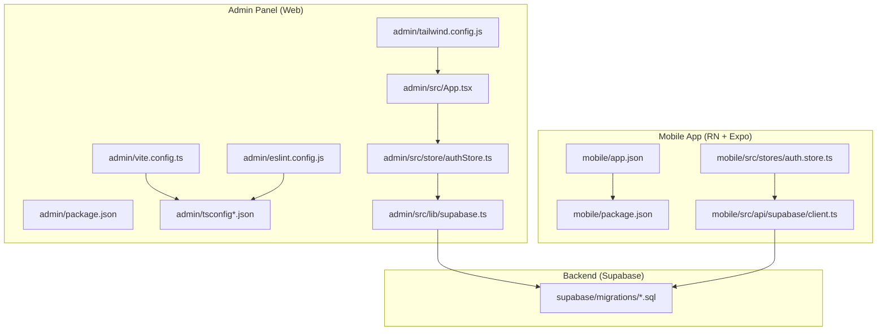
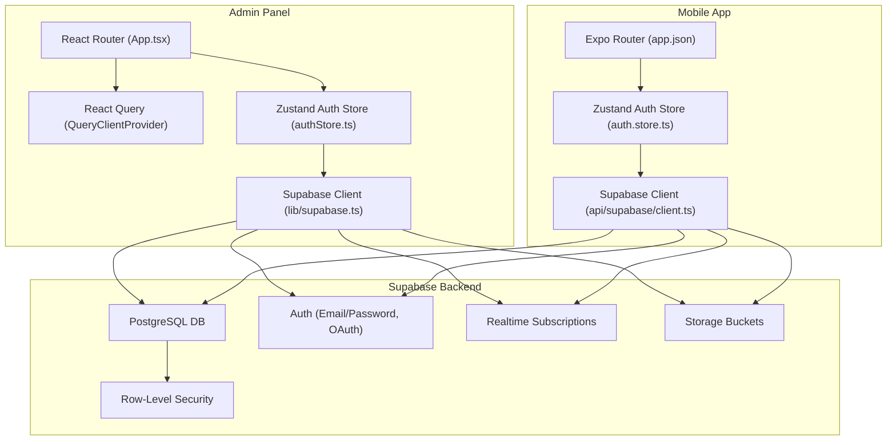
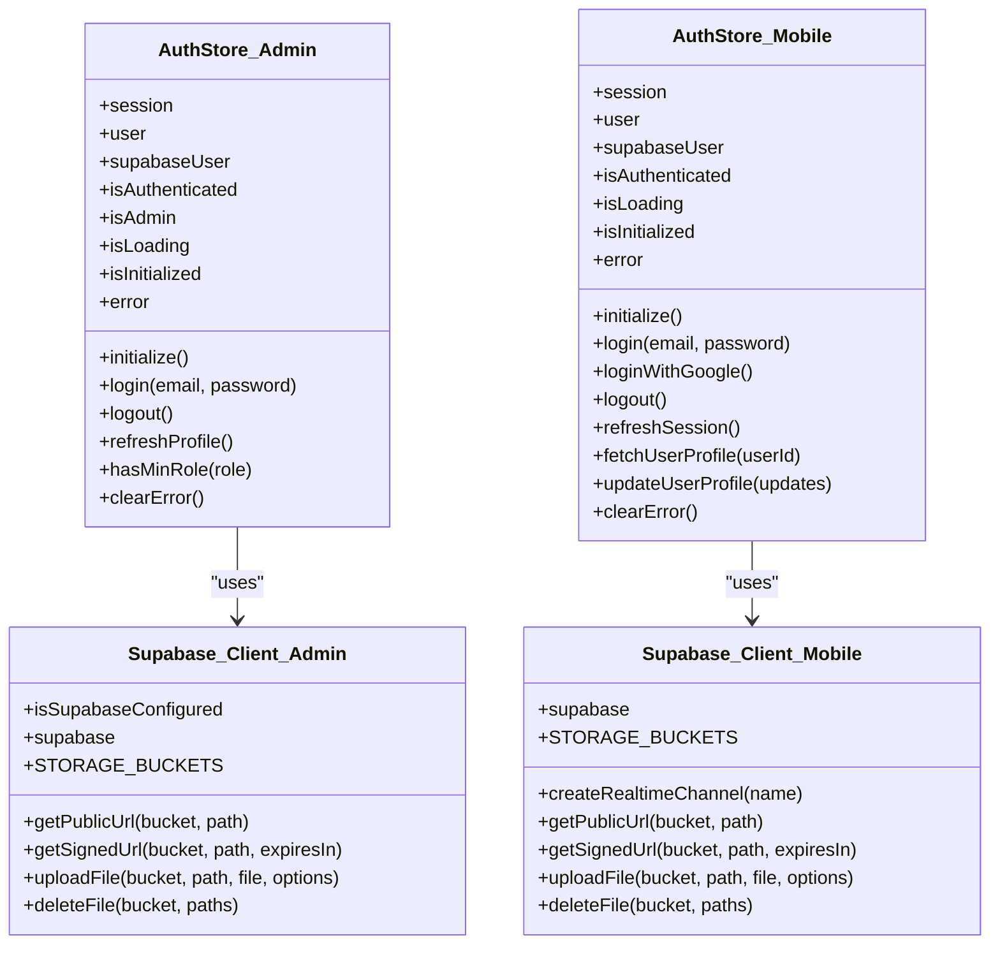
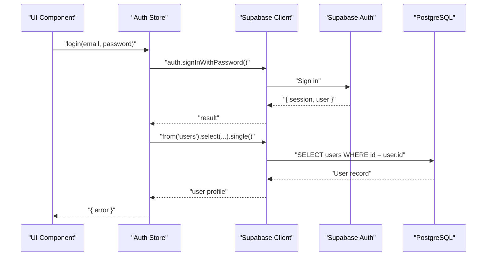
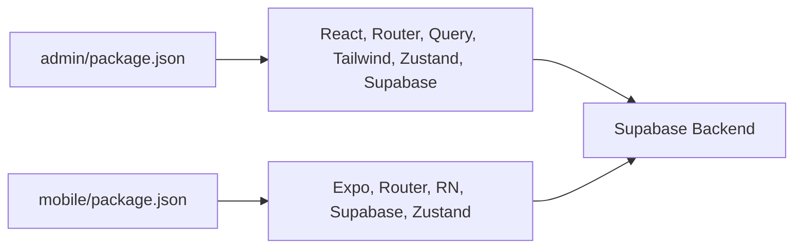

# Development Guidelines

<cite>
**Referenced Files in This Document**
- [README.md](file://README.md)
- [admin/package.json](file://admin/package.json)
- [admin/vite.config.ts](file://admin/vite.config.ts)
- [admin/eslint.config.js](file://admin/eslint.config.js)
- [admin/tailwind.config.js](file://admin/tailwind.config.js)
- [admin/tsconfig.json](file://admin/tsconfig.json)
- [admin/tsconfig.app.json](file://admin/tsconfig.app.json)
- [admin/tsconfig.node.json](file://admin/tsconfig.node.json)
- [admin/src/App.tsx](file://admin/src/App.tsx)
- [admin/src/store/authStore.ts](file://admin/src/store/authStore.ts)
- [admin/src/lib/supabase.ts](file://admin/src/lib/supabase.ts)
- [mobile/package.json](file://mobile/package.json)
- [mobile/app.json](file://mobile/app.json)
- [mobile/src/stores/auth.store.ts](file://mobile/src/stores/auth.store.ts)
- [mobile/src/api/supabase/client.ts](file://mobile/src/api/supabase/client.ts)
</cite>

## Table of Contents
1. [Introduction](#introduction)
2. [Project Structure](#project-structure)
3. [Core Components](#core-components)
4. [Architecture Overview](#architecture-overview)
5. [Detailed Component Analysis](#detailed-component-analysis)
6. [Dependency Analysis](#dependency-analysis)
7. [Performance Considerations](#performance-considerations)
8. [Troubleshooting Guide](#troubleshooting-guide)
9. [Contribution and Deployment Procedures](#contribution-and-deployment-procedures)
10. [Conclusion](#conclusion)

## Introduction
This document provides comprehensive development guidelines for contributing to Naliss UMYU Hub. It covers code standards, TypeScript configuration, ESLint rules, development workflow, component development patterns, state management, API integration, testing and debugging strategies, performance optimization, contribution and code review processes, and deployment procedures. The project consists of:
- A React web admin panel (admin/)
- A React Native Expo mobile application (mobile/)
- A Supabase backend (database, auth, storage, RLS policies)

These guidelines are designed to be accessible to contributors with varying levels of experience while ensuring consistency and quality across platforms.

## Project Structure
The repository follows a multi-package structure:
- admin/: React + Vite admin panel with routing, state management, and styling
- mobile/: React Native Expo app with navigation, state management, and native integrations
- supabase/: SQL migrations and policies for the backend
- docs/: Documentation artifacts
- Root README.md: Project overview, setup, and contribution process

**Diagram sources**
- [admin/package.json](file://admin/package.json#L1-L43)
- [admin/vite.config.ts](file://admin/vite.config.ts#L1-L8)
- [admin/tsconfig.json](file://admin/tsconfig.json#L1-L8)
- [admin/tsconfig.app.json](file://admin/tsconfig.app.json#L1-L29)
- [admin/tsconfig.node.json](file://admin/tsconfig.node.json#L1-L27)
- [admin/eslint.config.js](file://admin/eslint.config.js#L1-L24)
- [admin/tailwind.config.js](file://admin/tailwind.config.js#L1-L27)
- [admin/src/App.tsx](file://admin/src/App.tsx#L1-L64)
- [admin/src/store/authStore.ts](file://admin/src/store/authStore.ts#L1-L228)
- [admin/src/lib/supabase.ts](file://admin/src/lib/supabase.ts#L1-L73)
- [mobile/package.json](file://mobile/package.json#L1-L40)
- [mobile/app.json](file://mobile/app.json#L1-L70)
- [mobile/src/stores/auth.store.ts](file://mobile/src/stores/auth.store.ts#L1-L302)
- [mobile/src/api/supabase/client.ts](file://mobile/src/api/supabase/client.ts#L1-L87)

**Section sources**
- [README.md](file://README.md#L1-L247)
- [admin/package.json](file://admin/package.json#L1-L43)
- [admin/vite.config.ts](file://admin/vite.config.ts#L1-L8)
- [admin/tsconfig.json](file://admin/tsconfig.json#L1-L8)
- [admin/tsconfig.app.json](file://admin/tsconfig.app.json#L1-L29)
- [admin/tsconfig.node.json](file://admin/tsconfig.node.json#L1-L27)
- [admin/eslint.config.js](file://admin/eslint.config.js#L1-L24)
- [admin/tailwind.config.js](file://admin/tailwind.config.js#L1-L27)
- [mobile/package.json](file://mobile/package.json#L1-L40)
- [mobile/app.json](file://mobile/app.json#L1-L70)

## Core Components
This section outlines the foundational elements for building features consistently across platforms.

- TypeScript configuration
  - Separate app and node tsconfig files enable strict bundler-mode compilation and strict linting flags for both environments.
  - Strict compiler options enforce correctness and reduce runtime errors.
  - Bundler module resolution ensures compatibility with Vite and Metro.

- ESLint configuration
  - Flat config extends recommended rules for JavaScript, TypeScript, React Hooks, and React Refresh.
  - Global ignores exclude built artifacts.
  - Language options target modern ECMAScript and browser globals.

- Tailwind CSS
  - Content paths scan HTML and TS/TSX sources.
  - Theme extends a primary color palette aligned with the brand.

- Vite setup
  - React plugin enables fast HMR and JSX transformations.
  - Scripts define dev, build, lint, and preview commands.

- React Query defaults
  - Centralized client with sensible defaults for staleTime and retries improves caching behavior and resilience.

- Zustand stores
  - Auth stores encapsulate session lifecycle, profile fetching, and permission checks.
  - Persisted subsets minimize serialized state and improve UX.

- Supabase client
  - Environment-driven client creation with auto-refresh and persisted sessions.
  - Storage helpers unify public and signed URL generation, uploads, and deletions.

**Section sources**
- [admin/tsconfig.app.json](file://admin/tsconfig.app.json#L1-L29)
- [admin/tsconfig.node.json](file://admin/tsconfig.node.json#L1-L27)
- [admin/eslint.config.js](file://admin/eslint.config.js#L1-L24)
- [admin/tailwind.config.js](file://admin/tailwind.config.js#L1-L27)
- [admin/vite.config.ts](file://admin/vite.config.ts#L1-L8)
- [admin/src/App.tsx](file://admin/src/App.tsx#L1-L64)
- [admin/src/store/authStore.ts](file://admin/src/store/authStore.ts#L1-L228)
- [admin/src/lib/supabase.ts](file://admin/src/lib/supabase.ts#L1-L73)
- [mobile/src/stores/auth.store.ts](file://mobile/src/stores/auth.store.ts#L1-L302)
- [mobile/src/api/supabase/client.ts](file://mobile/src/api/supabase/client.ts#L1-L87)

## Architecture Overview
The system integrates a React web admin panel and a React Native mobile app, both consuming a shared Supabase backend. Authentication, real-time updates, storage, and row-level security form the backbone of the platform.

**Diagram sources**
- [admin/src/App.tsx](file://admin/src/App.tsx#L1-L64)
- [admin/src/store/authStore.ts](file://admin/src/store/authStore.ts#L1-L228)
- [admin/src/lib/supabase.ts](file://admin/src/lib/supabase.ts#L1-L73)
- [mobile/app.json](file://mobile/app.json#L1-L70)
- [mobile/src/stores/auth.store.ts](file://mobile/src/stores/auth.store.ts#L1-L302)
- [mobile/src/api/supabase/client.ts](file://mobile/src/api/supabase/client.ts#L1-L87)

## Detailed Component Analysis

### State Management Patterns
- Zustand stores
  - Auth stores manage session, user profile, loading states, and errors.
  - Actions handle initialization, login/logout, profile refresh, and permission checks.
  - Persist middleware serializes only essential slices to localStorage/session storage.

- React Query
  - Centralized client with default query options reduces duplication and improves cache behavior.

- Selector hooks
  - Derived selectors simplify consuming store slices and permissions.

**Diagram sources**
- [admin/src/store/authStore.ts](file://admin/src/store/authStore.ts#L1-L228)
- [admin/src/lib/supabase.ts](file://admin/src/lib/supabase.ts#L1-L73)
- [mobile/src/stores/auth.store.ts](file://mobile/src/stores/auth.store.ts#L1-L302)
- [mobile/src/api/supabase/client.ts](file://mobile/src/api/supabase/client.ts#L1-L87)

**Section sources**
- [admin/src/store/authStore.ts](file://admin/src/store/authStore.ts#L1-L228)
- [mobile/src/stores/auth.store.ts](file://mobile/src/stores/auth.store.ts#L1-L302)
- [admin/src/lib/supabase.ts](file://admin/src/lib/supabase.ts#L1-L73)
- [mobile/src/api/supabase/client.ts](file://mobile/src/api/supabase/client.ts#L1-L87)

### API Integration and Supabase Client
- Environment variables
  - Admin reads Vite-time variables for Supabase URL and key.
  - Mobile reads Expo public variables for Supabase URL and key.

- Client configuration
  - Auto-refresh tokens, persisted sessions, and optional realtime event rate limiting.
  - AsyncStorage integration for React Native.

- Storage helpers
  - Unified helpers for public URLs, signed URLs, uploads, and deletions.

**Diagram sources**
- [admin/src/store/authStore.ts](file://admin/src/store/authStore.ts#L94-L172)
- [admin/src/lib/supabase.ts](file://admin/src/lib/supabase.ts#L10-L18)
- [mobile/src/stores/auth.store.ts](file://mobile/src/stores/auth.store.ts#L99-L134)
- [mobile/src/api/supabase/client.ts](file://mobile/src/api/supabase/client.ts#L15-L27)

**Section sources**
- [admin/src/lib/supabase.ts](file://admin/src/lib/supabase.ts#L1-L73)
- [mobile/src/api/supabase/client.ts](file://mobile/src/api/supabase/client.ts#L1-L87)

### Component Development Guidelines
- File naming and structure
  - Prefer PascalCase for component files and folders.
  - Keep presentational and container components cohesive within feature folders.

- Props and types
  - Define explicit props interfaces and avoid any where possible.
  - Use union types for enums and literal values.

- Styling
  - Use Tailwind utilities for responsive designs.
  - Extend theme colors via tailwind.config.js for consistency.

- Routing
  - Admin uses React Router DOM with protected routes and lazy-loaded pages.
  - Mobile uses Expo Router with file-based routing and typed routes.

- State and effects
  - Initialize auth stores during app bootstrap.
  - Use React Query for server state and optimistic updates.
  - Use Zustand for client-side UI and small domain state.

- Accessibility
  - Provide alt texts for images and meaningful labels for interactive elements.
  - Respect focus order and keyboard navigation.

**Section sources**
- [admin/src/App.tsx](file://admin/src/App.tsx#L1-L64)
- [admin/tailwind.config.js](file://admin/tailwind.config.js#L1-L27)
- [mobile/app.json](file://mobile/app.json#L1-L70)

### Testing Strategies
- Unit tests for pure functions and selectors
  - Validate auth permission checks and role comparisons.
  - Mock Supabase client methods to assert calls and return values.

- Component tests
  - Render components under different store states (loading, authenticated, error).
  - Test user interactions (login, logout) by mocking store actions.

- Integration tests
  - Verify auth lifecycle: initialize, sign in, profile fetch, sign out.
  - Test Supabase storage operations with mock responses.

- Snapshot tests
  - Capture UI renders for regression detection, especially after styling changes.

- Continuous integration
  - Run linter and type checks on pull requests.
  - Enforce test coverage thresholds for critical modules.

[No sources needed since this section provides general guidance]

### Debugging Approaches
- Console logging
  - Log store actions and state transitions for visibility.
  - Distinguish between client and server errors.

- DevTools
  - React DevTools for component tree and hooks inspection.
  - React Query Devtools for query caching and refetch behavior.
  - Zustand Devtools for store state inspection.

- Network debugging
  - Inspect Supabase requests/responses and realtime channels.
  - Verify environment variables are injected correctly.

- Environment-specific modes
  - Admin supports a demo mode when Supabase is not configured.
  - Mobile validates environment variables at startup.

**Section sources**
- [admin/src/store/authStore.ts](file://admin/src/store/authStore.ts#L38-L92)
- [admin/src/lib/supabase.ts](file://admin/src/lib/supabase.ts#L6-L18)
- [mobile/src/api/supabase/client.ts](file://mobile/src/api/supabase/client.ts#L9-L13)

### Performance Optimization Techniques
- Client state
  - Persist minimal slices to reduce serialization overhead.
  - Use selector hooks to prevent unnecessary re-renders.

- Server state
  - Tune staleTime and refetch intervals for optimal cache freshness.
  - Cancel queries on unmount to avoid memory leaks.

- Assets
  - Use signed URLs for private assets and precompute public URLs when possible.
  - Compress images and limit attachment sizes.

- Rendering
  - Lazy-load heavy components and route segments.
  - Split bundles and leverage code splitting.

- Network
  - Debounce rapid UI triggers (e.g., search).
  - Batch updates to minimize redundant requests.

**Section sources**
- [admin/src/App.tsx](file://admin/src/App.tsx#L10-L17)
- [admin/src/store/authStore.ts](file://admin/src/store/authStore.ts#L215-L222)
- [mobile/src/stores/auth.store.ts](file://mobile/src/stores/auth.store.ts#L262-L302)

## Dependency Analysis
- Admin dependencies
  - React, React Router DOM, React Query, Tailwind CSS, Zustand, and Supabase JS.
  - Vite plugin for React and dev scripts for local development.

- Mobile dependencies
  - Expo, Expo Router, React Native, React Native dependencies, Supabase JS, Zustand, and AsyncStorage integration.

- Shared backend
  - Supabase provides database, auth, realtime, and storage.

**Diagram sources**
- [admin/package.json](file://admin/package.json#L12-L26)
- [admin/package.json](file://admin/package.json#L27-L41)
- [mobile/package.json](file://mobile/package.json#L11-L32)

**Section sources**
- [admin/package.json](file://admin/package.json#L1-L43)
- [mobile/package.json](file://mobile/package.json#L1-L40)

## Performance Considerations
- Use React Query’s defaultOptions to balance freshness and performance.
- Persist only necessary slices in Zustand stores.
- Optimize Tailwind builds by scoping content globs and purging unused styles.
- Minimize large payloads in storage; prefer streaming uploads and signed URLs.
- Monitor bundle size and split vendor code.

[No sources needed since this section provides general guidance]

## Troubleshooting Guide
- Supabase environment variables missing
  - Admin throws an error if URL/key are missing; verify .env variables are loaded by Vite.
  - Mobile requires EXPO_PUBLIC_SUPABase variables; ensure .env is present and variables are prefixed correctly.

- Auth state not initializing
  - Check onAuthStateChange subscriptions and ensure getSession resolves.
  - Verify Supabase auth is enabled and providers are configured.

- Storage operations failing
  - Confirm bucket names match and policies allow access.
  - Validate signed URL expiration and file types.

- Mobile app not starting
  - Ensure Expo CLI is installed and project dependencies are installed.
  - Verify app.json configuration for scheme, permissions, and plugins.

**Section sources**
- [admin/src/lib/supabase.ts](file://admin/src/lib/supabase.ts#L6-L18)
- [mobile/src/api/supabase/client.ts](file://mobile/src/api/supabase/client.ts#L9-L13)
- [mobile/app.json](file://mobile/app.json#L1-L70)

## Contribution and Deployment Procedures

### Development Environment Setup
- Prerequisites
  - Node.js 18+, npm/yarn, Expo CLI, and a Supabase project.

- Supabase setup
  - Apply migrations in order and configure storage buckets.
  - Enable Google OAuth provider if needed.

- Admin panel
  - Install dependencies, create .env with VITE_SUPABASE_URL and VITE_SUPABASE_ANON_KEY, then run dev.

- Mobile app
  - Install dependencies, create .env with EXPO_PUBLIC_SUPABASE_URL and EXPO_PUBLIC_SUPABASE_ANON_KEY, then run start.

- First admin user
  - Register a user via the mobile app, then elevate to system owner using the provided SQL function.

**Section sources**
- [README.md](file://README.md#L65-L144)
- [admin/package.json](file://admin/package.json#L6-L11)
- [mobile/package.json](file://mobile/package.json#L5-L10)

### Code Standards and Linting
- TypeScript
  - Strict compiler options and bundler module resolution enforced via separate tsconfig files.
  - Include only necessary source folders to keep builds fast.

- ESLint
  - Flat config extends recommended rules for TS, React Hooks, and React Refresh.
  - Run lint before committing to catch issues early.

- Formatting
  - Use Prettier-compatible settings and integrate with your editor for auto-formatting.

**Section sources**
- [admin/tsconfig.app.json](file://admin/tsconfig.app.json#L19-L25)
- [admin/tsconfig.node.json](file://admin/tsconfig.node.json#L17-L23)
- [admin/eslint.config.js](file://admin/eslint.config.js#L8-L23)

### Component Development Checklist
- Create a new feature folder under components with a descriptive name.
- Define prop interfaces and default exports.
- Use Tailwind for styling and avoid inline styles.
- Integrate with Zustand store for state and React Query for server data.
- Add unit and integration tests covering success and error paths.

[No sources needed since this section provides general guidance]

### State Management Checklist
- Auth stores
  - Initialize on app boot, listen to auth state changes, persist minimal state, and expose selector hooks.
- Domain stores
  - Encapsulate CRUD operations, handle loading/error states, and invalidate queries after writes.

**Section sources**
- [admin/src/store/authStore.ts](file://admin/src/store/authStore.ts#L26-L92)
- [mobile/src/stores/auth.store.ts](file://mobile/src/stores/auth.store.ts#L27-L96)

### API Integration Checklist
- Use the shared Supabase client instances for auth, database, and storage.
- Wrap storage operations with helpers for consistency.
- Handle errors gracefully and surface actionable messages to users.

**Section sources**
- [admin/src/lib/supabase.ts](file://admin/src/lib/supabase.ts#L20-L73)
- [mobile/src/api/supabase/client.ts](file://mobile/src/api/supabase/client.ts#L35-L87)

### Testing and Debugging Checklist
- Write tests for store actions, selectors, and API helpers.
- Use React Query Devtools and Zustand Devtools during development.
- Verify environment variables at startup and log meaningful errors.

**Section sources**
- [admin/src/store/authStore.ts](file://admin/src/store/authStore.ts#L85-L91)
- [mobile/src/stores/auth.store.ts](file://mobile/src/stores/auth.store.ts#L89-L96)

### Code Review Guidelines
- Ensure adherence to TypeScript strictness and ESLint rules.
- Verify component boundaries, prop contracts, and accessibility.
- Confirm store actions are covered by tests and error handling is robust.
- Validate environment variable usage and security posture (e.g., RLS, signed URLs).

[No sources needed since this section provides general guidance]

### Deployment Procedures
- Mobile app
  - Configure EAS build, then build for Android and iOS platforms.
  - Use EAS to manage distribution and updates.

- Admin panel
  - Build production bundle and deploy to Vercel.

**Section sources**
- [README.md](file://README.md#L188-L215)
- [admin/package.json](file://admin/package.json#L6-L11)

## Conclusion
By following these development guidelines, contributors can build consistent, maintainable, and performant features across the admin panel and mobile app while leveraging Supabase for authentication, real-time updates, and storage. Adhering to code standards, testing strategies, and deployment procedures ensures a smooth development lifecycle and reliable user experiences.