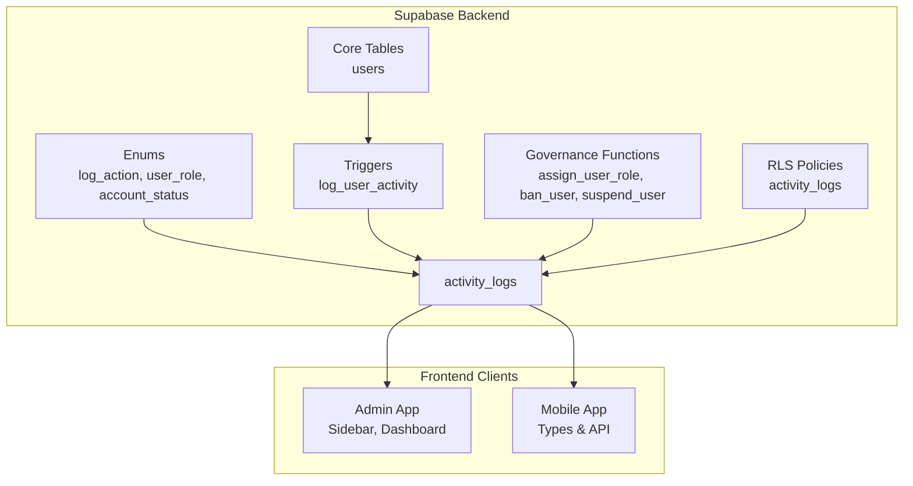
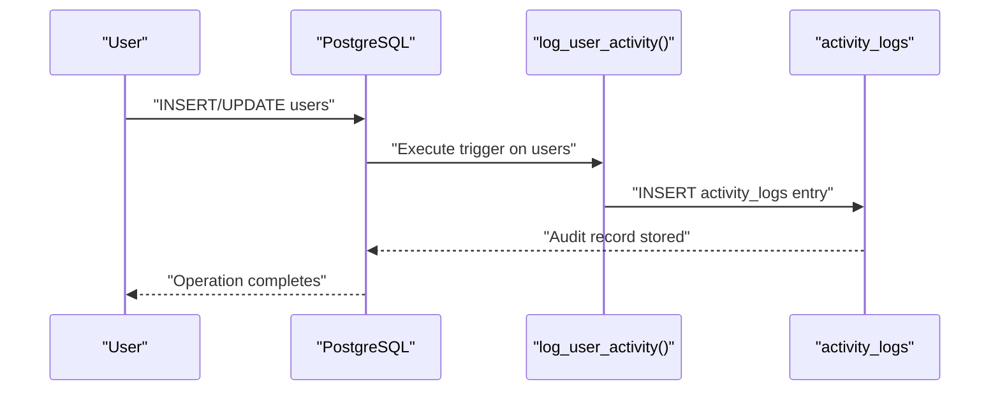
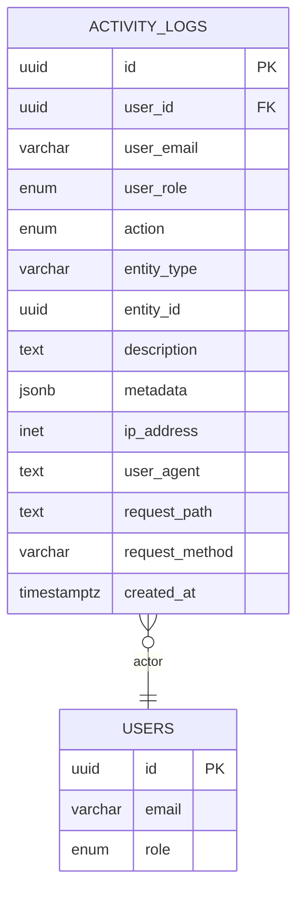
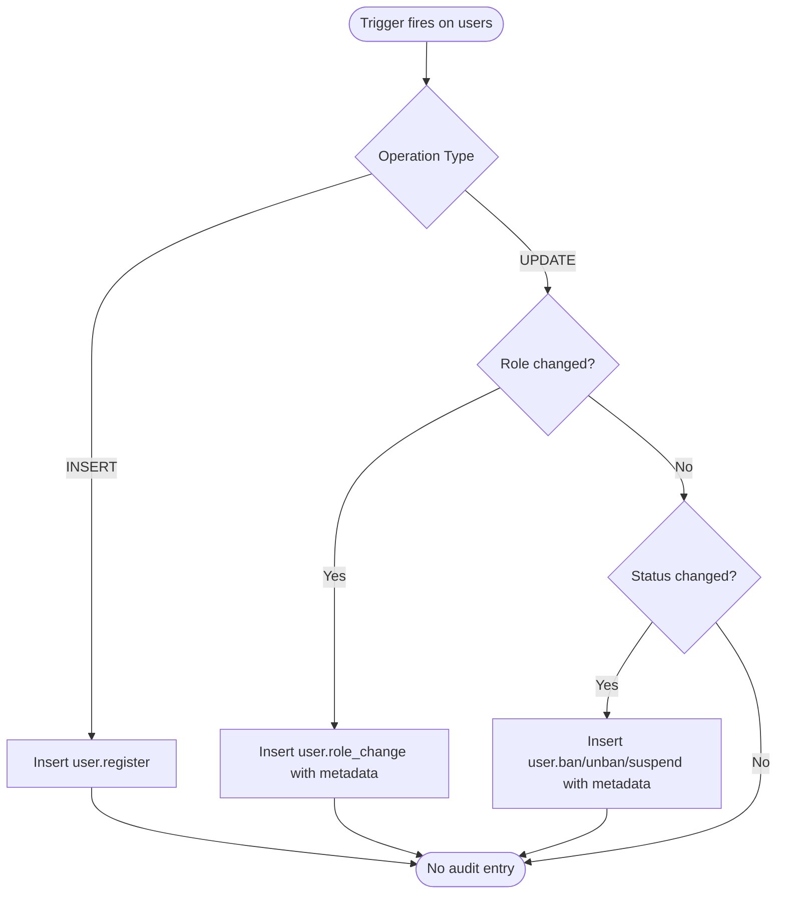
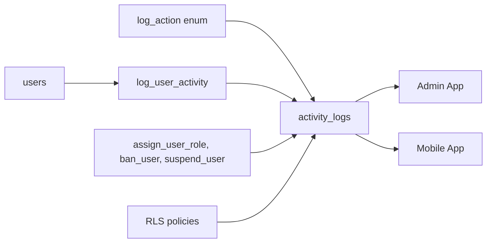

# Audit Trails & Activity Logging

<cite>
**Referenced Files in This Document**
- [001_enums.sql](file://supabase/migrations/001_enums.sql)
- [002_core_tables.sql](file://supabase/migrations/002_core_tables.sql)
- [006_triggers.sql](file://supabase/migrations/006_triggers.sql)
- [007_rls_policies.sql](file://supabase/migrations/007_rls_policies.sql)
- [008_governance_functions.sql](file://supabase/migrations/008_governance_functions.sql)
- [009_storage_policies.sql](file://supabase/migrations/009_storage_policies.sql)
- [index.ts (Admin Types)](file://admin/src/types/index.ts)
- [index.ts (Mobile Types)](file://mobile/src/types/index.ts)
- [database.types.ts (Mobile API Types)](file://mobile/src/api/database.types.ts)
- [Sidebar.tsx](file://admin/src/components/layout/Sidebar.tsx)
- [DashboardPage.tsx](file://admin/src/pages/DashboardPage.tsx)
</cite>

## Table of Contents
1. [Introduction](#introduction)
2. [Project Structure](#project-structure)
3. [Core Components](#core-components)
4. [Architecture Overview](#architecture-overview)
5. [Detailed Component Analysis](#detailed-component-analysis)
6. [Dependency Analysis](#dependency-analysis)
7. [Performance Considerations](#performance-considerations)
8. [Troubleshooting Guide](#troubleshooting-guide)
9. [Conclusion](#conclusion)
10. [Appendices](#appendices)

## Introduction
This document describes the audit trail and activity logging system implemented in the platform. It explains the activity_logs table schema, the triggers that generate audit entries, the types of activities tracked, log entry formats, administrative access controls, filtering capabilities, and integration points with the broader governance and security infrastructure. It also outlines compliance reporting features and how the system integrates with security monitoring.

## Project Structure
The audit trail is implemented across several Supabase migration files and is consumed by the admin and mobile applications:
- Supabase migrations define the audit table, triggers, enums, and row-level security policies.
- Governance functions provide administrative operations that log actions.
- Frontend types define the shape of activity log records returned to clients.
- Admin and mobile apps consume these records for display and filtering.

**Diagram sources**
- [001_enums.sql](file://supabase/migrations/001_enums.sql#L92-L132)
- [002_core_tables.sql](file://supabase/migrations/002_core_tables.sql#L43-L92)
- [006_triggers.sql](file://supabase/migrations/006_triggers.sql#L160-L214)
- [007_rls_policies.sql](file://supabase/migrations/007_rls_policies.sql#L470-L479)
- [008_governance_functions.sql](file://supabase/migrations/008_governance_functions.sql#L9-L68)

**Section sources**
- [001_enums.sql](file://supabase/migrations/001_enums.sql#L92-L132)
- [002_core_tables.sql](file://supabase/migrations/002_core_tables.sql#L43-L92)
- [006_triggers.sql](file://supabase/migrations/006_triggers.sql#L160-L214)
- [007_rls_policies.sql](file://supabase/migrations/007_rls_policies.sql#L470-L479)
- [008_governance_functions.sql](file://supabase/migrations/008_governance_functions.sql#L9-L68)

## Core Components
- activity_logs table: Stores audit entries with actor, action, entity context, request metadata, and timestamps.
- log_action enum: Defines standardized categories of auditable actions (user, message, material, event, announcement, admin, settings).
- Triggers: Automatically capture user registration, role/status changes, and other system events.
- Governance functions: Administrative operations that explicitly log actions.
- Row-level security: Restricts access to logs to authorized administrators.

Key implementation references:
- [activity_logs table definition](file://supabase/migrations/006_triggers.sql#L220-L245)
- [log_action enum](file://supabase/migrations/001_enums.sql#L92-L132)
- [log_user_activity trigger](file://supabase/migrations/006_triggers.sql#L160-L214)
- [assign_user_role logs](file://supabase/migrations/008_governance_functions.sql#L53-L66)
- [ban_user logs](file://supabase/migrations/008_governance_functions.sql#L112-L125)
- [suspend_user logs](file://supabase/migrations/008_governance_functions.sql#L196-L209)
- [RLS policy for logs](file://supabase/migrations/007_rls_policies.sql#L470-L479)

**Section sources**
- [006_triggers.sql](file://supabase/migrations/006_triggers.sql#L220-L245)
- [001_enums.sql](file://supabase/migrations/001_enums.sql#L92-L132)
- [008_governance_functions.sql](file://supabase/migrations/008_governance_functions.sql#L53-L66)
- [007_rls_policies.sql](file://supabase/migrations/007_rls_policies.sql#L470-L479)

## Architecture Overview
The audit trail architecture combines database-level triggers and explicit function calls to populate the activity_logs table. Access to logs is governed by row-level security policies that require administrators.

**Diagram sources**
- [006_triggers.sql](file://supabase/migrations/006_triggers.sql#L160-L214)
- [006_triggers.sql](file://supabase/migrations/006_triggers.sql#L220-L245)

## Detailed Component Analysis

### Activity Logs Table Schema
The activity_logs table captures:
- Actor: user_id, user_email, user_role
- Action: action (log_action enum), entity_type, entity_id
- Context: description, metadata (JSONB)
- Request context: ip_address, user_agent, request_path, request_method
- Timestamp: created_at

Indexes support common audit queries:
- user_id, action, entity_type/entity_id, created_at DESC, ip_address

**Diagram sources**
- [006_triggers.sql](file://supabase/migrations/006_triggers.sql#L220-L245)
- [002_core_tables.sql](file://supabase/migrations/002_core_tables.sql#L43-L92)

**Section sources**
- [006_triggers.sql](file://supabase/migrations/006_triggers.sql#L220-L245)
- [002_core_tables.sql](file://supabase/migrations/002_core_tables.sql#L43-L92)

### Logging Triggers
The log_user_activity trigger captures:
- User registration (INSERT on users)
- Role changes (UPDATE on users)
- Status changes (banned/suspended/active) with reason metadata

**Diagram sources**
- [006_triggers.sql](file://supabase/migrations/006_triggers.sql#L160-L214)

**Section sources**
- [006_triggers.sql](file://supabase/migrations/006_triggers.sql#L160-L214)

### Governance Functions That Log
Administrative functions explicitly insert audit entries:
- assign_user_role: logs role changes with performed_by metadata
- ban_user: logs bans with reason and performed_by
- suspend_user: logs suspensions with until/reason
- promote_initial_system_owner: logs initial system owner promotion

These functions ensure that administrative actions are consistently audited.

**Section sources**
- [008_governance_functions.sql](file://supabase/migrations/008_governance_functions.sql#L9-L68)
- [008_governance_functions.sql](file://supabase/migrations/008_governance_functions.sql#L74-L126)
- [008_governance_functions.sql](file://supabase/migrations/008_governance_functions.sql#L173-L210)
- [008_governance_functions.sql](file://supabase/migrations/008_governance_functions.sql#L472-L494)

### Types of Activities Tracked
The log_action enum defines standardized categories:
- User: register, profile_update, role_change, ban/unban/suspend, login/logout
- Message: send/edit/delete
- Material: upload/update/delete/download
- Event: create/update/delete/register
- Announcement: create/update/delete
- Admin: impersonation start/end
- Settings: change

**Section sources**
- [001_enums.sql](file://supabase/migrations/001_enums.sql#L92-L132)

### Log Entry Formats
Each entry includes:
- Actor: user_id, user_email, user_role
- Action: log_action enum
- Entity: entity_type and entity_id
- Context: description and structured metadata (JSONB)
- Request context: ip_address, user_agent, request_path, request_method
- Timestamp: created_at

Frontend type definitions align with the database schema for both admin and mobile clients.

**Section sources**
- [006_triggers.sql](file://supabase/migrations/006_triggers.sql#L220-L245)
- [index.ts (Admin Types)](file://admin/src/types/index.ts#L133-L149)
- [index.ts (Mobile Types)](file://mobile/src/types/index.ts#L308-L324)
- [database.types.ts (Mobile API Types)](file://mobile/src/api/database.types.ts#L468-L494)

### Administrative Access Controls
Row-level security policies restrict access to activity logs:
- Admins can read all logs (is_admin() and not banned)
- Users can insert logs (via triggers)

The admin sidebar indicates that Activity Logs is a protected route requiring super_admin or higher.

**Section sources**
- [007_rls_policies.sql](file://supabase/migrations/007_rls_policies.sql#L470-L479)
- [Sidebar.tsx](file://admin/src/components/layout/Sidebar.tsx#L31)

### Filtering Capabilities
Common filters supported by the schema and indexes:
- By user (user_id)
- By action (action)
- By entity (entity_type, entity_id)
- By IP address (ip_address)
- By date range (created_at DESC)

These filters enable targeted investigations and compliance reporting.

**Section sources**
- [006_triggers.sql](file://supabase/migrations/006_triggers.sql#L247-L252)

### Export Functionality
While the repository does not include a dedicated export endpoint, the activity_logs table is queryable via RPC functions and can be exported from the admin dashboard. The admin app’s dashboard consumes a system stats RPC, indicating the platform supports RPC-based data retrieval suitable for export.

**Section sources**
- [DashboardPage.tsx](file://admin/src/pages/DashboardPage.tsx#L21-L31)

### Retention Policies
Retention policies are not defined in the provided migrations. Organizations should implement periodic cleanup jobs to maintain performance and meet regulatory requirements. The governance functions include cleanup helpers for other tables, which can serve as templates for implementing retention policies for activity_logs.

**Section sources**
- [008_governance_functions.sql](file://supabase/migrations/008_governance_functions.sql#L414-L464)

### Compliance Reporting Features
The audit trail supports compliance reporting through:
- Standardized log_action categories
- Structured metadata for reasons and administrative context
- Actor and request context (IP, user agent, path/method)
- Entity-scoped auditing (user, message, material, event, announcement)

Administrators can filter and export logs for internal audits and external compliance reviews.

**Section sources**
- [001_enums.sql](file://supabase/migrations/001_enums.sql#L92-L132)
- [006_triggers.sql](file://supabase/migrations/006_triggers.sql#L220-L245)

### Integration with Security Monitoring Systems
The system can integrate with security monitoring via:
- Real-time subscriptions for messaging and announcements (enables live dashboards)
- Centralized logging of administrative actions
- Request context fields enabling correlation with network logs

Note: Real-time subscriptions are configured for messaging and announcements; activity_logs itself is not enabled for real-time publication in the provided migrations.

**Section sources**
- [008_governance_functions.sql](file://supabase/migrations/008_governance_functions.sql#L498-L510)

## Dependency Analysis
The audit trail depends on:
- Enums for standardized actions
- Core users table for actor identity
- Triggers for automatic logging
- Governance functions for administrative logging
- RLS policies for access control

**Diagram sources**
- [001_enums.sql](file://supabase/migrations/001_enums.sql#L92-L132)
- [002_core_tables.sql](file://supabase/migrations/002_core_tables.sql#L43-L92)
- [006_triggers.sql](file://supabase/migrations/006_triggers.sql#L160-L214)
- [008_governance_functions.sql](file://supabase/migrations/008_governance_functions.sql#L9-L68)
- [007_rls_policies.sql](file://supabase/migrations/007_rls_policies.sql#L470-L479)

**Section sources**
- [001_enums.sql](file://supabase/migrations/001_enums.sql#L92-L132)
- [002_core_tables.sql](file://supabase/migrations/002_core_tables.sql#L43-L92)
- [006_triggers.sql](file://supabase/migrations/006_triggers.sql#L160-L214)
- [008_governance_functions.sql](file://supabase/migrations/008_governance_functions.sql#L9-L68)
- [007_rls_policies.sql](file://supabase/migrations/007_rls_policies.sql#L470-L479)

## Performance Considerations
- Indexes on user_id, action, entity_type/entity_id, created_at DESC, and ip_address optimize audit queries.
- JSONB metadata enables flexible enrichment without schema changes.
- Consider partitioning or archiving older logs for long-term retention and query performance.
- Batch reads and pagination (as seen in the admin dashboard) help manage large datasets.

[No sources needed since this section provides general guidance]

## Troubleshooting Guide
Common issues and resolutions:
- Missing logs: Verify that triggers are attached to the users table and that RLS allows inserts via triggers.
- Access denied: Confirm the user has admin privileges and is not banned.
- Large datasets: Use indexed filters (user_id, action, entity_type, ip_address) and limit result sets.
- Cleanup: Use governance functions’ cleanup patterns to remove old data if implementing retention policies.

**Section sources**
- [006_triggers.sql](file://supabase/migrations/006_triggers.sql#L210-L214)
- [007_rls_policies.sql](file://supabase/migrations/007_rls_policies.sql#L470-L479)
- [008_governance_functions.sql](file://supabase/migrations/008_governance_functions.sql#L414-L464)

## Conclusion
The audit trail and activity logging system provides comprehensive coverage of user and administrative actions with standardized categorization, robust access controls, and flexible filtering. Administrators can leverage the system for compliance reporting and security monitoring, while the schema supports future enhancements such as export and retention policies.

[No sources needed since this section summarizes without analyzing specific files]

## Appendices

### Example Audit Scenarios
- User registration: An entry with action user.register and entity_type user.
- Role change: An entry with action user.role_change and metadata containing old/new roles.
- Suspension: An entry with action user.suspend and metadata including reason and until timestamp.
- Material upload: An entry with action material.upload and entity_type material.
- Announcement deletion: An entry with action announcement.delete and entity_type announcement.

**Section sources**
- [001_enums.sql](file://supabase/migrations/001_enums.sql#L92-L132)
- [006_triggers.sql](file://supabase/migrations/006_triggers.sql#L160-L214)
- [008_governance_functions.sql](file://supabase/migrations/008_governance_functions.sql#L53-L66)
- [008_governance_functions.sql](file://supabase/migrations/008_governance_functions.sql#L112-L125)
- [008_governance_functions.sql](file://supabase/migrations/008_governance_functions.sql#L196-L209)