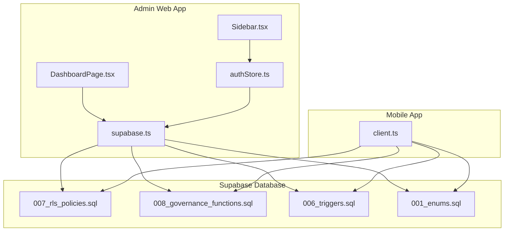
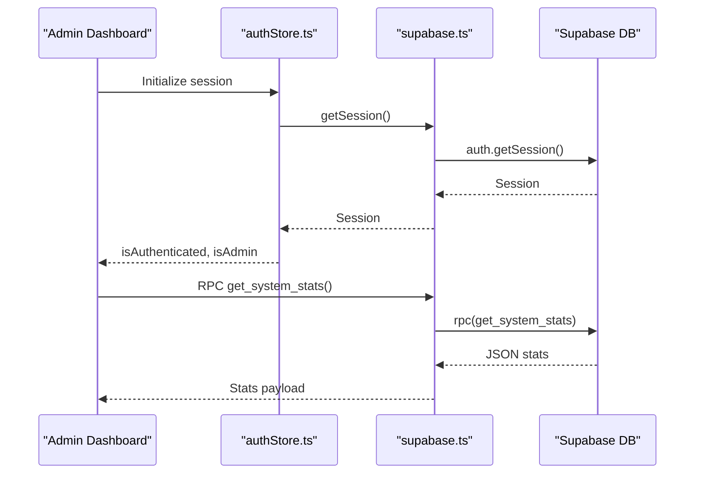
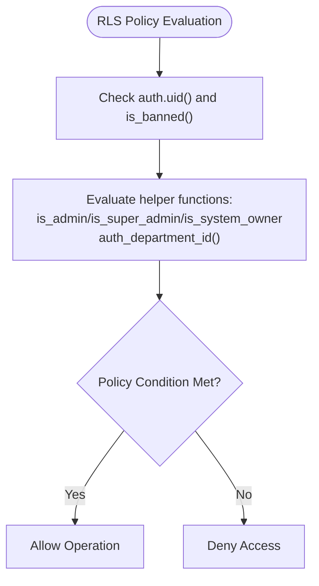
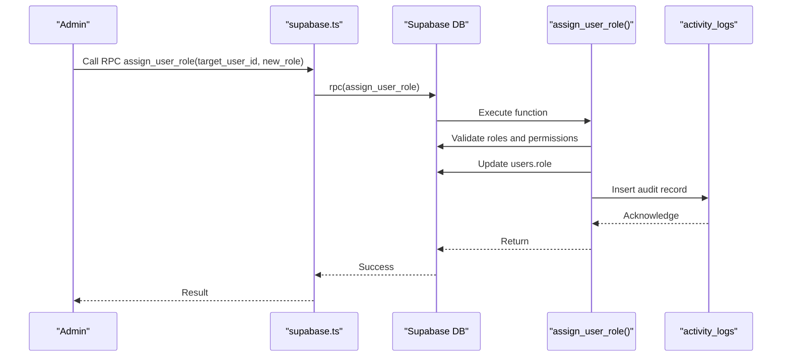
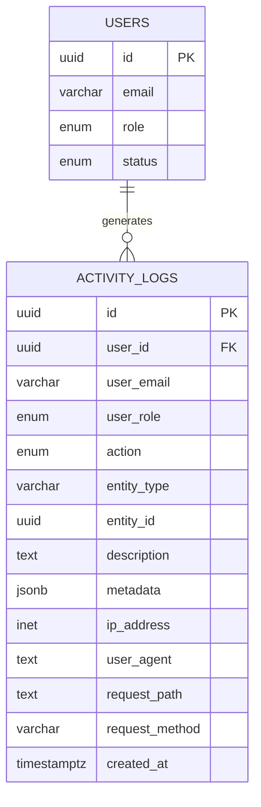
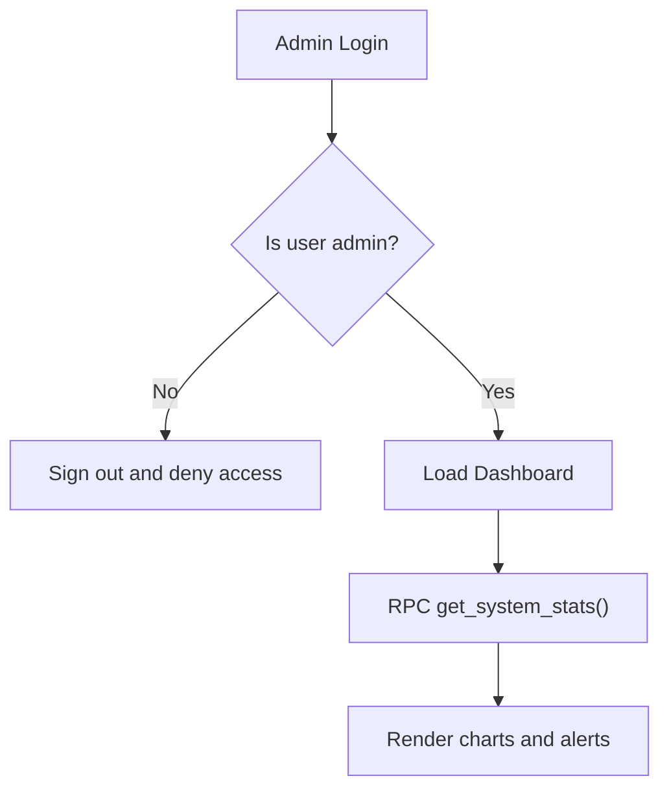
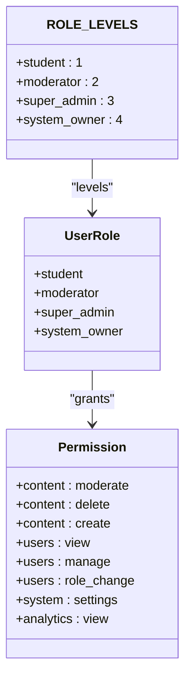
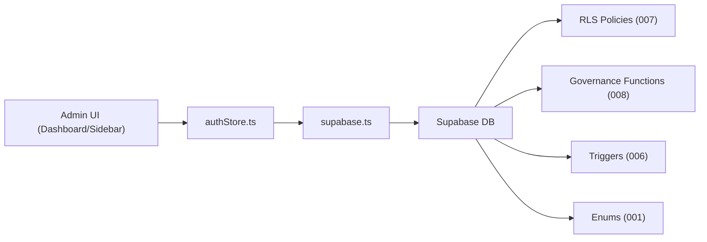

# Governance & Administration

<cite>
**Referenced Files in This Document**
- [007_rls_policies.sql](file://supabase/migrations/007_rls_policies.sql)
- [008_governance_functions.sql](file://supabase/migrations/008_governance_functions.sql)
- [006_triggers.sql](file://supabase/migrations/006_triggers.sql)
- [001_enums.sql](file://supabase/migrations/001_enums.sql)
- [supabase.ts](file://admin/src/lib/supabase.ts)
- [client.ts](file://mobile/src/api/supabase/client.ts)
- [authStore.ts](file://admin/src/store/authStore.ts)
- [DashboardPage.tsx](file://admin/src/pages/DashboardPage.tsx)
- [Sidebar.tsx](file://admin/src/components/layout/Sidebar.tsx)
- [index.ts (admin types)](file://admin/src/types/index.ts)
- [index.ts (mobile types)](file://mobile/src/types/index.ts)
</cite>

## Table of Contents
1. [Introduction](#introduction)
2. [Project Structure](#project-structure)
3. [Core Components](#core-components)
4. [Architecture Overview](#architecture-overview)
5. [Detailed Component Analysis](#detailed-component-analysis)
6. [Dependency Analysis](#dependency-analysis)
7. [Performance Considerations](#performance-considerations)
8. [Troubleshooting Guide](#troubleshooting-guide)
9. [Conclusion](#conclusion)

## Introduction
This document explains the governance and administration features of the platform, focusing on:
- Audit trail and activity logging
- User moderation capabilities
- System settings management
- Administrative controls and workflows
- Row-Level Security (RLS) policies
- Governance functions for user management and system maintenance
- Role-based permissions and compliance features
- Integration between admin tools and security policies

## Project Structure
The governance system spans three primary areas:
- Database-level policies and functions in Supabase migrations
- Admin web application for dashboards and administrative tasks
- Mobile application integration for real-time messaging and storage

**Diagram sources**
- [DashboardPage.tsx](file://admin/src/pages/DashboardPage.tsx#L1-L263)
- [Sidebar.tsx](file://admin/src/components/layout/Sidebar.tsx#L31-L68)
- [authStore.ts](file://admin/src/store/authStore.ts#L1-L228)
- [supabase.ts](file://admin/src/lib/supabase.ts#L1-L73)
- [client.ts](file://mobile/src/api/supabase/client.ts#L1-L87)
- [007_rls_policies.sql](file://supabase/migrations/007_rls_policies.sql#L1-L510)
- [008_governance_functions.sql](file://supabase/migrations/008_governance_functions.sql#L1-L577)
- [006_triggers.sql](file://supabase/migrations/006_triggers.sql#L183-L262)
- [001_enums.sql](file://supabase/migrations/001_enums.sql#L96-L166)

**Section sources**
- [DashboardPage.tsx](file://admin/src/pages/DashboardPage.tsx#L1-L263)
- [Sidebar.tsx](file://admin/src/components/layout/Sidebar.tsx#L31-L68)
- [authStore.ts](file://admin/src/store/authStore.ts#L1-L228)
- [supabase.ts](file://admin/src/lib/supabase.ts#L1-L73)
- [client.ts](file://mobile/src/api/supabase/client.ts#L1-L87)
- [007_rls_policies.sql](file://supabase/migrations/007_rls_policies.sql#L1-L510)
- [008_governance_functions.sql](file://supabase/migrations/008_governance_functions.sql#L1-L577)
- [006_triggers.sql](file://supabase/migrations/006_triggers.sql#L183-L262)
- [001_enums.sql](file://supabase/migrations/001_enums.sql#L96-L166)

## Core Components
- Row-Level Security (RLS) policies define who can access or modify data across all tables.
- Governance functions encapsulate administrative operations (role assignment, bans, suspensions, moderation, statistics).
- Activity logging captures all significant actions with metadata for auditability.
- Admin web app provides dashboards, navigation, and authentication with role-based access.
- Mobile app integrates with Supabase for real-time messaging and storage.

**Section sources**
- [007_rls_policies.sql](file://supabase/migrations/007_rls_policies.sql#L9-L510)
- [008_governance_functions.sql](file://supabase/migrations/008_governance_functions.sql#L1-L577)
- [006_triggers.sql](file://supabase/migrations/006_triggers.sql#L183-L262)
- [authStore.ts](file://admin/src/store/authStore.ts#L1-L228)
- [DashboardPage.tsx](file://admin/src/pages/DashboardPage.tsx#L1-L263)

## Architecture Overview
The governance architecture combines database-driven security with application-layer administration and real-time capabilities.

**Diagram sources**
- [authStore.ts](file://admin/src/store/authStore.ts#L38-L92)
- [supabase.ts](file://admin/src/lib/supabase.ts#L10-L18)
- [DashboardPage.tsx](file://admin/src/pages/DashboardPage.tsx#L21-L31)
- [008_governance_functions.sql](file://supabase/migrations/008_governance_functions.sql#L290-L336)

## Detailed Component Analysis

### Row-Level Security Policies
- RLS is enabled on all relevant tables.
- Helper functions provide role checks, department scoping, and admin detection.
- Policies enforce:
  - Users can read/update only their own profiles (subject to ban status).
  - Admins can view all users and manage system entities.
  - Moderators can manage content and users within departmental scope.
  - Public/system-wide visibility rules for departments, levels, semesters, courses, materials, events, announcements, and system settings.
  - Messaging and presence policies restrict access to participants and admins.
  - Activity logs and system settings are restricted to admins/super admins/system owners.

**Diagram sources**
- [007_rls_policies.sql](file://supabase/migrations/007_rls_policies.sql#L43-L88)
- [007_rls_policies.sql](file://supabase/migrations/007_rls_policies.sql#L94-L143)

**Section sources**
- [007_rls_policies.sql](file://supabase/migrations/007_rls_policies.sql#L9-L510)

### Governance Functions
Administrative operations are encapsulated in PostgreSQL functions:
- Role assignment with strict permission checks and hierarchical validation.
- Ban/suspend/unban with audit logging.
- Mute/unmute users for messaging with expiration handling.
- System statistics aggregation for dashboards.
- User activity log retrieval.
- Permission checking via a permission matrix.
- Cleanup routines for expired sessions, rate limits, typing indicators, and expired mutes.
- Initial system owner promotion with audit logging.
- Real-time publication setup for messaging and announcements.
- Views for user summaries, conversation previews, and material library.

**Diagram sources**
- [008_governance_functions.sql](file://supabase/migrations/008_governance_functions.sql#L9-L68)
- [006_triggers.sql](file://supabase/migrations/006_triggers.sql#L183-L208)

**Section sources**
- [008_governance_functions.sql](file://supabase/migrations/008_governance_functions.sql#L1-L577)
- [006_triggers.sql](file://supabase/migrations/006_triggers.sql#L183-L262)

### Activity Logging and Compliance
- A dedicated audit table captures actor, action, entity, description, metadata, and request context.
- Triggers automatically log user status changes (ban/suspend/activate).
- Functions support retrieving per-user activity logs.
- Indexes optimize audit queries by user, action, entity, timestamp, and IP.

**Diagram sources**
- [006_triggers.sql](file://supabase/migrations/006_triggers.sql#L220-L256)
- [001_enums.sql](file://supabase/migrations/001_enums.sql#L96-L132)

**Section sources**
- [006_triggers.sql](file://supabase/migrations/006_triggers.sql#L183-L262)
- [001_enums.sql](file://supabase/migrations/001_enums.sql#L96-L166)

### Administrative Workflows
- Authentication and role gating:
  - Admin web app initializes session, listens to auth state changes, and enforces admin-only access.
  - Role levels and labels are defined for UI and permission checks.
- Dashboard:
  - Fetches system statistics via RPC and renders charts and quick actions.
- Navigation:
  - Sidebar filters menu items by minimum required role.

**Diagram sources**
- [authStore.ts](file://admin/src/store/authStore.ts#L94-L172)
- [DashboardPage.tsx](file://admin/src/pages/DashboardPage.tsx#L21-L31)
- [Sidebar.tsx](file://admin/src/components/layout/Sidebar.tsx#L44-L50)

**Section sources**
- [authStore.ts](file://admin/src/store/authStore.ts#L1-L228)
- [DashboardPage.tsx](file://admin/src/pages/DashboardPage.tsx#L1-L263)
- [Sidebar.tsx](file://admin/src/components/layout/Sidebar.tsx#L31-L68)
- [index.ts (admin types)](file://admin/src/types/index.ts#L185-L224)

### Role-Based Permissions and Hierarchies
- Roles: student, moderator, super_admin, system_owner with strict hierarchy.
- Permission matrix supports granular checks for content moderation, user management, announcements, analytics, and system settings.
- UI and backend enforce role-based access control consistently.

**Diagram sources**
- [index.ts (admin types)](file://admin/src/types/index.ts#L1-L224)
- [index.ts (mobile types)](file://mobile/src/types/index.ts#L394-L447)

**Section sources**
- [index.ts (admin types)](file://admin/src/types/index.ts#L185-L224)
- [index.ts (mobile types)](file://mobile/src/types/index.ts#L409-L447)

### System Settings Management
- Settings are RLS-restricted: public reads allowed; admin/super-admin/system owner can read all; only system owner can write.
- Settings are typed and categorized, with editable_by roles defined.
- Admins can manage settings via the admin UI.

**Section sources**
- [007_rls_policies.sql](file://supabase/migrations/007_rls_policies.sql#L457-L468)
- [index.ts (mobile types)](file://mobile/src/types/index.ts#L341-L353)

### Content Moderation and Messaging Controls
- Moderators can manage materials and messages; admins have broader moderation rights.
- Mute/unmute controls for messaging with permanent/expired mutes.
- Message reports and profanity filters are admin-only.
- Real-time subscriptions enable live updates for messaging and announcements.

**Section sources**
- [007_rls_policies.sql](file://supabase/migrations/007_rls_policies.sql#L205-L426)
- [008_governance_functions.sql](file://supabase/migrations/008_governance_functions.sql#L217-L284)
- [008_governance_functions.sql](file://supabase/migrations/008_governance_functions.sql#L498-L510)

### Storage and Real-Time Integration
- Storage buckets for avatars, materials, event covers, announcement media, and message attachments.
- Public and signed URLs for secure asset access.
- Real-time channels for messaging and announcements.

**Section sources**
- [supabase.ts](file://admin/src/lib/supabase.ts#L20-L43)
- [client.ts](file://mobile/src/api/supabase/client.ts#L34-L57)
- [008_governance_functions.sql](file://supabase/migrations/008_governance_functions.sql#L498-L510)

## Dependency Analysis
- Admin web app depends on Supabase client configuration and auth store for session and role management.
- Governance functions and RLS policies define the authoritative access control and audit boundaries.
- Mobile app integrates with the same Supabase backend for real-time messaging and storage.

**Diagram sources**
- [authStore.ts](file://admin/src/store/authStore.ts#L1-L228)
- [supabase.ts](file://admin/src/lib/supabase.ts#L1-L73)
- [007_rls_policies.sql](file://supabase/migrations/007_rls_policies.sql#L1-L510)
- [008_governance_functions.sql](file://supabase/migrations/008_governance_functions.sql#L1-L577)
- [006_triggers.sql](file://supabase/migrations/006_triggers.sql#L183-L262)
- [001_enums.sql](file://supabase/migrations/001_enums.sql#L96-L166)

**Section sources**
- [authStore.ts](file://admin/src/store/authStore.ts#L1-L228)
- [supabase.ts](file://admin/src/lib/supabase.ts#L1-L73)
- [007_rls_policies.sql](file://supabase/migrations/007_rls_policies.sql#L1-L510)
- [008_governance_functions.sql](file://supabase/migrations/008_governance_functions.sql#L1-L577)
- [006_triggers.sql](file://supabase/migrations/006_triggers.sql#L183-L262)
- [001_enums.sql](file://supabase/migrations/001_enums.sql#L96-L166)

## Performance Considerations
- RLS evaluation occurs per-row; keep policy conditions minimal and indexed where possible.
- Use targeted indexes on frequently queried audit columns (user_id, action, created_at).
- Batch operations for cleanup jobs (expired sessions, rate limits, typing indicators, expired mutes) to reduce overhead.
- Leverage RPC functions for aggregated stats to minimize client-side computation.

## Troubleshooting Guide
- Authentication failures:
  - Verify Supabase configuration and environment variables in both admin and mobile apps.
  - Ensure auth state change listeners are initialized and sessions persisted.
- Authorization errors:
  - Confirm user role and status are active; banned users are blocked by policies.
  - Check minimum role requirements for routes and sidebar items.
- Audit gaps:
  - Ensure triggers are attached to relevant tables and activity logs are indexed.
  - Validate that governance functions are invoked for administrative actions.
- Real-time issues:
  - Confirm realtime publications include messaging and announcements tables.
  - Adjust eventsPerSecond and channel creation parameters as needed.

**Section sources**
- [supabase.ts](file://admin/src/lib/supabase.ts#L3-L18)
- [client.ts](file://mobile/src/api/supabase/client.ts#L6-L27)
- [authStore.ts](file://admin/src/store/authStore.ts#L38-L92)
- [006_triggers.sql](file://supabase/migrations/006_triggers.sql#L210-L214)
- [008_governance_functions.sql](file://supabase/migrations/008_governance_functions.sql#L498-L510)

## Conclusion
The governance and administration system combines robust database-level RLS, comprehensive audit logging, and practical admin tooling. Role-based permissions, automated triggers, and RPC-based functions provide a secure, auditable, and maintainable foundation for managing users, content, and system settings across the platform.