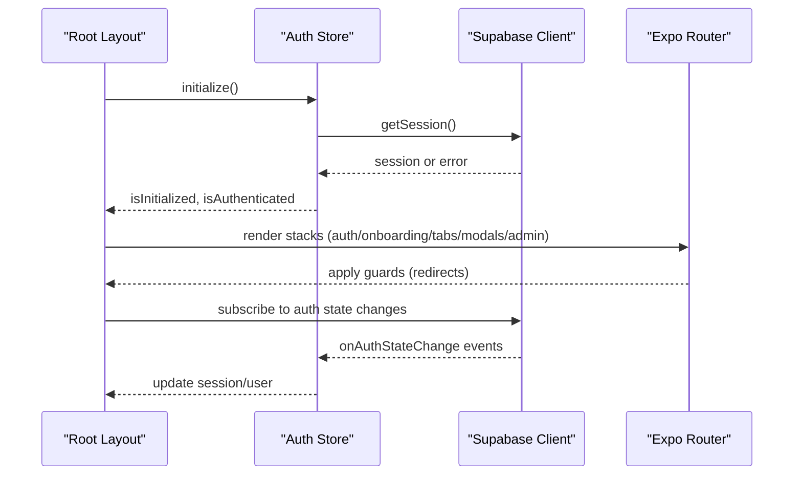
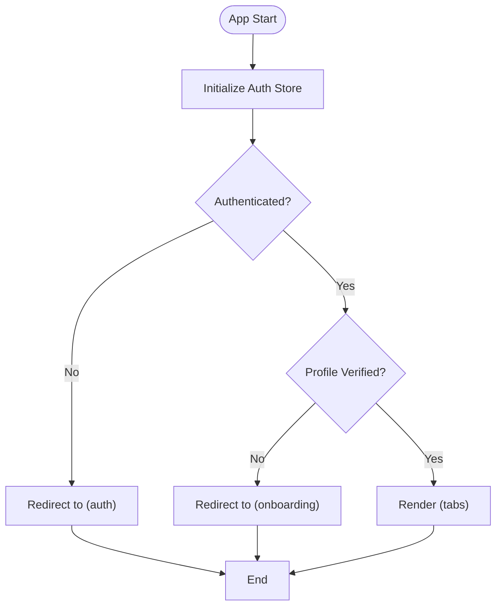
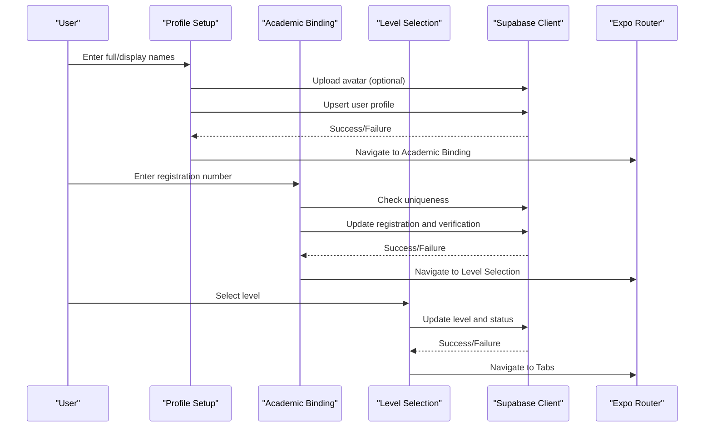
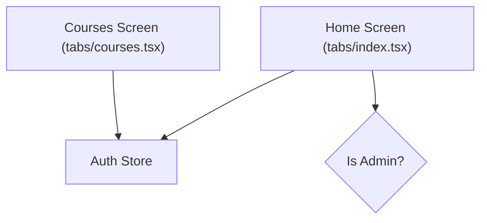
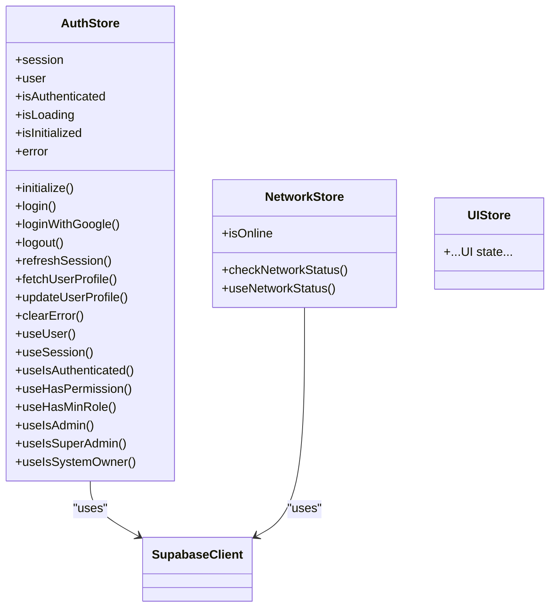
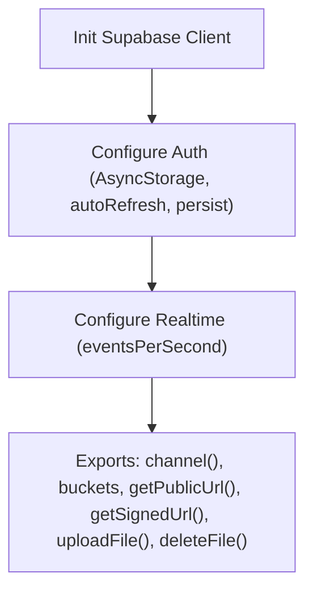
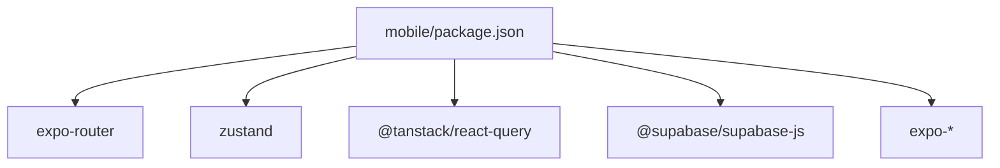

# Mobile Application

<cite>
**Referenced Files in This Document**
- [package.json](file://mobile/package.json)
- [app.json](file://mobile/app.json)
- [App.tsx](file://mobile/App.tsx)
- [src/api/supabase/client.ts](file://mobile/src/api/supabase/client.ts)
- [src/stores/index.ts](file://mobile/src/stores/index.ts)
- [src/stores/auth.store.ts](file://mobile/src/stores/auth.store.ts)
- [src/stores/network.store.ts](file://mobile/src/stores/network.store.ts)
- [app/_layout.tsx](file://mobile/app/_layout.tsx)
- [app/(tabs)/_layout.tsx](file://mobile/app/(tabs)/_layout.tsx)
- [app/(auth)/_layout.tsx](file://mobile/app/(auth)/_layout.tsx)
- [app/(onboarding)/_layout.tsx](file://mobile/app/(onboarding)/_layout.tsx)
- [app/(onboarding)/profile-setup.tsx](file://mobile/app/(onboarding)/profile-setup.tsx)
- [app/(onboarding)/academic-binding.tsx](file://mobile/app/(onboarding)/academic-binding.tsx)
- [app/(onboarding)/level-selection.tsx](file://mobile/app/(onboarding)/level-selection.tsx)
- [app/(tabs)/index.tsx](file://mobile/app/(tabs)/index.tsx)
- [app/(tabs)/courses.tsx](file://mobile/app/(tabs)/courses.tsx)
</cite>

## Table of Contents
1. [Introduction](#introduction)
2. [Project Structure](#project-structure)
3. [Core Components](#core-components)
4. [Architecture Overview](#architecture-overview)
5. [Detailed Component Analysis](#detailed-component-analysis)
6. [Dependency Analysis](#dependency-analysis)
7. [Performance Considerations](#performance-considerations)
8. [Troubleshooting Guide](#troubleshooting-guide)
9. [Conclusion](#conclusion)
10. [Appendices](#appendices)

## Introduction
This document describes the React Native mobile application built with Expo and Expo Router. It covers the file-based routing model, navigation structure with tabs and modals, onboarding flows for new users, component organization, state management with Zustand stores, and integration with Supabase services. It also outlines mobile-specific features such as the dashboard with announcements and events, a mini-LMS with offline support, real-time messaging with presence detection, and push notifications. Finally, it provides development workflow, build configuration, and deployment considerations for iOS and Android.

## Project Structure
The mobile application resides under the mobile directory and follows an Expo Router file-based routing convention. Key areas:
- Routing: app directory with named route groups for auth, onboarding, tabs, modals, and admin.
- Stores: src/stores for global state using Zustand.
- API: src/api/supabase/client.ts for Supabase client initialization and helpers.
- Pages: app/(group)/page.tsx files define screens per group.
- Assets: app icons, splash, and permissions configured in app.json.

```mermaid
graph TB
subgraph "Expo App"
A["_layout.tsx<br/>Root Stack"]
subgraph "Route Groups"
B["auth/_layout.tsx"]
C["onboarding/_layout.tsx"]
D["tabs/_layout.tsx"]
E["modals"]
F["admin"]
end
subgraph "Pages"
P1["auth/login.tsx"]
P2["onboarding/profile-setup.tsx"]
P3["onboarding/academic-binding.tsx"]
P4["onboarding/level-selection.tsx"]
P5["tabs/index.tsx"]
P6["tabs/courses.tsx"]
end
end
subgraph "State"
S1["stores/auth.store.ts"]
S2["stores/ui.store.ts"]
S3["stores/network.store.ts"]
end
subgraph "API"
API["api/supabase/client.ts"]
end
A --> B
A --> C
A --> D
A --> E
A --> F
B --> P1
C --> P2
C --> P3
C --> P4
D --> P5
D --> P6
S1 --> API
S3 --> API
```

**Diagram sources**
- [app/_layout.tsx](file://mobile/app/_layout.tsx#L1-L95)
- [app/(auth)/_layout.tsx](file://mobile/app/(auth)/_layout.tsx#L1-L31)
- [app/(onboarding)/_layout.tsx](file://mobile/app/(onboarding)/_layout.tsx#L1-L31)
- [app/(tabs)/_layout.tsx](file://mobile/app/(tabs)/_layout.tsx#L1-L111)
- [app/(onboarding)/profile-setup.tsx](file://mobile/app/(onboarding)/profile-setup.tsx#L1-L328)
- [app/(onboarding)/academic-binding.tsx](file://mobile/app/(onboarding)/academic-binding.tsx#L1-L473)
- [app/(onboarding)/level-selection.tsx](file://mobile/app/(onboarding)/level-selection.tsx#L1-L354)
- [app/(tabs)/index.tsx](file://mobile/app/(tabs)/index.tsx#L1-L331)
- [app/(tabs)/courses.tsx](file://mobile/app/(tabs)/courses.tsx#L1-L296)
- [src/stores/auth.store.ts](file://mobile/src/stores/auth.store.ts#L1-L302)
- [src/stores/network.store.ts](file://mobile/src/stores/network.store.ts#L1-L200)
- [src/api/supabase/client.ts](file://mobile/src/api/supabase/client.ts#L1-L87)

**Section sources**
- [package.json](file://mobile/package.json#L1-L40)
- [app.json](file://mobile/app.json#L1-L70)
- [app/_layout.tsx](file://mobile/app/_layout.tsx#L1-L95)

## Core Components
- Authentication and user state: managed via a Zustand store with Supabase auth integration, including session persistence and real-time auth state changes.
- Network status: a dedicated store to track connectivity and periodic checks.
- Supabase client: initialized with AsyncStorage for secure token storage, auto-refresh, and realtime event limits.
- Routing: Expo Router stacks and tabs with guards to enforce auth/onboarding/profile completion flows.
- Onboarding: three-step flow to collect profile, academic identity, and level.
- Dashboard and LMS: home screen with announcements/events placeholders and courses screen with level filtering.

**Section sources**
- [src/stores/auth.store.ts](file://mobile/src/stores/auth.store.ts#L1-L302)
- [src/stores/network.store.ts](file://mobile/src/stores/network.store.ts#L1-L200)
- [src/api/supabase/client.ts](file://mobile/src/api/supabase/client.ts#L1-L87)
- [app/_layout.tsx](file://mobile/app/_layout.tsx#L1-L95)
- [app/(tabs)/_layout.tsx](file://mobile/app/(tabs)/_layout.tsx#L1-L111)

## Architecture Overview
The app initializes the root stack, sets up React Query for caching, and enforces navigation guards. Authenticated users with completed profiles enter the main tabs; otherwise, they are redirected to auth or onboarding. Supabase handles authentication, storage, and real-time channels. Zustand manages global UI and network state.



**Diagram sources**
- [app/_layout.tsx](file://mobile/app/_layout.tsx#L24-L82)
- [src/stores/auth.store.ts](file://mobile/src/stores/auth.store.ts#L37-L96)
- [src/api/supabase/client.ts](file://mobile/src/api/supabase/client.ts#L15-L27)

## Detailed Component Analysis

### Authentication and Navigation Guards
- Root layout initializes the auth store and network checks, renders stacks for auth, onboarding, tabs, modals, and admin, and applies guards based on authentication and profile completion.
- Auth layout redirects authenticated users appropriately and exposes login/register/verification flows.
- Tabs layout enforces that only authenticated users with verified profiles can access tabs; otherwise, they are redirected to onboarding or login.
- Onboarding layout ensures unauthenticated users are sent to login and prevents access if the profile is already complete.



**Diagram sources**
- [app/_layout.tsx](file://mobile/app/_layout.tsx#L54-L81)
- [app/(auth)/_layout.tsx](file://mobile/app/(auth)/_layout.tsx#L4-L30)
- [app/(onboarding)/_layout.tsx](file://mobile/app/(onboarding)/_layout.tsx#L4-L30)
- [app/(tabs)/_layout.tsx](file://mobile/app/(tabs)/_layout.tsx#L6-L18)

**Section sources**
- [app/_layout.tsx](file://mobile/app/_layout.tsx#L24-L82)
- [app/(auth)/_layout.tsx](file://mobile/app/(auth)/_layout.tsx#L1-L31)
- [app/(onboarding)/_layout.tsx](file://mobile/app/(onboarding)/_layout.tsx#L1-L31)
- [app/(tabs)/_layout.tsx](file://mobile/app/(tabs)/_layout.tsx#L1-L111)

### Onboarding Flow
The onboarding flow consists of three steps:
- Profile setup: collects full/display names, optional avatar upload to Supabase storage, and transitions to academic binding.
- Academic binding: validates institutional registration number against email prefix and last digits, enforces uniqueness, and transitions to level selection.
- Level selection: selects academic level, marks user as active, and completes onboarding.



**Diagram sources**
- [app/(onboarding)/profile-setup.tsx](file://mobile/app/(onboarding)/profile-setup.tsx#L70-L116)
- [app/(onboarding)/academic-binding.tsx](file://mobile/app/(onboarding)/academic-binding.tsx#L125-L189)
- [app/(onboarding)/level-selection.tsx](file://mobile/app/(onboarding)/level-selection.tsx#L51-L90)
- [src/api/supabase/client.ts](file://mobile/src/api/supabase/client.ts#L59-L86)

**Section sources**
- [app/(onboarding)/profile-setup.tsx](file://mobile/app/(onboarding)/profile-setup.tsx#L1-L328)
- [app/(onboarding)/academic-binding.tsx](file://mobile/app/(onboarding)/academic-binding.tsx#L1-L473)
- [app/(onboarding)/level-selection.tsx](file://mobile/app/(onboarding)/level-selection.tsx#L1-L354)

### Dashboard and Mini-LMS
- Home screen displays greeting, quick stats, recent announcements, upcoming events, quick actions, and admin access for administrators.
- Courses screen provides level filtering and course cards with metadata; refresh controls are present for future data fetching.



**Diagram sources**
- [app/(tabs)/index.tsx](file://mobile/app/(tabs)/index.tsx#L12-L139)
- [app/(tabs)/courses.tsx](file://mobile/app/(tabs)/courses.tsx#L14-L143)
- [src/stores/auth.store.ts](file://mobile/src/stores/auth.store.ts#L283-L287)

**Section sources**
- [app/(tabs)/index.tsx](file://mobile/app/(tabs)/index.tsx#L1-L331)
- [app/(tabs)/courses.tsx](file://mobile/app/(tabs)/courses.tsx#L1-L296)

### State Management with Zustand
- Auth store encapsulates session retrieval, login/logout, profile fetching/updating, and permission/role checks.
- Index re-exports convenience selectors for common use cases.
- Network store tracks connectivity and periodic checks.
- UI store is exported for UI-related state.



**Diagram sources**
- [src/stores/auth.store.ts](file://mobile/src/stores/auth.store.ts#L27-L260)
- [src/stores/network.store.ts](file://mobile/src/stores/network.store.ts#L1-L200)
- [src/stores/index.ts](file://mobile/src/stores/index.ts#L1-L4)
- [src/api/supabase/client.ts](file://mobile/src/api/supabase/client.ts#L1-L87)

**Section sources**
- [src/stores/auth.store.ts](file://mobile/src/stores/auth.store.ts#L1-L302)
- [src/stores/network.store.ts](file://mobile/src/stores/network.store.ts#L1-L200)
- [src/stores/index.ts](file://mobile/src/stores/index.ts#L1-L4)

### Supabase Integration
- Client initialization uses AsyncStorage for secure token persistence, auto-refresh, and session persistence.
- Realtime channel helper and storage helpers for avatars, materials, event covers, announcements, and message attachments.
- Public and signed URL helpers for media access.



**Diagram sources**
- [src/api/supabase/client.ts](file://mobile/src/api/supabase/client.ts#L15-L87)

**Section sources**
- [src/api/supabase/client.ts](file://mobile/src/api/supabase/client.ts#L1-L87)

## Dependency Analysis
- Expo Router powers file-based routing and navigation stacks/tabs.
- Zustand provides lightweight global state.
- React Query manages server cache and refetch policies.
- Supabase JS SDK integrates auth, database, storage, and real-time.
- Expo ecosystem packages enable platform capabilities (notifications, secure store, SQLite, image picker, linking).



**Diagram sources**
- [package.json](file://mobile/package.json#L11-L32)

**Section sources**
- [package.json](file://mobile/package.json#L1-L40)

## Performance Considerations
- React Query defaults reduce network load with staleTime and gcTime; adjust based on data volatility.
- Auth store subscribes to Supabase auth state changes; ensure cleanup on unmount.
- Onboarding screens perform client-side validations to reduce server round trips.
- Image uploads use blob conversion and configurable content types; consider compression for large files.
- Periodic network checks are scheduled; tune frequency to balance battery life and responsiveness.

[No sources needed since this section provides general guidance]

## Troubleshooting Guide
- Auth initialization errors: verify environment variables for Supabase URL and anon key; ensure app.json scheme matches OAuth redirect.
- Onboarding failures: registration number uniqueness and validation errors are surfaced; monitor failed attempts threshold.
- Storage uploads: ensure bucket names and permissions are configured; handle signed URL generation errors.
- Network checks: periodic checks can be adjusted; confirm device connectivity and permissions.

**Section sources**
- [src/api/supabase/client.ts](file://mobile/src/api/supabase/client.ts#L9-L13)
- [app/(onboarding)/academic-binding.tsx](file://mobile/app/(onboarding)/academic-binding.tsx#L141-L156)
- [app/_layout.tsx](file://mobile/app/_layout.tsx#L33-L43)

## Conclusion
The mobile application leverages Expo Router for structured navigation, Zustand for efficient state management, and Supabase for authentication, storage, and real-time features. The onboarding flow ensures institutional identity verification and profile completion, while the dashboard and mini-LMS provide core learning and social experiences. The architecture supports scalability and maintainability with clear separation of concerns and modular components.

[No sources needed since this section summarizes without analyzing specific files]

## Appendices

### Build and Deployment Considerations
- iOS: configure bundle identifier, camera/photo library usage descriptions, and entitlements as per app.json.
- Android: set package name, adaptive icon, permissions, and google-services.json; ensure ProGuard/R8 rules if applicable.
- Notifications: plugin configured with notification icon and color; ensure device tokens and permissions are handled.
- EAS: project ID configured under app.json extra.eas; use EAS Build and Submit for production deployments.

**Section sources**
- [app.json](file://mobile/app.json#L15-L68)

### Development Workflow
- Start the dev server with npm/yarn scripts.
- Use platform-specific commands to launch on iOS or Android devices/emulators.
- Leverage Expo Router’s file-based routing to add new screens by placing files under the appropriate route group.

**Section sources**
- [package.json](file://mobile/package.json#L5-L10)
- [App.tsx](file://mobile/App.tsx#L1-L21)