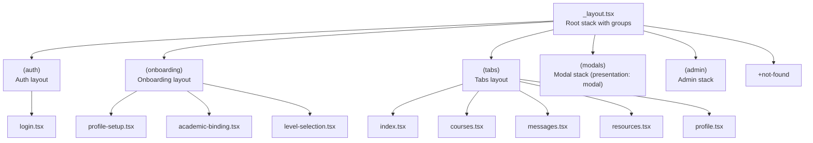
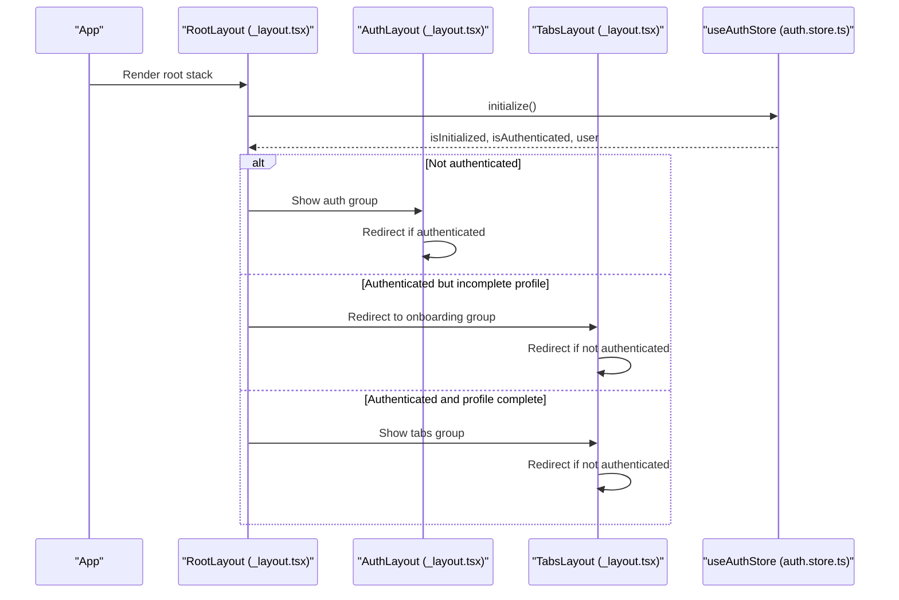
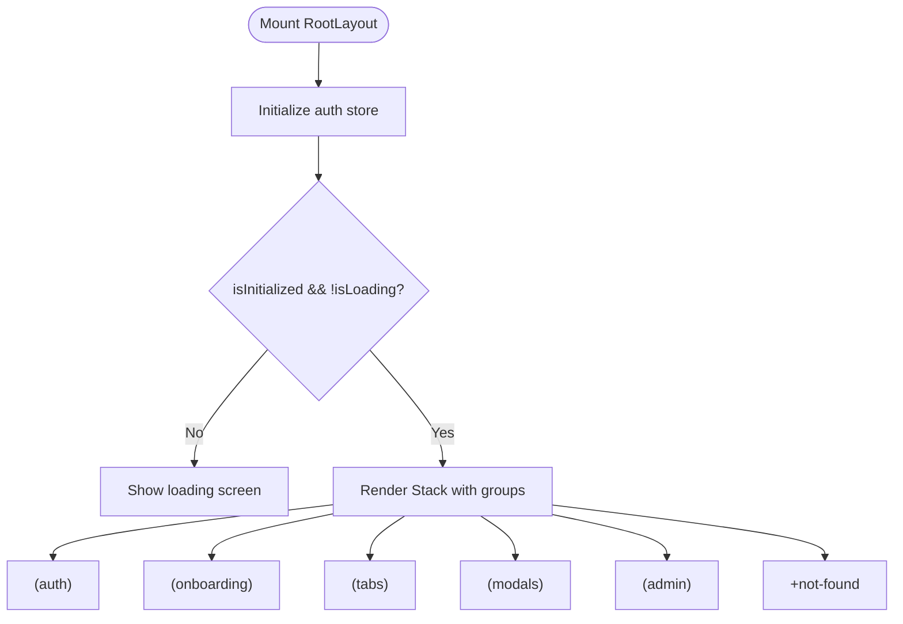
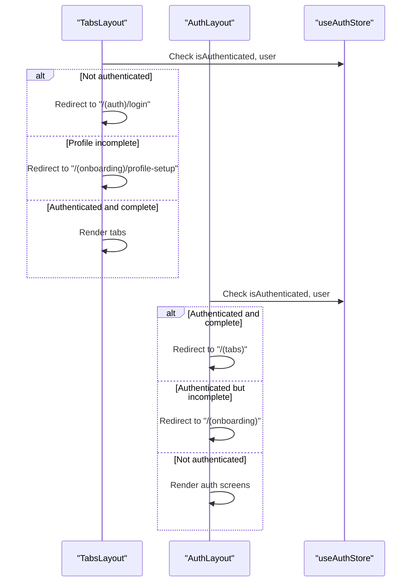
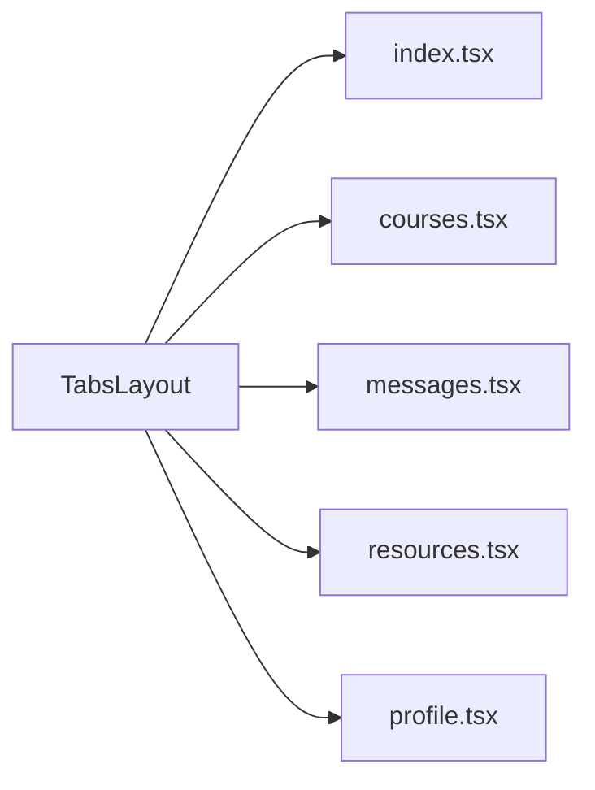
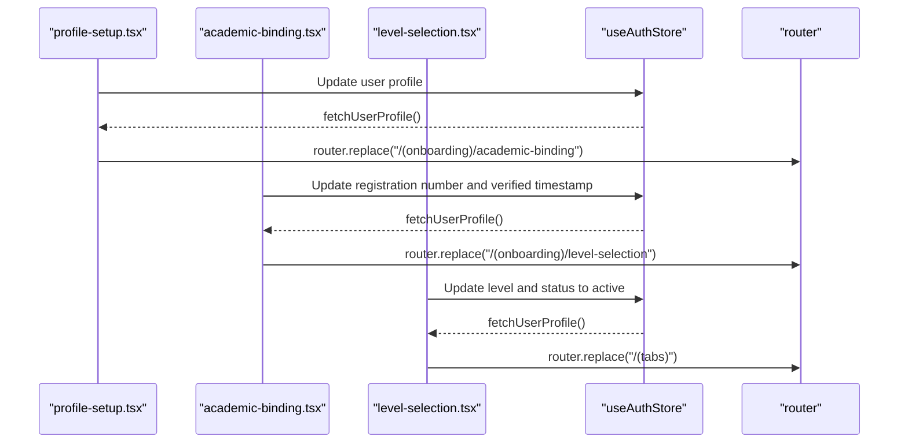
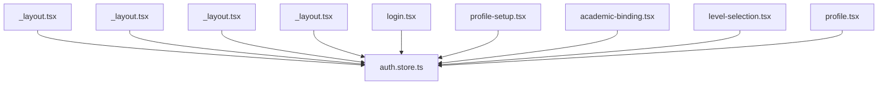

# Navigation & Routing

<cite>
**Referenced Files in This Document**
- [mobile/app/_layout.tsx](file://mobile/app/_layout.tsx)
- [mobile/app/(tabs)/_layout.tsx](file://mobile/app/(tabs)/_layout.tsx)
- [mobile/app/(auth)/_layout.tsx](file://mobile/app/(auth)/_layout.tsx)
- [mobile/app/(onboarding)/_layout.tsx](file://mobile/app/(onboarding)/_layout.tsx)
- [mobile/app/(auth)/login.tsx](file://mobile/app/(auth)/login.tsx)
- [mobile/app/(onboarding)/profile-setup.tsx](file://mobile/app/(onboarding)/profile-setup.tsx)
- [mobile/app/(onboarding)/academic-binding.tsx](file://mobile/app/(onboarding)/academic-binding.tsx)
- [mobile/app/(onboarding)/level-selection.tsx](file://mobile/app/(onboarding)/level-selection.tsx)
- [mobile/app/(tabs)/index.tsx](file://mobile/app/(tabs)/index.tsx)
- [mobile/app/(tabs)/courses.tsx](file://mobile/app/(tabs)/courses.tsx)
- [mobile/app/(tabs)/messages.tsx](file://mobile/app/(tabs)/messages.tsx)
- [mobile/app/(tabs)/resources.tsx](file://mobile/app/(tabs)/resources.tsx)
- [mobile/app/(tabs)/profile.tsx](file://mobile/app/(tabs)/profile.tsx)
- [mobile/src/stores/auth.store.ts](file://mobile/src/stores/auth.store.ts)
</cite>

## Table of Contents
1. [Introduction](#introduction)
2. [Project Structure](#project-structure)
3. [Core Components](#core-components)
4. [Architecture Overview](#architecture-overview)
5. [Detailed Component Analysis](#detailed-component-analysis)
6. [Dependency Analysis](#dependency-analysis)
7. [Performance Considerations](#performance-considerations)
8. [Troubleshooting Guide](#troubleshooting-guide)
9. [Conclusion](#conclusion)

## Introduction
This document explains the mobile application’s navigation and routing system built with Expo Router’s file-based routing. It covers:
- Route groups and nested navigation
- Tab navigation with five primary screens
- Authentication flow and protected routes
- Onboarding flow and modal-like transitions
- Programmatic navigation, guards, route parameters, and deep linking
- Route transitions and handling navigation state changes

## Project Structure
The routing is organized under the mobile/app directory using route groups:
- (auth): Login and related auth screens
- (onboarding): Multi-step profile setup
- (tabs): Main tabbed interface with five screens
- (modals): Modal presentations (declared but no modals present yet)
- (admin): Admin area (declared but no screens present yet)

**Diagram sources**
- [mobile/app/_layout.tsx](file://mobile/app/_layout.tsx#L56-L77)
- [mobile/app/(auth)/_layout.tsx](file://mobile/app/(auth)/_layout.tsx#L17-L29)
- [mobile/app/(onboarding)/_layout.tsx](file://mobile/app/(onboarding)/_layout.tsx#L17-L29)
- [mobile/app/(tabs)/_layout.tsx](file://mobile/app/(tabs)/_layout.tsx#L20-L94)

**Section sources**
- [mobile/app/_layout.tsx](file://mobile/app/_layout.tsx#L56-L77)
- [mobile/app/(auth)/_layout.tsx](file://mobile/app/(auth)/_layout.tsx#L17-L29)
- [mobile/app/(onboarding)/_layout.tsx](file://mobile/app/(onboarding)/_layout.tsx#L17-L29)
- [mobile/app/(tabs)/_layout.tsx](file://mobile/app/(tabs)/_layout.tsx#L20-L94)

## Core Components
- Root stack defines route groups and global loading state, network checks, and the not-found fallback.
- Auth layout enforces redirections based on authentication and profile completion.
- Onboarding layout enforces step progression and disables gestures during onboarding.
- Tabs layout defines the five-tab main navigation with guards and badges.
- Auth store manages session lifecycle, user state, and permissions.

Key responsibilities:
- Navigation guards: Redirects occur in tab and layout components based on authentication and profile state.
- Programmatic navigation: Uses router APIs to navigate between screens and replace onboarding steps.
- Protected routes: Tabs are guarded; unauthenticated users are redirected to auth.
- Route parameters: Not currently used in the referenced files; parameters can be passed via URL segments or query params.
- Deep linking: Not configured in the referenced files; would require linking configuration outside this scope.

**Section sources**
- [mobile/app/_layout.tsx](file://mobile/app/_layout.tsx#L24-L82)
- [mobile/app/(auth)/_layout.tsx](file://mobile/app/(auth)/_layout.tsx#L4-L30)
- [mobile/app/(onboarding)/_layout.tsx](file://mobile/app/(onboarding)/_layout.tsx#L4-L30)
- [mobile/app/(tabs)/_layout.tsx](file://mobile/app/(tabs)/_layout.tsx#L6-L95)
- [mobile/src/stores/auth.store.ts](file://mobile/src/stores/auth.store.ts#L27-L260)

## Architecture Overview
Expo Router organizes routes by filesystem. The root stack declares named groups. Each group has its own layout that can enforce guards and define nested screens. The auth store coordinates authentication state and triggers navigation decisions.

**Diagram sources**
- [mobile/app/_layout.tsx](file://mobile/app/_layout.tsx#L24-L82)
- [mobile/app/(auth)/_layout.tsx](file://mobile/app/(auth)/_layout.tsx#L4-L30)
- [mobile/app/(onboarding)/_layout.tsx](file://mobile/app/(onboarding)/_layout.tsx#L4-L30)
- [mobile/app/(tabs)/_layout.tsx](file://mobile/app/(tabs)/_layout.tsx#L6-L18)
- [mobile/src/stores/auth.store.ts](file://mobile/src/stores/auth.store.ts#L37-L96)

## Detailed Component Analysis

### Root Layout and Guards
- Initializes auth and network stores on mount.
- Declares stacks for (auth), (onboarding), (tabs), (modals), (admin), and +not-found.
- Shows a loading screen until initialization completes.

**Diagram sources**
- [mobile/app/_layout.tsx](file://mobile/app/_layout.tsx#L24-L82)

**Section sources**
- [mobile/app/_layout.tsx](file://mobile/app/_layout.tsx#L24-L82)

### Authentication Flow and Guards
- Auth layout redirects authenticated users away from auth screens.
- Tabs layout redirects unauthenticated users to login.
- Onboarding layout redirects unauthenticated users to login and prevents navigation forward when profile is complete.

**Diagram sources**
- [mobile/app/(tabs)/_layout.tsx](file://mobile/app/(tabs)/_layout.tsx#L6-L18)
- [mobile/app/(auth)/_layout.tsx](file://mobile/app/(auth)/_layout.tsx#L4-L15)
- [mobile/app/(onboarding)/_layout.tsx](file://mobile/app/(onboarding)/_layout.tsx#L4-L15)

**Section sources**
- [mobile/app/(tabs)/_layout.tsx](file://mobile/app/(tabs)/_layout.tsx#L6-L18)
- [mobile/app/(auth)/_layout.tsx](file://mobile/app/(auth)/_layout.tsx#L4-L15)
- [mobile/app/(onboarding)/_layout.tsx](file://mobile/app/(onboarding)/_layout.tsx#L4-L15)

### Main Tab Layout and Five Screens
- Tabs layout enforces authentication and profile completion.
- Defines five tabs: Home, Courses, Messages, Resources, Profile.
- Includes badges and custom tab icons.

**Diagram sources**
- [mobile/app/(tabs)/_layout.tsx](file://mobile/app/(tabs)/_layout.tsx#L46-L94)
- [mobile/app/(tabs)/index.tsx](file://mobile/app/(tabs)/index.tsx#L12-L139)
- [mobile/app/(tabs)/courses.tsx](file://mobile/app/(tabs)/courses.tsx#L14-L143)
- [mobile/app/(tabs)/messages.tsx](file://mobile/app/(tabs)/messages.tsx#L16-L155)
- [mobile/app/(tabs)/resources.tsx](file://mobile/app/(tabs)/resources.tsx#L22-L169)
- [mobile/app/(tabs)/profile.tsx](file://mobile/app/(tabs)/profile.tsx#L18-L261)

**Section sources**
- [mobile/app/(tabs)/_layout.tsx](file://mobile/app/(tabs)/_layout.tsx#L46-L94)

### Onboarding Flow and Step Transitions
- profile-setup.tsx: Collects full name, optional display name, avatar upload, and updates user status to pending verification.
- academic-binding.tsx: Validates and persists registration number; includes real-time validation and lockout after failed attempts.
- level-selection.tsx: Selects academic level, sets status to active, and navigates to main tabs.

**Diagram sources**
- [mobile/app/(onboarding)/profile-setup.tsx](file://mobile/app/(onboarding)/profile-setup.tsx#L70-L116)
- [mobile/app/(onboarding)/academic-binding.tsx](file://mobile/app/(onboarding)/academic-binding.tsx#L125-L189)
- [mobile/app/(onboarding)/level-selection.tsx](file://mobile/app/(onboarding)/level-selection.tsx#L51-L90)
- [mobile/src/stores/auth.store.ts](file://mobile/src/stores/auth.store.ts#L199-L256)

**Section sources**
- [mobile/app/(onboarding)/profile-setup.tsx](file://mobile/app/(onboarding)/profile-setup.tsx#L70-L116)
- [mobile/app/(onboarding)/academic-binding.tsx](file://mobile/app/(onboarding)/academic-binding.tsx#L125-L189)
- [mobile/app/(onboarding)/level-selection.tsx](file://mobile/app/(onboarding)/level-selection.tsx#L51-L90)

### Authentication Screens and Programmatic Navigation
- login.tsx demonstrates programmatic navigation to forgot-password and Google login via OAuth.
- Uses router.push/router.replace for navigation and clears errors on submit.

**Section sources**
- [mobile/app/(auth)/login.tsx](file://mobile/app/(auth)/login.tsx#L25-L53)

### Programmatic Navigation Patterns
Common patterns observed:
- router.push('/path'): Pushes a new route onto the stack.
- router.replace('/path'): Replaces the current route.
- Redirects in layouts enforce navigation based on state.

Examples in code:
- Onboarding step transitions use router.replace to move between steps.
- Logout uses router.replace to return to login.

**Section sources**
- [mobile/app/(onboarding)/profile-setup.tsx](file://mobile/app/(onboarding)/profile-setup.tsx#L110-L116)
- [mobile/app/(onboarding)/academic-binding.tsx](file://mobile/app/(onboarding)/academic-binding.tsx#L181-L189)
- [mobile/app/(onboarding)/level-selection.tsx](file://mobile/app/(onboarding)/level-selection.tsx#L81-L84)
- [mobile/app/(tabs)/profile.tsx](file://mobile/app/(tabs)/profile.tsx#L32-L38)

### Route Parameters and Deep Linking
- Route parameters: Not used in the referenced files; parameters can be accessed via route segments or query strings.
- Deep linking: Not configured in the referenced files; would require platform-specific configuration and linking setup.

[No sources needed since this section provides general guidance]

### Route Transitions and Modal Presentation
- The (modals) group is declared with presentation: 'modal', indicating potential modal transitions.
- No modal screens are present in the referenced files; modal behavior would depend on how routes are pushed with modal presentation.

**Section sources**
- [mobile/app/_layout.tsx](file://mobile/app/_layout.tsx#L66-L70)

## Dependency Analysis
- Root layout depends on auth store for initialization and network store for connectivity checks.
- Auth layout depends on auth store to decide whether to show auth screens or redirect.
- Tabs layout depends on auth store to guard access and on useIsAdmin for admin UI.
- Onboarding screens depend on auth store for profile updates and router for navigation.

**Diagram sources**
- [mobile/app/_layout.tsx](file://mobile/app/_layout.tsx#L24-L82)
- [mobile/app/(auth)/_layout.tsx](file://mobile/app/(auth)/_layout.tsx#L4-L30)
- [mobile/app/(tabs)/_layout.tsx](file://mobile/app/(tabs)/_layout.tsx#L6-L18)
- [mobile/app/(onboarding)/_layout.tsx](file://mobile/app/(onboarding)/_layout.tsx#L4-L30)
- [mobile/src/stores/auth.store.ts](file://mobile/src/stores/auth.store.ts#L27-L260)

**Section sources**
- [mobile/src/stores/auth.store.ts](file://mobile/src/stores/auth.store.ts#L27-L260)

## Performance Considerations
- Auth initialization runs once on mount; avoid unnecessary re-renders by keeping initialization logic minimal.
- Network checks run periodically; tune intervals based on device connectivity patterns.
- Onboarding screens perform server calls; consider optimistic UI and error boundaries.
- Tab screens use lightweight lists; defer heavy computations to background threads.

[No sources needed since this section provides general guidance]

## Troubleshooting Guide
- Authentication loops: Verify auth store initialization and onAuthStateChange subscriptions.
- Onboarding lockout: Academic binding enforces a lock after repeated failures; ensure logout and re-authentication flow.
- Navigation not working: Confirm route names match group and screen names; ensure router.push/router.replace usage is correct.
- Not found fallback: The +not-found screen is declared; ensure it renders appropriately for unmatched routes.

**Section sources**
- [mobile/src/stores/auth.store.ts](file://mobile/src/stores/auth.store.ts#L37-L96)
- [mobile/app/(onboarding)/academic-binding.tsx](file://mobile/app/(onboarding)/academic-binding.tsx#L191-L208)
- [mobile/app/_layout.tsx](file://mobile/app/_layout.tsx#L75-L77)

## Conclusion
The navigation system leverages Expo Router’s file-based routing with clear route groups and guards. Authentication and onboarding flows are enforced in layouts, while the main tabbed interface provides five primary screens. Programmatic navigation is used consistently for step transitions and logout. The architecture supports future enhancements such as modal presentations, route parameters, and deep linking.