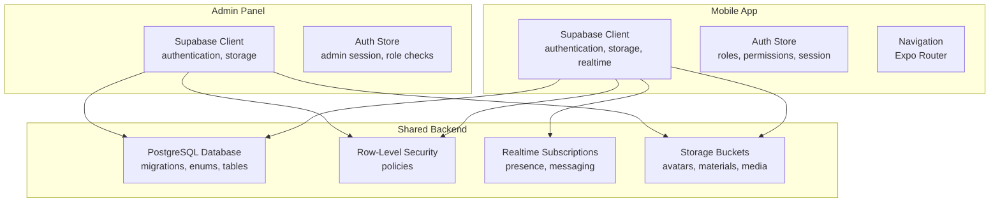
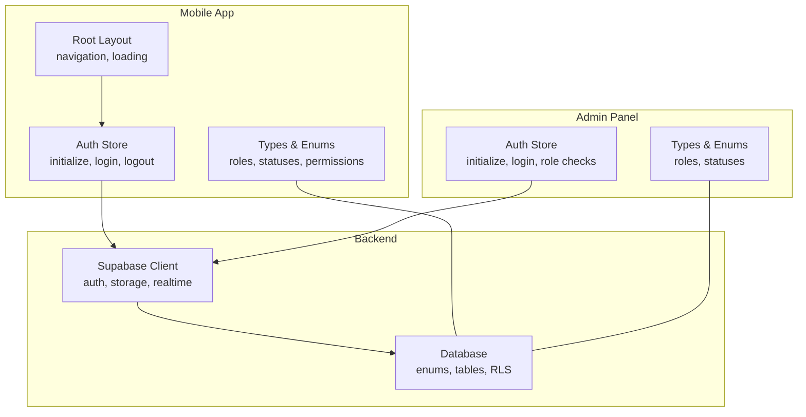
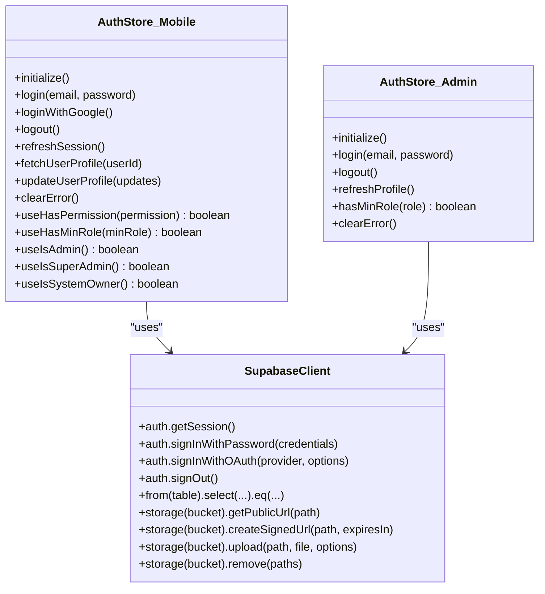
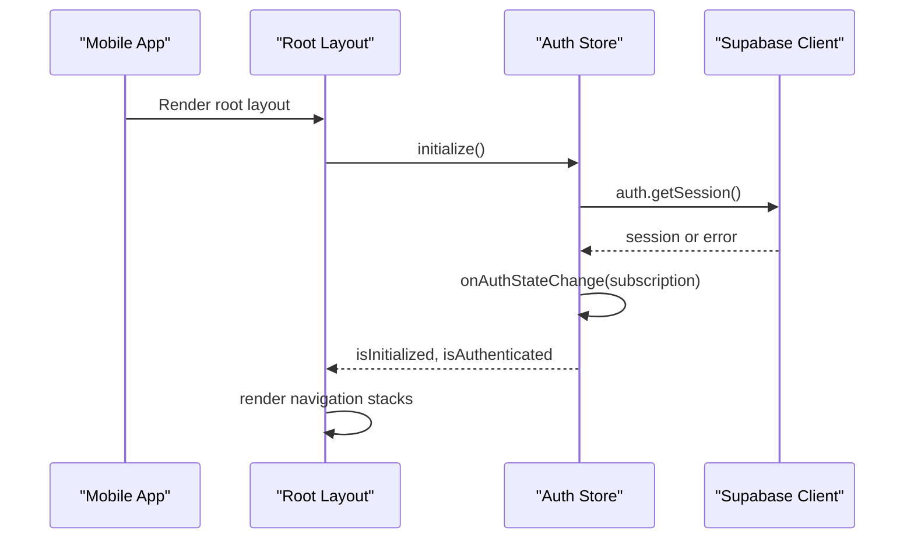
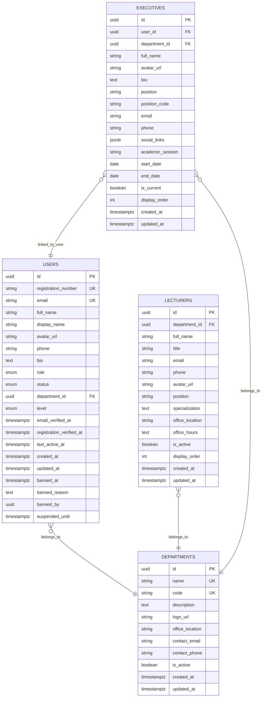
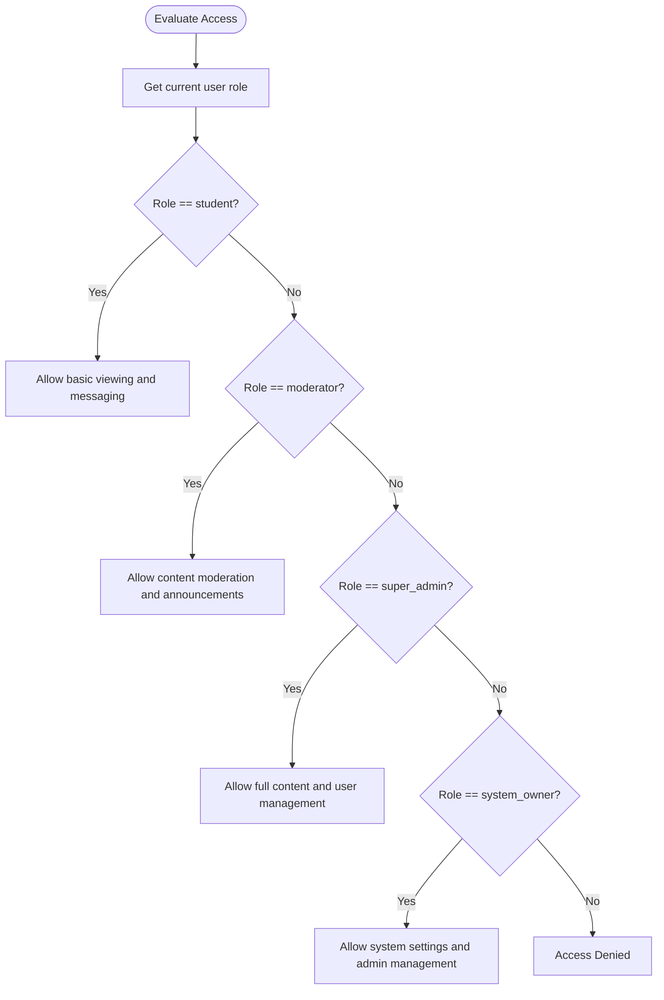
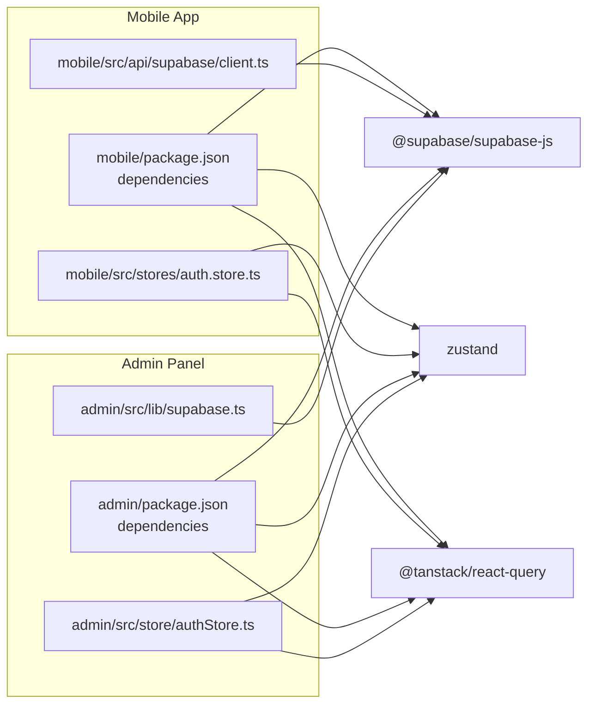

# Project Overview

<cite>
**Referenced Files in This Document**
- [README.md](file://README.md)
- [mobile/package.json](file://mobile/package.json)
- [admin/package.json](file://admin/package.json)
- [supabase/migrations/001_enums.sql](file://supabase/migrations/001_enums.sql)
- [supabase/migrations/002_core_tables.sql](file://supabase/migrations/002_core_tables.sql)
- [mobile/src/api/supabase/client.ts](file://mobile/src/api/supabase/client.ts)
- [admin/src/lib/supabase.ts](file://admin/src/lib/supabase.ts)
- [mobile/src/stores/auth.store.ts](file://mobile/src/stores/auth.store.ts)
- [admin/src/store/authStore.ts](file://admin/src/store/authStore.ts)
- [mobile/app/_layout.tsx](file://mobile/app/_layout.tsx)
- [mobile/src/types/index.ts](file://mobile/src/types/index.ts)
- [admin/src/types/index.ts](file://admin/src/types/index.ts)
</cite>

## Table of Contents
1. [Introduction](#introduction)
2. [Project Structure](#project-structure)
3. [Core Components](#core-components)
4. [Architecture Overview](#architecture-overview)
5. [Detailed Component Analysis](#detailed-component-analysis)
6. [Dependency Analysis](#dependency-analysis)
7. [Performance Considerations](#performance-considerations)
8. [Troubleshooting Guide](#troubleshooting-guide)
9. [Conclusion](#conclusion)

## Introduction
Naliss UMYU Hub is a modern cross-platform educational platform designed for Library and Information Science (LIS) students and staff at the University of Maiduguri. It provides a secure, identity-bound digital ecosystem that centralizes academic resources, real-time communication, departmental information, and leadership transparency. The platform consists of three interconnected applications within a single monorepo: a React Native mobile application for iOS and Android, a React-based admin dashboard for content and user management, and a shared Supabase backend for authentication, real-time messaging, storage, and row-level security policies.

The system’s core value proposition lies in offering:
- Academic resources and a mini-LMS with offline support
- Real-time messaging with presence and moderation
- Departmental directories and leadership profiles
- Transparent governance and activity auditing
- Secure identity validation and role-based access control

Target audience:
- LIS students (primary users)
- Moderators and administrators within the department
- Super Admins and System Owners managing the platform
- Lecturers and student leaders whose profiles are integrated into the system

## Project Structure
The repository follows a monorepo architecture with three primary applications and a shared backend layer:
- mobile/: React Native Expo application for students and users
- admin/: React web admin panel for managing content and users
- supabase/: PostgreSQL database with migrations, RLS policies, triggers, and storage buckets

**Diagram sources**
- [mobile/src/api/supabase/client.ts](file://mobile/src/api/supabase/client.ts#L15-L27)
- [admin/src/lib/supabase.ts](file://admin/src/lib/supabase.ts#L10-L18)
- [supabase/migrations/001_enums.sql](file://supabase/migrations/001_enums.sql#L9-L23)
- [supabase/migrations/002_core_tables.sql](file://supabase/migrations/002_core_tables.sql#L43-L76)

**Section sources**
- [README.md](file://README.md#L5-L14)
- [mobile/package.json](file://mobile/package.json#L11-L32)
- [admin/package.json](file://admin/package.json#L12-L26)

## Core Components
- Mobile Application (React Native + Expo)
  - Navigation via Expo Router
  - State management with Zustand and server state with React Query
  - Offline-first capabilities with SQLite and cached data
  - Real-time messaging and presence via Supabase
  - Identity-bound authentication with institutional email validation

- Admin Dashboard (React + Vite)
  - Role-based access control with admin-only routes
  - Content management for announcements, events, and learning materials
  - User management, moderation tools, and audit logging
  - Responsive UI with Tailwind CSS

- Shared Backend (Supabase)
  - PostgreSQL database with custom enums and core tables
  - Row-Level Security policies for data isolation
  - Real-time subscriptions for live updates
  - Storage buckets for avatars, materials, and media

Key features aligned with the codebase:
- Institutional email validation and academic identity binding
- Four-tier role hierarchy with permission mapping
- Presence tracking and real-time messaging channels
- Comprehensive audit logging and system settings
- Storage helpers for public and signed URLs, uploads, and deletions

**Section sources**
- [README.md](file://README.md#L16-L63)
- [mobile/src/api/supabase/client.ts](file://mobile/src/api/supabase/client.ts#L35-L86)
- [admin/src/lib/supabase.ts](file://admin/src/lib/supabase.ts#L21-L72)
- [mobile/src/stores/auth.store.ts](file://mobile/src/stores/auth.store.ts#L26-L302)
- [admin/src/store/authStore.ts](file://admin/src/store/authStore.ts#L26-L228)

## Architecture Overview
The system architecture centers on Supabase as the unified backend, connecting both the mobile app and admin panel through a shared client abstraction. The mobile app integrates offline-first patterns with server state synchronization, while the admin panel focuses on administrative workflows and analytics.

**Diagram sources**
- [mobile/app/_layout.tsx](file://mobile/app/_layout.tsx#L24-L94)
- [mobile/src/stores/auth.store.ts](file://mobile/src/stores/auth.store.ts#L27-L96)
- [admin/src/store/authStore.ts](file://admin/src/store/authStore.ts#L26-L92)
- [mobile/src/types/index.ts](file://mobile/src/types/index.ts#L409-L456)
- [admin/src/types/index.ts](file://admin/src/types/index.ts#L185-L191)

## Detailed Component Analysis

### Authentication and Authorization Stores
Both the mobile and admin applications implement dedicated stores for authentication state and role-based access checks. These stores manage session initialization, login/logout flows, profile fetching, and permission evaluation.

**Diagram sources**
- [mobile/src/stores/auth.store.ts](file://mobile/src/stores/auth.store.ts#L27-L302)
- [admin/src/store/authStore.ts](file://admin/src/store/authStore.ts#L26-L228)
- [mobile/src/api/supabase/client.ts](file://mobile/src/api/supabase/client.ts#L15-L27)
- [admin/src/lib/supabase.ts](file://admin/src/lib/supabase.ts#L10-L18)

**Section sources**
- [mobile/src/stores/auth.store.ts](file://mobile/src/stores/auth.store.ts#L27-L302)
- [admin/src/store/authStore.ts](file://admin/src/store/authStore.ts#L26-L228)
- [mobile/src/api/supabase/client.ts](file://mobile/src/api/supabase/client.ts#L15-L27)
- [admin/src/lib/supabase.ts](file://admin/src/lib/supabase.ts#L10-L18)

### Mobile App Navigation and Initialization
The mobile app initializes authentication on startup, manages network status, and routes users through onboarding, authentication, and main application screens. It configures React Query defaults for caching and refetching behavior.

**Diagram sources**
- [mobile/app/_layout.tsx](file://mobile/app/_layout.tsx#L24-L94)
- [mobile/src/stores/auth.store.ts](file://mobile/src/stores/auth.store.ts#L38-L96)
- [mobile/src/api/supabase/client.ts](file://mobile/src/api/supabase/client.ts#L15-L27)

**Section sources**
- [mobile/app/_layout.tsx](file://mobile/app/_layout.tsx#L24-L94)
- [mobile/src/stores/auth.store.ts](file://mobile/src/stores/auth.store.ts#L38-L96)

### Database Schema and Roles
The backend defines custom enums and core tables that model users, departments, lecturers, and executives. It also includes triggers and policies to maintain updated timestamps and enforce row-level security across tables.

**Diagram sources**
- [supabase/migrations/002_core_tables.sql](file://supabase/migrations/002_core_tables.sql#L43-L76)
- [supabase/migrations/002_core_tables.sql](file://supabase/migrations/002_core_tables.sql#L98-L126)
- [supabase/migrations/002_core_tables.sql](file://supabase/migrations/002_core_tables.sql#L140-L174)

**Section sources**
- [supabase/migrations/001_enums.sql](file://supabase/migrations/001_enums.sql#L9-L23)
- [supabase/migrations/002_core_tables.sql](file://supabase/migrations/002_core_tables.sql#L43-L76)

### Role Hierarchy and Permissions
The system enforces a four-tier role hierarchy with explicit permission mappings. The mobile and admin stores expose convenience hooks to evaluate minimum roles and permissions at runtime.

**Diagram sources**
- [mobile/src/types/index.ts](file://mobile/src/types/index.ts#L409-L456)
- [admin/src/types/index.ts](file://admin/src/types/index.ts#L185-L191)
- [mobile/src/stores/auth.store.ts](file://mobile/src/stores/auth.store.ts#L269-L301)
- [admin/src/store/authStore.ts](file://admin/src/store/authStore.ts#L207-L211)

**Section sources**
- [mobile/src/types/index.ts](file://mobile/src/types/index.ts#L409-L456)
- [admin/src/types/index.ts](file://admin/src/types/index.ts#L185-L191)
- [mobile/src/stores/auth.store.ts](file://mobile/src/stores/auth.store.ts#L269-L301)
- [admin/src/store/authStore.ts](file://admin/src/store/authStore.ts#L207-L211)

## Dependency Analysis
The mobile and admin applications share a common backend client abstraction and rely on Supabase for authentication, storage, and real-time features. Both apps use Zustand for client-side state and React Query for server state management.

**Diagram sources**
- [mobile/package.json](file://mobile/package.json#L11-L32)
- [admin/package.json](file://admin/package.json#L12-L26)
- [mobile/src/api/supabase/client.ts](file://mobile/src/api/supabase/client.ts#L3-L7)
- [admin/src/lib/supabase.ts](file://admin/src/lib/supabase.ts#L1-L4)

**Section sources**
- [mobile/package.json](file://mobile/package.json#L11-L32)
- [admin/package.json](file://admin/package.json#L12-L26)
- [mobile/src/api/supabase/client.ts](file://mobile/src/api/supabase/client.ts#L3-L7)
- [admin/src/lib/supabase.ts](file://admin/src/lib/supabase.ts#L1-L4)

## Performance Considerations
- Caching and stale-while-revalidate: React Query defaults reduce network load and improve responsiveness.
- Offline-first design: SQLite and local caching enable functionality when connectivity is intermittent.
- Realtime throttling: Supabase realtime eventsPerSecond limit balances responsiveness with resource usage.
- Storage optimization: Signed URLs and bucket separation minimize bandwidth and improve asset delivery.
- Role-based rendering: Conditional UI rendering reduces unnecessary re-renders for non-admin users.

[No sources needed since this section provides general guidance]

## Troubleshooting Guide
Common setup and runtime issues:
- Missing environment variables: Ensure Supabase URL and anon key are configured in both mobile and admin environments.
- Authentication failures: Verify institutional email validation and that accounts are not banned or suspended.
- Storage errors: Confirm bucket names match and files are uploaded with correct content types.
- Admin access denied: Confirm user role is at least moderator; demo mode may simulate admin behavior when backend is not configured.

**Section sources**
- [mobile/src/api/supabase/client.ts](file://mobile/src/api/supabase/client.ts#L9-L13)
- [admin/src/lib/supabase.ts](file://admin/src/lib/supabase.ts#L6-L8)
- [mobile/src/stores/auth.store.ts](file://mobile/src/stores/auth.store.ts#L104-L107)
- [admin/src/store/authStore.ts](file://admin/src/store/authStore.ts#L149-L156)

## Conclusion
Naliss UMYU Hub delivers a cohesive, secure, and scalable educational platform tailored to LIS students and staff at the University of Maiduguri. Its monorepo architecture, centered on Supabase, enables rapid iteration across the mobile app, admin dashboard, and backend services. By combining institutional identity validation, role-based permissions, real-time communication, and transparent governance, the platform establishes a modern digital ecosystem that supports academic excellence and community engagement.