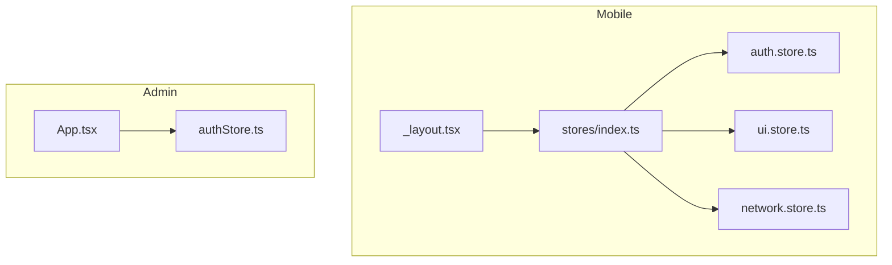
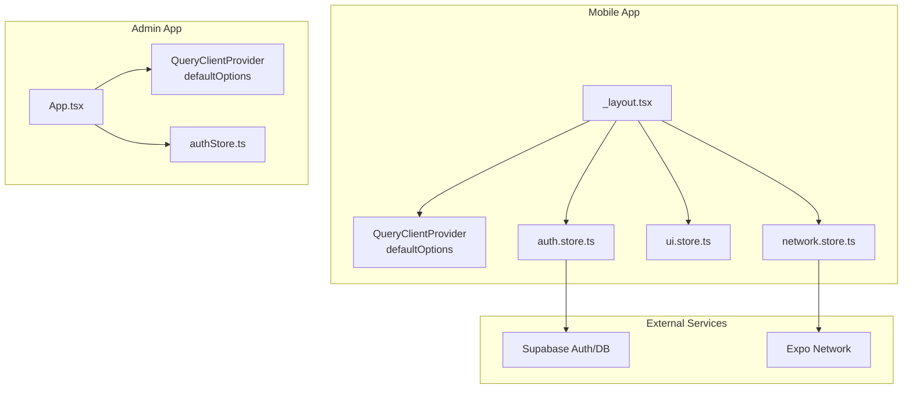
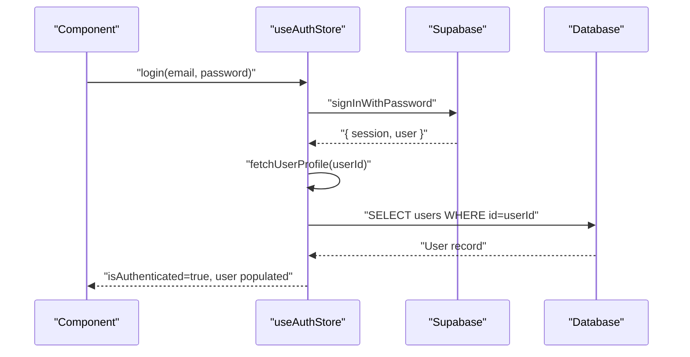
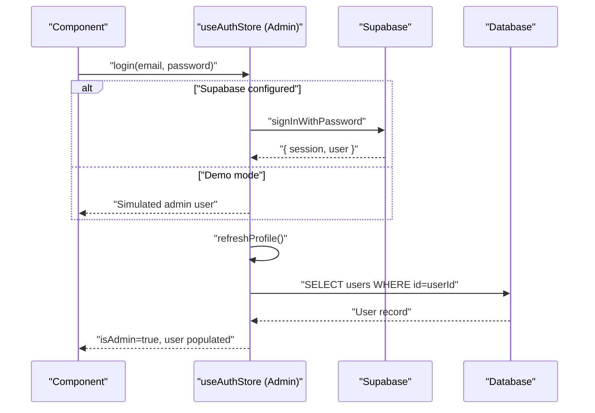
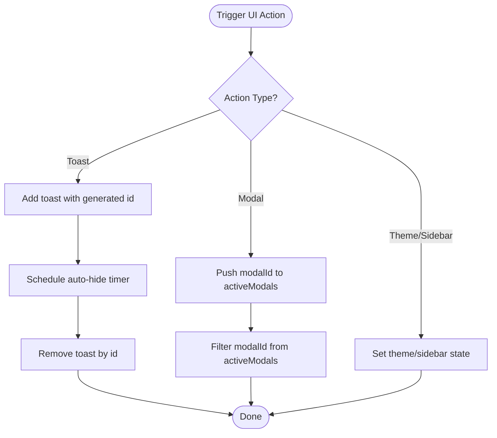
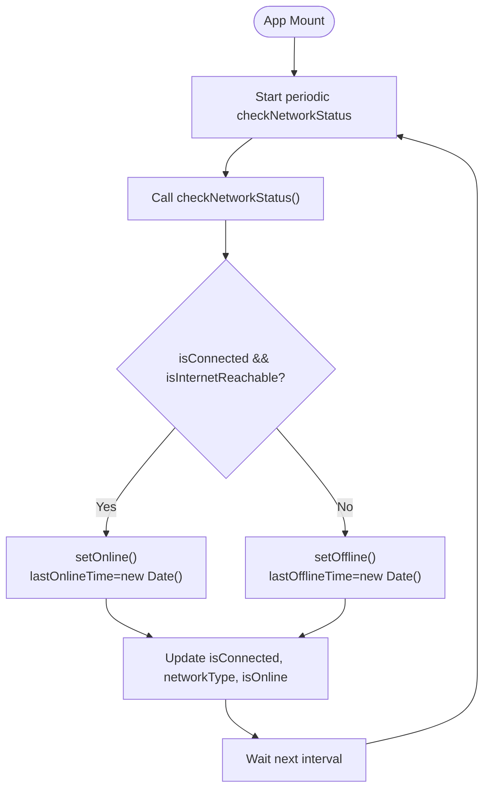
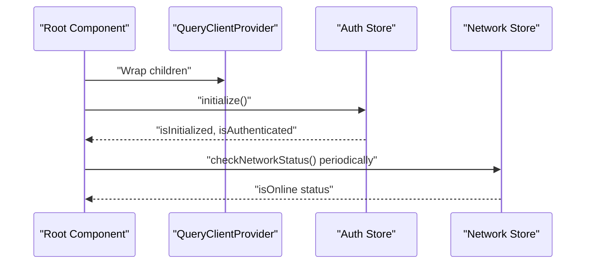
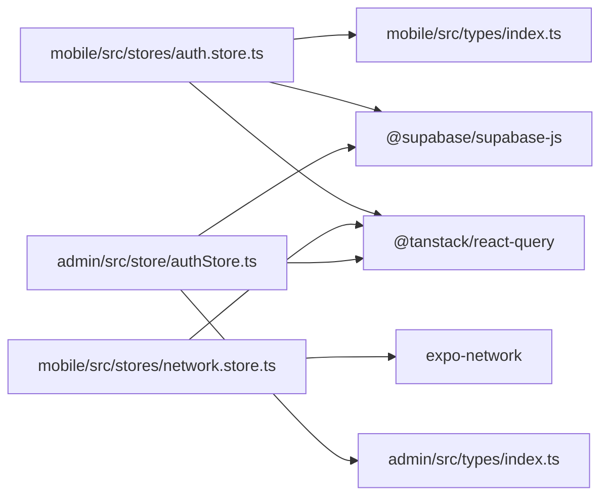

# State Management Architecture

<cite>
**Referenced Files in This Document**
- [mobile/src/stores/auth.store.ts](file://mobile/src/stores/auth.store.ts)
- [mobile/src/stores/ui.store.ts](file://mobile/src/stores/ui.store.ts)
- [mobile/src/stores/network.store.ts](file://mobile/src/stores/network.store.ts)
- [mobile/src/stores/index.ts](file://mobile/src/stores/index.ts)
- [mobile/src/types/index.ts](file://mobile/src/types/index.ts)
- [mobile/app/_layout.tsx](file://mobile/app/_layout.tsx)
- [admin/src/store/authStore.ts](file://admin/src/store/authStore.ts)
- [admin/src/App.tsx](file://admin/src/App.tsx)
- [admin/src/types/index.ts](file://admin/src/types/index.ts)
</cite>

## Table of Contents
1. [Introduction](#introduction)
2. [Project Structure](#project-structure)
3. [Core Components](#core-components)
4. [Architecture Overview](#architecture-overview)
5. [Detailed Component Analysis](#detailed-component-analysis)
6. [Dependency Analysis](#dependency-analysis)
7. [Performance Considerations](#performance-considerations)
8. [Troubleshooting Guide](#troubleshooting-guide)
9. [Conclusion](#conclusion)
10. [Appendices](#appendices)

## Introduction
This document explains the state management architecture built with Zustand across the mobile and admin applications. It covers store patterns for authentication, UI state, and network state, along with integration points for server state via React Query. It also documents best practices, cross-component communication patterns, persistence strategies, synchronization between applications, and debugging approaches.

## Project Structure
The state management is organized per-application:
- Mobile application: stores under mobile/src/stores, with selector exports in mobile/src/stores/index.ts.
- Admin application: stores under admin/src/store, integrated with React Query in admin/src/App.tsx.

Key responsibilities:
- Authentication store: manages session, user profile, permissions, and role checks.
- UI store: handles theme, modals, toasts, offline banner, and global loading overlays.
- Network store: monitors connectivity, timestamps, and sync queue counters.
- React Query: provides server state caching and refetching policies.

**Diagram sources**
- [mobile/app/_layout.tsx](file://mobile/app/_layout.tsx#L1-L95)
- [mobile/src/stores/index.ts](file://mobile/src/stores/index.ts#L1-L4)
- [mobile/src/stores/auth.store.ts](file://mobile/src/stores/auth.store.ts#L1-L302)
- [mobile/src/stores/ui.store.ts](file://mobile/src/stores/ui.store.ts#L1-L99)
- [mobile/src/stores/network.store.ts](file://mobile/src/stores/network.store.ts#L1-L103)
- [admin/src/App.tsx](file://admin/src/App.tsx#L1-L64)
- [admin/src/store/authStore.ts](file://admin/src/store/authStore.ts#L1-L228)

**Section sources**
- [mobile/app/_layout.tsx](file://mobile/app/_layout.tsx#L1-L95)
- [mobile/src/stores/index.ts](file://mobile/src/stores/index.ts#L1-L4)
- [admin/src/App.tsx](file://admin/src/App.tsx#L1-L64)

## Core Components
- Authentication Store (Mobile)
  - Manages session, Supabase user, local user profile, initialization, login/logout, session refresh, profile fetch/update, and error handling.
  - Provides permission and role-level helpers for access control.
- Authentication Store (Admin)
  - Mirrors core auth actions and adds admin-role gating and persistence via Zustand middleware.
- UI Store (Mobile)
  - Centralizes theme, toasts, offline banner visibility, global loading overlay, and modal stack.
- Network Store (Mobile)
  - Tracks online/offline state, connection type, timestamps, and a pending sync counter.
- React Query Integration
  - Both apps wrap routing with a QueryClientProvider and configure defaults for staleTime, retries, garbage collection, and refetch triggers.

**Section sources**
- [mobile/src/stores/auth.store.ts](file://mobile/src/stores/auth.store.ts#L1-L302)
- [mobile/src/stores/ui.store.ts](file://mobile/src/stores/ui.store.ts#L1-L99)
- [mobile/src/stores/network.store.ts](file://mobile/src/stores/network.store.ts#L1-L103)
- [admin/src/store/authStore.ts](file://admin/src/store/authStore.ts#L1-L228)
- [admin/src/App.tsx](file://admin/src/App.tsx#L1-L64)
- [mobile/app/_layout.tsx](file://mobile/app/_layout.tsx#L1-L95)

## Architecture Overview
Zustand stores are the primary client-side state containers. They integrate with:
- Supabase for authentication and user profile reads/writes.
- Expo Network for connectivity detection.
- React Query for server state caching and synchronization.

**Diagram sources**
- [mobile/app/_layout.tsx](file://mobile/app/_layout.tsx#L1-L95)
- [mobile/src/stores/auth.store.ts](file://mobile/src/stores/auth.store.ts#L1-L302)
- [mobile/src/stores/ui.store.ts](file://mobile/src/stores/ui.store.ts#L1-L99)
- [mobile/src/stores/network.store.ts](file://mobile/src/stores/network.store.ts#L1-L103)
- [admin/src/App.tsx](file://admin/src/App.tsx#L1-L64)
- [admin/src/store/authStore.ts](file://admin/src/store/authStore.ts#L1-L228)

## Detailed Component Analysis

### Authentication Store (Mobile)
- Responsibilities
  - Initialize auth state, subscribe to Supabase auth state changes, manage session lifecycle, fetch and update user profile, enforce institutional email rules, and expose permission/role helpers.
- Key Patterns
  - Selector hooks for common selections (user, session, isAuthenticated, isLoading).
  - Permission and role-level checks derived from centralized role definitions.
  - Cleanup subscription returned by initialize to prevent leaks.
- Cross-component Communication
  - Components subscribe via exported selectors; login/logout updates shared state; profile fetch updates user context.
- Persistence
  - Not persisted in this store; relies on Supabase session restoration on init.
- Integration Notes
  - Uses Supabase client for session, sign-in, OAuth, and profile queries.

**Diagram sources**
- [mobile/src/stores/auth.store.ts](file://mobile/src/stores/auth.store.ts#L98-L134)
- [mobile/src/stores/auth.store.ts](file://mobile/src/stores/auth.store.ts#L199-L234)

**Section sources**
- [mobile/src/stores/auth.store.ts](file://mobile/src/stores/auth.store.ts#L1-L302)
- [mobile/src/types/index.ts](file://mobile/src/types/index.ts#L1-L456)

### Authentication Store (Admin)
- Responsibilities
  - Initialize auth, handle login (with demo mode fallback), refresh profile, enforce admin role checks, and clear errors.
- Persistence
  - Uses Zustand persist middleware to persist only the session to localStorage, reducing sensitive data exposure.
- Cross-component Communication
  - Selector hooks provide user, admin flag, and role checks to UI and route guards.
- Integration Notes
  - Integrates with React Query via QueryClientProvider in App.tsx.

**Diagram sources**
- [admin/src/store/authStore.ts](file://admin/src/store/authStore.ts#L94-L172)
- [admin/src/store/authStore.ts](file://admin/src/store/authStore.ts#L186-L205)

**Section sources**
- [admin/src/store/authStore.ts](file://admin/src/store/authStore.ts#L1-L228)
- [admin/src/types/index.ts](file://admin/src/types/index.ts#L1-L224)

### UI Store (Mobile)
- Responsibilities
  - Theme management, sidebar state, toast notifications, offline banner visibility, global loading overlay, and modal stack.
- Patterns
  - Auto-hiding toasts with timers; modal stack maintains open modals by ID.
- Cross-component Communication
  - Components trigger actions to show/hide toasts, open/close modals, and toggle theme/sidebar.

**Diagram sources**
- [mobile/src/stores/ui.store.ts](file://mobile/src/stores/ui.store.ts#L44-L98)

**Section sources**
- [mobile/src/stores/ui.store.ts](file://mobile/src/stores/ui.store.ts#L1-L99)

### Network Store (Mobile)
- Responsibilities
  - Monitor connectivity via Expo Network, track online/offline transitions, maintain timestamps, and manage a pending sync counter.
- Patterns
  - Periodic polling via interval in root layout; setters encapsulate state transitions.
- Cross-component Communication
  - Components consume isOnline and trigger manual checks; pending sync counter coordinates optimistic updates.

**Diagram sources**
- [mobile/src/stores/network.store.ts](file://mobile/src/stores/network.store.ts#L26-L90)
- [mobile/app/_layout.tsx](file://mobile/app/_layout.tsx#L33-L43)

**Section sources**
- [mobile/src/stores/network.store.ts](file://mobile/src/stores/network.store.ts#L1-L103)
- [mobile/app/_layout.tsx](file://mobile/app/_layout.tsx#L1-L95)

### React Query Integration
- Mobile
  - QueryClientProvider wraps the app with tuned defaults: staleTime, gcTime, retry, refetchOnWindowFocus, refetchOnReconnect.
  - Auth initialization runs in root layout; network checks run periodically.
- Admin
  - QueryClientProvider configured similarly; auth initialization runs in App initializer.

**Diagram sources**
- [mobile/app/_layout.tsx](file://mobile/app/_layout.tsx#L11-L22)
- [admin/src/App.tsx](file://admin/src/App.tsx#L9-L17)

**Section sources**
- [mobile/app/_layout.tsx](file://mobile/app/_layout.tsx#L1-L95)
- [admin/src/App.tsx](file://admin/src/App.tsx#L1-L64)

## Dependency Analysis
- Internal Dependencies
  - mobile/src/stores/index.ts re-exports selectors for convenient imports across components.
  - mobile/src/stores/auth.store.ts depends on Supabase client and type definitions.
  - admin/src/store/authStore.ts depends on Supabase client and types; uses Zustand persist middleware.
- External Dependencies
  - Supabase for auth and database operations.
  - Expo Network for connectivity detection.
  - React Query for server state caching and synchronization.

**Diagram sources**
- [mobile/src/stores/auth.store.ts](file://mobile/src/stores/auth.store.ts#L1-L5)
- [mobile/src/stores/network.store.ts](file://mobile/src/stores/network.store.ts#L1-L2)
- [mobile/src/types/index.ts](file://mobile/src/types/index.ts#L1-L456)
- [admin/src/store/authStore.ts](file://admin/src/store/authStore.ts#L1-L6)
- [admin/src/types/index.ts](file://admin/src/types/index.ts#L1-L224)

**Section sources**
- [mobile/src/stores/index.ts](file://mobile/src/stores/index.ts#L1-L4)
- [mobile/src/stores/auth.store.ts](file://mobile/src/stores/auth.store.ts#L1-L302)
- [admin/src/store/authStore.ts](file://admin/src/store/authStore.ts#L1-L228)

## Performance Considerations
- Zustand
  - Keep state flat and granular; use selector hooks to avoid unnecessary re-renders.
  - Prefer partial state selectors over full-state subscriptions.
- React Query
  - Tune staleTime and gcTime to balance freshness and memory usage.
  - Use refetchOnWindowFocus and refetchOnReconnect judiciously to avoid excessive network calls.
- Network Store
  - Polling interval should be configurable; consider throttling or OS-level connectivity listeners if needed.
- Authentication
  - Persist only minimal session data (as done in admin) to reduce storage overhead and risk.
- UI Store
  - Toast auto-hide timers should be cleared on unmount to prevent leaks.

[No sources needed since this section provides general guidance]

## Troubleshooting Guide
- Authentication Initialization Failures
  - Check Supabase configuration and session retrieval; ensure cleanup subscription is returned and used.
- Login Errors
  - Inspect returned error messages from Supabase; validate institutional email format in mobile auth store.
- Profile Fetch Issues
  - Handle missing profile records gracefully; ensure banned accounts trigger sign-out.
- Network Checks
  - Verify Expo Network availability and permissions; ensure periodic checks are scheduled and cleared on unmount.
- React Query
  - Confirm QueryClientProvider wraps the app; adjust defaultOptions for your environment.
- Debugging Tips
  - Use browser devtools to inspect Zustand state snapshots.
  - Temporarily log actions and state transitions in stores.
  - Validate selectors and ensure components subscribe to the right slices.

**Section sources**
- [mobile/src/stores/auth.store.ts](file://mobile/src/stores/auth.store.ts#L89-L96)
- [mobile/src/stores/network.store.ts](file://mobile/src/stores/network.store.ts#L56-L59)
- [admin/src/store/authStore.ts](file://admin/src/store/authStore.ts#L85-L91)

## Conclusion
The state management architecture leverages Zustand for predictable, scalable client-side state with clear separation of concerns across authentication, UI, and network domains. Integration with Supabase and React Query ensures robust server state handling and seamless user experiences. Persistence strategies are applied thoughtfully, and selector-based subscriptions minimize re-renders. The patterns documented here provide a solid foundation for extending functionality and maintaining performance across both mobile and admin applications.

[No sources needed since this section summarizes without analyzing specific files]

## Appendices

### Store Organization and Exports (Mobile)
- Exported selectors enable easy consumption across components.
- Group related stores and keep selector exports centralized.

**Section sources**
- [mobile/src/stores/index.ts](file://mobile/src/stores/index.ts#L1-L4)

### Role and Permission Definitions
- Centralized role hierarchy and permission maps support fine-grained access control in both stores.

**Section sources**
- [mobile/src/types/index.ts](file://mobile/src/types/index.ts#L409-L456)
- [admin/src/types/index.ts](file://admin/src/types/index.ts#L185-L191)