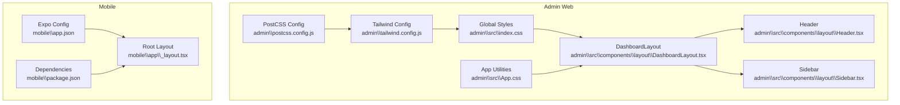
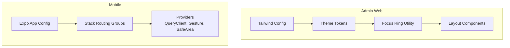
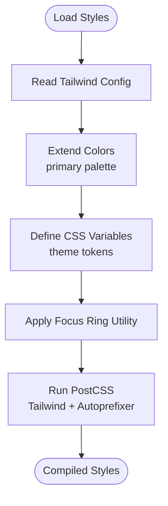
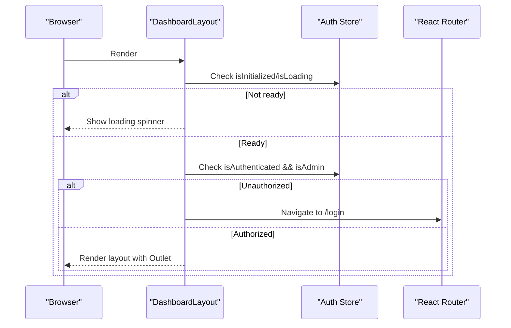
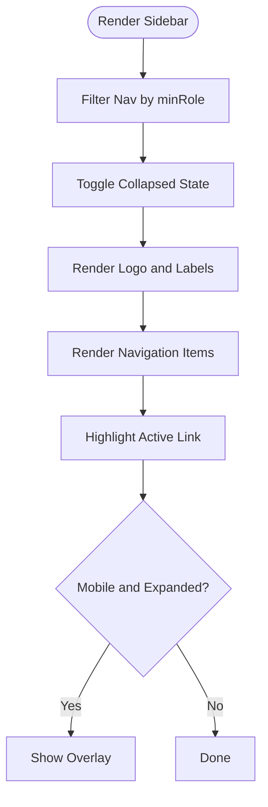
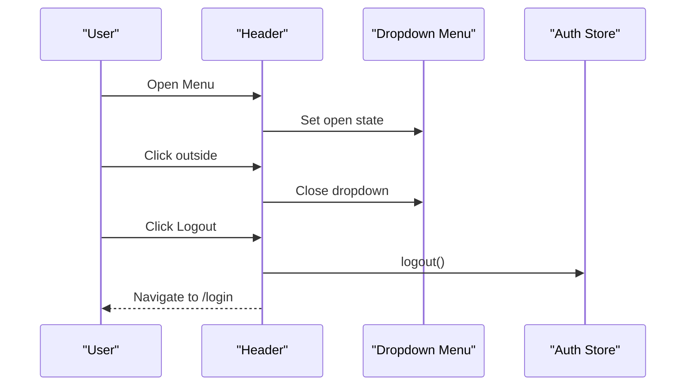
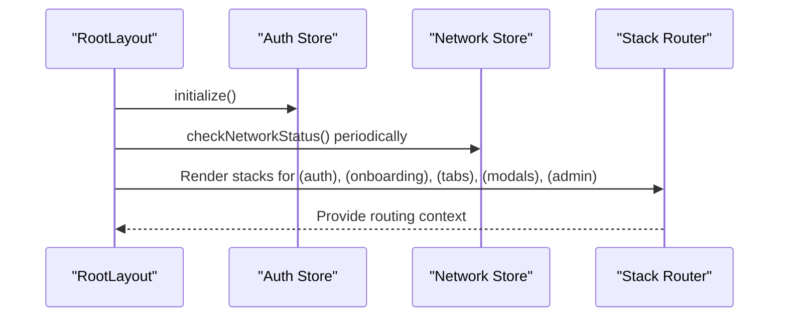
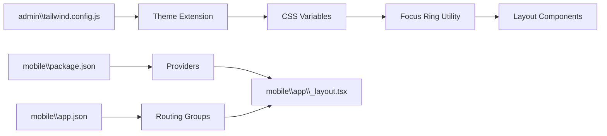

# Styling & UI Components

<cite>
**Referenced Files in This Document**
- [admin\tailwind.config.js](file://admin\tailwind.config.js)
- [admin\postcss.config.js](file://admin\postcss.config.js)
- [admin\src\index.css](file://admin\src\index.css)
- [admin\src\App.css](file://admin\src\App.css)
- [admin\src\components\layout\DashboardLayout.tsx](file://admin\src\components\layout\DashboardLayout.tsx)
- [admin\src\components\layout\Header.tsx](file://admin\src\components\layout\Header.tsx)
- [admin\src\components\layout\Sidebar.tsx](file://admin\src\components\layout\Sidebar.tsx)
- [mobile\app.json](file://mobile\app.json)
- [mobile\package.json](file://mobile\package.json)
- [mobile\app\_layout.tsx](file://mobile\app\_layout.tsx)
</cite>

## Table of Contents
1. [Introduction](#introduction)
2. [Project Structure](#project-structure)
3. [Core Components](#core-components)
4. [Architecture Overview](#architecture-overview)
5. [Detailed Component Analysis](#detailed-component-analysis)
6. [Dependency Analysis](#dependency-analysis)
7. [Performance Considerations](#performance-considerations)
8. [Troubleshooting Guide](#troubleshooting-guide)
9. [Conclusion](#conclusion)
10. [Appendices](#appendices)

## Introduction
This document explains the styling and UI component system across the admin web application and the mobile application. It covers Tailwind CSS configuration, design system implementation, component library organization, responsive design patterns, theme management, and cross-platform UI consistency. It also documents reusable component patterns, prop interfaces, customization options, development guidelines, styling best practices, accessibility considerations, and integration with the overall application architecture.

## Project Structure
The styling system is implemented differently in each platform:
- Admin (Web): Tailwind CSS with PostCSS, custom theme tokens, and global base styles.
- Mobile (React Native): Expo-managed project with native UI primitives and a centralized layout wrapper.

Key files:
- Admin Tailwind configuration and PostCSS setup define the design system and build pipeline.
- Admin global styles define theme tokens and focus utilities.
- Admin layout components implement responsive sidebar, header, and outlet rendering.
- Mobile app layout orchestrates routing groups and global providers, while relying on native components for UI.

**Diagram sources**
- [admin\tailwind.config.js](file://admin\tailwind.config.js#L1-L27)
- [admin\postcss.config.js](file://admin\postcss.config.js#L1-L7)
- [admin\src\index.css](file://admin\src\index.css#L1-L60)
- [admin\src\App.css](file://admin\src\App.css#L1-L43)
- [admin\src\components\layout\DashboardLayout.tsx](file://admin\src\components\layout\DashboardLayout.tsx#L1-L38)
- [admin\src\components\layout\Header.tsx](file://admin\src\components\layout\Header.tsx#L1-L105)
- [admin\src\components\layout\Sidebar.tsx](file://admin\src\components\layout\Sidebar.tsx#L1-L172)
- [mobile\app.json](file://mobile\app.json#L1-L70)
- [mobile\package.json](file://mobile\package.json#L1-L40)
- [mobile\app\_layout.tsx](file://mobile\app\_layout.tsx#L1-L95)

**Section sources**
- [admin\tailwind.config.js](file://admin\tailwind.config.js#L1-L27)
- [admin\postcss.config.js](file://admin\postcss.config.js#L1-L7)
- [admin\src\index.css](file://admin\src\index.css#L1-L60)
- [admin\src\App.css](file://admin\src\App.css#L1-L43)
- [admin\src\components\layout\DashboardLayout.tsx](file://admin\src\components\layout\DashboardLayout.tsx#L1-L38)
- [admin\src\components\layout\Header.tsx](file://admin\src\components\layout\Header.tsx#L1-L105)
- [admin\src\components\layout\Sidebar.tsx](file://admin\src\components\layout\Sidebar.tsx#L1-L172)
- [mobile\app.json](file://mobile\app.json#L1-L70)
- [mobile\package.json](file://mobile\package.json#L1-L40)
- [mobile\app\_layout.tsx](file://mobile\app\_layout.tsx#L1-L95)

## Core Components
- Admin Tailwind Design System
  - Theme extension defines a primary color palette mapped to Tailwind utilities.
  - Global CSS defines theme tokens and a focus ring utility for keyboard accessibility.
  - PostCSS pipeline integrates Tailwind and autoprefixer.

- Admin Layout Components
  - DashboardLayout manages authentication gating, loading states, and outlet rendering.
  - Sidebar provides responsive navigation with role-based visibility and collapsible behavior.
  - Header renders notifications, user avatar/profile, and logout flow with click-outside handling.

- Mobile Layout and Routing
  - Root layout initializes authentication, network monitoring, and React Query provider.
  - Stack-based routing groups separate auth, onboarding, main tabs, modals, and admin screens.

**Section sources**
- [admin\tailwind.config.js](file://admin\tailwind.config.js#L7-L24)
- [admin\src\index.css](file://admin\src\index.css#L4-L15)
- [admin\src\index.css](file://admin\src\index.css#L53-L59)
- [admin\postcss.config.js](file://admin\postcss.config.js#L1-L7)
- [admin\src\components\layout\DashboardLayout.tsx](file://admin\src\components\layout\DashboardLayout.tsx#L6-L37)
- [admin\src\components\layout\Sidebar.tsx](file://admin\src\components\layout\Sidebar.tsx#L39-L171)
- [admin\src\components\layout\Header.tsx](file://admin\src\components\layout\Header.tsx#L7-L104)
- [mobile\app\_layout.tsx](file://mobile\app\_layout.tsx#L24-L94)

## Architecture Overview
The styling architecture separates concerns between:
- Admin web: CSS-in-JS via Tailwind utilities, PostCSS build pipeline, and global theme tokens.
- Mobile: Native UI components with centralized layout and routing orchestration.

**Diagram sources**
- [admin\tailwind.config.js](file://admin\tailwind.config.js#L7-L24)
- [admin\src\index.css](file://admin\src\index.css#L4-L15)
- [admin\src\index.css](file://admin\src\index.css#L53-L59)
- [admin\src\components\layout\DashboardLayout.tsx](file://admin\src\components\layout\DashboardLayout.tsx#L1-L38)
- [admin\src\components\layout\Sidebar.tsx](file://admin\src\components\layout\Sidebar.tsx#L1-L172)
- [admin\src\components\layout\Header.tsx](file://admin\src\components\layout\Header.tsx#L1-L105)
- [mobile\app.json](file://mobile\app.json#L1-L70)
- [mobile\app\_layout.tsx](file://mobile\app\_layout.tsx#L24-L94)

## Detailed Component Analysis

### Admin Tailwind Design System
- Theme Extension
  - The primary palette is defined under theme.extend.colors and exposed as Tailwind utilities.
- Global Theme Tokens
  - CSS custom properties mirror the Tailwind palette for use in component logic and animations.
- Focus Ring Utility
  - A reusable focus-ring class ensures visible focus states for keyboard navigation.
- Build Pipeline
  - PostCSS integrates Tailwind and autoprefixer to process styles.

**Diagram sources**
- [admin\tailwind.config.js](file://admin\tailwind.config.js#L7-L24)
- [admin\src\index.css](file://admin\src\index.css#L4-L15)
- [admin\src\index.css](file://admin\src\index.css#L53-L59)
- [admin\postcss.config.js](file://admin\postcss.config.js#L1-L7)

**Section sources**
- [admin\tailwind.config.js](file://admin\tailwind.config.js#L7-L24)
- [admin\src\index.css](file://admin\src\index.css#L4-L15)
- [admin\src\index.css](file://admin\src\index.css#L53-L59)
- [admin\postcss.config.js](file://admin\postcss.config.js#L1-L7)

### DashboardLayout
- Responsibilities
  - Authentication gating and redirect to login when unauthenticated or unauthorized.
  - Loading state with spinner until initialization completes.
  - Outlet rendering for page content with responsive padding.
- Responsive Behavior
  - Sidebar offset applied via left padding at larger breakpoints.
- Integration
  - Uses auth store for state and integrates with routing.

**Diagram sources**
- [admin\src\components\layout\DashboardLayout.tsx](file://admin\src\components\layout\DashboardLayout.tsx#L6-L37)

**Section sources**
- [admin\src\components\layout\DashboardLayout.tsx](file://admin\src\components\layout\DashboardLayout.tsx#L6-L37)

### Sidebar
- Navigation Filtering
  - Role-based visibility filters navigation items using a minRole property.
- Collapsible Behavior
  - Collapsed state toggles width and label visibility with smooth transitions.
  - Overlay appears on mobile when collapsed.
- Active States
  - Active link highlighting uses primary/purple palettes depending on section.
- Accessibility
  - Keyboard focus handled by default browser behavior; consider adding explicit focus styles if needed.

**Diagram sources**
- [admin\src\components\layout\Sidebar.tsx](file://admin\src\components\layout\Sidebar.tsx#L39-L171)

**Section sources**
- [admin\src\components\layout\Sidebar.tsx](file://admin\src\components\layout\Sidebar.tsx#L21-L50)
- [admin\src\components\layout\Sidebar.tsx](file://admin\src\components\layout\Sidebar.tsx#L65-L171)

### Header
- User Menu
  - Click-outside detection closes dropdown.
  - Avatar fallback uses initials with primary color background.
- Actions
  - Notifications badge and logout action trigger navigation to login.
- Responsiveness
  - Text truncation and spacing adapt to small screens.

**Diagram sources**
- [admin\src\components\layout\Header.tsx](file://admin\src\components\layout\Header.tsx#L7-L104)

**Section sources**
- [admin\src\components\layout\Header.tsx](file://admin\src\components\layout\Header.tsx#L7-L104)

### Mobile Layout and Routing
- Initialization
  - Auth initialization and periodic network checks ensure readiness.
- Providers
  - React Query client configured with caching and refetch policies.
  - Gesture and safe area providers wrap the app for native compatibility.
- Routing Groups
  - Separate stacks for auth, onboarding, tabs, modals, and admin screens.

**Diagram sources**
- [mobile\app\_layout.tsx](file://mobile\app\_layout.tsx#L24-L94)

**Section sources**
- [mobile\app\_layout.tsx](file://mobile\app\_layout.tsx#L24-L94)

## Dependency Analysis
- Admin
  - Tailwind config depends on theme extension and content scanning paths.
  - Global styles depend on theme tokens and focus utilities.
  - Layout components depend on auth store and routing.
- Mobile
  - Root layout depends on auth and network stores, React Query, and routing groups.

**Diagram sources**
- [admin\tailwind.config.js](file://admin\tailwind.config.js#L7-L24)
- [admin\src\index.css](file://admin\src\index.css#L4-L15)
- [admin\src\index.css](file://admin\src\index.css#L53-L59)
- [admin\src\components\layout\DashboardLayout.tsx](file://admin\src\components\layout\DashboardLayout.tsx#L1-L38)
- [mobile\app.json](file://mobile\app.json#L1-L70)
- [mobile\package.json](file://mobile\package.json#L1-L40)
- [mobile\app\_layout.tsx](file://mobile\app\_layout.tsx#L24-L94)

**Section sources**
- [admin\tailwind.config.js](file://admin\tailwind.config.js#L1-L27)
- [admin\src\index.css](file://admin\src\index.css#L1-L60)
- [admin\src\components\layout\DashboardLayout.tsx](file://admin\src\components\layout\DashboardLayout.tsx#L1-L38)
- [mobile\app.json](file://mobile\app.json#L1-L70)
- [mobile\package.json](file://mobile\package.json#L1-L40)
- [mobile\app\_layout.tsx](file://mobile\app\_layout.tsx#L24-L94)

## Performance Considerations
- Admin
  - Prefer Tailwind utilities over ad-hoc CSS to leverage purging and minimize bundle size.
  - Use CSS variables for theme tokens to avoid repeated Tailwind class usage.
  - Keep focus ring utility scoped to interactive elements to reduce specificity.
- Mobile
  - Avoid heavy nested views in stack groups; keep route stacks shallow for smoother transitions.
  - Use React Query’s caching wisely to reduce redundant network requests.

[No sources needed since this section provides general guidance]

## Troubleshooting Guide
- Admin
  - Tailwind utilities not applying: verify content paths in Tailwind config and ensure PostCSS runs during build.
  - Theme tokens mismatch: confirm CSS variables match Tailwind color definitions.
  - Focus ring not visible: ensure focus ring utility is applied to interactive elements.
- Mobile
  - Auth initialization loops: confirm initialization side effects are guarded and not re-executed unnecessarily.
  - Network checks: ensure periodic checks are cleared on unmount to prevent memory leaks.

**Section sources**
- [admin\tailwind.config.js](file://admin\tailwind.config.js#L3-L6)
- [admin\postcss.config.js](file://admin\postcss.config.js#L1-L7)
- [admin\src\index.css](file://admin\src\index.css#L53-L59)
- [mobile\app\_layout.tsx](file://mobile\app\_layout.tsx#L33-L43)

## Conclusion
The admin application employs a robust Tailwind-based design system with theme tokens and a focus ring utility, complemented by responsive layout components. The mobile application uses a native-first approach with a centralized layout and routing groups, ensuring consistent UX across platforms. Together, these systems provide a scalable foundation for building accessible, maintainable UI components.

[No sources needed since this section summarizes without analyzing specific files]

## Appendices
- Cross-Platform UI Consistency
  - Align typography and spacing tokens at the component level.
  - Use semantic roles and ARIA attributes where applicable in web components.
  - Test keyboard navigation and screen reader support in web components.
- Component Development Guidelines
  - Reuse Tailwind utilities and theme tokens; avoid inline styles.
  - Encapsulate interactive states (hover, focus, active) consistently.
  - Document props and accessibility behavior for each component.
- Styling Best Practices
  - Favor utility-first classes; group related utilities per element.
  - Centralize theme tokens in CSS variables for dynamic updates.
  - Keep component-specific styles minimal and scoped.
- Accessibility Compliance
  - Ensure sufficient color contrast against backgrounds.
  - Provide visible focus indicators and keyboard operability.
  - Use proper heading hierarchy and landmark regions in web layouts.

[No sources needed since this section provides general guidance]