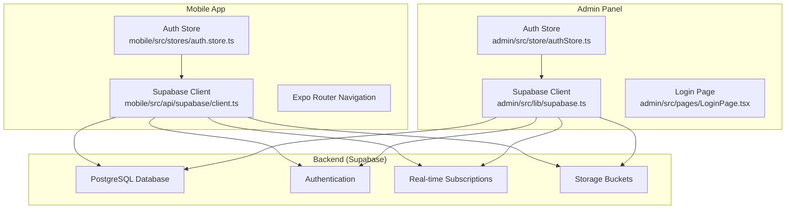
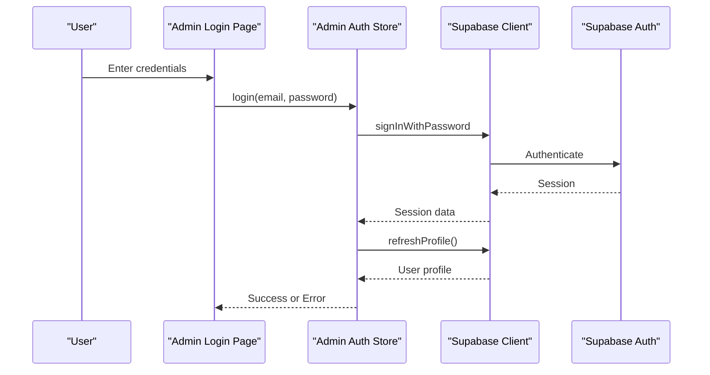
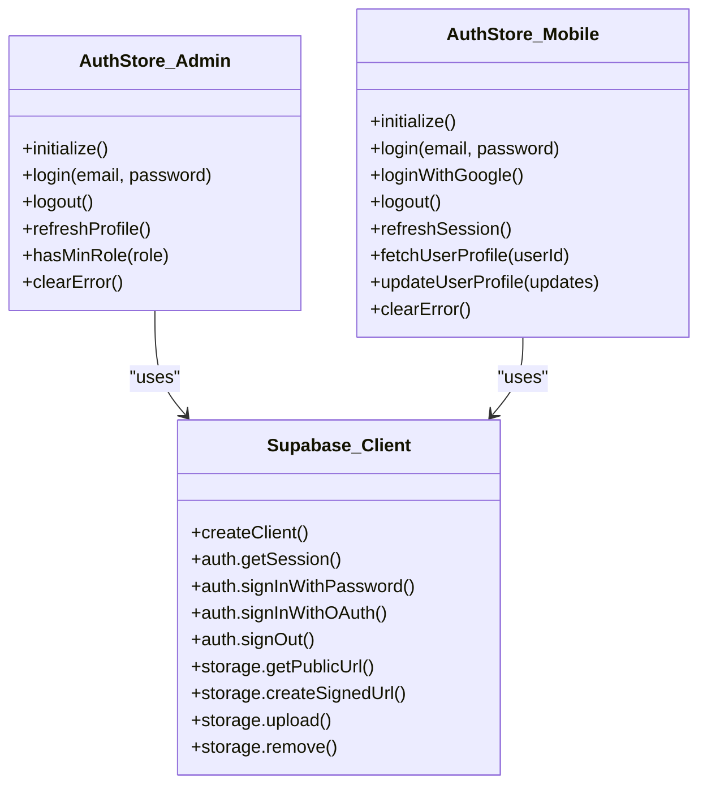
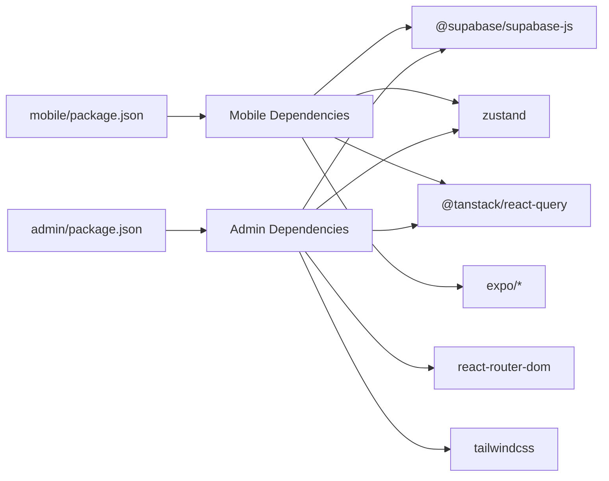
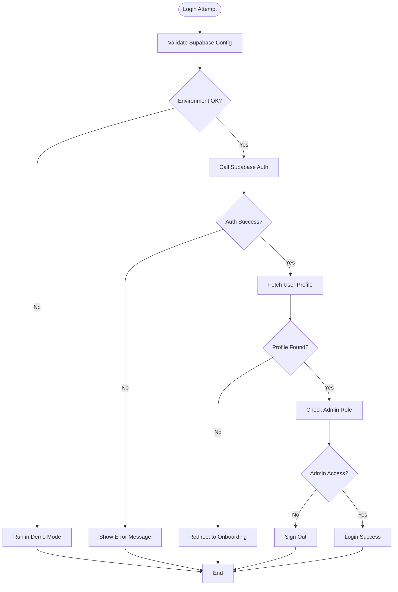

# Troubleshooting & FAQ

<cite>
**Referenced Files in This Document**
- [README.md](file://README.md)
- [admin/package.json](file://admin/package.json)
- [mobile/package.json](file://mobile/package.json)
- [admin/vite.config.ts](file://admin/vite.config.ts)
- [admin/src/lib/supabase.ts](file://admin/src/lib/supabase.ts)
- [admin/src/store/authStore.ts](file://admin/src/store/authStore.ts)
- [admin/src/pages/LoginPage.tsx](file://admin/src/pages/LoginPage.tsx)
- [mobile/app.json](file://mobile/app.json)
- [mobile/src/api/supabase/client.ts](file://mobile/src/api/supabase/client.ts)
- [mobile/src/stores/auth.store.ts](file://mobile/src/stores/auth.store.ts)
- [supabase/migrations/001_enums.sql](file://supabase/migrations/001_enums.sql)
- [supabase/migrations/002_core_tables.sql](file://supabase/migrations/002_core_tables.sql)
</cite>

## Table of Contents
1. [Introduction](#introduction)
2. [Project Structure](#project-structure)
3. [Core Components](#core-components)
4. [Architecture Overview](#architecture-overview)
5. [Detailed Component Analysis](#detailed-component-analysis)
6. [Dependency Analysis](#dependency-analysis)
7. [Performance Considerations](#performance-considerations)
8. [Troubleshooting Guide](#troubleshooting-guide)
9. [Conclusion](#conclusion)
10. [Appendices](#appendices)

## Introduction
This document provides comprehensive troubleshooting guidance and frequently asked questions for Naliss UMYU Hub. It focuses on resolving common installation issues, authentication problems, database connection errors, and deployment challenges. It also covers debugging approaches for state management issues, API integration problems, and mobile-specific development challenges. Solutions address performance issues, security configuration problems, and cross-platform compatibility concerns, with step-by-step diagnostic procedures and resolution strategies for typical development and production issues.

## Project Structure
Naliss UMYU Hub consists of:
- A React Native Expo mobile application supporting iOS and Android
- A React web admin panel
- A Supabase backend providing database, authentication, real-time, and storage

**Diagram sources**
- [mobile/src/api/supabase/client.ts](file://mobile/src/api/supabase/client.ts#L1-L87)
- [mobile/src/stores/auth.store.ts](file://mobile/src/stores/auth.store.ts#L1-L302)
- [admin/src/lib/supabase.ts](file://admin/src/lib/supabase.ts#L1-L73)
- [admin/src/store/authStore.ts](file://admin/src/store/authStore.ts#L1-L228)
- [admin/src/pages/LoginPage.tsx](file://admin/src/pages/LoginPage.tsx#L1-L123)

**Section sources**
- [README.md](file://README.md#L1-L247)
- [admin/package.json](file://admin/package.json#L1-L43)
- [mobile/package.json](file://mobile/package.json#L1-L40)
- [admin/vite.config.ts](file://admin/vite.config.ts#L1-L8)

## Core Components
- Supabase client initialization and environment configuration
- Authentication stores using Zustand with persistence
- Real-time channels and storage helpers
- Role-based access control and permission checks
- Environment variables for Supabase URL and anonymous keys

Key implementation references:
- Supabase client creation and environment validation
- Auth store initialization, login/logout, and profile refresh
- Storage helpers for public and signed URLs, uploads, and deletions
- Real-time channel creation and configuration

**Section sources**
- [admin/src/lib/supabase.ts](file://admin/src/lib/supabase.ts#L1-L73)
- [admin/src/store/authStore.ts](file://admin/src/store/authStore.ts#L1-L228)
- [admin/src/pages/LoginPage.tsx](file://admin/src/pages/LoginPage.tsx#L1-L123)
- [mobile/src/api/supabase/client.ts](file://mobile/src/api/supabase/client.ts#L1-L87)
- [mobile/src/stores/auth.store.ts](file://mobile/src/stores/auth.store.ts#L1-L302)

## Architecture Overview
The system integrates three primary layers:
- Frontend (Mobile and Admin) consuming Supabase services
- Backend (Supabase) providing database, auth, real-time, and storage
- Shared configuration via environment variables

**Diagram sources**
- [admin/src/pages/LoginPage.tsx](file://admin/src/pages/LoginPage.tsx#L1-L123)
- [admin/src/store/authStore.ts](file://admin/src/store/authStore.ts#L1-L228)
- [admin/src/lib/supabase.ts](file://admin/src/lib/supabase.ts#L1-L73)

## Detailed Component Analysis

### Authentication Stores
Both mobile and admin panels use Zustand stores to manage authentication state, session persistence, and profile synchronization.

**Diagram sources**
- [admin/src/store/authStore.ts](file://admin/src/store/authStore.ts#L1-L228)
- [mobile/src/stores/auth.store.ts](file://mobile/src/stores/auth.store.ts#L1-L302)
- [admin/src/lib/supabase.ts](file://admin/src/lib/supabase.ts#L1-L73)
- [mobile/src/api/supabase/client.ts](file://mobile/src/api/supabase/client.ts#L1-L87)

**Section sources**
- [admin/src/store/authStore.ts](file://admin/src/store/authStore.ts#L1-L228)
- [mobile/src/stores/auth.store.ts](file://mobile/src/stores/auth.store.ts#L1-L302)
- [admin/src/lib/supabase.ts](file://admin/src/lib/supabase.ts#L1-L73)
- [mobile/src/api/supabase/client.ts](file://mobile/src/api/supabase/client.ts#L1-L87)

### Supabase Client Initialization
- Mobile client validates environment variables and throws if missing
- Admin client detects configuration and runs in demo mode if not configured
- Both expose storage helpers and real-time channel creation

Common pitfalls:
- Missing environment variables
- Incorrect Supabase URL or anonymous key
- Misconfigured storage buckets

**Section sources**
- [mobile/src/api/supabase/client.ts](file://mobile/src/api/supabase/client.ts#L1-L87)
- [admin/src/lib/supabase.ts](file://admin/src/lib/supabase.ts#L1-L73)

### Database Schema and Roles
- Enum types define role hierarchy and statuses
- Core tables include departments, users, lecturers, executives, and presence
- Triggers maintain updated_at timestamps

Common issues:
- Enums mismatch during migration
- Missing indexes impacting performance
- Presence tracking not updating

**Section sources**
- [supabase/migrations/001_enums.sql](file://supabase/migrations/001_enums.sql#L1-L167)
- [supabase/migrations/002_core_tables.sql](file://supabase/migrations/002_core_tables.sql#L1-L252)

## Dependency Analysis
- Mobile depends on Expo, React Native, Supabase JS, Zustand, React Query, and SQLite
- Admin depends on React, React Router, Tailwind CSS, Supabase JS, Zustand, and React Query
- Both share Supabase client libraries and rely on environment variables

**Diagram sources**
- [mobile/package.json](file://mobile/package.json#L1-L40)
- [admin/package.json](file://admin/package.json#L1-L43)

**Section sources**
- [mobile/package.json](file://mobile/package.json#L1-L40)
- [admin/package.json](file://admin/package.json#L1-L43)

## Performance Considerations
- Real-time events per second capped in mobile client
- Indexes on frequently queried columns in core tables
- Storage signed URLs for controlled access
- Avoid unnecessary re-renders by using selector hooks

Recommendations:
- Monitor real-time traffic and adjust eventsPerSecond as needed
- Add indexes for new query patterns
- Use signed URLs for sensitive content
- Persist only essential auth state to reduce hydration overhead

**Section sources**
- [mobile/src/api/supabase/client.ts](file://mobile/src/api/supabase/client.ts#L20-L27)
- [supabase/migrations/002_core_tables.sql](file://supabase/migrations/002_core_tables.sql#L78-L86)

## Troubleshooting Guide

### Installation Issues
Symptoms:
- Application fails to start or crashes immediately
- Missing environment variables error on startup

Diagnosis steps:
1. Verify Node.js and npm/yarn versions meet prerequisites
2. Confirm Supabase project exists and migrations are applied in order
3. Check environment variable files exist and contain correct values
4. Ensure storage buckets are created as documented

Resolution strategies:
- Reinstall dependencies after verifying prerequisites
- Recreate environment files from examples and populate Supabase credentials
- Re-run migrations sequentially if any fail
- Recreate storage buckets if missing

**Section sources**
- [README.md](file://README.md#L65-L147)

### Authentication Problems
Symptoms:
- Login fails with generic or provider-specific errors
- Admin login redirects back to login page
- Mobile login rejects institutional email format

Diagnosis steps:
1. Confirm Supabase authentication is enabled and providers configured
2. Verify admin store demo mode conditions and Supabase configuration detection
3. Check mobile email validation regex and Supabase auth response
4. Inspect auth state change handlers and session persistence

Resolution strategies:
- Enable and configure providers in Supabase Auth
- Ensure environment variables are present for non-demo operation
- Adjust email validation if using custom domains
- Subscribe to auth state changes and handle SIGNED_OUT transitions

**Diagram sources**
- [admin/src/store/authStore.ts](file://admin/src/store/authStore.ts#L38-L92)
- [admin/src/pages/LoginPage.tsx](file://admin/src/pages/LoginPage.tsx#L19-L32)
- [mobile/src/stores/auth.store.ts](file://mobile/src/stores/auth.store.ts#L98-L134)

**Section sources**
- [admin/src/store/authStore.ts](file://admin/src/store/authStore.ts#L1-L228)
- [admin/src/pages/LoginPage.tsx](file://admin/src/pages/LoginPage.tsx#L1-L123)
- [mobile/src/stores/auth.store.ts](file://mobile/src/stores/auth.store.ts#L1-L302)

### Database Connection Errors
Symptoms:
- Migration failures or constraint violations
- Missing enums or table definitions
- Role comparison or RLS policy errors

Diagnosis steps:
1. Verify migration order and completion
2. Check enum types and helper functions availability
3. Confirm triggers for updated_at columns
4. Validate RLS policies and row-level security

Resolution strategies:
- Run migrations in strict order and resolve conflicts
- Recreate enum types and helper functions if missing
- Recreate triggers for updated_at if removed
- Review and adjust RLS policies for new tables

**Section sources**
- [supabase/migrations/001_enums.sql](file://supabase/migrations/001_enums.sql#L1-L167)
- [supabase/migrations/002_core_tables.sql](file://supabase/migrations/002_core_tables.sql#L217-L252)

### Deployment Challenges
Symptoms:
- Build fails due to missing environment variables
- Admin panel deployment errors on Vercel
- Mobile EAS build configuration issues

Diagnosis steps:
1. Confirm environment variables are present during build
2. Validate Vite configuration and build scripts
3. Check EAS build configuration and platform-specific settings

Resolution strategies:
- Set environment variables in CI/CD or local builds
- Use provided build commands and verify Vercel project settings
- Configure EAS build profiles and secrets

**Section sources**
- [README.md](file://README.md#L188-L215)
- [admin/vite.config.ts](file://admin/vite.config.ts#L1-L8)

### State Management Debugging
Symptoms:
- Auth state not persisting across sessions
- Profile not updating after login
- Conflicting state after logout

Diagnosis steps:
1. Check Zustand persistence middleware configuration
2. Verify auth state change subscriptions
3. Inspect session retrieval and refresh flows

Resolution strategies:
- Ensure persistence is enabled and selective for safe state
- Subscribe to auth state changes and update user profile accordingly
- Unsubscribe listeners on unmount to prevent leaks

**Section sources**
- [admin/src/store/authStore.ts](file://admin/src/store/authStore.ts#L215-L222)
- [mobile/src/stores/auth.store.ts](file://mobile/src/stores/auth.store.ts#L60-L88)

### API Integration Problems
Symptoms:
- Storage upload/delete failures
- Public URL generation errors
- Real-time channel subscription issues

Diagnosis steps:
1. Verify storage bucket names and permissions
2. Check signed URL expiration and error handling
3. Confirm real-time eventsPerSecond limits

Resolution strategies:
- Use correct bucket names and ensure permissions
- Handle signed URL errors gracefully and retry if needed
- Adjust real-time limits based on usage patterns

**Section sources**
- [admin/src/lib/supabase.ts](file://admin/src/lib/supabase.ts#L20-L43)
- [mobile/src/api/supabase/client.ts](file://mobile/src/api/supabase/client.ts#L34-L87)

### Mobile-Specific Development Challenges
Symptoms:
- Missing permissions or capabilities
- Scheme and deep link configuration issues
- Platform-specific plugin setup

Diagnosis steps:
1. Verify app.json scheme and bundle identifiers
2. Check Android permissions and iOS infoPlist entries
3. Confirm plugin configurations for notifications and Google Sign-In

Resolution strategies:
- Align scheme and identifiers with routing expectations
- Add required permissions and rationale strings
- Ensure plugin configurations match platform requirements

**Section sources**
- [mobile/app.json](file://mobile/app.json#L1-L70)

### Security Configuration Problems
Symptoms:
- Unauthorized access despite role checks
- Profile fetch errors indicating missing records
- Account banned or suspended behavior

Diagnosis steps:
1. Verify role hierarchy and permission mappings
2. Check user profile existence and status
3. Confirm ban enforcement logic

Resolution strategies:
- Ensure role comparisons align with enum levels
- Handle PGRST116 errors by redirecting to onboarding
- Enforce sign-out and error messaging for banned users

**Section sources**
- [supabase/migrations/001_enums.sql](file://supabase/migrations/001_enums.sql#L138-L167)
- [mobile/src/stores/auth.store.ts](file://mobile/src/stores/auth.store.ts#L200-L234)

### Cross-Platform Compatibility
Symptoms:
- Differences between web and native environments
- AsyncStorage vs browser storage differences
- Platform-specific API availability

Diagnosis steps:
1. Confirm environment variable exposure per platform
2. Validate AsyncStorage usage on mobile
3. Check platform-specific plugin behavior

Resolution strategies:
- Use platform-appropriate storage APIs
- Expose environment variables correctly for each platform
- Test platform-specific features separately

**Section sources**
- [mobile/src/api/supabase/client.ts](file://mobile/src/api/supabase/client.ts#L15-L27)
- [admin/src/lib/supabase.ts](file://admin/src/lib/supabase.ts#L3-L18)

## Conclusion
This guide consolidates actionable diagnostics and resolutions for Naliss UMYU Hub across installation, authentication, database, deployment, state management, API integration, mobile development, security, and cross-platform concerns. By following the structured troubleshooting procedures and leveraging the referenced implementation points, teams can efficiently resolve issues in both development and production environments.

## Appendices

### Step-by-Step Diagnostic Procedures
- Environment setup: Verify prerequisites, create Supabase project, apply migrations, create storage buckets, configure providers, and set environment variables
- Authentication: Validate Supabase configuration, test login flows, confirm auth state changes, and handle demo mode scenarios
- Database: Confirm migration order, enum availability, triggers, and RLS policies
- Deployment: Use provided build commands, configure CI/CD variables, and validate EAS settings
- State management: Check persistence middleware, auth subscriptions, and cleanup procedures
- API integration: Validate storage buckets, signed URL handling, and real-time limits
- Mobile development: Confirm scheme, permissions, and plugin configurations
- Security: Verify role levels, profile fetch behavior, and ban enforcement
- Cross-platform: Align environment variables and storage APIs per platform

**Section sources**
- [README.md](file://README.md#L65-L215)
- [admin/src/store/authStore.ts](file://admin/src/store/authStore.ts#L38-L92)
- [mobile/src/stores/auth.store.ts](file://mobile/src/stores/auth.store.ts#L98-L134)
- [supabase/migrations/001_enums.sql](file://supabase/migrations/001_enums.sql#L138-L167)
- [mobile/app.json](file://mobile/app.json#L1-L70)